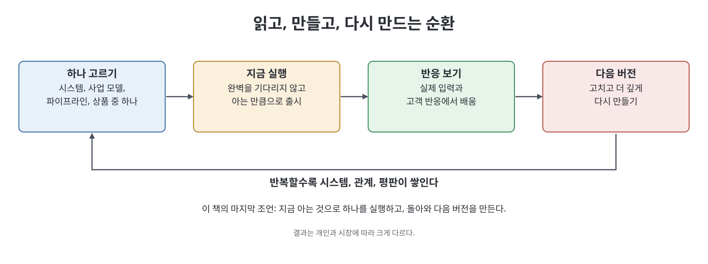

# 맺음말 만드는 사람의 이점 (Closing: The Builder's Advantage)

저자는 책 전체를 돌아보며 끝맺는다. 아키텍처 원칙에서 AI 에이전시 만들기, 디지털 상품 포트폴리오의 경제, 무리하지 않고 키우는 운영 규율, 프롬프트 엔지니어링의 기초와 고급 운영 패턴까지 먼 길을 지나왔다고 정리한다. 이 맺음말은 새 지식을 더하기보다 책을 읽은 뒤 무엇을 하라는지를 짧게 밝히는 글이다. 책 끝의 독자에게 보내는 글과 후기 요청도 함께 다룬다.

> **쉽게 말하면**
> 책의 마지막 조언은 하나다. 더 공부하지 말고, 이 책에서 하나만 골라 지금 아는 만큼으로 실행하라는 것이다.

> **참고(노트 작성자)** 책은 시장이 준비되어 있고 초기 우위의 창이 아직 열려 있다고 말하지만, 이는 저자의 전망이며 검증되지 않았다. 사업 성과는 개인과 시장에 따라 크게 다르다. 독자 후기 요청은 책을 산 곳에 남기는 정직한 서평을 청하는 저자의 부탁이다.

## 글의 흐름

1. 이 책이 길러 주려는 것
2. 다음 한 걸음
3. 책이 보는 좋은 실무자의 모습
4. 독자에게 보내는 글

## 1. 이 책이 길러 주려는 것

책은 프레임워크를 소비만 하지 않고 직접 따져 가며 읽은 독자라면, 대부분의 AI 도구 사용자가 갖지 못하는 것을 얻었다고 말한다. AI를 "쓰는" 데서 그치지 않고 "어떻게 만들어 쓰는가"에 대한 구조적 이해다. 저자는 이 이해가 이 분야에서 만들 모든 값진 것의 토대라고 본다.

## 2. 다음 한 걸음

저자의 처방은 복잡하지 않다. 이 책에서 하나를 고른다. 시스템 하나, 사업 모델 하나, 파이프라인(pipeline) 하나, 상품 아이디어 하나다. 그리고 완벽하지 않게, 더 조사하지 않고, 지금 아는 것으로 실행한다. 실제 입력과 실제 고객의 반응 속에서 무언가를 만들어 내놓으며 얻는 정보가, 가만히 앉아 하는 어떤 추가 준비보다 가치 있다는 논리다.

| 하지 말 것 | 하라고 권하는 것 |
|-----------|------------------|
| 완벽해질 때까지 기다리기 | 부족해도 일단 내놓고 반응 보기 |
| 조사를 더 하기 | 지금 아는 것으로 하나를 실행하기 |
| 여러 가지를 한꺼번에 벌이기 | 시스템, 모델, 파이프라인, 상품 중 하나 고르기 |

이 조언은 18장의 90일 실행 로드맵과 부록 E의 30일 스프린트가 구체화한다.

## 3. 책이 보는 좋은 실무자의 모습

저자는 다음 AI 능력의 파도가 올 때 진정으로 값지고 방어 가능한 것을 만들어 둔 사람의 특징을 네 가지로 든다. 무리하게 일하는 대신 시스템을 만든다. 거래만 쫓지 않고 고객 관계에 투자한다. 결과물의 품질을 협상 불가로 둔다. 신중하고 꾸준하게 움직인다. 24장의 복리 자산 이야기와 22장의 전문가 기준이 여기서 다시 모인다.

| 태도 | 이어지는 장 |
|------|-------------|
| 시스템으로 일하기 | 17장 운영 확장, 19장 고급 자동화 |
| 관계에 투자하기 | 13장 수입 파이프라인, 24장 복리 자산 |
| 품질을 양보하지 않기 | 22장 윤리와 전문가 기준 |

## 4. 독자에게 보내는 글

저자는 책 쓰기를 믿음의 행위라고 표현한다. 만나 본 적 없는 누군가에게 쓸모가 있기를 바라며 몇 달을 쓰지만 피드백까지 길고 불확실하다는 것이다. 한 가지 프레임워크가 생각을 바꾸었거나, 시스템 하나가 결과를 개선했거나, 방향이 선명해졌다면 책은 제 몫을 한 것이라고 말한다. 그리고 구매처에 구체적이고 정직한 후기를 남겨 달라고 청한다. 다음 독자의 판단을 돕고 다음 개정판에서 무엇을 깊게 하고 무엇을 다시 생각할지 알려 주기 때문이다. 책은 "만들어 보고, 다시 돌아와 다음 버전을 만들라"는 말로 끝난다.

## 핵심 정리

- 책의 가장 큰 가치는 AI를 쓰는 요령이 아니라 AI로 무엇을 어떻게 만드는지에 대한 구조적 이해라고 저자는 본다.
- 다음 단계는 책에서 하나(시스템, 사업 모델, 파이프라인, 상품 중 하나)를 골라 지금 실행하는 것이다.
- 실제 입력과 고객 반응에서 얻는 정보는 가만히 하는 준비보다 가치 있다고 저자는 주장한다.
- 오래 남는 실무자는 시스템, 관계, 품질을 택하고 신중하고 꾸준하게 움직인다.
- 시장 전망과 수익은 저자의 견해일 뿐이다. 실행의 결과는 내가 책임지고 검증한다.

 
 
 

이전: [24장 긴 게임 복리 가치 쌓기](24%EC%9E%A5%20%EA%B8%B4%20%EA%B2%8C%EC%9E%84%20%EB%B3%B5%EB%A6%AC%20%EA%B0%80%EC%B9%98%20%EC%8C%93%EA%B8%B0.md) | 다음: [부록 Readme](../06.%20%EB%B6%80%EB%A1%9D/Readme.md)

 

[Claude AI Automation and Monetization](../)
