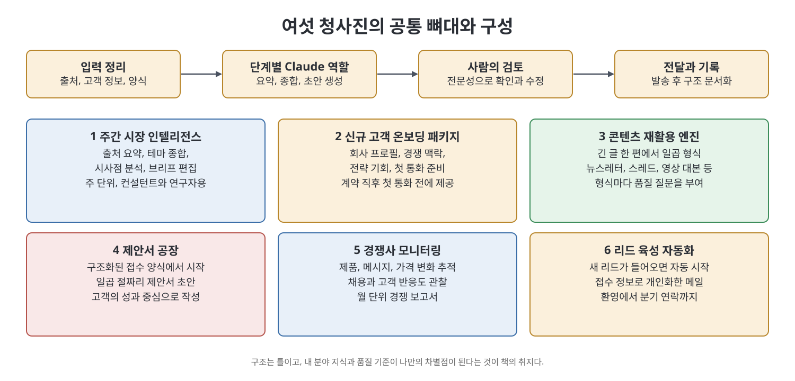

# 보너스 장 B1 여섯 가지 AI 시스템 청사진 (Bonus Chapter B1: Six Complete AI System Blueprints)

보너스 장은 Claude로 만들 수 있는 가치 높은 시스템 여섯 가지를 "바로 구현할 수 있는 명세"로 보여 준다. 책은 각 청사진이 시스템 구조, 핵심 프롬프트, 연동 층, 품질 기준을 갖추고 있다고 소개한다. 그리고 구조는 틀일 뿐이고 도메인 지식, 고객 맥락, 품질 기준이 나만의 차별점이라고 못 박는다. 이 노트는 각 청사진의 프롬프트와 표 본문을 옮기지 않고, 시스템이 어떤 단계로 짜여 있고 무엇을 확인하는지만 정리한다.

> **쉽게 말하면**
> 청사진은 요리법이 아니라 주방 배치도다. 어떤 단계에서 무엇을 넣고 누가 확인하는지가 정해져 있으니, 재료(내 분야 지식)만 바꿔 넣으면 된다.

> **참고(노트 작성자)** 각 시스템에 붙은 소요 시간(검토 15분, 제안서 30분 이내 등)은 책의 주장이며 검증하지 않았다. 고객에게 메일을 자동 발송하거나 고객 정보를 처리하는 시스템은 개인정보와 수신 동의 규정을 지켜야 하므로 전문가 확인이 필요하다.

## 이 장의 흐름

1. 여섯 청사진에 공통된 뼈대
2. 청사진 1 주간 시장 인텔리전스 시스템
3. 청사진 2 고객 온보딩 인텔리전스 시스템
4. 청사진 3 콘텐츠 재활용 엔진
5. 청사진 4 제안서 공장
6. 청사진 5 경쟁사 모니터링 시스템
7. 청사진 6 리드 육성 자동화 시스템
8. 시작하는 순서와 마무리 글

## 1. 공통된 뼈대

여섯 청사진은 모양이 다르지만 같은 틀을 따른다. 단계를 나누고, 각 단계의 입력과 Claude의 역할과 출력을 정하고, 사람이 확인할 지점을 둔다. 앞서 배운 멀티 스테이지 파이프라인(multi-stage pipeline, 앞 단계 출력이 다음 단계 입력이 되는 구조)을 업무 유형별로 구체화한 셈이다.

| 구성 요소 | 하는 일 | 설계할 때 물을 것 |
|----------|---------|-----------------|
| 입력 | 출처 자료, 고객 정보, 접수 양식 | 무엇이 빠지면 결과가 얕아지는가 |
| Claude 역할 | 요약, 종합, 분석, 초안 생성 | 단계마다 하나의 일만 맡겼는가 |
| 사람의 검토 | 사실 확인, 전문성 덧붙이기 | 어디서 틀리면 가장 아픈가 |
| 전달 | 문서, 이메일, 채널 게시 | 받는 사람이 바로 쓸 수 있는 형식인가 |



## 2. 청사진 1 주간 시장 인텔리전스

컨설턴트, 연구자, 에이전시 운영자가 한 산업을 꾸준히 따라가며 고객에게 주간 브리프(간단한 보고서)를 보내는 시스템이다. 네 단계로 이어진다. 먼저 여러 출처를 요약해 근거가 붙은 동향 목록을 만들고, 그 목록에서 서너 개의 큰 주제를 뽑고, 대상 고객에게 어떤 의미인지 분석한 뒤, 마지막에 하나의 브리프로 편집한다. 책은 2단계 주제 종합용 프롬프트를 예로 싣는데, 역할(전문 분석가), 주제마다 지켜야 할 항목(구체적 이름, 근거 동향, 고객에게의 의미, 긴급도 등급)을 정해 둔 구조다. 새 예시를 직접 쓰면 다음과 같다.

```
당신은 [산업]을 십 년 본 분석가다.
아래 동향 목록에서 주제 세 개를 뽑아라.
주제마다 (1) 구체적 이름 (2) 근거 동향 두 개
(3) [고객 유형]에게 중요한 이유 한 단락 (4) 긴급도 3단계를 적어라.
```

이 시스템의 요점은 단계 사이에 사람이 짧게 확인한다는 것이다. 책은 출처 요약 검토에 약 15분, 주제 검토에 약 10분 정도를 잡는다고 소개하며, 마지막 편집 전에 전문가의 눈을 넣으라고 한다.

## 3. 청사진 2 고객 온보딩 인텔리전스

새 고객이 계약하면 첫 통화 전에 그 회사에 대한 조사 패키지를 만들어 준비성을 보여 주는 시스템이다. 네 단계는 회사 프로필 추출(웹사이트와 공개 자료에서 규모, 모델, 제품, 포지셔닝 정리), 경쟁 맥락(상위 경쟁사 비교), 전략 기회 도출(참여 범위와 관련된 기회 세 가지), 첫 통화 준비 문서(질문과 이야기할 거리)다. 표의 입력과 출력만 이어 붙여도 하나의 흐름이 된다는 점이 구조의 핵심이다. 고객이 준 비공개 자료를 다룰 때는 비밀 유지 약속을 먼저 확인해야 한다.

## 4. 청사진 3 콘텐츠 재활용 엔진

긴 글 한 편을 일곱 가지 형식으로 바꿔 채널마다 올리는 시스템이다. 책이 드는 일곱 형식은 이메일 뉴스레터, 짧은 글 연속(스레드), 전문직 SNS 장문, 90초 영상 대본, 슬라이드형 카드 묶음, 팟캐스트 대화 소재, 검색용 메타 정보다. 눈여겨볼 부분은 형식마다 품질 질문이 하나씩 붙어 있다는 점이다. 예를 들어 스레드는 한 줄씩 떼어도 가치가 있는지, 영상 대본은 90초 안에 자연스럽게 읽히는지를 묻는다. 형식 변환은 Claude가 하고, 이 질문에 답하는 일이 사람의 몫이다.

## 5. 청사진 4 제안서 공장

한 달에 제안서를 여러 건 쓰는 컨설턴트나 프리랜서가 구조화된 접수 양식에서 맞춤 제안서를 30분 안에 뽑는 시스템이다(책의 주장). 접수 양식에는 고객 이름과 업종, 말로 한 요구와 실제 속 필요, 의사결정자의 관심사, 예산 신호, 일정이 들어가고, 우리 쪽에서는 해결책, 차별점, 과거 성과, 가격 구조를 채운다. 출력은 요약, 도전 과제, 접근 방식 세 단계, 받게 될 산출물, 투자 금액, 지금 해야 하는 이유, 다음 행동 한 가지의 일곱 절이다. 제안서가 서비스 제공자의 과정이 아니라 고객의 결과에 초점을 맞추도록 시키는 것이 설계의 핵심이다. 접수 양식의 "속 필요" 칸이 품질을 가른다.

## 6. 청사진 5 경쟁사 모니터링

한 달에 한 번 주요 경쟁사의 변화를 점검하는 보고서 시스템이다. 책은 다섯 범주를 든다. 제품과 기능 변화, 콘텐츠와 메시지 변화, 가격과 패키지, 채용과 성장 신호, 고객 반응이다. 범주마다 확인할 출처(웹사이트, 릴리스 노트, 리뷰 사이트, 채용 공고 등)와 Claude의 분석 역할이 짝을 이룬다. 예컨대 채용 공고에서 상대의 전략 우선순위를 추정하게 하는 식이다. 추정은 추정으로 표시하고 사실과 구분해 보고하게 하는 것이 안전하다.

## 7. 청사진 6 리드 육성 자동화

새 잠재 고객(리드)이 데이터베이스에 들어오면 정해진 일정에 따라 이메일 시퀀스가 자동 발송되는 시스템이다. 시점은 즉시(환영), 3일째(관심 주제 인사이트), 7일째(비슷한 사례 요약), 14일째(부드러운 제안), 21일째(무응답 시 안부와 다른 진입로), 마지막 활동 후 90일(분기 안부)이다. 책이 강조하는 차별점은 개인화 층이다. 접수 때 받은 직책, 고민, 회사 유형, 목표를 매번 Claude에게 넘겨 템플릿 같지 않은 메일을 만든다는 것이다. 책은 이것이 열람률과 전환율을 크게 높인다고 주장한다. 자동 발송 전에 수신 동의와 해지 방법을 갖췄는지 전문가와 확인해야 한다.

여섯 시스템을 한 표로 견주면 다음과 같다.

| 청사진 | 주기 | 주된 사용자 | 사람이 꼭 볼 곳 |
|--------|------|------------|----------------|
| 시장 인텔리전스 | 주 1회 | 컨설턴트, 연구자 | 출처 사실과 시사점 |
| 고객 온보딩 | 계약 시 | 컨설팅, 에이전시 | 회사 프로필의 정확성 |
| 콘텐츠 재활용 | 글마다 | 콘텐츠 운영자 | 형식별 품질 질문 |
| 제안서 공장 | 제안마다 | 컨설턴트, 프리랜서 | 속 필요 진술과 가격 |
| 경쟁사 모니터링 | 월 1회 | 에이전시, 사업자 | 추정과 사실의 구분 |
| 리드 육성 | 리드마다 자동 | 영업, 마케팅 | 발송 동의와 문구 점검 |

## 8. 시작하는 순서와 마무리 글

보너스 장 끝의 행동 목록은 순서가 중요하다. 지금 사업과 가장 가까운 청사진 하나를 고르고, 1단계 프롬프트를 세 가지 실제 입력으로 시험하고, 자동화를 만들기 전에 연동 구조 전체를 그리고, 1단계가 검증된 뒤에야 2단계를 잇고, 돌아가기 시작하면 구조를 문서로 남긴다. 한꺼번에 이어 붙이지 않는다는 것이 규칙이다.

그 뒤에 놓인 짧은 맺음 글에서 저자는 이 책이 줄 수 없는 것이 시작하는 결정이라고 말한다. 성공한 실무자들의 공통점으로 준비되기 전에 시작했고, 처음의 어설픈 결과를 고쳐 나갔고, 진전이 안 보이던 몇 주를 견뎠다는 점을 든다. "만들고, 개선하고, 다음 것을 만든다"가 방법의 전부라는 것이 저자의 결론이다.

## 핵심 정리

- 여섯 청사진은 단계 분해, 단계별 입력과 Claude 역할과 출력, 사람의 확인 지점이라는 같은 뼈대를 가진다.
- 시장 인텔리전스, 고객 온보딩, 경쟁사 모니터링은 조사와 종합 시스템이고, 콘텐츠 재활용, 제안서, 리드 육성은 생산과 전달 시스템이다.
- 형식마다 품질 질문을 붙이고 단계마다 사람이 짧게 검토하는 것이 품질을 지키는 방법이다.
- 리드 육성의 핵심은 접수 정보를 쓰는 개인화 층이며, 자동 발송에는 동의와 개인정보 점검이 필요하다.
- 한 청사진을 골라 1단계부터 검증하며 늘리고, 돌아가면 구조를 문서화하라는 것이 책의 조언이다.

<br>
<br>
<br>

이전: [Readme](Readme.md) | 다음: [부록 A 프레임워크와 모델 참조](%EB%B6%80%EB%A1%9D%20A%20%ED%94%84%EB%A0%88%EC%9E%84%EC%9B%8C%ED%81%AC%EC%99%80%20%EB%AA%A8%EB%8D%B8%20%EC%B0%B8%EC%A1%B0.md)

<br>

[Claude AI Automation and Monetization](../)
