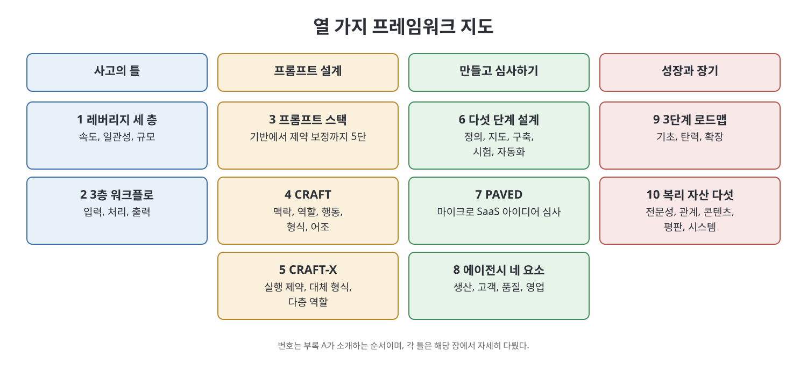

# 부록 A 프레임워크와 모델 참조 (Appendix A: Complete Framework and Model Reference)

부록 A는 책 전체에 이름이 붙어 나온 프레임워크 열 가지를 한곳에 모은 참조 부록이다. 장을 다시 읽지 않고도 기억을 되살릴 수 있게 각 틀의 출처 장, 구성 요소, 언제 쓰는지를 압축했다. 이 노트는 책의 표를 그대로 옮기지 않고, 열 가지를 "무엇을 위한 틀인가"를 기준으로 네 묶음으로 다시 배열했다.

> **쉽게 말하면**
> 열 가지 틀은 서로 다른 도구가 아니라 한 사업의 서로 다른 층이다. 사고방식, 프롬프트, 시스템 설계, 사업 심사와 성장으로 나눠 보면 헷갈리지 않는다.

> **참고(노트 작성자)** 프레임워크 안의 인원 배치, 매출 목표, 기간은 책의 예시이며 노트 작성자가 검증하지 않았다. 수익과 시간은 책의 사례이고 결과는 개인과 시장에 따라 크게 다르다.

## 이 부록의 흐름

1. 사고의 틀: 레버리지 세 층, 3층 워크플로 모델
2. 프롬프트 설계의 틀: 프롬프트 스택, CRAFT, CRAFT-X
3. 만들고 심사하는 틀: 다섯 단계 설계, PAVED, 에이전시 네 요소
4. 성장과 장기의 틀: 3단계 로드맵, 복리 자산 다섯
5. 상황별로 어떤 틀을 꺼내나

## 1. 사고의 틀

**AI 레버리지 세 층(1장).** Claude가 만드는 가치를 세 층으로 나눈다. 속도(같은 일을 더 빨리), 일관성(많은 양에서도 품질 유지), 규모(혼자 일하는 사람이 시간과 수입의 천장을 넘는 것)다. 책은 속도는 적당한 효과이고 규모는 사업 구조를 바꾸는 효과라고 평가한다. 자신의 일이 지금 어느 층에 머무는지 묻는 데 쓴다.

**3층 워크플로 모델(2장).** 모든 Claude 시스템을 입력 층(시스템 프롬프트, 맥락, 예시, 제약), 처리 층(추론과 생성, 단계적 사고 설계), 출력 층(형식, 전달 위치, 후속 사용)으로 본다. 결과가 나쁘면 세 층 중 어디가 문제인지 먼저 가르는 진단 틀이다.

## 2. 프롬프트 설계의 틀

**프롬프트 스택(3장).** 프롬프트를 바뀌는 속도에 따라 다섯 층으로 쌓는다. 기반(성격, 가치, 제약. 가끔 바뀜), 작업(작업 종류와 출력 형식. 주 단위), 맥락 주입(이번 실행의 자료. 매번), 예시(품질이 떨어질 때), 제약 보정(그때그때)이다. 층마다 파일을 따로 두면 수정 범위가 작아진다.

**CRAFT(3장).** 한 번의 프롬프트를 다섯 요소로 점검한다. 맥락(Context), 역할(Role), 행동(Action), 형식(Format), 어조(Tone)다. 책은 예로 인사 관리자를 독자로 한 소프트웨어 비교 글 요청을 보여 준다.

**CRAFT-X(15장).** CRAFT에 운영용 확장을 얹는다. 시간과 토큰 예산, 품질 하한, 실패 시 처리 같은 실행 제약, 입력이 들쭉날쭉할 때의 대체 형식, 여러 전문가 시각을 겹치는 다층 역할이다.

| 틀 | 쓰는 때 | 한 줄 요령 |
|----|--------|-----------|
| 프롬프트 스택 | 프롬프트가 늘어나 관리가 어려울 때 | 바뀌는 속도로 층을 나눈다 |
| CRAFT | 새 프롬프트를 쓸 때 | 다섯 칸을 빠짐없이 채운다 |
| CRAFT-X | 대량, 기업용 시스템일 때 | 실패와 예외 처리를 미리 적는다 |

## 3. 만들고 심사하는 틀

**다섯 단계 워크플로 설계(4장).** 정의(여섯 질문에 답하는 한 단락의 작업 명세), 지도(단계 경계와 인계 지점), 구축(단계별 프롬프트 작성과 시험), 스트레스 시험(경계 사례와 실패 시나리오), 자동화(단계 연결과 모니터링)의 순서다. 자동화를 마지막에 둔다는 점이 핵심이다.

**PAVED(11장).** 마이크로 SaaS 아이디어를 다섯 기준으로 심사한다. 문제의 구체성, 청중에게 닿을 길, 이미 돈을 쓰는 수요의 증거, 4주에서 8주 안에 만들 수 있는 실행 가능성, 첫 고객 50명이 어디서 올지 아는 유통 명확성이다. 하나라도 위험 신호가 있으면 그 이유부터 해소하라는 용도다.

**AI 에이전시 네 요소(9장).** 확장 가능한 에이전시를 생산 시스템, 고객 성공, 품질 관리, 사업 개발로 나눈다. 각 요소에서 Claude가 맡는 일(주 생산자, 소통 초안, 자기 검토와 수정, 제안과 아웃리치 초안)과 사람이 맡는 일(품질 검토자, 계정 관리자, 시니어 검토, 창업자)이 짝지어 있다. 책은 월 매출 규모별 인원 예시를 주지만 수치는 가이드일 뿐이다.

## 4. 성장과 장기의 틀

**3단계 월 1만 달러 로드맵(12장).** 기초(처음 두 달, 실제 고객으로 모델 증명), 탄력(3개월에서 5개월째, 체계화와 파이프라인), 확장(6개월 이후, 검증된 모델을 효율적으로 키움)이다. 책은 단계마다 월 매출 목표를 제시하지만 이는 책의 예이며 사람마다 크게 다르다. 단계의 마일스톤(첫 유료 고객과 첫 사례, 안정적 고객 확보, 수입원 여러 개와 팀)이 숫자보다 쓸모 있다.

**복리 자산 다섯(24장).** 시간이 지날수록 불어나는 자산을 다섯 가지로 본다. 분야 전문성, 고객 관계, 콘텐츠 아카이브, 평판과 사회적 증거, 시스템의 정교함이다. 각각 무엇을 통해 복리로 쌓이는지(학습과 고객 일, 전달의 탁월함, 꾸준한 발행, 결과의 꼼꼼한 기록, 구축과 시험과 개선의 반복)가 정해져 있다.

## 5. 상황별로 어떤 틀을 꺼내나

| 지금 상황 | 꺼낼 틀 |
|----------|---------|
| 결과가 들쭉날쭉하다 | 3층 워크플로로 문제 층 찾기, CRAFT 점검 |
| 새 자동화를 설계한다 | 다섯 단계 설계, CRAFT-X |
| 제품 아이디어를 고른다 | PAVED |
| 에이전시 구조를 짠다 | 네 요소 모델 |
| 올해 계획을 세운다 | 3단계 로드맵, 복리 자산 |

## 핵심 정리

- 열 가지 프레임워크는 사고, 프롬프트, 설계와 심사, 성장의 네 층으로 정리된다.
- 프롬프트 스택은 바뀌는 속도로 나누고, CRAFT는 한 번의 프롬프트를, CRAFT-X는 운영 제약을 점검한다.
- 다섯 단계 설계는 자동화를 맨 마지막에 놓고 PAVED는 만들기 전에 아이디어를 심사한다.
- 로드맵과 복리 자산은 숫자보다 마일스톤과 쌓이는 것의 종류를 보라는 틀이다.
- 책의 수치와 인원 예시는 참고용이며 자기 상황에 맞춰 조정해야 한다.

 
 
 

이전: [보너스 장 B1 여섯 가지 AI 시스템 청사진](%EB%B3%B4%EB%84%88%EC%8A%A4%20%EC%9E%A5%20B1%20%EC%97%AC%EC%84%AF%20%EA%B0%80%EC%A7%80%20AI%20%EC%8B%9C%EC%8A%A4%ED%85%9C%20%EC%B2%AD%EC%82%AC%EC%A7%84.md) | 다음: [부록 B 수익 모델별 빠른 시작](%EB%B6%80%EB%A1%9D%20B%20%EC%88%98%EC%9D%B5%20%EB%AA%A8%EB%8D%B8%EB%B3%84%20%EB%B9%A0%EB%A5%B8%20%EC%8B%9C%EC%9E%91.md)

 

[Claude AI Automation and Monetization](../)
