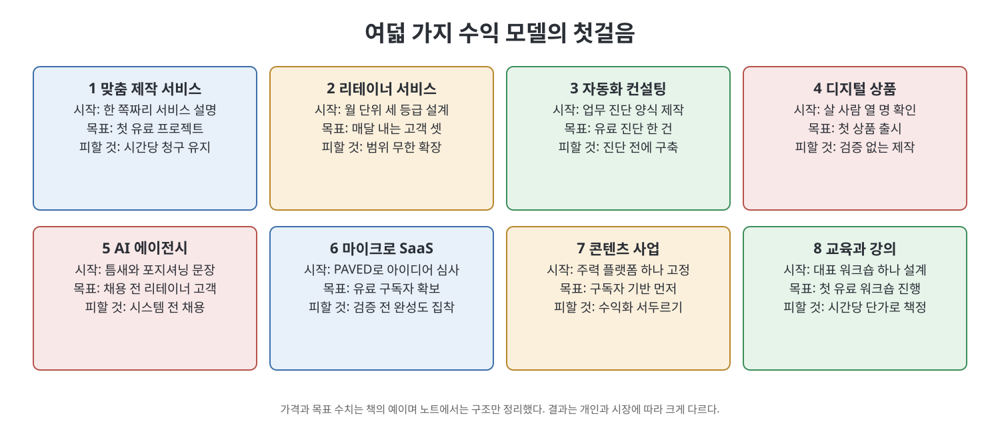

# 부록 B 수익 모델별 빠른 시작 (Appendix B: Income Stream Quick-Start Guide)

부록 B는 책이 다룬 여덟 가지 사업 모델마다 한 장짜리 시작 카드를 준다. 카드의 항목은 첫 행동, 먼저 만들 시스템, 첫 고객 후보, 첫 목표, 가격 출발점, 가장 피해야 할 실수다. 이미 주력 모델을 골랐을 때 실행을 시작하는 결정 도구로 쓰라는 것이 책의 안내다. 이 노트는 카드를 옮기지 않고 모델을 성격별로 묶어 공통 원칙을 뽑고, 모델마다 핵심 한 줄만 남겼다.

> **쉽게 말하면**
> 여덟 카드에서 반복되는 말은 하나다. 만들기 전에 사겠다는 사람부터 확인하고, 작게 시작해 한 건을 끝내 본 뒤 키운다.

> **참고(노트 작성자)** 카드의 가격대와 기간은 책의 예이며 노트 작성자가 검증하지 않았다. 수익과 시간은 책의 사례이고 결과는 개인과 시장에 따라 크게 다르다. 가격을 정하거나 계약서를 쓸 때는 전문가 확인이 필요할 수 있다.

## 이 부록의 흐름

1. 서비스형 모델: 맞춤 제작, 리테이너, 자동화 컨설팅
2. 상품과 제품형 모델: 디지털 상품, 마이크로 SaaS
3. 조직과 관계형 모델: AI 에이전시, 콘텐츠 사업, 교육과 강의
4. 카드 전체에서 뽑은 공통 원칙

## 1. 서비스형 모델

**맞춤 제작 서비스(Done-for-You).** 고객에게 완성된 결과물을 넘기는 서비스다. 시작은 구체적 결과물, 대상 고객, 가격을 적은 한 쪽짜리 서비스 설명서다. 먼저 만들 것은 핵심 결과물을 자신 있는 품질로 뽑는 Claude 파이프라인이고, 첫 고객은 내 지인 중 그 문제가 있는 사람이다. 책은 가격대로 건당 몇백 달러에서 천 달러대 초반을 예시한다. 피할 실수는 AI를 쓰게 된 뒤에도 시간당으로 청구하는 것이다. 빨라진 만큼 매출이 줄기 때문이다.

**리테이너 서비스(Retainer, 월 정액 계약).** 매달 정해진 범위의 일을 정액으로 맡는 계약이다. 세 가지 등급과 월별 산출물을 설계하고, 매달 필요한 물량을 처리하는 생산 파이프라인을 먼저 만든다. 목표는 정기 지불 고객 세 명이다. 가장 큰 실수는 범위가 슬금슬금 늘어나는 것이므로 포함과 비포함을 문서로 적어 둔다.

**자동화 컨설팅.** 업무 진단 양식을 만들어 자동화 기회를 찾아 주는 서비스다. 처음에는 고객의 맥락에 맞춘 시연 시스템으로 자동화가 어떤 모습인지 보여 주고, 반복 업무를 불평하는 아는 사업주에게 먼저 접근한다. 목표는 유료 진단 한 건과 그 사례화다. 진단이 끝나고 대금이 확정되기 전에 구축부터 시작하는 것이 피할 실수다.

## 2. 상품과 제품형 모델

**디지털 상품.** 프롬프트 팩, 가이드, 강의 같은 상품이다. 첫 행동은 사겠다는 사람 열 명을 직접 찾는 검증이다. 상품 종류에 맞는 콘텐츠 생성 시스템을 만들고, 판매는 Gumroad나 Lemon Squeezy처럼 바로 열 수 있는 플랫폼과 기존 청중에서 시작한다. 목표는 첫 상품 출시와 첫 열 건 판매이며, 입문 상품의 가격은 책의 예로 수십 달러대다. 아무도 원한다고 말하지 않은 상품을 만드는 것이 대표적 실수다.

**마이크로 SaaS.** 11장 후보 중 하나를 골라 PAVED로 심사하는 것이 첫 행동이다. 코드를 쓰기 전에 Claude와 양식 도구로 수동 버전을 만들어 값을 낸 첫 사용자를 얻는다. 기술은 먼저 노코드 스택으로 시작한다. 목표는 유료 구독자 열 명이며 유료 광고는 그 뒤다. 실제 결제 사용자 검증 없이 완성도 높은 제품부터 만드는 것이 피할 실수다.

## 3. 조직과 관계형 모델

**AI 에이전시.** 틈새와 포지셔닝 문장을 정하고, 핵심 결과물을 낼 최소 생산 시스템부터 만든다. 책은 직원을 뽑기 전에 리테이너 고객 세 명을 먼저 얻으라고 한다. 첫 채용은 파트타임 계정 관리자나 프로젝트 조정자다. 생산 시스템이 안정되기 전에 사람부터 뽑는 것이 실수다.

**콘텐츠 사업.** 주력 플랫폼 하나를 고르고 열두 달 지킬 수 있는 발행 빈도를 정한다. 뉴스레터, 글, 영상 대본 중 주력 형식의 생산 파이프라인이 먼저다. 책은 구독자 오백 명을 모으기 전에는 수익화를 켜지 말라고 하며, 의미 있는 수익까지 대개 6개월에서 12개월의 꾸준한 발행이 걸린다고 설명한다. 성장은 추천 프로그램, 게스트 기고, 대표 콘텐츠의 SNS 배포로 만든다. 독자와 관계를 쌓기 전에 수익화를 쫓는 것이 실수다.

**교육과 강의.** 특정 직업군 대상의 대표 워크숍 하나를 20장의 틀로 설계하고, 모듈 개발 프롬프트 시스템으로 커리큘럼과 자료를 만든다. 시범 수업은 내 분야의 협회나 회사에 제안한다. 목표는 첫 유료 워크숍과 사례 정리다. 책은 반일과 종일 워크숍의 가격 범위를 예시하며, 워크숍을 상담 시간당 단가로 매기지 말고 교육의 하루 단가 관행으로 매기라고 한다.

| 묶음 | 모델 | 첫 목표의 성격 |
|------|------|--------------|
| 서비스형 | 맞춤 제작, 리테이너, 자동화 컨설팅 | 첫 유료 한 건 또는 정기 고객 셋 |
| 상품형 | 디지털 상품, 마이크로 SaaS | 사겠다는 사람의 검증과 첫 판매 |
| 관계형 | 에이전시, 콘텐츠, 교육 | 청중 또는 고객 기반 먼저 |

## 4. 카드 전체에서 뽑은 공통 원칙

| 반복되는 원칙 | 카드에서 나타나는 모습 |
|-------------|--------------------|
| 검증 먼저 | 사겠다는 사람 확인, 수동 버전, 유료 진단 선결제 |
| 시스템 먼저, 사람은 나중 | 에이전시는 파이프라인 안정 뒤에 채용 |
| 범위를 글로 | 리테이너의 포함과 비포함 명시 |
| 가격은 결과물 기준 | 시간당이 아니라 건당, 하루당 단가 |

## 핵심 정리

- 여덟 카드는 모두 첫 행동, 먼저 만들 시스템, 첫 목표, 피할 실수의 같은 틀로 짜여 있다.
- 서비스형은 시간 대신 결과물로 가격을 매기고 범위를 문서로 막는다.
- 상품형은 사겠다는 사람 확인과 수동 버전 검증이 만들기보다 먼저다.
- 에이전시, 콘텐츠, 교육은 고객 기반과 청중 관계가 수익화보다 앞선다.
- 가격과 기간은 책의 예이므로 자기 시장에서 다시 검증해야 한다.

 
 
 

이전: [부록 A 프레임워크와 모델 참조](%EB%B6%80%EB%A1%9D%20A%20%ED%94%84%EB%A0%88%EC%9E%84%EC%9B%8C%ED%81%AC%EC%99%80%20%EB%AA%A8%EB%8D%B8%20%EC%B0%B8%EC%A1%B0.md) | 다음: [부록 C 도구와 기술 참조](%EB%B6%80%EB%A1%9D%20C%20%EB%8F%84%EA%B5%AC%EC%99%80%20%EA%B8%B0%EC%88%A0%20%EC%B0%B8%EC%A1%B0.md)

 

[Claude AI Automation and Monetization](../)
