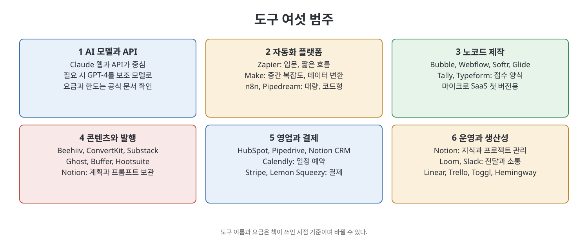

# 부록 C 도구와 기술 참조 (Appendix C: Tools, Resources, and Technology Reference)

부록 C는 책에 나온 도구를 범주별로 모은 실용 참조표다. 각 도구가 어떤 용도에 맞는지, 어디서 쓰는지, 고를 때 고려할 점이 무엇인지를 알려 준다. 책이 쓰인 시점의 목록이므로 새 도구가 계속 나오며, 요금과 기능은 바뀐다. 이 노트는 표를 그대로 옮기지 않고 "어떤 기준으로 고르는가"를 중심으로 다시 짰다.

> **쉽게 말하면**
> 도구 이름보다 고르는 기준이 오래 간다. 처음에는 가장 쉬운 도구로 시작하고, 물량이나 개인정보 요구가 커질 때 옮긴다.

> **참고(노트 작성자)** 도구 이름, 요금제, 기능은 책이 쓰인 시점 기준이며 노트 작성자가 검증하지 않았다. 가격이나 수수료 같은 숫자는 노트에서 뺐고, 최신 정보는 각 서비스의 공식 사이트에서 확인해야 한다. 고객 데이터를 외부 플랫폼에 보낼 때는 개인정보 관련 전문가 확인이 필요하다.

## 이 부록의 흐름

1. AI 모델과 API
2. 자동화와 연동 플랫폼
3. 노코드 제품 제작 도구
4. 콘텐츠와 발행 도구
5. 영업과 고객 관리, 결제
6. 운영과 생산성 도구
7. 고르는 기준 정리

## 1. AI 모델과 API

책의 중심 엔진은 Claude다. 웹 서비스(claude.ai)로 직접 쓰거나 API(Application Programming Interface, 프로그램이 Claude를 호출하는 통로)로 자동화에 연결한다. API는 키를 발급받아 쓰며 기초 프로그래밍이나 노코드 도구 지식이 필요하다. 책은 OpenAI의 GPT-4를 대체 모델로 언급하며, 백업이나 비교 시험용으로 유용하다고 본다. 요금과 사용 한도는 제공사의 공식 사이트에서 최신 내용을 확인하라고 안내한다.

## 2. 자동화와 연동 플랫폼

여러 서비스를 이어 반복 작업을 돌리는 도구다. 책은 네 가지를 비교한다.

| 도구 | 어울리는 사람과 일 | 고를 이유 |
|------|------------------|-----------|
| Zapier | 입문자, 두세 단계의 단순 흐름 | 설정이 빠르다 |
| Make | 중간 복잡도, 데이터 가공이 많은 흐름 | 변환 기능이 풍부하다 |
| n8n | 대량 처리, 개인정보 요구, 맞춤 로직 | 직접 설치(self-hosted)가 가능하다 |
| Pipedream | 코드를 쓰는 개발자 | 코드 중심 자동화 |

n8n은 서버에 직접 설치하면 실행당 비용이 들지 않고 고객 정보가 제3자 플랫폼을 거치지 않는다는 점이 장점이다. 책은 시작 요금 구간을 함께 표로 주지만 노트는 수치를 빼고 구조만 남겼다.

## 3. 노코드 제품 제작 도구

코드를 쓰지 않고 제품이나 화면을 만드는 도구들이다. Bubble은 본격 웹앱을 만드는 도구로 익숙해지는 데 한두 주가 걸린다고 책은 본다. Webflow는 홍보 사이트와 제품 소개 페이지, Softr는 Airtable 위의 데이터 중심 도구와 포털, Glide는 스프레드시트 데이터로 만드는 모바일 앱에 어울린다. Tally와 Typeform은 접수 양식과 설문에 쓰는 아주 쉬운 도구다. 마이크로 SaaS를 만들 때 이 중 하나로 수동 버전을 먼저 세우는 것이 책의 권고다.

## 4. 콘텐츠와 발행 도구

| 범주 | 도구 | 어울리는 용도 |
|------|------|--------------|
| 뉴스레터 | Beehiiv, Substack | 구독 기반 발행, 추천 기능, 독자 공동체 |
| 이메일 마케팅 | ConvertKit | 창작자 사업, 강의 판매, 세분화와 자동화 |
| 블로그와 회원 사이트 | Ghost | 직접 설치 가능한 전문 블로그 |
| 소셜 예약 | Buffer, Hootsuite | 여러 채널의 대량 배포 관리 |
| 기획과 지식 관리 | Notion | 콘텐츠 계획, 프롬프트 라이브러리, 팀 절차서 |

## 5. 영업과 고객 관리, 결제

고객 관리(CRM, 잠재 고객과 고객과의 소통을 기록하는 도구)로는 HubSpot의 무료 구간, 서비스 사업의 영업 흐름용 Pipedrive, 혼자 일하는 사람용 Notion 기반 간이 CRM이 나온다. 일정 예약은 Calendly로 자동화한다. 결제는 디지털 상품 판매에 간편한 Lemon Squeezy, 맞춤 결제와 구독 관리를 위한 Stripe가 소개된다. 책은 두 곳의 수수료 구조를 적어 두었으나 바뀔 수 있으므로 확인이 필요하다.

## 6. 운영과 생산성 도구

Notion은 프롬프트 라이브러리, 절차서, 고객 프로젝트 추적을 한곳에 둔다. Loom은 고객에게 결과물을 줄 때 짧은 설명 영상을 곁들여 인지된 가치를 높인다. Slack은 에이전시와 큰 규모의 고객 소통 채널이다. Linear나 Trello는 산출물 진행 상태와 시스템 개선 목록, Toggl Track은 산출물당 실제 시간을 알아 가격을 조정하는 데 쓴다. Hemingway Editor는 AI가 쓴 글의 가독성을 빠르게 검사한다.

## 7. 고르는 기준 정리

| 기준 | 질문 |
|------|------|
| 학습 부담 | 이번 주 안에 첫 결과를 낼 수 있는가 |
| 규모 | 물량이 열 배가 되어도 비용이 감당되는가 |
| 데이터 민감도 | 고객 정보가 외부 플랫폼을 지나도 되는가 |
| 이동 가능성 | 나중에 다른 도구로 옮기기 쉬운가 |

## 핵심 정리

- 책은 Claude를 중심 엔진으로 보고 GPT-4 등은 보조 모델로 소개한다.
- 자동화는 Zapier로 입문해 Make를 거쳐 대량, 개인정보 요구 시 n8n으로 가는 경로가 자연스럽다.
- 노코드 도구로 수동 버전을 먼저 세운 뒤 코드를 쓰는 것이 책의 순서다.
- 콘텐츠, 영업, 결제, 운영 도구는 하나씩 필요가 생길 때 더하며 한꺼번에 도입하지 않는다.
- 도구 이름과 요금은 시점에 묶여 있으므로 공식 사이트로 확인하고 고르는 기준을 남긴다.

 
 
 

이전: [부록 B 수익 모델별 빠른 시작](%EB%B6%80%EB%A1%9D%20B%20%EC%88%98%EC%9D%B5%20%EB%AA%A8%EB%8D%B8%EB%B3%84%20%EB%B9%A0%EB%A5%B8%20%EC%8B%9C%EC%9E%91.md) | 다음: [부록 D 용어집](%EB%B6%80%EB%A1%9D%20D%20%EC%9A%A9%EC%96%B4%EC%A7%91.md)

 

[Claude AI Automation and Monetization](../)
