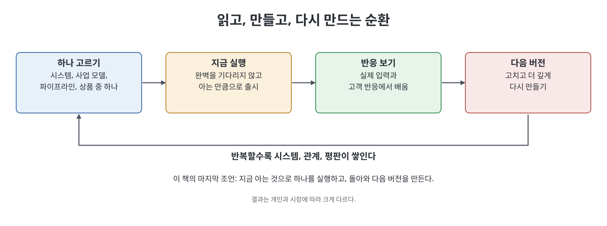

# 부록 E 30일 스프린트 계획 (Appendix E: The 30-Day Fast-Start Sprint Plan)

부록 E는 책을 다 읽고 곧바로 움직이고 싶은 독자를 위한 하루 단위 행동 계획이다. 처음 시작하는 사람이나 하던 일을 크게 바꾸는 사람을 위해 설계되었고, 이미 가진 자산에 맞춰 조정하라고 한다. 전제는 주력 사업 모델을 이미 골랐다는 것이며, 못 골랐다면 처음 이틀을 그 결정에 쓴다. 이 노트는 날짜별 표를 그대로 옮기지 않고 30일을 여섯 구간으로 묶어 각 구간의 목적과 "끝났다고 볼 조건"을 다시 정리했다.

> **쉽게 말하면**
> 30일은 완벽한 사업을 세우는 기간이 아니라, 시스템 하나와 사람 스무 명과 제안 한 건과 사례 한 편을 만들어 보는 실험 기간이다.

> **참고(노트 작성자)** 날짜별 목표 수량(연락 건수, 명단 수 등)은 책이 제시한 예이며 노트 작성자가 검증하지 않았다. 수익과 시간은 책의 사례이고 결과는 개인과 시장에 따라 크게 다르다. 영업 메시지를 보낼 때는 수신 동의와 광고 관련 규정을 전문가에게 확인해야 한다.

## 이 부록의 흐름

1. 1일에서 2일: 기반 결정
2. 3일에서 7일: 준비(시스템, 가격, 명단)
3. 8일에서 15일: 첫 접촉과 첫 대화
4. 16일에서 25일: 제안과 개선, 마감
5. 26일에서 30일: 사례, 다음 수입원, 점검

## 1. 기반 결정(1일에서 2일)

사업 모델을 고르고 포지셔닝 문장(내가 누구에게 무엇을 해 주는지 한 문장)을 쓰고 이상적인 고객의 모습을 그린다. 이 단계가 끝났다고 볼 조건은 한 쪽짜리 사업 논거가 글로 남았을 때다. 길게 쓸 필요 없이 이후 모든 결정의 기준이 되는 메모를 만든다는 뜻이다.

## 2. 준비(3일에서 7일)

사흘째와 나흘째에는 핵심 결과물을 만드는 Claude 파이프라인을 짓고 다섯 가지 입력으로 시험한다. 합격 기준은 내가 고객에게 보낼 만한 수준인지다. 다음 이틀은 서비스 패키지나 상품 구성에 구체적인 가격을 붙여 세 등급으로 정리한다. 7일째에는 이상적인 잠재 고객 20명의 명단을 연락처와 함께 만든다. 책의 기준은 이메일이나 LinkedIn 프로필까지 확보해야 완료다.

## 3. 첫 접촉과 첫 대화(8일에서 15일)

8일과 9일에 개인 맞춤 연락 10건을 보내는데, 템플릿을 그대로 복사하지 않는다(6장의 틀을 쓴다). 10일에는 전문성을 보여 주는 첫 콘텐츠 한 편을 주력 플랫폼에 올린다. 11일과 12일은 후속 연락과 초기 피드백 반영, 13일과 14일은 지인 네트워크를 포함한 두 번째 10건 발송으로 누적 20건을 채운다. 15일에는 구조화된 질문 목록으로 첫 탐색 통화를 한다. 끝났다고 볼 조건은 한 잠재 고객의 필요를 분명히 이해한 것이다.

## 4. 제안과 개선, 마감(16일에서 25일)

16일과 17일에 6장과 9장의 틀로 첫 제안서를 써서 낸다. 18일과 19일에는 시험 결과를 보고 프롬프트를 개선하고 자체 검토 단계를 더하며, 개선한 프롬프트가 라이브러리에 최소 세 개 반영되어야 한다. 20일에는 첫 글을 소셜 채널용으로 바꾼 두 번째 콘텐츠를 낸다. 21일에서 23일에는 고객 확보 흐름을 체계화해 매주 반복할 수 있는 연락 절차를 문서화한다. 24일과 25일에는 첫 고객과 계약을 맺거나, 안 되면 후속 계획이라도 세운다.

## 5. 사례, 다음 수입원, 점검(26일에서 30일)

26일과 27일에는 초기 작업이나 고객 결과를 첫 사례 초안으로 정리한다. 28일과 29일에는 두 번째 수입원, 즉 첫 디지털 상품이나 둘째 서비스 등급의 윤곽을 잡는다. 30일에는 30일 전체를 돌아보고 31일에서 90일의 목표와 계획을 문서로 남긴다. 책은 이 마지막 날의 점검을 솔직히 하라고 강조한다. 계획대로 했는지, 어디서 벗어났고 왜인지, 시장과 시스템과 내 습관에 대해 첫날 몰랐던 것이 무엇인지를 묻는다. 이 교훈이 스프린트 중간의 어떤 전술 수정보다 값지다는 것이 저자의 말이다.

| 구간 | 산출물 | 흔한 막힘 |
|------|--------|----------|
| 기반 결정 | 한 쪽 사업 논거 | 모델을 못 정해 시간을 쓴다 |
| 준비 | 시험된 시스템, 가격표, 명단 | 시스템을 너무 오래 다듬는다 |
| 첫 접촉 | 연락 20건, 탐색 통화 | 템플릿 복붙으로 반응이 없다 |
| 제안과 마감 | 제안서, 개선 프롬프트, 계약 또는 후속 계획 | 제안 후 연락이 끊긴다 |
| 사례와 확장 | 사례 초안, 두 번째 수입원 윤곽 | 기록을 미룬다 |

## 6. 일정을 쓰는 요령

- 책의 날짜는 기준이다. 본업이 있다면 두 배로 늘려도 구조가 같으면 괜찮다.
- 각 구간의 완료 조건을 달력에 적어 "한 일"이 아니라 "끝난 것"을 체크한다.
- 점검 날에는 숫자(보낸 건수, 대화 수)와 느낌(어디서 막혔나)을 모두 적는다.

## 핵심 정리

- 30일은 결정, 준비, 첫 접촉, 제안과 마감, 사례와 확장, 점검의 여섯 구간이다.
- 구간마다 "완료 조건"이 있어서 한 일이 아니라 끝난 것을 확인할 수 있다.
- 연락은 개인 맞춤으로 하고 템플릿 복사를 피하는 것이 책의 요구다.
- 30일째의 정직한 점검과 31일에서 90일의 계획이 스프린트의 가장 큰 산출물이다.
- 목표 수량은 책의 예이며 자신의 시간과 시장에 맞춰 조정한다.

 
 
 

이전: [부록 D 용어집](%EB%B6%80%EB%A1%9D%20D%20%EC%9A%A9%EC%96%B4%EC%A7%91.md) | 다음: [부록 F 사업 계획서 템플릿](%EB%B6%80%EB%A1%9D%20F%20%EC%82%AC%EC%97%85%20%EA%B3%84%ED%9A%8D%EC%84%9C%20%ED%85%9C%ED%94%8C%EB%A6%BF.md)

 

[Claude AI Automation and Monetization](../)
