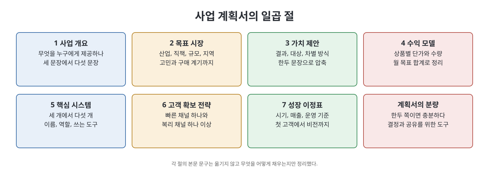

# 부록 F 사업 계획서 템플릿 (Appendix F: AI Business Plan Template)

부록 F는 혼자 하거나 소규모 팀으로 하는 AI 사업을 위한 한두 쪽짜리 사업 계획서 템플릿이다. 저자는 사업 계획서가 60쪽짜리일 필요는 없고, 좋은 결정을 내리고 파트너나 투자자, 팀원에게 방향을 전할 만큼의 전략적 명료함이면 된다고 본다. 템플릿은 일곱 절로 이루어지며 절마다 무엇을 어떻게 채울지 안내가 붙는다. 이 노트는 템플릿의 문구와 표를 그대로 옮기지 않고, 각 절의 목적과 채우는 요령을 정리하고 새 예시를 직접 썼다.

> **쉽게 말하면**
> 계획서는 투자자에게 보이는 서류이기 전에, 나 스스로에게 "내가 지금 무엇을 누구에게 팔고 있는가"를 확인시키는 한두 쪽짜리 메모다.

> **참고(노트 작성자)** 책의 예시 수치(고객 규모, 월 매출 목표 등)는 책의 예이며 노트 작성자가 검증하지 않았다. 수익과 시간은 책의 사례이고 결과는 개인과 시장에 따라 크게 다르다. 투자 유치나 법인 설립, 세금에 관한 판단은 전문가 확인이 필요하다.

## 이 부록의 흐름

1. 절 1 사업 개요
2. 절 2 목표 시장
3. 절 3 가치 제안
4. 절 4 수익 모델과 재무 전망
5. 절 5 핵심 시스템과 운영
6. 절 6 고객 확보 전략
7. 절 7 성장 이정표
8. 계획서를 쓰고 고치는 요령

## 1. 사업 개요

세 문장에서 다섯 문장으로 무엇을 하고, 누구를 위해 하고, 무엇이 남다른지를 쓴다. 기준은 아무 배경 없는 똑똑한 친구에게 설명했을 때 그 친구가 다른 사람에게 정확히 옮길 수 있는지다. 책은 이 절을 쓰는 데 Claude를 쓰는 프롬프트를 제공한다. 구성 요소는 내가 하는 일, 섬기는 대상, 내가 만드는 핵심 결과, 차별점, 수익 모델(리테이너, 프로젝트, 구독, 상품)의 다섯 칸이고, 모호한 말을 피하고 모든 문장이 구체적이어야 한다는 지시가 붙는다. 비슷한 요청을 새로 쓰면 아래와 같다.

```
내 사업을 세 문장으로 소개해 줘.
- 하는 일: [서비스]
- 대상: [고객 유형]
- 고객에게 생기는 변화: [결과]
- 다른 점: [차별점]
막연한 형용사는 빼고 문장마다 구체적인 사실을 넣어 줘.
```

## 2. 목표 시장

목록이나 모임 자리에서 이상적인 고객을 찾아낼 수 있을 만큼 구체적으로 적는다. 모호한 시장은 모호한 마케팅과 낮은 전환을 낳는다. 책의 표는 여섯 차원으로 시장을 정의한다.

| 차원 | 적는 내용 | 새 예시 |
|------|----------|---------|
| 업종 | 고객이 속한 산업 | 지역 병원과 치과 |
| 직책 | 구매를 결정하는 사람 | 원무 팀장 |
| 규모 | 직원 수나 매출 구간 | 직원 20명 안팎 |
| 지역 | 서비스 가능한 곳 | 수도권 |
| 핵심 고민 | 해결하고 싶은 문제 | 접수 문의 응대 부담 |
| 구매 계기 | 지금 사게 만드는 사건 | 신규 지점 개설 직후 |

## 3. 가치 제안

내가 누구에게 무엇을 해 주고, 대안보다 왜 나은지를 가장 선명하게 한 문장으로 줄인 것이다. 시험 질문은 이 문장만 읽은 사람이 자기에게 해당하는지 바로 알 수 있는가다. 책은 세 요소를 든다. 제공하는 구체적 결과(서비스가 아니라 결과), 그 결과를 받는 고객의 종류, 내 전달 방식을 다르게 만드는 독특한 메커니즘이다. 세 가지를 한두 문장에 모두 담는다.

## 4. 수익 모델과 재무 전망

수익원을 행으로 놓고 단가, 월 물량, 월 목표 매출을 열로 둔 표로 정리한다. 행은 주력 서비스나 리테이너, 보조 서비스나 프로젝트, 디지털 상품, 기타(제휴, 소개 수수료 등)이고 마지막 줄이 월 목표 합계다. 단가에 물량을 곱한 값이 목표와 맞는지 계산해 보면, 목표가 현실적인지 바로 보인다. 예를 들어 고객이 몇 명 필요한지 거꾸로 따져 보게 한다.

## 5. 핵심 시스템과 운영

사업이 의존하는 핵심 시스템 세 개에서 다섯 개를 이름, 하는 일, 돌아가는 주요 도구로 적는다. 이 절은 사업이 아이디어에 그치지 않고 운영에 뿌리를 두고 있음을 보여 주는 증거다. 4장의 워크플로 설계와 부록 A의 다섯 단계 설계로 만든 시스템들이 여기에 들어간다.

## 6. 고객 확보 전략

어떤 경로로 고객을 찾고 전환하며 첫 접촉부터 매출까지 얼마나 걸리는지를 구체적으로 쓴다. 좋은 전략은 채널이 최소 둘이다. 빠른 결과를 위한 채널(직접 연락)과 장기 복리를 위한 채널(콘텐츠나 추천)이다. 부록 E의 30일 계획이 이 절의 첫 실행 계획이다.

## 7. 성장 이정표

| 이정표 | 시기를 정하는 방식 | 매출 표지 | 운영 표지 |
|--------|------------------|----------|----------|
| 첫 유료 고객 | 몇 주째 | 첫 입금액 | 첫 시스템의 실사용 |
| 모델 증명 | 몇 개월째 | 월 매출 기준 | 사례가 있는 만족 고객 셋 |
| 지속 가능한 매출 | 몇 개월째 | 월 매출 기준 | 반복되는 고객 확보 절차 |
| 확장 문턱 | 몇 개월째 | 책의 예는 월 1만 달러 | 사람이나 자동화가 전달 업무를 맡음 |
| 비전 | 장기 | 비전 금액 | 장기 목표의 서술 |

시기와 금액은 빈칸으로 두었다가 자신의 상황에 맞춰 채우는 형태다. 책의 월 1만 달러는 12장의 로드맵과 맞춘 예시 기준일 뿐이다.



## 8. 계획서를 쓰고 고치는 요령

- 순서는 개요, 시장, 가치 제안, 수익, 시스템, 확보, 이정표로 가되, 막히면 가치 제안부터 써도 좋다.
- 분기마다 부록 H의 월간 점검 결과를 반영해 수치와 이정표를 고친다.
- 투자자나 파트너에게 보낼 때는 수치의 근거와 가정을 함께 설명할 준비를 한다.

## 핵심 정리

- 한두 쪽짜리 계획서면 충분하고 목적은 결정과 공유이다.
- 시장은 목록에서 찾아낼 수 있을 만큼 구체적으로 정의한다.
- 가치 제안은 결과, 대상, 독특한 전달 방식의 세 요소를 한두 문장에 담는다.
- 수익 표는 단가, 물량, 월 목표로 현실성을 검산하는 도구다.
- 고객 확보는 빠른 채널과 복리 채널을 함께 가진다.

<br>
<br>
<br>

이전: [부록 E 30일 스프린트 계획](%EB%B6%80%EB%A1%9D%20E%2030%EC%9D%BC%20%EC%8A%A4%ED%94%84%EB%A6%B0%ED%8A%B8%20%EA%B3%84%ED%9A%8D.md) | 다음: [부록 G 추가 사례집](%EB%B6%80%EB%A1%9D%20G%20%EC%B6%94%EA%B0%80%20%EC%82%AC%EB%A1%80%EC%A7%91.md)

<br>

[Claude AI Automation and Monetization](../)
