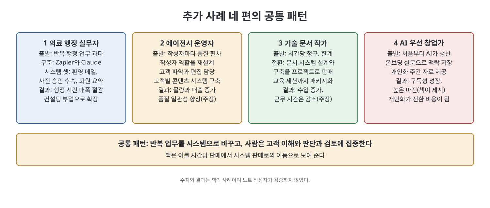

# 부록 G 추가 사례집 (Appendix G: Extended Case Study Collection)

부록 G는 본문 흐름에 넣기 어려웠던 네 편의 사례를 앞뒤 비교와 시스템 세부와 함께 모아 둔다. 의료 행정 실무자, 마케팅 에이전시 운영자, 기술 문서 작가, AI를 처음부터 중심에 둔 창업가다. 이 노트는 사례의 서술이나 표를 옮기지 않고, 각 사례를 "출발점, 한 일, 책이 주장하는 변화, 배울 점" 순으로 새로 정리했다. 사례 속 이름과 수치는 책이 소개한 그대로이며 검증된 것이 아니다.

> **쉽게 말하면**
> 네 사례의 공통점은 "일을 더 빨리 하게 됐다"가 아니라 "일의 모양을 시스템으로 바꿨다"는 것이다. 모양이 바뀌면 가격과 시간 구조도 바뀐다.

> **참고(노트 작성자)** 사례의 결과와 수치는 모두 책의 주장이며 노트 작성자가 검증하지 않았다. 수익과 시간은 책의 사례이고 결과는 개인과 시장에 따라 크게 다르다. 환자 정보나 고객 정보를 AI 도구에 넣는 일은 개인정보와 의료정보 규정의 적용을 받을 수 있어 전문가 확인이 필요하다.

## 이 부록의 흐름

1. 사례 1 의료 행정 실무자 엘레나
2. 사례 2 에이전시 운영자 테런스
3. 사례 3 기술 문서 작가 아흐마드
4. 사례 4 AI 우선 창업가 키샤
5. 네 사례 비교와 공통 교훈

## 1. 사례 1 의료 행정 실무자 엘레나

출발점은 물리치료 클리닉의 운영 관리자 엘레나다. 비기술 배경이었고, 행정 직원들이 환자 안내 메일, 보험 사전 승인 후속 처리, 신규 환자 접수 문서 같은 반복 업무에 시간의 상당 부분을 쓰고 있었다. 책에 따르면 그녀는 Zapier와 Claude를 조합해 두 달 동안 저녁과 주말에 세 가지 자동화를 만들었다.

- 신규 환자 환영 순서: 환자가 등록되면 첫 방문 안내, 주차, 보험 확인 절차 등을 담은 맞춤 메일 초안이 자동 생성된다.
- 사전 승인 후속: 답변이 없는 요청에 대해 보험사에 보낼 독촉 서신을 환자 기록에서 미리 채워 만든다.
- 퇴원 요약: 치료사가 구조화된 양식을 내면 의뢰 의사용 요약 서식이 생성된다.

책이 주장하는 결과는 6개월 뒤 반복 소통에 쓰던 행정 시간이 주당 20시간 넘게 풀렸고, 그 여력이 일정 관리와 보험 이의 신청으로 옮겨 갔으며, 해고 없이 자연 감소로 인건비 한 자리를 줄여 임상 인력 채용에 돌렸다는 것이다. 그녀는 다른 클리닉에서 자문 제안을 받아 파트타임 자동화 컨설팅을 시작했다. 배울 점은 가까운 업무 현장이 곧 첫 컨설팅 시장이 된다는 것이다. 다만 환자 정보를 다루므로 법적 요건 확인이 선행되어야 한다.

## 2. 사례 2 에이전시 운영자 테런스

출발점은 직원 열두 명 규모의 마케팅 에이전시 대표 테런스다. 작성자 여섯 명이 일곱 개 업종 고객에게 장문 콘텐츠를 만들었는데, 작성자마다 기준과 브랜드 보이스 해석이 달라 품질이 들쭉날쭉했다. 큰 고객이 "같은 사람이 쓰는 건가요"라고 물을 정도였다. 그는 이것이 재능이 아니라 시스템의 문제라고 보았다.

한 일은 작성자를 내보내는 것이 아니라 역할을 다시 설계하는 것이었다. 작성자의 일을 고객 이해(독자, 목소리, 목표를 깊이 아는 것)와 편집 탁월함(Claude가 쓴 초안을 정말 좋게 만드는 것)으로 바꾸고, 고객 업종별로 브랜드 보이스, 독자 정보, 콘텐츠 기준, 품질 하한을 담은 Claude 시스템을 만들었다. 책이 주장하는 결과는 월 콘텐츠 물량이 두 배 넘게 늘고, 한 편의 제작 시간이 줄고, 고객이 느끼는 품질이 일관되며, 월 콘텐츠 매출이 크게 올랐다는 것이다. 작성자 수는 줄었지만 담당 업무는 전략과 편집 쪽으로 이동했다.

## 3. 사례 3 기술 문서 작가 아흐마드

출발점은 시간당으로 일하며 주 40시간 넘게 꽉 차 있던 소프트웨어 업계의 기술 문서 작가 아흐마드다. 그가 깨달은 것은 고객이 가치를 두는 것이 글 자체보다 문서 시스템의 품질이라는 점이다. 프로젝트가 끝나면 고객은 "누가 썼냐"보다 "이 품질을 어떻게 계속 유지하냐"를 물었다.

전환은 "문서 작성" 판매에서 "문서 시스템 설계와 구축" 판매로의 이동이었다. 문서 구조를 설계하고, 이후 콘텐츠 생성을 돕는 Claude 시스템을 만들고, 현재 제품 상태의 전체 문서와 유지 방법 교육 세션까지 한 묶음으로 프로젝트 가격에 담았다. 책은 이 묶음의 가격이 건당 수천 달러에서 만 달러대였고, 월 매출이 이전의 대략 1.5배 이상이 되었으며 주당 근무시간은 줄었다고 주장한다. 배울 점은 가격을 투입 시간이 아니라 고객이 받는 시스템의 가치에 묶었다는 점이다.

## 4. 사례 4 AI 우선 창업가 키샤

출발점은 독립 재무 설계사를 위한 B2B 정보 서비스를 만드는 초보 창업가 키샤다. 상품은 설계사가 자기 이름으로 고객에게 보낼 수 있는 주간 시장 논평과 고객 소통 자료 묶음이다. 기존 제품에 AI 기능을 덧붙이는 대신 처음부터 AI를 생산 엔진으로 놓았다. 설계사는 20분짜리 온보딩 설문으로 고객 인구 구성, 위험 성향, 소통 스타일, 관심 주제를 입력하고, 이 정보가 개인 시스템의 지속 맥락이 되어 매주 개인화된 자료가 나온다.

책이 제시하는 열 달째 수치는 구독자 312명, 월 이탈률 3% 안팎, 매출총이익률 약 85%, 팀 세 명, 고객당 API 비용 월 수 달러 수준이다. 책은 여기에 생애가치 대비 고객 확보 비용의 비율 같은 단위 경제 지표도 계산해 보인다. 이 지표는 가정에 크게 좌우되는 추정이므로 그대로 믿기보다 자기 사업에서 다시 계산해 보는 틀로 쓰는 것이 낫다. 경쟁 방어력은 개인화 층에서 나온다는 것이 책의 설명이다. 일반 AI 도구도 시장 논평은 쓰지만 "그 설계사가 쓴 것처럼" 나오지는 않는다는 점이 전환 비용을 만든다.

## 5. 네 사례 비교와 공통 교훈

| 사례 | 출발점 | 바꾼 것 |
|------|--------|---------|
| 엘레나 | 반복 행정 | 업무를 자동화하고 컨설팅으로 확장 |
| 테런스 | 품질 편차 | 작성자 역할을 편집과 고객 이해로 재설계 |
| 아흐마드 | 시간당 판매의 한계 | 글에서 시스템 판매로 전환 |
| 키샤 | 새 제품 설계 | AI를 생산 엔진으로 놓고 개인화로 차별화 |

| 공통 교훈 | 의미 |
|----------|------|
| 사람의 일을 판단으로 이동 | 반복 생산은 시스템, 검토와 관계는 사람 |
| 맥락을 저장한다 | 고객 보이스, 설문 정보가 시스템의 재료가 된다 |
| 가격은 결과나 시스템 기준 | 시간 단가에서 벗어나야 AI의 효율이 이익이 된다 |

## 핵심 정리

- 네 사례 모두 일을 빠르게 한 것이 아니라 일의 구조를 시스템으로 바꾼 이야기다.
- 엘레나는 가까운 직장의 반복 업무를 자동화해 컨설팅 기회로 확장했다고 책은 소개한다.
- 테런스는 작성자를 고객 이해와 편집 담당으로 재배치해 품질 일관성과 물량을 얻었다고 한다.
- 아흐마드의 전환은 시간당 문서 작성에서 프로젝트 단위 문서 시스템으로 가격 기준을 옮긴 것이다.
- 키샤의 사례는 개인화 층이 경쟁 방어력이 된다는 주장이며, 수치는 책의 추정으로 읽어야 한다.

 
 
 

이전: [부록 F 사업 계획서 템플릿](%EB%B6%80%EB%A1%9D%20F%20%EC%82%AC%EC%97%85%20%EA%B3%84%ED%9A%8D%EC%84%9C%20%ED%85%9C%ED%94%8C%EB%A6%BF.md) | 다음: [부록 H 월간 사업 점검 템플릿](%EB%B6%80%EB%A1%9D%20H%20%EC%9B%94%EA%B0%84%20%EC%82%AC%EC%97%85%20%EC%A0%90%EA%B2%80%20%ED%85%9C%ED%94%8C%EB%A6%BF.md)

 

[Claude AI Automation and Monetization](../)
