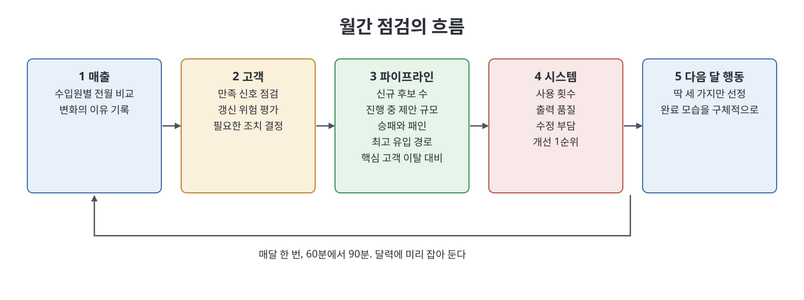

# 부록 H 월간 사업 점검 템플릿 (Appendix H: Monthly Business Review Template)

부록 H는 매달 한 번 60분에서 90분을 들여 사업 상태를 점검하는 템플릿이다. 저자는 월간 점검이 어떤 사업에서든 투자 대비 효과가 가장 큰 의식 중 하나라고 본다. 눈앞의 바쁨이 아닌 선명한 눈으로 사업을 보게 하고, 방향이 표류하지 않게 판단의 리듬을 만들어 주기 때문이다. 요구되는 태도는 낙관이 아닌 정직이다. 잘 안 되는 부분을 인정하는 점검이 실제 변화를 만든다. 이 노트는 템플릿의 표와 질문 문구를 옮기지 않고 구성과 쓰는 법을 다시 정리했다.

> **쉽게 말하면**
> 월간 점검은 가계부 결산과 같다. 돈, 사람, 앞으로 들어올 일, 도구 상태를 훑고, 다음 달에 꼭 할 세 가지만 남긴다.

> **참고(노트 작성자)** 소요 시간과 효과에 관한 설명은 책의 주장이다. 재무 수치를 정리해 세무나 투자 판단에 쓸 때는 전문가 확인이 필요하다.

## 이 부록의 흐름

1. 1부 매출과 재무 점검
2. 2부 고객과 전달 점검
3. 3부 파이프라인과 사업 개발 점검
4. 4부 시스템과 운영 점검
5. 5부 다음 달 우선 행동
6. 점검을 습관으로 만드는 법

## 1. 1부 매출과 재무 점검

수입원별로 지난달과 이번 달 금액, 변화 폭, 변화의 이유를 적고 맨 아래에 합계를 둔다. 핵심은 숫자 자체가 아니라 "왜 변했는가" 칸이다. 예를 들어 재계약이 늘었는지, 단발 프로젝트 하나가 몰렸는지에 따라 같은 증가라도 의미가 다르다. 비교 기준은 전월이므로 계절 요인이 있으면 한 줄 메모를 덧붙인다.

## 2. 2부 고객과 전달 점검

고객별로 현재 상태, 만족의 신호(높음, 중간, 낮음), 갱신 위험, 필요한 조치를 기록한다. 만족과 위험을 따로 적는 이유는 만족해도 예산 문제로 끊기는 일이 있기 때문이다. 이 표는 문제가 터지기 전에 먼저 연락할 대상을 고르는 도구다.

## 3. 3부 파이프라인과 사업 개발 점검

책은 다섯 질문에 정직하게 답하라고 한다. 질문의 주제는 이번 달에 들어온 자격 있는 신규 후보의 수, 진행 중인 제안서의 총 금액, 수주와 실주의 수와 이유, 가장 좋은 유입 경로, 가장 큰 고객이 내일 떠난다면 그 매출을 메우는 데 걸리는 시간이다. 책은 이 답이 어떤 스프레드시트보다 사업 건강을 잘 보여 준다고 말한다. 질문 문구는 옮기지 않았으니, 자기 말로 다시 써 두는 것이 좋다.

## 4. 4부 시스템과 운영 점검

핵심 Claude 시스템별로 월 사용 횟수, 출력 품질, 수정 부담(사람이 얼마나 고쳐야 하는가), 개선 우선순위를 기록한다. 품질과 수정 부담은 높음, 중간, 낮음 세 단계로 적는다. 결과가 좋은 시스템, 늘 많이 고쳐야 하는 시스템, 가장 시급한 개선 하나를 가린다. 부록 A의 CRAFT나 프롬프트 스택으로 어느 층을 손볼지 정하면 된다.

| 상태 | 읽는 법 | 조치 |
|------|--------|------|
| 품질 높음, 수정 낮음 | 안정 | 유지, 기록 |
| 품질 높음, 수정 높음 | 사람이 땜질 중 | 예시 층과 형식 지시 보강 |
| 품질 낮음, 사용 많음 | 위험, 최우선 | 프롬프트 재설계 |
| 사용 적음 | 필요성 재확인 | 폐기 또는 홍보 |

## 5. 5부 다음 달 우선 행동

점검을 마칠 때 다음 달의 우선 행동을 정확히 세 가지만 적는다. 긴 목록이 아니라 완료하면 가장 효과가 큰 세 가지다. 책은 "끝난 모습"을 구체적으로 쓰라고 요구한다. 예를 들어 "제안 프롬프트 개선"이 아니라 제안서 프롬프트에 예시 두 개를 추가해 다섯 건에 시험하고 수정 시간이 줄었는지 기록한다처럼 쓴다.

## 6. 점검을 습관으로 만드는 법

책은 12개월 동안 꾸준히 한 월간 점검이 즉흥적 사고로는 따라올 수 없는 사업 정보의 우위를 만든다고 주장한다. 달이 시작되기 전에 점검 일정을 잡고 그 시간을 지키라는 것이 조언이다.

| 습관 | 요령 |
|------|------|
| 정해진 날 | 매월 같은 요일과 시간으로 일정에 고정한다 |
| 같은 양식 | 지난달과 비교할 수 있게 양식을 바꾸지 않는다 |
| 기록 보존 | 열두 달치를 모아 추세를 본다 |
| 행동 연결 | 점검 결과를 세 가지 행동으로 닫는다 |

## 핵심 정리

- 월간 점검은 매출, 고객, 파이프라인, 시스템, 다음 달 행동의 다섯 부분으로 구성된다.
- 숫자 옆에 변화의 이유를 적어야 해석이 가능하다.
- 파이프라인 점검의 마지막 질문은 핵심 고객 이탈 시 대비 시간으로, 의존도를 드러낸다.
- 시스템은 품질과 수정 부담을 함께 봐야 땜질로 버티는 것을 찾을 수 있다.
- 다음 달 우선 행동은 딱 세 가지이며 끝난 모습을 구체적으로 적는다.

 
 
 

이전: [부록 G 추가 사례집](%EB%B6%80%EB%A1%9D%20G%20%EC%B6%94%EA%B0%80%20%EC%82%AC%EB%A1%80%EC%A7%91.md) | 다음: [부록 I 산출물 샘플과 품질 기준](%EB%B6%80%EB%A1%9D%20I%20%EC%82%B0%EC%B6%9C%EB%AC%BC%20%EC%83%98%ED%94%8C%EA%B3%BC%20%ED%92%88%EC%A7%88%20%EA%B8%B0%EC%A4%80.md)

 

[Claude AI Automation and Monetization](../)
