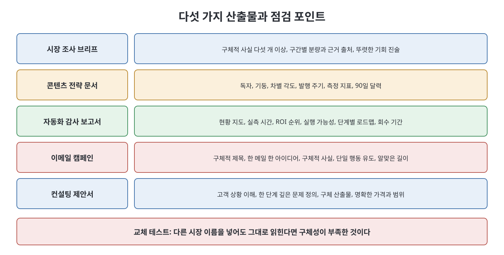

# 부록 I 산출물 샘플과 품질 기준 (Appendix I: Sample Deliverables and Quality Standards)

부록 I는 AI 기반 서비스 사업이 가장 흔히 만드는 다섯 가지 산출물의 구조와 품질 기준, 그리고 좋은 결과와 훌륭한 결과를 가르는 요소를 주석 달린 샘플 구조로 보여 준다. 책은 이 기준을 자기 품질 점검표의 바탕으로 삼고 분야와 고객에 맞게 고쳐 쓰라고 한다. 이 노트는 책의 표를 옮기지 않고, 다섯 산출물을 "구조, 합격선, 흔한 실패"의 같은 틀로 새로 정리했으며 책의 구간별 글자 수나 분량은 대부분 생략했다.

> **쉽게 말하면**
> 좋은 결과물은 읽는 사람이 바로 쓸 수 있을 만큼 구체적이다. AI가 쓴 글은 구체성이 가장 먼저 무너지므로, 기준은 거의 항상 "구체적인가"로 모인다.

> **참고(노트 작성자)** 분량과 횟수 같은 숫자 기준은 책의 제안이며 노트 작성자가 검증하지 않았다. 시장 조사 브리프의 통계와 사실은 반드시 출처를 확인해야 한다.

## 이 부록의 흐름

1. 샘플 1 시장 조사 브리프
2. 샘플 2 콘텐츠 전략 문서
3. 샘플 3 자동화 감사 보고서
4. 샘플 4 이메일 캠페인 시퀀스
5. 샘플 5 컨설팅 제안서
6. 품질 기준을 점검표로 바꾸는 법

## 1. 시장 조사 브리프

구조는 요약, 시장 규모와 성장, 경쟁 구도, 고객 세그먼트 분석, 기회 격차, 권고의 여섯 부분이다. 합격선은 각 부분이 약속한 일을 하는 것이다. 요약은 시장이 무엇이고 누가 이기고 있으며 기회가 무엇인지를 답하고, 시장 규모에는 구체적 수치와 출처가 있어야 한다. 경쟁 구도는 여러 업체를 이름으로 구분해 설명하고, 세그먼트는 서로 다른 집단의 특성을 보여 주며, 기회는 근거 있는 세 가지 이상으로 압축한다. 책이 짚는 대표 실패는 구체성 붕괴(specificity collapse)다. 질문은 선명하게 시작했는데 끝은 어떤 시장에나 해당하는 말로 흐려지는 현상이다. 시험법은 업종 이름을 다른 것으로 바꿔도 글이 그대로 읽힌다면 구체성이 부족하다고 보는 것이다. 책은 다른 시장 브리프에는 나오지 않을 사실, 숫자, 이름이 최소 다섯 개는 있어야 한다고 말한다.

## 2. 콘텐츠 전략 문서

구조는 독자 프로필, 콘텐츠 기둥, 경쟁 차별화, 발행 주기, 측정 틀, 90일 달력이다. 독자 프로필은 일반적인 마케팅 페르소나가 아니라 주제 선택을 안내할 만큼 구체적이어야 한다. 기둥은 독자의 필요와 연결되고 주제는 범주가 아니라 구체적인 글감이어야 한다. 차별화는 "더 좋은 콘텐츠"가 아니라 무엇을 다르게 할지를 말한다. 발행 주기는 실제 자원과 제작 시간에 현실적이어야 하고, 측정은 허영 지표가 아니라 콘텐츠 목표와 연결된 소수의 지표여야 한다. 달력은 당장 제작에 들어갈 수 있을 만큼 구체적이다.

## 3. 자동화 감사 보고서

구조는 현재 상태 지도, 시간 투입 분석, 자동화 기회 순위, 기술 실행 가능성, 구현 로드맵, 투자와 회수 요약이다. 합격선은 방법의 엄밀함에 있다. 시간은 짐작이 아니라 실측이나 검증된 추정이고, ROI(투자 대비 효과)는 실제 인건비와 보수적 효과 추정으로 계산하며, 기술 평가는 고객의 기술 수준에서 실현 가능한 만큼만 솔직히 말한다. 로드맵은 복잡도가 아니라 효과와 실현 가능성 순서로 단계를 매긴다. 투자와 회수 요약의 숫자는 둥글려진 짐작이 아니라 방어할 수 있는 값이어야 한다.

## 4. 이메일 캠페인 시퀀스

| 요소 | 좋은 기준 | 실패 형태 |
|------|----------|----------|
| 제목 | 구체적이고 호기심이나 이익을 준다. 책은 50자 이내를 권한다 | 막연한 회차명, 낚시성 |
| 첫 문장 | "저는"으로 시작하지 않고 독자와 바로 관련된다 | 인사말 상투구 |
| 본문 | 한 메일에 한 아이디어, 문제에서 해결로 흐름 | 서로 안 이어진 여러 주제 |
| 구체성 | 사실, 숫자, 예시 중 최소 하나 | 모든 주장이 일반론 |
| 행동 유도 | 단일하고 행동이 분명한 요청 | 여러 개이거나 "더 알아보기" 같은 모호함 |
| 길이 | 육성 메일은 짧게, 안내 메일은 더 짧게(책의 단어 수 기준) | 너무 길거나 너무 짧음 |

## 5. 컨설팅 제안서

구조는 요약, 문제 정의, 제안 접근법, 산출물, 투자, 선택 이유, 다음 단계다. 요약은 고객이 이해받았다고 느낄 만큼 상황에 특화되어야 한다. 문제 정의는 고객이 말한 것보다 한 단계 더 깊은 필요까지 간다. 접근법은 일반 방법론 틀이 아닌 고객 상황에 맞는 세 단계에서 다섯 단계이고, 산출물은 형식과 일정이 구체적이어서 계약의 바탕이 될 만하다. 투자 절은 가격, 지불 구조, 포함과 제외를 모호함 없이 쓴다. 선택 이유는 "열정"이나 "전문성" 같은 주장 대신 구체적 근거 두세 개이고, 다음 단계는 기한이 있는 하나의 행동이다.

## 6. 품질 기준을 점검표로 바꾸는 법

| 단계 | 하는 일 |
|------|--------|
| 1 | 산출물 종류마다 위 구조에서 "이 부분이 해야 할 일"을 한 문장씩 적는다 |
| 2 | 흔한 실패를 짝으로 적어 "이 부분이 이렇게 읽히면 불합격"으로 바꾼다 |
| 3 | 구체성 시험(다른 업종 이름 바꿔 읽기)을 항상 마지막에 넣는다 |
| 4 | 점검표는 사람이 바뀌어도 같은 결과를 내도록 문서로 둔다 |

이 점검표는 부록 K의 "출시 전 점검"과 부록 H의 시스템 점검에도 이어진다. AI에게 자기 결과를 이 기준으로 먼저 점검하게 한 뒤 사람이 확인하는 이중 구조가 자연스럽다.

## 핵심 정리

- 다섯 산출물은 각각 정해진 구조가 있고, 부분마다 해야 할 일과 실패 형태가 짝지어 있다.
- 가장 흔한 실패는 구체성 붕괴이며 업종 이름 교체 시험으로 잡을 수 있다.
- 자동화 감사와 제안서는 숫자와 범위를 방어할 수 있어야 한다.
- 이메일은 한 메일 한 아이디어, 단일 행동 유도, 구체적 사실이 기본이다.
- 책의 기준을 내 분야의 점검표로 고쳐 쓰는 것이 이 부록의 목적이다.

 
 
 

이전: [부록 H 월간 사업 점검 템플릿](%EB%B6%80%EB%A1%9D%20H%20%EC%9B%94%EA%B0%84%20%EC%82%AC%EC%97%85%20%EC%A0%90%EA%B2%80%20%ED%85%9C%ED%94%8C%EB%A6%BF.md) | 다음: [부록 J 계속 배우기](%EB%B6%80%EB%A1%9D%20J%20%EA%B3%84%EC%86%8D%20%EB%B0%B0%EC%9A%B0%EA%B8%B0.md)

 

[Claude AI Automation and Monetization](../)
