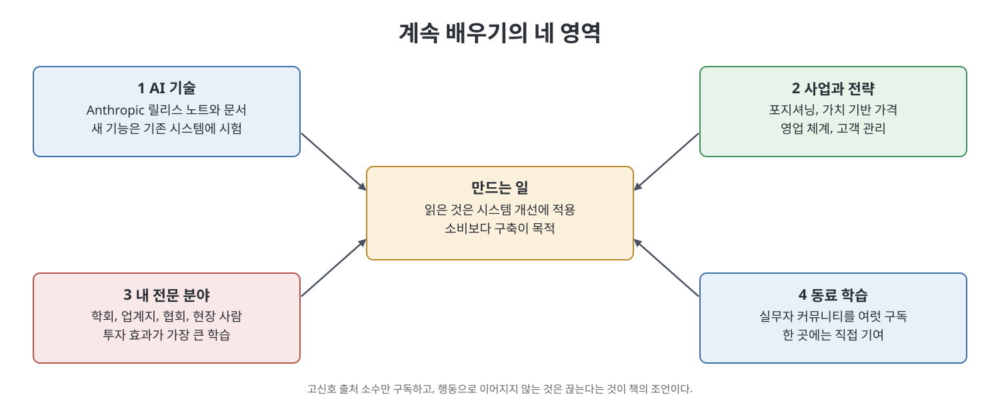

# 부록 J 계속 배우기 (Appendix J: Continuing Education and Learning Resources)

부록 J는 AI 사업을 오래 이어 가려면 거의 모든 분야보다 빠르게 변하는 환경을 따라가야 한다는 문제를 다룬다. 정보량에 짓눌리지 않으면서 깊이를 챙기는 독서와 학습의 틀을 제안하는데, 책은 네 영역을 동시에 꾸준히 학습하라고 권한다. AI 기술 지형, 내 전문 분야, 사업과 전략 규율, 다른 AI 실무자와의 동료 학습이다. 이 노트는 책의 목록을 옮기기보다 영역별로 "무엇을, 어떤 태도로" 배우는지 풀어 다시 정리했다.

> **쉽게 말하면**
> 배움은 사업의 연료이지 사업 자체가 아니다. 많이 읽는 사람이 아니라, 읽은 것을 시스템과 고객 일에 적용하는 사람이 이긴다.

> **참고(노트 작성자)** 책이 추천한 공식 문서 주소와 자료는 책이 쓰인 시점 기준이며, 노트는 구체적 링크 목록을 옮기지 않았다. 최신 자료는 직접 확인해야 한다. 책은 네 영역을 말하지만 세부 항목은 앞의 세 영역이 중심이고 동료 학습은 독립된 절 없이 짧게 언급된다.

## 이 부록의 흐름

1. 영역 1 AI 기술과 Claude
2. 영역 2 사업과 전략
3. 영역 3 내 전문 분야
4. 동료 학습
5. 정보 과부하 다루기
6. 학습 시간표 만들기

## 1. 영역 1 AI 기술과 Claude

Claude의 새 기능은 Anthropic의 릴리스 노트와 공식 문서로 따라간다. 책이 권하는 정기 독서는 Anthropic의 제품 업데이트와 문서, 연구와 기능 소식을 전하는 블로그, 프롬프트 엔지니어들이 발견을 나누는 AI 실무자 커뮤니티다. 커뮤니티는 여러 곳을 팔로우하되 한 곳에는 직접 기여하라고 한다. 새 기능이 나왔을 때의 태도도 중요하다. 새 시스템을 처음부터 짓기 전에, 이미 있는 시스템에 어떻게 도움이 될지 먼저 실험하라는 것이다. 모델이 좋아질 때 가장 큰 이득을 보는 사람은 이미 설계가 잘된 시스템을 업그레이드할 수 있는 사람이다.

## 2. 영역 2 사업과 전략

책은 AI 실무자에게 가장 중요한 사업 기술을 포지셔닝과 차별화, 가격 전략, 고객 관계 관리, 반복 가능한 영업 체계로 꼽는다. 이 분야는 AI 기술만큼 빨리 변하지 않지만 지속 가능한 사업에는 똑같이 중요하다.

| 초점 | 배우는 내용 |
|------|-----------|
| 포지셔닝 | 붐비는 시장에서 내 서비스를 구별하는 법 |
| 가치 기반 가격 | 투입 시간이 아닌 고객의 가치로 값을 매기는 규율 |
| 영업과 사업 개발 | 연락과 콘텐츠로 꾸준한 파이프라인 만들기 |
| 고객 관리 | 유지, 추천, 장기 관계를 만드는 습관 |

## 3. 영역 3 내 전문 분야

고른 틈새가 무엇이든 그 분야의 전문성을 더 깊이 쌓는 것이 수익이 가장 높은 학습 투자라는 것이 책의 주장이다. 분야 지식이 1년 늘 때마다 AI 시스템의 품질, 고객 대화의 신뢰도, 전문성에 붙는 프리미엄이 함께 오른다고 한다. 실천 수단으로는 업계 콘퍼런스, 전문 간행물, 전문가 협회, 내가 섬기는 분야의 실무자들과의 관계, 지금 아는 것의 경계에서 하는 현장 작업이 꼽힌다. 마지막 항목이 가장 많이 배우는 길이라는 점이 눈에 띈다.

## 4. 동료 학습

책은 AI 실무자 커뮤니티를 기술 영역의 독서 항목에서 다루지만, 다른 실무자와의 교류를 네 번째 학습 영역으로 둔다. 읽기만 하는 것보다 내 시스템 이야기를 설명하고 질문을 받는 것이 이해를 키운다. 새 예시로, 같은 업종에서 일하는 사람 두세 명과 한 달에 한 번 각자의 프롬프트 하나를 보여 주고 서로 개선점을 찾는 모임을 만들 수 있다.

## 5. 정보 과부하 다루기

AI 분야는 막대한 양의 콘텐츠를 쏟아내는데 상당수는 저품질이거나 유행 따라가기거나 피상적이다. 책은 선택적 소비의 규율이 능동적 학습의 규율만큼 중요하다고 말한다. 소수의 고신호 출처만 구독하고, 읽고도 행동으로 이어지지 않는 출처는 구독을 끊는다. 가장 좋은 사업을 세우는 사람들은 AI 콘텐츠를 가장 많이 소비하는 사람이 아니라 가장 많이 만들고, 만든 것을 되돌아보고, 배운 것을 적용해 시스템을 개선하는 사람이다. 책은 "학습은 만들기를 위한 수단이지 그 자체로 목적이 아니다"로 이 부록을 맺는다.

## 6. 학습 시간표 만들기

| 주기 | 할 일 | 산출물 |
|------|-------|--------|
| 매주 | 공식 업데이트 훑기, 구독 출처 정리 | 시험해 볼 기능 한두 개 메모 |
| 매월 | 월간 점검(부록 H)에서 시스템 개선 항목 정하기 | 개선한 프롬프트 |
| 분기 | 분야 행사나 협회 모임 참석, 동료 모임 | 새 관계, 새 사례 소재 |

새 예시로, 주 1시간 읽기, 월 1회 실험, 분기 1회 외부 만남처럼 가볍게 정해도 충분하다. 읽은 만큼 만들고 기록하는 것이 핵심이다.

## 핵심 정리

- 학습은 AI 기술, 사업 전략, 내 전문 분야, 동료의 네 영역을 함께 이어 간다.
- 새 기능이 나오면 새로 짓기보다 기존 시스템을 개선하는 실험부터 한다.
- 변하는 속도는 기술이 빠르고 사업 기술은 느리지만 둘 다 필요하다.
- 전문 분야 지식이 가장 수익성 높은 학습 투자라는 것이 책의 주장이다.
- 소수의 좋은 출처만 보고, 행동으로 이어지지 않는 소비는 줄이는 것이 과부하 대처법이다.

 
 
 

이전: [부록 I 산출물 샘플과 품질 기준](%EB%B6%80%EB%A1%9D%20I%20%EC%82%B0%EC%B6%9C%EB%AC%BC%20%EC%83%98%ED%94%8C%EA%B3%BC%20%ED%92%88%EC%A7%88%20%EA%B8%B0%EC%A4%80.md) | 다음: [부록 K 출시 전 점검표](%EB%B6%80%EB%A1%9D%20K%20%EC%B6%9C%EC%8B%9C%20%EC%A0%84%20%EC%A0%90%EA%B2%80%ED%91%9C.md)

 

[Claude AI Automation and Monetization](../)
