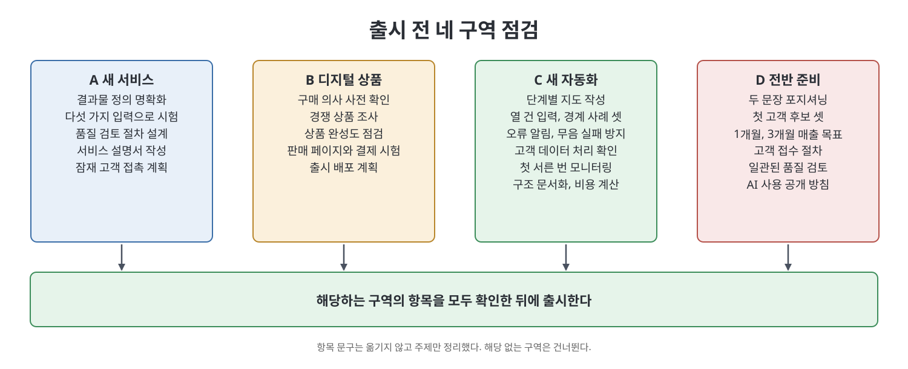

# 부록 K 출시 전 점검표 (Appendix K: Master Pre-Launch Checklist)

부록 K는 새 서비스, 상품, 자동화를 내놓기 전에 확인할 종합 점검표다. 책은 목록의 모든 항목이 실제 사업을 무너뜨린 실패 유형이며, 항목을 확인하는 시간이 그 문제를 고치는 시간보다 짧다고 말한다. 점검표는 네 구역으로 나뉜다. 새 서비스, 새 디지털 상품, 새 자동화, 사업 전반의 출시 준비다. 이 노트는 책의 항목 문장을 옮기지 않고, 구역마다 "무엇을 확인하게 하는가"를 주제로 묶어 다시 썼다. 실제로 쓸 때는 이 주제를 자기 말의 질문으로 바꿔 쓰는 것이 좋다.

> **쉽게 말하면**
> 출시 점검표는 비행 전 점검과 같다. 대부분 이미 아는 항목이지만, 바쁠 때 빠뜨린 한 줄이 사고가 되므로 적어서 하나씩 지운다.

> **참고(노트 작성자)** 항목의 횟수와 기준(시험 입력 수, 모니터링 횟수, 도달 인원 등)은 책의 제안이며 노트 작성자가 검증하지 않았다. 고객 데이터 처리, 결제, AI 사용 공개, 환불과 계약 조건은 법과 세금, 개인정보에 걸린 영역이어서 전문가 확인이 필요하다.

## 이 부록의 흐름

1. 구역 A 새 서비스 출시 전
2. 구역 B 새 디지털 상품 출시 전
3. 구역 C 새 자동화 배포 전
4. 구역 D 사업 전반의 출시 준비
5. 점검표를 쓰는 방법

## 1. 구역 A 새 서비스 출시 전

서비스 점검의 주제는 "결과물을 객관적으로 평가할 수 있게 정의했는가"에서 시작한다. 이어서 그 결과물을 만드는 Claude 시스템을 여러 종류의 입력으로 시험했는지, 출력 품질을 정직하게 검토해 내가 자랑스러워할 수준인지, 모든 결과물을 영원히 내가 직접 검토하지 않아도 되는 품질 검토 절차가 있는지를 묻는다. 서비스 설명서에는 결과물, 가격, 일정, 수정 정책이 들어가야 하고, 구체적인 잠재 고객 후보와 접촉 계획이 있어야 한다. 마지막으로 성공적인 전달의 기준을 고객에게 설명할 수 있어야 한다. 책은 시험 입력을 최소 다섯 종류로 잡는다.

## 2. 구역 B 새 디지털 상품 출시 전

상품 점검은 수요 확인에서 시작한다. 사겠다고 말한 잠재 구매자가 있는지(책은 최소 다섯 명), 비슷한 상품이 있는지, 내 것이 왜 의미 있게 다른지를 조사한다. 그다음은 완성도(내가 돈을 내고 살 수준으로 만들고 검토했는가), 판매 페이지(구체적인 대상, 문제, 약속), 결제와 전달 경로(시험 구매로 끝까지 확인)다. 출시 때는 적어도 수백 명에게 닿을 배포 계획과, 성공의 정의와 평가 시점도 정해 둔다. 책이 제시하는 도달 기준은 관련 있는 사람 200명에서 300명 이상이다.

## 3. 구역 C 새 자동화 배포 전

자동화 점검은 가장 항목이 많다. 모든 단계를 지도로 그려 단계마다 무엇이 일어나는지 문서화한다. 대표 입력 열 건과 그중 경계 사례 세 건으로 시험한다. 소리 없이 실패하지 않도록 오류 처리를 넣고 문제가 생기면 내게 알림이 오게 한다. 자동화가 다루는 고객 데이터가 내가 약속한 개인정보 방침대로 처리되는지 확인한다. 처음 서른 번 실행은 모니터링하며 신뢰할 수 있는지 지켜본다. 구조를 문서로 남겨 나중에 유지하거나 바꿀 수 있게 하고, 월 API 비용을 계산해 예산 안인지 확인한다. 앞서 나온 3층 워크플로의 입력, 처리, 출력 가운데 어느 곳에서 실패해도 알아챌 수 있는지가 요점이다.

## 4. 구역 D 사업 전반의 출시 준비

전반 점검은 개별 시스템이 아니라 사업의 몸통을 본다. 두 문장으로 말하는 포지셔닝, 구체적으로 정한 첫 고객이나 구매자 세 명, 첫 달과 석 달째 매출 목표, 시스템이 필요로 하는 정보를 모두 받는 고객 접수 절차, 시간에 쫓겨도 일관되게 적용할 품질 검토 절차, 첫 고객 일에서 첫 사례를 모으고 공개할 계획, 정직하고 직업 맥락에 알맞은 AI 사용 공개 방식이다. 마지막 항목은 22장의 윤리와 투명성과 맞닿는다.

| 구역 | 확인하는 질문의 성격 | 책이 정한 대표 기준 |
|------|------------------|-------------------|
| A 서비스 | 정의, 시험, 품질, 판매 준비 | 다른 입력 5종 시험 |
| B 상품 | 수요, 경쟁, 완성도, 결제, 배포 | 구매 의사자 5명 확인 |
| C 자동화 | 지도, 시험, 오류, 개인정보, 비용 | 열 건 시험, 첫 30회 감시 |
| D 전반 | 포지셔닝, 고객, 목표, 접수, 공개 | 두 문장 포지셔닝 |

## 5. 점검표를 쓰는 방법

해당하는 구역만 쓴다. 서비스를 내놓으면 A와 D를, 상품을 내놓으면 B와 D를, 자동화를 켜면 C와 D를 본다. 항목마다 증거를 남기는 것이 좋다. 예컨대 "시험했다" 옆에 시험 입력 목록의 위치를 적는다.

| 쓰는 때 | 확인 방법 |
|--------|----------|
| 출시 1주 전 | 전체 점검, 빈 항목을 일정으로 바꾼다 |
| 출시 당일 | 결제와 전달 경로를 마지막으로 시험한다 |
| 출시 후 첫 달 | 모니터링 결과와 첫 피드백을 점검표에 기록한다 |

점검표는 한 번 쓰고 끝내지 말고 사업이 커지면서 새 실패 유형을 항목으로 더해 간다. 부록 I의 품질 기준과 부록 H의 월간 점검에 이어 쓰면 한 사이클이 닫힌다.

## 핵심 정리

- 점검표는 서비스, 상품, 자동화, 사업 전반의 네 구역이며 상황에 맞는 구역만 쓴다.
- 서비스는 여러 입력으로 시험하고 품질 검토를 나에게만 의존하지 않게 만든다.
- 상품은 사겠다는 사람의 확인과 시험 구매, 충분한 배포 계획이 핵심이다.
- 자동화는 오류 알림, 개인정보 확인, 처음 서른 번의 감시, 구조 문서화를 요구한다.
- 전반 준비에는 포지셔닝, 첫 고객, 매출 목표, 접수 절차, 사례 계획, AI 사용 공개 방침이 들어간다.

 
 
 

이전: [부록 J 계속 배우기](%EB%B6%80%EB%A1%9D%20J%20%EA%B3%84%EC%86%8D%20%EB%B0%B0%EC%9A%B0%EA%B8%B0.md)

 

[Claude AI Automation and Monetization](../)
