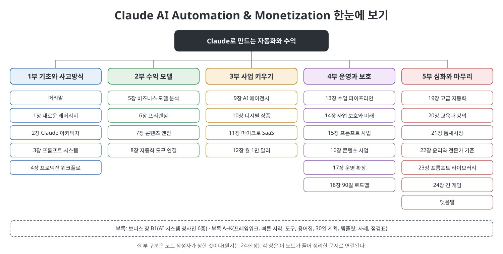

# **Claude AI Automation & Monetization 학습 노트**
(Claude AI Automation & Monetization: Build AI-Powered Systems, Automate Workflows, and Generate Real Income Using Claude AI, 장별 정리 노트)
 

이 문서는 Eslam Wahba의 『Claude AI Automation & Monetization』(2판)을 장별로 정리한 한국어 학습 노트입니다. 원문을 번역한 것이 아니라 내용을 우리말로 풀어서 다시 설명했고, 처음 나오는 용어에는 쉬운 풀이와 영어 병기를 붙였습니다. 책은 Claude를 단순한 채팅 도구가 아니라 하나의 시스템으로 설계하는 관점에서 출발해, 프롬프트 시스템과 자동화 워크플로를 만들고 이를 프리랜싱, 콘텐츠, 에이전시, 디지털 상품, 마이크로 SaaS 같은 수익 모델로 연결하는 방법을 24개 장과 보너스 장, 부록 A~K로 다룹니다. 이 노트는 5개 부와 부록으로 묶어 같은 순서를 따르며, 장마다 개념도와 표를 직접 만들어 넣었습니다.

> **이 노트를 읽을 때 유의할 점**
> - 이 노트는 원서의 **요약·해설본**이며 원서를 대신하지 않습니다. 정확한 내용은 원서에서 확인하세요.
> - 책의 수익, 가격, 성공 사례, 소요 시간 같은 숫자는 **책의 주장이며 이 노트가 검증하지 않았습니다.** 구체적인 금액과 가격표는 구조만 정리하고 대부분 뺐습니다. 수익은 보장되지 않으며 결과는 개인과 시장에 따라 크게 다릅니다.
> - 책이 소개하는 도구, 요금제, 기능, 모델 이름은 책이 쓰인 시점의 서술이라 지금과 다를 수 있습니다.
> - 법, 세금, 계약, 개인정보, 광고 관련 내용은 책의 서술을 정리한 것일 뿐 법률 조언이 아닙니다. 실제 사업에서는 전문가 확인이 필요합니다.
> - 책의 프롬프트와 템플릿 본문은 옮기지 않았습니다. 용도와 구성만 정리하고, 필요한 곳에는 새로 쓴 짧은 예시를 넣었습니다.
> - 5부의 구분은 읽기 편하도록 노트 작성자가 묶은 것이며, 원서는 장으로만 구성됩니다. 책 본문이 안내하는 장 번호와 이 노트의 장 번호가 어긋나는 곳이 있어(예: 5장의 안내) 그 부분은 장 번호를 못 박지 않았습니다.
 

---

## 목차

- [1부 기초와 사고방식 (머리말, 1~4장)](01.%201%EB%B6%80%20%EA%B8%B0%EC%B4%88%EC%99%80%20%EC%82%AC%EA%B3%A0%EB%B0%A9%EC%8B%9D/Readme.md)
  - [머리말](01.%201%EB%B6%80%20%EA%B8%B0%EC%B4%88%EC%99%80%20%EC%82%AC%EA%B3%A0%EB%B0%A9%EC%8B%9D/%EB%A8%B8%EB%A6%AC%EB%A7%90.md)
  - [1장 새로운 레버리지: 인지 자본과 AI 승수](01.%201%EB%B6%80%20%EA%B8%B0%EC%B4%88%EC%99%80%20%EC%82%AC%EA%B3%A0%EB%B0%A9%EC%8B%9D/01%EC%9E%A5%20%EC%83%88%EB%A1%9C%EC%9A%B4%20%EB%A0%88%EB%B2%84%EB%A6%AC%EC%A7%80%20%EC%9D%B8%EC%A7%80%20%EC%9E%90%EB%B3%B8%EA%B3%BC%20AI%20%EC%8A%B9%EC%88%98.md)
  - [2장 시스템 아키텍처로서의 Claude 이해](01.%201%EB%B6%80%20%EA%B8%B0%EC%B4%88%EC%99%80%20%EC%82%AC%EA%B3%A0%EB%B0%A9%EC%8B%9D/02%EC%9E%A5%20%EC%8B%9C%EC%8A%A4%ED%85%9C%20%EC%95%84%ED%82%A4%ED%85%8D%EC%B2%98%EB%A1%9C%EC%84%9C%EC%9D%98%20Claude%20%EC%9D%B4%ED%95%B4.md)
  - [3장 고급 프롬프트 시스템 설계](01.%201%EB%B6%80%20%EA%B8%B0%EC%B4%88%EC%99%80%20%EC%82%AC%EA%B3%A0%EB%B0%A9%EC%8B%9D/03%EC%9E%A5%20%EA%B3%A0%EA%B8%89%20%ED%94%84%EB%A1%AC%ED%94%84%ED%8A%B8%20%EC%8B%9C%EC%8A%A4%ED%85%9C%20%EC%84%A4%EA%B3%84.md)
  - [4장 프로덕션에서 버티는 AI 워크플로 설계](01.%201%EB%B6%80%20%EA%B8%B0%EC%B4%88%EC%99%80%20%EC%82%AC%EA%B3%A0%EB%B0%A9%EC%8B%9D/04%EC%9E%A5%20%ED%94%84%EB%A1%9C%EB%8D%95%EC%85%98%EC%97%90%EC%84%9C%20%EB%B2%84%ED%8B%B0%EB%8A%94%20AI%20%EC%9B%8C%ED%81%AC%ED%94%8C%EB%A1%9C%20%EC%84%A4%EA%B3%84.md)
  - [핵심 정리](01.%201%EB%B6%80%20%EA%B8%B0%EC%B4%88%EC%99%80%20%EC%82%AC%EA%B3%A0%EB%B0%A9%EC%8B%9D/%ED%95%B5%EC%8B%AC%20%EC%A0%95%EB%A6%AC.md)
- [2부 수익 모델 (5~8장)](02.%202%EB%B6%80%20%EC%88%98%EC%9D%B5%20%EB%AA%A8%EB%8D%B8/Readme.md)
  - [5장 AI 비즈니스 모델 전체 분석](02.%202%EB%B6%80%20%EC%88%98%EC%9D%B5%20%EB%AA%A8%EB%8D%B8/05%EC%9E%A5%20AI%20%EB%B9%84%EC%A6%88%EB%8B%88%EC%8A%A4%20%EB%AA%A8%EB%8D%B8%20%EC%A0%84%EC%B2%B4%20%EB%B6%84%EC%84%9D.md)
  - [6장 Claude로 프리랜싱하기](02.%202%EB%B6%80%20%EC%88%98%EC%9D%B5%20%EB%AA%A8%EB%8D%B8/06%EC%9E%A5%20Claude%EB%A1%9C%20%ED%94%84%EB%A6%AC%EB%9E%9C%EC%8B%B1%ED%95%98%EA%B8%B0.md)
  - [7장 콘텐츠 엔진](02.%202%EB%B6%80%20%EC%88%98%EC%9D%B5%20%EB%AA%A8%EB%8D%B8/07%EC%9E%A5%20%EC%BD%98%ED%85%90%EC%B8%A0%20%EC%97%94%EC%A7%84.md)
  - [8장 Claude와 자동화 도구 연결](02.%202%EB%B6%80%20%EC%88%98%EC%9D%B5%20%EB%AA%A8%EB%8D%B8/08%EC%9E%A5%20Claude%EC%99%80%20%EC%9E%90%EB%8F%99%ED%99%94%20%EB%8F%84%EA%B5%AC%20%EC%97%B0%EA%B2%B0.md)
  - [핵심 정리](02.%202%EB%B6%80%20%EC%88%98%EC%9D%B5%20%EB%AA%A8%EB%8D%B8/%ED%95%B5%EC%8B%AC%20%EC%A0%95%EB%A6%AC.md)
- [3부 사업 키우기 (9~12장)](03.%203%EB%B6%80%20%EC%82%AC%EC%97%85%20%ED%82%A4%EC%9A%B0%EA%B8%B0/Readme.md)
  - [9장 AI 에이전시](03.%203%EB%B6%80%20%EC%82%AC%EC%97%85%20%ED%82%A4%EC%9A%B0%EA%B8%B0/09%EC%9E%A5%20AI%20%EC%97%90%EC%9D%B4%EC%A0%84%EC%8B%9C.md)
  - [10장 디지털 상품과 수동 소득](03.%203%EB%B6%80%20%EC%82%AC%EC%97%85%20%ED%82%A4%EC%9A%B0%EA%B8%B0/10%EC%9E%A5%20%EB%94%94%EC%A7%80%ED%84%B8%20%EC%83%81%ED%92%88%EA%B3%BC%20%EC%88%98%EB%8F%99%20%EC%86%8C%EB%93%9D.md)
  - [11장 마이크로 SaaS](03.%203%EB%B6%80%20%EC%82%AC%EC%97%85%20%ED%82%A4%EC%9A%B0%EA%B8%B0/11%EC%9E%A5%20%EB%A7%88%EC%9D%B4%ED%81%AC%EB%A1%9C%20SaaS.md)
  - [12장 월 1만 달러로 키우기](03.%203%EB%B6%80%20%EC%82%AC%EC%97%85%20%ED%82%A4%EC%9A%B0%EA%B8%B0/12%EC%9E%A5%20%EC%9B%94%201%EB%A7%8C%20%EB%8B%AC%EB%9F%AC%EB%A1%9C%20%ED%82%A4%EC%9A%B0%EA%B8%B0.md)
  - [핵심 정리](03.%203%EB%B6%80%20%EC%82%AC%EC%97%85%20%ED%82%A4%EC%9A%B0%EA%B8%B0/%ED%95%B5%EC%8B%AC%20%EC%A0%95%EB%A6%AC.md)
- [4부 운영과 보호 (13~18장)](04.%204%EB%B6%80%20%EC%9A%B4%EC%98%81%EA%B3%BC%20%EB%B3%B4%ED%98%B8/Readme.md)
  - [13장 반복 가능한 수입 파이프라인](04.%204%EB%B6%80%20%EC%9A%B4%EC%98%81%EA%B3%BC%20%EB%B3%B4%ED%98%B8/13%EC%9E%A5%20%EB%B0%98%EB%B3%B5%20%EA%B0%80%EB%8A%A5%ED%95%9C%20%EC%88%98%EC%9E%85%20%ED%8C%8C%EC%9D%B4%ED%94%84%EB%9D%BC%EC%9D%B8.md)
  - [14장 AI 사업을 지키고 키우고 미래에 대비하기](04.%204%EB%B6%80%20%EC%9A%B4%EC%98%81%EA%B3%BC%20%EB%B3%B4%ED%98%B8/14%EC%9E%A5%20AI%20%EC%82%AC%EC%97%85%EC%9D%84%20%EC%A7%80%ED%82%A4%EA%B3%A0%20%ED%82%A4%EC%9A%B0%EA%B3%A0%20%EB%AF%B8%EB%9E%98%EC%97%90%20%EB%8C%80%EB%B9%84%ED%95%98%EA%B8%B0.md)
  - [15장 프롬프트 엔지니어링 사업](04.%204%EB%B6%80%20%EC%9A%B4%EC%98%81%EA%B3%BC%20%EB%B3%B4%ED%98%B8/15%EC%9E%A5%20%ED%94%84%EB%A1%AC%ED%94%84%ED%8A%B8%20%EC%97%94%EC%A7%80%EB%8B%88%EC%96%B4%EB%A7%81%20%EC%82%AC%EC%97%85.md)
  - [16장 AI 콘텐츠 사업](04.%204%EB%B6%80%20%EC%9A%B4%EC%98%81%EA%B3%BC%20%EB%B3%B4%ED%98%B8/16%EC%9E%A5%20AI%20%EC%BD%98%ED%85%90%EC%B8%A0%20%EC%82%AC%EC%97%85.md)
  - [17장 운영 확장: 시스템이 무리한 노력보다 낫다](04.%204%EB%B6%80%20%EC%9A%B4%EC%98%81%EA%B3%BC%20%EB%B3%B4%ED%98%B8/17%EC%9E%A5%20%EC%9A%B4%EC%98%81%20%ED%99%95%EC%9E%A5%20%EC%8B%9C%EC%8A%A4%ED%85%9C%EC%9D%B4%20%EB%AC%B4%EB%A6%AC%ED%95%9C%20%EB%85%B8%EB%A0%A5%EB%B3%B4%EB%8B%A4%20%EB%82%AB%EB%8B%A4.md)
  - [18장 90일 실행 로드맵](04.%204%EB%B6%80%20%EC%9A%B4%EC%98%81%EA%B3%BC%20%EB%B3%B4%ED%98%B8/18%EC%9E%A5%2090%EC%9D%BC%20%EC%8B%A4%ED%96%89%20%EB%A1%9C%EB%93%9C%EB%A7%B5.md)
  - [핵심 정리](04.%204%EB%B6%80%20%EC%9A%B4%EC%98%81%EA%B3%BC%20%EB%B3%B4%ED%98%B8/%ED%95%B5%EC%8B%AC%20%EC%A0%95%EB%A6%AC.md)
- [5부 심화와 마무리 (19~24장, 맺음말)](05.%205%EB%B6%80%20%EC%8B%AC%ED%99%94%EC%99%80%20%EB%A7%88%EB%AC%B4%EB%A6%AC/Readme.md)
  - [19장 고급 자동화: n8n, API 체인, 커스텀 연동](05.%205%EB%B6%80%20%EC%8B%AC%ED%99%94%EC%99%80%20%EB%A7%88%EB%AC%B4%EB%A6%AC/19%EC%9E%A5%20%EA%B3%A0%EA%B8%89%20%EC%9E%90%EB%8F%99%ED%99%94%28n8n%2C%20API%20%EC%B2%B4%EC%9D%B8%2C%20%EC%BB%A4%EC%8A%A4%ED%85%80%20%EC%97%B0%EB%8F%99%29.md)
  - [20장 교육과 강의](05.%205%EB%B6%80%20%EC%8B%AC%ED%99%94%EC%99%80%20%EB%A7%88%EB%AC%B4%EB%A6%AC/20%EC%9E%A5%20%EA%B5%90%EC%9C%A1%EA%B3%BC%20%EA%B0%95%EC%9D%98.md)
  - [21장 틈새시장 심층 분석](05.%205%EB%B6%80%20%EC%8B%AC%ED%99%94%EC%99%80%20%EB%A7%88%EB%AC%B4%EB%A6%AC/21%EC%9E%A5%20%ED%8B%88%EC%83%88%EC%8B%9C%EC%9E%A5%20%EC%8B%AC%EC%B8%B5%20%EB%B6%84%EC%84%9D.md)
  - [22장 윤리·투명성·전문가 기준](05.%205%EB%B6%80%20%EC%8B%AC%ED%99%94%EC%99%80%20%EB%A7%88%EB%AC%B4%EB%A6%AC/22%EC%9E%A5%20%EC%9C%A4%EB%A6%AC%C2%B7%ED%88%AC%EB%AA%85%EC%84%B1%C2%B7%EC%A0%84%EB%AC%B8%EA%B0%80%20%EA%B8%B0%EC%A4%80.md)
  - [23장 실전 프롬프트 라이브러리](05.%205%EB%B6%80%20%EC%8B%AC%ED%99%94%EC%99%80%20%EB%A7%88%EB%AC%B4%EB%A6%AC/23%EC%9E%A5%20%EC%8B%A4%EC%A0%84%20%ED%94%84%EB%A1%AC%ED%94%84%ED%8A%B8%20%EB%9D%BC%EC%9D%B4%EB%B8%8C%EB%9F%AC%EB%A6%AC.md)
  - [24장 긴 게임: 복리 가치 쌓기](05.%205%EB%B6%80%20%EC%8B%AC%ED%99%94%EC%99%80%20%EB%A7%88%EB%AC%B4%EB%A6%AC/24%EC%9E%A5%20%EA%B8%B4%20%EA%B2%8C%EC%9E%84%20%EB%B3%B5%EB%A6%AC%20%EA%B0%80%EC%B9%98%20%EC%8C%93%EA%B8%B0.md)
  - [맺음말](05.%205%EB%B6%80%20%EC%8B%AC%ED%99%94%EC%99%80%20%EB%A7%88%EB%AC%B4%EB%A6%AC/%EB%A7%BA%EC%9D%8C%EB%A7%90.md)
  - [핵심 정리](05.%205%EB%B6%80%20%EC%8B%AC%ED%99%94%EC%99%80%20%EB%A7%88%EB%AC%B4%EB%A6%AC/%ED%95%B5%EC%8B%AC%20%EC%A0%95%EB%A6%AC.md)
- [부록 (보너스 장 B1, 부록 A~K)](06.%20%EB%B6%80%EB%A1%9D/Readme.md)
  - [보너스 장 B1 여섯 가지 AI 시스템 청사진](06.%20%EB%B6%80%EB%A1%9D/%EB%B3%B4%EB%84%88%EC%8A%A4%20%EC%9E%A5%20B1%20%EC%97%AC%EC%84%AF%20%EA%B0%80%EC%A7%80%20AI%20%EC%8B%9C%EC%8A%A4%ED%85%9C%20%EC%B2%AD%EC%82%AC%EC%A7%84.md)
  - [부록 A 프레임워크와 모델 참조](06.%20%EB%B6%80%EB%A1%9D/%EB%B6%80%EB%A1%9D%20A%20%ED%94%84%EB%A0%88%EC%9E%84%EC%9B%8C%ED%81%AC%EC%99%80%20%EB%AA%A8%EB%8D%B8%20%EC%B0%B8%EC%A1%B0.md)
  - [부록 B 수익 모델별 빠른 시작](06.%20%EB%B6%80%EB%A1%9D/%EB%B6%80%EB%A1%9D%20B%20%EC%88%98%EC%9D%B5%20%EB%AA%A8%EB%8D%B8%EB%B3%84%20%EB%B9%A0%EB%A5%B8%20%EC%8B%9C%EC%9E%91.md)
  - [부록 C 도구와 기술 참조](06.%20%EB%B6%80%EB%A1%9D/%EB%B6%80%EB%A1%9D%20C%20%EB%8F%84%EA%B5%AC%EC%99%80%20%EA%B8%B0%EC%88%A0%20%EC%B0%B8%EC%A1%B0.md)
  - [부록 D 용어집](06.%20%EB%B6%80%EB%A1%9D/%EB%B6%80%EB%A1%9D%20D%20%EC%9A%A9%EC%96%B4%EC%A7%91.md)
  - [부록 E 30일 스프린트 계획](06.%20%EB%B6%80%EB%A1%9D/%EB%B6%80%EB%A1%9D%20E%2030%EC%9D%BC%20%EC%8A%A4%ED%94%84%EB%A6%B0%ED%8A%B8%20%EA%B3%84%ED%9A%8D.md)
  - [부록 F 사업 계획서 템플릿](06.%20%EB%B6%80%EB%A1%9D/%EB%B6%80%EB%A1%9D%20F%20%EC%82%AC%EC%97%85%20%EA%B3%84%ED%9A%8D%EC%84%9C%20%ED%85%9C%ED%94%8C%EB%A6%BF.md)
  - [부록 G 추가 사례집](06.%20%EB%B6%80%EB%A1%9D/%EB%B6%80%EB%A1%9D%20G%20%EC%B6%94%EA%B0%80%20%EC%82%AC%EB%A1%80%EC%A7%91.md)
  - [부록 H 월간 사업 점검 템플릿](06.%20%EB%B6%80%EB%A1%9D/%EB%B6%80%EB%A1%9D%20H%20%EC%9B%94%EA%B0%84%20%EC%82%AC%EC%97%85%20%EC%A0%90%EA%B2%80%20%ED%85%9C%ED%94%8C%EB%A6%BF.md)
  - [부록 I 산출물 샘플과 품질 기준](06.%20%EB%B6%80%EB%A1%9D/%EB%B6%80%EB%A1%9D%20I%20%EC%82%B0%EC%B6%9C%EB%AC%BC%20%EC%83%98%ED%94%8C%EA%B3%BC%20%ED%92%88%EC%A7%88%20%EA%B8%B0%EC%A4%80.md)
  - [부록 J 계속 배우기](06.%20%EB%B6%80%EB%A1%9D/%EB%B6%80%EB%A1%9D%20J%20%EA%B3%84%EC%86%8D%20%EB%B0%B0%EC%9A%B0%EA%B8%B0.md)
  - [부록 K 출시 전 점검표](06.%20%EB%B6%80%EB%A1%9D/%EB%B6%80%EB%A1%9D%20K%20%EC%B6%9C%EC%8B%9C%20%EC%A0%84%20%EC%A0%90%EA%B2%80%ED%91%9C.md)

---

## 읽는 순서 제안

| 목적 | 추천 경로 |
|------|-----------|
| Claude를 시스템으로 보는 관점과 프롬프트·워크플로 설계를 익히고 싶다 | 1부 (머리말, 1~4장) |
| 어떤 수익 모델이 있고 어디서 시작할지 알고 싶다 | 2부 (5~8장) |
| 에이전시, 디지털 상품, 마이크로 SaaS로 키우는 방법을 알고 싶다 | 3부 (9~12장) |
| 운영, 위험 관리, 90일 실행 계획을 세우고 싶다 | 4부 (13~18장) |
| 고급 자동화, 교육, 윤리, 프롬프트 라이브러리를 알고 싶다 | 5부 (19~24장, 맺음말) |
| 청사진, 템플릿, 용어집, 점검표를 빠르게 찾고 싶다 | 부록 (B1, A~K) |

## 용어 몇 가지

| 용어 | 쉬운 설명 |
|------|-----------|
| 프롬프트 시스템 (prompt system) | 프롬프트 하나가 아니라 역할, 맥락, 형식, 검증을 층층이 쌓아 반복해서 쓰는 구조 |
| 워크플로 (workflow) | 입력에서 결과까지 정해진 단계로 일이 흘러가는 순서 |
| 에이전시 (agency) | 여러 고객에게 서비스를 제공하는 사업 형태 |
| 마이크로 SaaS (micro SaaS) | 아주 좁은 문제 하나를 푸는 작은 구독형 소프트웨어 |
| 수동 소득 (passive income) | 만들어 둔 상품이 계속 팔려 들어오는 수입. 관리 노력은 여전히 필요 |
| 파이프라인 (pipeline) | 일정한 결과물을 안정적으로 만들어 내는 반복 구조 |

---

## 이 노트에 대하여

- 각 장 문서는 개요, 흐름, 본문 정리, 표, 그림, 핵심 정리, 이전·다음 링크 순서로 구성됩니다.
- 그림은 모두 이 노트용으로 새로 그린 SVG이며 책의 그림을 쓰지 않았습니다.
- 같은 저장소의 다른 학습 노트와 같은 형식을 따릅니다.

