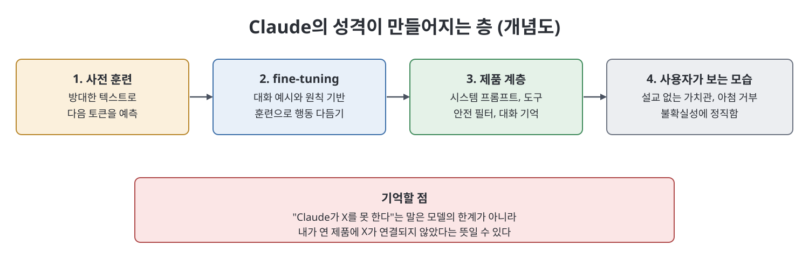

# 1장 양심을 가진 기계 (The Machine With a Conscience)

이 장은 Claude를 "누르면 정해진 일이 일어나는 버튼"이 아니라 "자기 판단 기준을 가진 동료"로 이해하게 만드는 장이다. 책은 Claude의 특징적인 행동이 거의 모두 Anthropic이라는 회사가 내린 한 가지 결정, 곧 어떤 지능을 만들 것인가에 대한 선택에서 나온다고 본다. 그래서 회사의 성격, 훈련 방식인 Constitutional AI, Claude가 다른 챗봇과 다르게 느껴지는 이유, 그리고 책 전체에서 쓰는 기본 용어를 차례로 정리한다.

> **쉽게 말하면**
> Claude는 시키는 대로만 하는 자판기가 아니라, 틀렸다고 생각하면 말해 주는 동료에 가깝다. 그 성격이 어디서 왔는지 알면 이후 모든 장이 쉬워진다.

> **참고(노트 작성자)** 이 장의 회사 설립 연도, 인물, 제품 이름과 상태(베타, 리서치 프리뷰 등)는 책이 서술한 시점(2026년 판) 기준이며 노트가 따로 검증하지 않았다. 바뀔 수 있다.

## 이 장의 흐름

1. Anthropic과 공익법인 구조
2. Constitutional AI
3. LLM과 제품 계층의 구분
4. Claude가 다르게 느껴지는 세 가지 특성
5. 제품 지도와 핵심 용어 아홉 가지

## 1. Anthropic과 회사 구조

책에 따르면 Anthropic은 2021년에 다른 대형 AI 연구소에서 나온 연구자들이 세웠고, Dario Amodei가 연구와 CEO를, Daniela Amodei가 운영과 사장을 맡는다. 책이 설명하는 회사의 논지는 강력한 AI는 어차피 올 것이고 위험도 실재하니, 직접 만들면서 책임 있는 기준을 세우겠다는 것이다.

핵심은 회사가 Public Benefit Corporation(공익법인)이라는 점이다. 책은 일반 기업의 이사진이 주주 이익 극대화 의무를 지는 데 비해, 공익법인은 이익과 함께 명시한 공익 목표를 고려할 수 있고 그래야 한다고 설명한다. 책이 밝힌 Anthropic의 목표는 인류가 변혁적 AI로의 전환을 안전하게 넘기도록 하는 것이다. 책은 이 구조가 Claude가 해로운 요청을 거절하고, "확실하지 않다"고 말하는 행동의 배경이라고 해석한다.

## 2. Constitutional AI

기존의 주된 방식은 사람 평가자가 두 응답 중 더 나은 것을 고르게 하는 RLHF(사람 피드백 기반 강화학습)다. 책은 이 방식이 평가자를 기쁘게 하는 쪽으로 모델을 키워 아첨 성향을 낳을 수 있다고 지적한다.

Constitutional AI는 모델에게 글로 쓴 원칙 목록(constitution)을 주고, 모델이 자기 출력을 그 원칙에 비추어 비판하고 고치게 하는 훈련을 일부 섞는 방식이다. 책은 "좋아/나빠"라는 신호만으로 아이를 키우는 것과, 원칙 목록을 주고 행동 전에 스스로 대조하게 하는 것에 비유한다. 결과적으로 행동이 더 일관되고 조정하기 쉬우며, 듣기 좋은 말만 하는 경향이 줄어든다는 것이 책의 주장이다. 다만 책은 완벽한 모델이 되는 것은 아니라고 선을 긋는다. 여전히 틀릴 수 있고, 틀린 내용을 자신 있게 말할 수도 있다.

> **TRAP 정리** 거절을 당했을 때는 모델이 나를 판단한다고 여기지 말고, 정당한 목적을 구체적으로 밝혀 다시 요청하라는 것이 책의 조언이다. 모델은 의도를 보고 추론한다.

## 3. LLM과 제품 계층

Claude는 대규모 언어 모델(LLM)을 제품으로 감싼 것이다. 모델의 핵심 동작은 앞의 텍스트를 보고 다음 조각을 예측하는 일을 반복하는 것이며, 구조는 transformer라는 신경망이다. 갓 훈련된 원시 모델은 대화 상대가 아니라 글을 이어 쓰는 기계이므로, 도움이 되고 예의 바른 대화 예시로 다시 훈련하는 `fine-tuning`을 거친다. 책은 이것을 도서관과 사서의 차이로 비유한다.

그 위에 제품 계층이 얹힌다. 시스템 프롬프트, 웹 검색이나 코드 실행 같은 도구, 안전 필터, 대화 기억, 사용자 지침, 화면(인터페이스)이다. 그래서 "Claude가 X를 못 한다"는 불만은 종종 "내가 연 제품에 X가 아직 연결되지 않았다"는 뜻이라고 책은 말한다.

## 4. Claude가 다르게 느껴지는 이유

| 특성 | 내용 | 책의 비유 |
|------|------|----------|
| 설교하지 않는 가치관 | 어려운 주제도 다루되 부당한 쪽으로 밀리지 않고 훈계도 하지 않음 | 편안한 손님 |
| 아첨하지 않음 | 계획의 강점과 함께 약점도 짚음 | 예스맨 대신 좋은 편집자 |
| 불확실성에 정직함 | "모르겠다", "확인해 보라"고 말함 | 신뢰도를 신호로 주는 도구 |

책은 사례로 물류 회사 이야기를 든다. 기사의 법정 휴식 시간을 어기는 일정표를 자신 있게 내놓던 도구 대신 Claude를 쓰자, 준수 여부를 보장할 수 없다고 말해 오히려 더 믿게 되었다는 것이다. 또 책은 Anthropic이 말하는 "race to the top"(안전을 겨루어 업계 수준을 끌어올리는 경쟁)을 소개하고, 실용적 이점으로 환각 감소 노력, 공개된 정책, 광고 없는 제품을 꼽는다. 그래도 중요한 결과는 직접 검증하고 사람이 최종 판단하라고 덧붙인다.

## 5. 제품 지도와 용어

책은 제품이 하나가 아니라 같은 모델 위의 여러 "문"이라고 소개한다.

| 제품·구성요소 | 책의 설명 |
|--------------|----------|
| claude.ai 웹·데스크톱·모바일 앱 | 대화형 기본 제품 |
| Cowork | 길고 복잡한 일을 맡기는 데스크톱 도구(리서치 프리뷰) |
| Claude Code | 코드베이스 안에서 일하는 명령줄 에이전트 코딩 도구 |
| Claude in Chrome / Excel | 브라우저·스프레드시트용 에이전트(베타) |
| API, Agent SDK, Skills, Plugins, MCP | 직접 시스템을 만드는 사람을 위한 구성 요소 |

용어 아홉 가지는 아래와 같다.

| 용어 | 쉬운 설명 |
|------|-----------|
| token | 모델이 읽고 쓰는 단위. 책은 영어 단어의 약 4분의 3이라는 경험칙을 든다 |
| context window | 모델이 한 번에 다룰 수 있는 총 텍스트(입력과 출력 합) |
| parameter | 훈련으로 조정되는 내부 수치. 개수는 능력의 거친 지표일 뿐 |
| hallucination | 그럴듯하지만 거짓인 내용을 생성하는 것 |
| fine-tuning | 일반 훈련 뒤 특정 행동·분야용으로 더 다듬는 훈련 |
| RLHF | 사람 선호로 모델을 조정하는 기법 |
| inference | 훈련이 아니라 실제로 답을 만드는 실행 단계 |
| multimodal | 텍스트 외에 이미지 등도 다루는 능력 |
| agent | 목표를 받아 계획하고 도구를 쓰며 결과를 보고 고쳐 가며 끝까지 수행하는 시스템 |

## 핵심 정리

- Anthropic은 안전을 앞세운 공익법인이며, 이 구조가 Claude의 신중한 행동 배경이라고 책은 본다.
- Constitutional AI는 글로 쓴 원칙에 비추어 모델이 스스로 비판하고 고치게 하는 훈련으로, 일관성과 아첨 저항에 기여한다.
- Claude는 다음 토큰을 예측하는 LLM에 시스템 프롬프트, 도구, 안전 장치가 덧붙은 제품이며 모델과 제품은 구분해야 한다.
- 설교하지 않는 가치관, 아첨 거부, 불확실성에 대한 정직함이 Claude의 개성이다.
- 책의 조언은 환각이 피해를 주지 못하도록 작업 흐름을 설계하고, 중요한 결과는 직접 검증하라는 것이다.

 
 
 

이전: [1부 Readme](Readme.md) | 다음: [2장 Opus·Sonnet·Haiku 모델 가족](02%EC%9E%A5%20Opus%C2%B7Sonnet%C2%B7Haiku%20%EB%AA%A8%EB%8D%B8%20%EA%B0%80%EC%A1%B1.md)

 

[Claude AI Bible](../)
