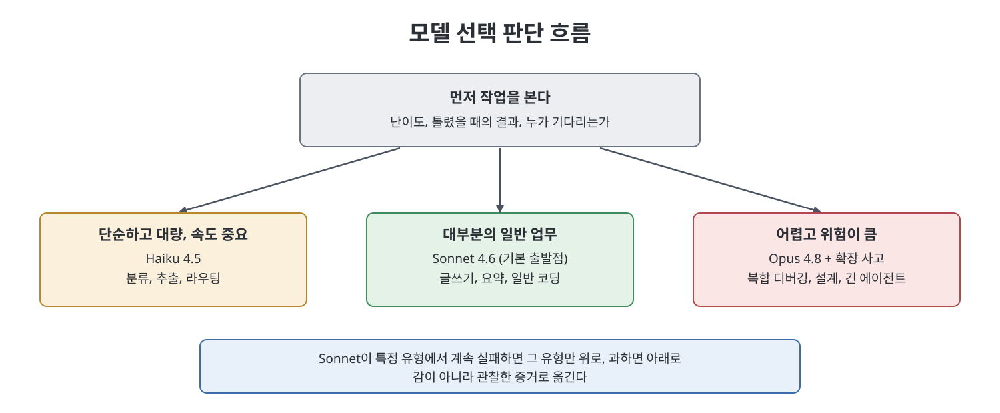

# 2장 Opus·Sonnet·Haiku 모델 가족 (Meet the Family)

이 장은 Anthropic이 모델을 하나가 아니라 성격이 다른 세 가지로 내놓는 이유와, 작업마다 어떤 모델을 고를지를 다룬다. 책은 많은 사람이 가장 강력한 모델 하나로 모든 일을 처리하며 비용과 시간을 낭비한다고 지적한다. 그래서 세 모델의 역할, 컨텍스트 창, 확장 사고, 비전, 속도, 프롬프트 캐싱, 모델 폐기 대응, 직접 비교 시험까지를 정리한다.

> **쉽게 말하면**
> 기본은 중간 모델로 시작하고, 어려우면 올리고, 단순 반복이면 내린다. 비싼 모델을 습관처럼 쓰지 말라는 장이다.

> **참고(노트 작성자)** 모델 이름·버전(Opus 4.8, Sonnet 4.6, Haiku 4.5), API 문자열, 컨텍스트 창 크기 등은 책이 서술한 시점 기준이다. 노트는 이를 검증하지 않았고, 책 스스로도 공식 문서에서 현재 값을 확인하라고 한다.

## 이 장의 흐름

1. 이름의 의미와 세 모델의 역할
2. 컨텍스트 창, 확장 사고, 비전
3. 선택 기준: 난이도, 속도, 위험
4. 비용 요령: 단계별 라우팅과 캐싱
5. 모델 폐기 대비와 직접 비교 시험

## 1. 이름의 의미와 세 모델

책은 Opus(대작), Sonnet(중간 길이의 정형시), Haiku(짧은 시)라는 글쓰기 형식이 곧 성능과 비용의 균형을 나타낸다고 설명한다. 책이 쓰는 비유는 전문 서비스 회사다.

| 모델 | 책의 역할 비유 | 맞는 일 | 한계 |
|------|--------------|--------|------|
| Opus 4.8 | 선임 파트너 | 원인과 증상이 먼 복합 디버깅, 설계, 상호작용하는 조건의 법무·재무 추론, 판단이 많이 이어지는 긴 에이전트 작업 | 토큰당 가장 비싸고 응답이 가장 느림 |
| Sonnet 4.6 | 경험 많은 어소시에이트 | 글쓰기, 요약, 일반 코딩, 긴 대화 등 업무 대부분 | 매우 어려운 추론에서만 Opus와 차이가 보임 |
| Haiku 4.5 | 빠른 주니어 | 분류, 추출, 라우팅, 초벌 필터처럼 단순하고 대량인 일 | 미묘한 추론에는 약해 "자신 있는 평범함"이 나올 수 있음 |

책이 적은 API 모델 문자열은 `claude-opus-4-8`, `claude-sonnet-4-6`, `claude-haiku-4-5-20251001`이다. 책은 버전 숫자보다 세 등급의 관계가 더 오래간다고 강조한다.

## 2. 큰 기능들

**컨텍스트 창.** 책은 대략 20만 토큰, 약 300쪽 분량이라고 쓰며 일부 등급은 더 크다고 한다. 긴 계약서나 코드 모듈을 쪼개지 않고 한 번에 넣고 질문할 수 있다는 것이 이점이다. 다만 책은 두 가지를 경고한다. 아주 긴 입력의 한가운데는 주의를 덜 받을 수 있으므로 중요한 내용은 눈에 띄는 곳에 명시하고, 토큰은 곧 비용과 한도이므로 필요 이상으로 넣지 말라는 것이다.

**확장 사고(extended thinking).** 모델이 답하기 전에 단계별로 추론할 여유를 주는 모드다. 다단계 논리, 수학, 복잡한 디버깅, 계획 수립처럼 한 번의 실수가 큰 비용인 문제에서 정확도가 오른다. 반면 생일 인사 같은 단순한 일에는 사고 토큰만 낭비한다. 책은 난이도에 맞춰 사고의 깊이를 정하라고 한다.

**비전.** 오류 화면 캡처, 손으로 쓴 화이트보드 사진, 차트, 양식 등 이미지를 읽고 추론한다. 작은 글씨나 빽빽한 표는 틀릴 수 있으니 중요한 추출은 검증하고, 채팅 제품에서는 이미지를 편집하지 않고 읽기만 한다고 책은 짚는다.

## 3. 선택 기준

책의 순서는 이렇다. 먼저 추론의 난이도를 본다. 어렵고 위험이 크면 Opus와 확장 사고, 일반 업무면 Sonnet, 단순 대량이면 Haiku로 시작한다. 그다음 증거에 따라 움직인다. Sonnet이 특정 유형에서 계속 실패하면 그 유형만 Opus로 올리고, 과한 반복 업무는 Haiku로 내린다. 핵심 원칙은 "일을 해낼 만한 가장 싼 모델에서 시작해, 실패를 확인한 뒤 올린다"는 것이다.

속도는 세 번째 축이다. 사용자가 기다리는 대화형 서비스에서는 빠른 모델이 낫고, 밤새 도는 배치 작업에서는 속도를 무시하고 비용과 품질을 본다. 책은 API에 즉시성을 포기하는 대신 값을 낮추는 batch 처리 모드가 있다고 소개한다. 또 중요하다고 느끼는 감정과 틀렸을 때의 결과는 다르다고 구분한다. 위로 편지는 중요하지만 flagship이 필요 없고, 지루한 스프레드시트 대조는 한 숫자의 오류가 큰 결정을 흔들 수 있어 Opus가 맞을 수 있다.

## 4. 비용을 줄이는 요령

- **단계별 라우팅**: Haiku가 쉬운 건을 처리하고, 애매한 것은 Sonnet, 정말 어려운 소수만 Opus로 올린다. 책은 이것을 운영 AI에서 가장 큰 비용 절감 수단이라고 한다. 사례로 티켓 분류를 Haiku로 옮겨 비용을 절반 넘게 줄인 팀, 표준 조항을 싼 모델이 걸러 비용을 약 3분의 2 줄인 스타트업을 든다.
- **프롬프트 캐싱**: 매 요청마다 반복되는 큰 고정 문맥(예: 50쪽 매뉴얼)을 다시 비싸게 보내지 않고 재사용하게 하는 API 기능이다. 반복 문맥 비용이 줄면 더 좋은 모델을 쓸 여지가 생긴다고 책은 말한다. 세부 방법은 뒤의 API 장에서 다룬다고 한다.

## 5. 폐기 대응과 직접 시험

모델은 결국 폐기(deprecated)되었다가 중단(retired)된다. 책의 대비책은 모델 문자열을 여러 파일에 흩뿌리지 말고 설정값 한 곳에 두는 것, 공식 폐기 공지를 달력에 올려 두는 것, 새 버전은 내 작업으로 먼저 시험하는 것이다.

직접 시험 방법은 다음과 같다. 실제 작업 3~5건을 고르고(서로 다양하게), 좋은 답의 기준을 먼저 적고, 같은 프롬프트로 세 모델을 돌려 나란히 본다. 싼 모델이 정말 부족했는지, 비싼 모델이 비용만큼 나은지, 차이가 일관적인지를 확인한다.

## 핵심 정리

- 세 모델은 성능, 비용, 속도의 균형이 다르며 Sonnet이 기본 출발점이다.
- 난이도와 위험이 높을 때만 Opus와 확장 사고를 쓰고, 단순 대량 작업은 Haiku로 처리한다.
- 큰 컨텍스트 창은 문서를 한 번에 다루게 해 주지만, 중간 내용은 덜 주목받을 수 있고 토큰은 비용이다.
- 비용 레버는 단계별 라우팅과 프롬프트 캐싱이며, 모델 버전은 설정 한 곳에 두어 폐기에 대비한다.
- 마지막 판단은 감이 아니라 내 작업으로 직접 비교한 증거로 한다.

 
 
 

이전: [1장 양심을 가진 기계](01%EC%9E%A5%20%EC%96%91%EC%8B%AC%EC%9D%84%20%EA%B0%80%EC%A7%84%20%EA%B8%B0%EA%B3%84.md) | 다음: [3장 Claude와 다른 AI 비교](03%EC%9E%A5%20Claude%EC%99%80%20%EB%8B%A4%EB%A5%B8%20AI%20%EB%B9%84%EA%B5%90.md)

 

[Claude AI Bible](../)
