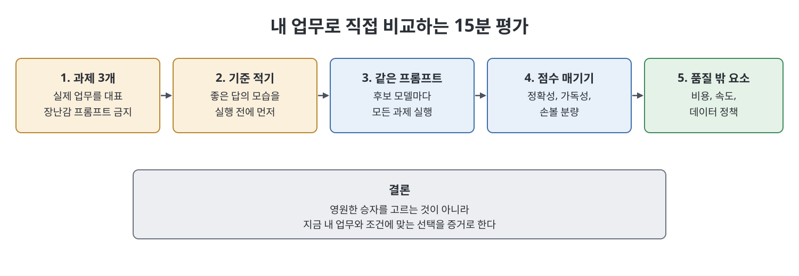

# 3장 Claude와 다른 AI 비교 (Claude Against the World)

이 장은 Claude가 이긴다고 주장하는 대신, 여러 AI 모델을 공정하게 비교하고 선택하는 방법을 다룬다. 책의 출발점은 2026년의 주요 모델이 모두 좋고 분야별 선두가 분기마다 바뀐다는 인식이다. 그래서 영원한 승자를 고르기보다 각 모델의 성격을 알고 작업을 적절히 나누는 능력을 기르자고 한다. 비교 기준, 경쟁 모델 여섯 개와의 대비, 생태계와 벤치마크의 한계, 15분 평가법, 여러 모델 함께 쓰기, 갈아타기 비용을 정리한다.

> **쉽게 말하면**
> "어느 모델이 최고인가"는 잘못된 질문이다. "무엇에, 누구에게, 얼마에, 어떤 조건에서"를 묻고, 내 작업으로 직접 시험해서 고르라는 장이다.

> **참고(노트 작성자)** 아래 경쟁 모델에 대한 평가는 저자의 경험과 의견이며, 2026년 판 서술 시점의 인상이다. 노트는 이를 검증하지 않았고 모델 사정은 빠르게 바뀐다.

## 이 장의 흐름

1. 한 모델에 대한 충성이 위험한 이유
2. 공정한 비교의 기준
3. 경쟁 모델과의 대비
4. 생태계와 벤치마크
5. 15분 평가, 여러 모델 쓰기, 갈아타기

## 1. 충성의 위험과 비교 기준

책은 첫 번째로 써 본 모델에 계속 머무는 습관을 조용한 부채라고 본다. 더 나은 대안을 시험하지 않게 되고, 업계 전체가 개선되는 것도 놓치기 때문이다. 권하는 자세는 깊이 아는 주력 모델 하나를 두되 다른 모델에 열린 눈을 유지하는 것이다.

비교 기준으로 책은 여섯 가지를 든다. 어려운 과제의 순수 능력, 글의 결, 아첨, 불확실성 처리 같은 성격, 주변 생태계, 비용과 속도, 개인정보·데이터 정책, 내 업무량에서의 안정성이다. 어느 축에서도 한 모델이 모두 앞서지 않는다고 책은 말한다.

## 2. 경쟁 모델과의 대비

| 상대 | 상대의 강점(책의 서술) | Claude의 강점(책의 서술) |
|------|----------------------|------------------------|
| OpenAI GPT | 대중 인지도, 거대한 개발자 생태계, 빠른 기능 출시, 넓은 범용성 | 긴 코딩·에이전트 작업의 일관성, 절제된 글투, 정직과 절제 |
| Google Gemini | 검색·안드로이드·업무 도구에 녹아든 배포력, 큰 컨텍스트와 멀티모달 | 추론·코딩의 신뢰성, 선호되는 글 목소리, 안전·정직 태도 |
| Meta Llama | 오픈 웨이트라 자체 하드웨어에서 실행·미세조정 가능 | 최전선 성능, 관리형 서비스의 편리함, 도구 생태계 |
| Mistral | 효율적인 모델, 오픈·상용 혼합, 유럽 데이터 주권에 맞는 지역성 | 최상단의 추론·에이전트 능력, 더 넓은 도구 생태계 |
| DeepSeek | 낮은 비용 대비 성능, 오픈 모델 | 최전선 성능, 안전 태도, 자국 관할 제공자를 원하는 구매자 |
| xAI Grok | 소셜 플랫폼 연동, 실시간 시사 접근, 느슨한 스타일 | 예측 가능한 전문적 성격, 안전 설계, 성숙한 생태계 |

책은 몇 가지 단서를 붙인다. Llama와는 경쟁이라기보다 용도가 다르다. 개인정보 때문에 직접 운영해야 하거나 대량 처리 비용을 아끼려면 오픈 웨이트가 답이고, 많은 팀이 오픈 모델과 Claude를 나눠 쓴다. DeepSeek은 성능만이 아니라 제공자의 관할 지역에 따른 데이터 거버넌스·규제 문제가 있으므로 자기 상황에서 솔직히 따져 보라고 한다. 이미 특정 회사의 도구에 깊이 묶여 있다면 그 "중력"도 정당한 고려 요소라고 한다.

## 3. 생태계와 벤치마크

책은 많은 실무에서 모델 자체보다 주변이 더 중요하다고 본다. 엔진(모델)만이 아니라 차와 도로(앱, 연동, 에이전트 프레임워크, 개발자 플랫폼, 커뮤니티)를 함께 고르는 것이라는 비유다.

벤치마크는 대략적 필터로만 쓰라고 한다. 고정된 시험은 공개되면 맞춰 튜닝될 수 있고, 상위권 간 격차는 대개 의미 없이 작으며, 내 업무와 먼 과제를 재고, 한 시점의 스냅샷이기 때문이다. 특히 회사가 직접 내놓은 비교 차트는 광고로 읽으라고 경고한다. 사례로 리더보드 1위 모델을 시험 없이 표준으로 삼았다가, 포르투갈어 카피에서는 2위 모델이 더 나았다는 브라질 에이전시 이야기를 든다.

## 4. 15분 평가법

1. 실제 업무를 대표하는 과제 세 개를 고른다. 장난감 프롬프트는 장난감 결론을 낳는다.
2. 실행 전에 좋은 답의 기준을 한두 문장으로 적는다.
3. 고려 중인 각 모델에 같은 프롬프트로 세 과제를 모두 돌린다.
4. 기준에 비추어 정확성, 가독성, 손볼 분량을 점수화한다.
5. 품질 외에 비용, 속도, 데이터 정책이 맞는지 따진다.

## 5. 여러 모델 쓰기, 갈아타기, 프롬프트 이식

한 모델로 초안을 쓰고 다른 모델에게 약점·근거 없는 주장·반론을 찾게 하는 draft-then-critique가 고전적 패턴이다. 브레인스토밍과 가지치기를 모델별로 나누거나, 중요한 질문에 두 모델이 독립적으로 답하게 하고 의견이 갈리는 곳을 직접 검증 대상으로 삼을 수도 있다. 책은 두 모델이 확신을 갖고 다르게 답하는 지점이 "사람이 확인할 곳"을 알려 주는 신호라고 한다.

| 갈아타기 비용의 실체 | 줄이는 방법(책의 조언) |
|-------------------|-------------------|
| 튜닝한 프롬프트, 연동, 팀의 습관, 사용자 지침 | 프롬프트와 워크플로를 문서화한다 |
| 한 회사 전용 연결 | 가능하면 공개 표준으로 도구를 연결한다 |
| 변화를 모르는 채 굳어짐 | 가끔 경쟁 모델과 재평가한다 |

잠금(lock-in)은 벼랑이 아니라 관리할 스펙트럼이다. 또 한 모델에서 잘 되던 프롬프트가 다른 모델에서는 그대로 통하지 않는 경우가 많으므로, 모델을 옮길 때는 복사가 아니라 약간의 재조정 작업으로 보라고 책은 말한다.

## 핵심 정리

- 주요 모델은 모두 훌륭하고 선두는 분야와 시기에 따라 바뀌므로, 작업을 나누는 능력이 핵심이다.
- 능력, 성격, 생태계, 비용, 정책, 안정성을 함께 보고, 단일 축 우승자는 없다.
- 벤치마크는 대략적 필터이며 벤더가 낸 비교표는 광고로 읽는다.
- 15분 평가(실제 과제 3개, 사전 기준, 같은 프롬프트, 점수화)가 어떤 리더보드보다 내게 유효하다.
- 모델을 병행하고, 의견이 갈리는 곳을 검증하며, 이전 시에는 프롬프트를 재조정한다.

 
 
 

이전: [2장 Opus·Sonnet·Haiku 모델 가족](02%EC%9E%A5%20Opus%C2%B7Sonnet%C2%B7Haiku%20%EB%AA%A8%EB%8D%B8%20%EA%B0%80%EC%A1%B1.md) | 다음: [4장 시작하기 요금제·가격·개인정보·계정](04%EC%9E%A5%20%EC%8B%9C%EC%9E%91%ED%95%98%EA%B8%B0%20%EC%9A%94%EA%B8%88%EC%A0%9C%C2%B7%EA%B0%80%EA%B2%A9%C2%B7%EA%B0%9C%EC%9D%B8%EC%A0%95%EB%B3%B4%C2%B7%EA%B3%84%EC%A0%95.md)

 

[Claude AI Bible](../)
