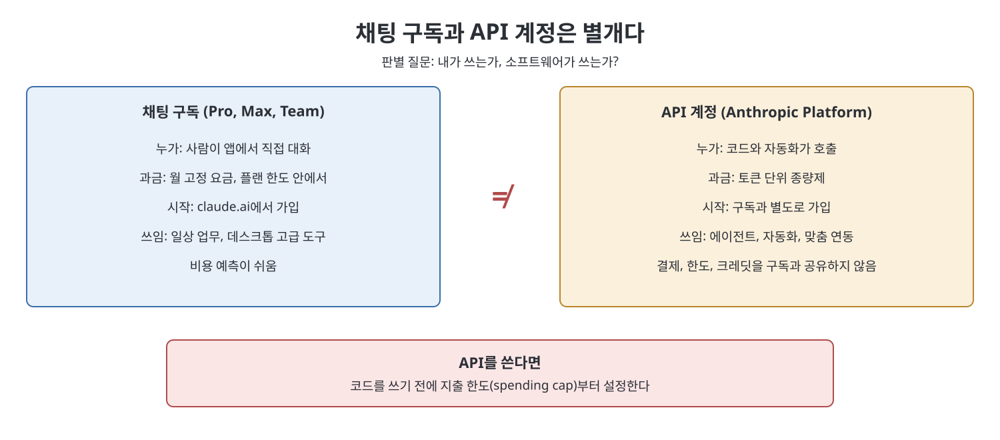

# 4장 시작하기 요금제·가격·개인정보·계정 (Getting Set Up)

이 장은 건너뛰기 쉽지만 잘못 넘어가면 돈이나 개인정보 문제로 돌아오는 설정 단계를 다룬다. 요금제의 구조와 고르는 법, 계정 만들기, 사용자 지침, 개인정보, 팀과 엔터프라이즈, 그리고 이 책 전체에서 가장 중요하다고 책이 강조하는 구분, 곧 채팅 구독과 API 계정의 차이를 정리한다. 책은 정확한 가격과 한도는 바뀌므로 숫자를 "모양"으로만 받아들이고 공식 문서(docs.claude.com, support.claude.com)에서 확인하라고 거듭 말한다.

> **쉽게 말하면**
> 말로 쓰는 사람은 구독, 코드가 쓰는 경우는 API다. 둘은 별개 계정이고, 처음에는 낮은 요금제로 시작해 막힐 때 올린다.

> **참고(노트 작성자)** 책은 이 장에서 구체적인 금액이나 사용 한도 수치를 적지 않는다. 아래 표의 요금제 이름과 성격은 책이 서술한 시점(2026년 판) 기준이며 노트가 검증하지 않았다. 실제 요금·한도·보관 기간은 반드시 공식 문서로 확인해야 한다.

## 이 장의 흐름

1. 요금제 사다리와 선택 기준
2. 계정 만들기와 사용자 지침
3. 개인정보
4. 팀과 엔터프라이즈
5. 채팅 구독 대 API 계정, 비용 추정

## 1. 요금제 사다리

책은 사용량과 관리 필요, 두 질문으로 요금제를 설명한다. "헤드룸(여유)과 관리를 산다"는 한 줄이 핵심이다.

| 구분 | 요금제 | 책의 설명 |
|------|--------|----------|
| 개인 | Free | 무료, 한도가 의미 있게 있음. 맞는지 확인하는 용도 |
| 개인 | Pro | 자주 쓰고 무료 한도에 자주 걸리는 사람. 한도와 기능이 크게 늘어남 |
| 개인 | Max | 일이 Claude 중심이고 Pro 한도에도 걸리는 파워 유저. 가장 무거운 모델과 새 기능에 폭넓은 접근. 보통 여러 단계 |
| 조직 | Team | 공동 결제, 구성원 추가·삭제, 중앙 관리가 필요한 소규모 그룹 |
| 조직 | Enterprise | 보안, ID, 통제, 규모 요건이 큰 조직 |

선택법은 "낮게 시작해서 현실이 밀어 올리게 하라"이다. Free로 한두 주 실제 업무를 해 보고, 한도에 걸려 필요한 일이 끊기는지를 본다. Pro에서도 같은 시험을 한다. 조직은 사용량보다 공동 결제와 접근 관리가 필요해지는 순간이 전환점이다. 책은 "안전하게"라며 최상위를 사는 것을 가장 흔하고 낭비적인 실수로 꼽는다. 올릴 때 큰 불이익이 없으니 막힐 때 올리면 된다는 것이다.

## 2. 계정과 사용자 지침

claude.ai에서 이메일이나 기존 로그인으로 가입하면 기본적으로 Free로 시작한다. 책은 브라우저 탭에 머물지 말고 Mac·Windows 데스크톱 앱과 iOS·Android 앱을 설치하라고 권한다. 데스크톱 앱은 뒤의 강력한 도구에서 중요해진다고 한다. 그리고 설정 화면을 처음부터 끝까지 한 번 읽어 두라고 한다. 개인정보 통제가 거기에 있기 때문이다.

가장 가치 있는 설정은 `Custom instructions`(사용자 지침, 개인 설정 또는 스타일 설정)로 소개된다. 역할, 분야, 주로 쓰는 독자, 길이와 어조 선호를 한 번 적어 두면 매 대화마다 반복 설명하지 않아도 된다. 원칙은 "모든 대화에서 참인 것은 설정으로 올린다"이다.

## 3. 개인정보

책이 말하는 요점은 다음과 같다.

| 항목 | 책의 서술 | 해야 할 일 |
|------|----------|----------|
| 광고와 데이터 판매 | 제품에 광고가 없고 Anthropic은 데이터를 팔지 않는다 | 사업 모델이 사용자 데이터 수익화가 아님을 이해 |
| 학습 사용 | 사용자가 통제하는 설정이며 선택(opt-in)과 명확한 설정을 중심으로 한 태도 | 계정의 현재 설정값을 직접 확인, 회사 계정이면 조직 설정 확인 |
| 보관 | 대화는 제품 작동을 위해 보관되고, 삭제와 보관 정책이 있음 | 정확한 기간은 요금제·계정 유형에 따라 다르므로 공식 문서로 확인 |

책은 기본값이 업계에 비해 개인정보에 우호적이라고 평가하면서도, 민감한 내용을 넣기 전에 설정과 최신 공식 정책을 직접 읽으라고 당부한다. 사례로, AI 금지 직전이던 회계 법인이 설정과 정책을 한 줄씩 읽고 학습 통제를 자사 선호대로 정해 한 쪽짜리 정책으로 도입한 이야기가 나온다.

## 4. 팀과 엔터프라이즈

Team은 사용량이 아니라 "개인 계정 더미를 관리되는 하나로" 바꾸는 계층이다. 책은 구성원을 추가하기 전에 개인정보·학습 통제를 그룹 단위로 먼저 정하라고 조언한다. Enterprise에는 SSO(회사 ID로 로그인), 더 강한 관리 통제, 데이터를 어디서 처리·저장하는지에 관한 data residency 같은 요건이 따른다고 설명한다. 구체적 사항은 조직별로 협상하고 문서화되므로 자사 보안·컴플라이언스 요구 목록을 공식 문서와 영업 과정에 가져가 확인하라고 한다.

## 5. 채팅 구독 대 API 계정

| 비교 | 채팅 구독(Pro, Max, Team) | API 계정(Anthropic Platform) |
|------|--------------------------|------------------------------|
| 용도 | 사람이 앱에서 Claude와 대화 | 코드·자동화가 Claude를 호출해 무언가를 만듦 |
| 과금 | 월 고정 요금, 플랜 한도 내 | 종량제, 토큰 단위 |
| 계정 | 별도 | 별도 가입, 구독과 결제·한도·크레딧을 공유하지 않음 |
| 책의 용도 | 일상 업무, 데스크톱 고급 도구 | 뒤쪽의 에이전트, 자동화, 맞춤 연동 |

판별 질문은 "내가 쓰는가, 소프트웨어가 쓰는가"다. 사람이 앉아 대화한다면 구독이면 충분하고, 프로그램이 사람 개입 없이 호출한다면 API가 필요하다. 둘 다 필요한 사람은 별도 계정으로 둘 다 갖는다. 책의 가장 실용적인 조언은 API를 만들 때 코드를 쓰기 전에 지출 한도(spending cap)부터 거는 것이다. 한도는 무한 반복하는 버그를 큰 청구서가 아닌 정지로 바꾸는 안전벨트라고 한다.

사용량 추정은 구독의 경우 빈도와 강도(주 며칠, 하루 몇 번, 가벼운지 무거운지)로 Free, Pro, Max 중 어디인지 가늠하고, 가장 쉬운 방법은 Free로 일주일 써 보는 것이다. API는 하루 호출 횟수, 호출당 입력·출력 토큰, 사용 모델을 곱해 하루 비용을 내고 30을 곱한다. 현재 단가는 공식 문서에서 가져오라고 한다.

## 핵심 정리

- 개인은 Free, Pro, Max, 조직은 Team, Enterprise이며 개인 계단은 사용 여유를, 조직 계단은 관리를 산다.
- 낮게 시작하고 업무를 실제로 끊는 한도에 걸릴 때 올리며, 최상위를 불안해서 사지 않는다.
- custom instructions에 항상 참인 맥락을 적고, 개인정보와 학습 설정은 직접 확인한다.
- 구독과 API는 결제와 한도가 완전히 별개이며, API는 코드를 쓰기 전에 지출 한도부터 건다.
- 가격, 한도, 보관 기간은 공식 문서로 확인한다. 책은 이 장에서 구체 수치를 제시하지 않는다.

 
 
 

이전: [3장 Claude와 다른 AI 비교](03%EC%9E%A5%20Claude%EC%99%80%20%EB%8B%A4%EB%A5%B8%20AI%20%EB%B9%84%EA%B5%90.md) | 다음: [핵심 정리](%ED%95%B5%EC%8B%AC%20%EC%A0%95%EB%A6%AC.md)

 

[Claude AI Bible](../)
