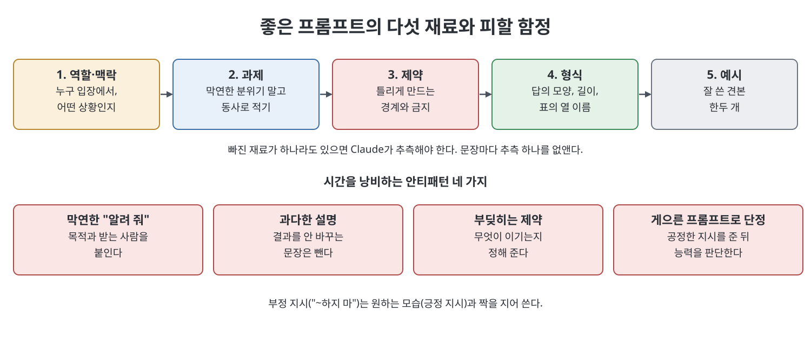

# 5장 기술로서의 프롬프팅 (Prompting as a Craft)

이 장은 프롬프트를 비법이 아니라 "명확한 생각을 눈에 보이게 적은 것"으로 다룬다. 책에 따르면 마법의 문구는 없고, 새로 온 동료에게 월요일 아침에 일을 정확히 맡기는 능력이 그대로 Claude에게도 통한다. 장은 좋은 프롬프트의 재료 다섯 가지, 프롬프트를 "상시 지시서"로 보는 사고 틀, 시스템 프롬프트와 사용자 프롬프트의 구분, 예시 제시(few-shot)·태그·부정 지시·길이와 형식 지정, 반복 개선, 재사용 패턴, 시간을 낭비하는 안티패턴 네 가지 순으로 진행된다.

> **쉽게 말하면**
> 짧고 막연하게 부탁하면 밋밋한 답이 나온다. 상대가 추측할 일을 줄여 주는 것이 프롬프팅의 거의 전부다.

## 이 장의 흐름

1. 좋은 프롬프트의 다섯 재료
2. 상시 지시서라는 사고 틀
3. 시스템 프롬프트와 사용자 프롬프트
4. 핵심 기법: 추론 유도, 예시, 태그, 부정 지시, 길이·형식
5. 반복 개선과 재사용 패턴
6. 피해야 할 안티패턴

## 1. 다섯 재료

책은 강한 프롬프트가 최대 다섯 재료로 이뤄진다고 본다. 늘 다 필요하지는 않지만, 프롬프트가 실패하면 보통 이 중 하나가 빠진 것이다.

| 재료 | 역할 | 내 식의 예 |
|------|------|-----------|
| 역할과 맥락 | 누구 입장에서, 어떤 상황인지 | "10명 규모 편집부의 팀장이다. 신입이 내일 첫 출근한다" |
| 과제 | 막연한 분위기가 아니라 동사로 | "환영 메일을 쓴다" |
| 제약 | 어기면 결과가 틀리는 경계 | "200자 이내, 급여 이야기는 제외" |
| 형식 | 답의 모양 | "제목 한 줄, 본문, 서명 한 줄" |
| 예시 | 좋은 결과의 견본 | 예전에 잘 쓴 메일 한두 개 |

검색엔진처럼 키워드 두세 개만 넣는 습관을 책은 가장 비싼 습관으로 꼽는다. 입력이 두 단어면 조준도 두 단어만큼만 된다는 이유다. 긴 프롬프트가 좋은 것이 아니라, 문장마다 Claude의 추측 하나를 없애 주기 때문에 좋다.

## 2. 상시 지시서

책은 프롬프트를 선장이 자는 동안 당직 사관이 따를 지시서에 비유한다. 되물을 수 없으니 목표와 한계, 보고 형식을 미리 분명히 적어야 하고, 사관이 알아서 할 일까지 간섭하면 정작 중요한 한 줄이 묻힌다. 이 틀이 알려 주는 점은 셋이다.

- Claude는 내가 의도한 것이 아니라 적은 것을 따른다.
- 지시서는 그 자체로 완결되어야 한다.
- 지나친 설명(over-stuffing)도 실패다. 누구나 아는 것은 적지 않고, 모르면 추측할 수 없거나 틀리면 비싼 것만 적는다.

## 3. 시스템 프롬프트와 사용자 프롬프트

사용자 프롬프트는 그때그때 보내는 요청이고, 시스템 프롬프트는 대화 위에서 계속 적용되는 지침이다. 앱에서는 `custom instructions`나 Project 지침이 같은 역할을 한다(7장 참고). 변하지 않는 규칙은 시스템 쪽에, 오늘의 일은 사용자 쪽에 둔다. 책은 재사용할 시스템 프롬프트를 "너는 ~다" 식으로 쓰고, 절대 규칙은 서너 개로 짧게 두라고 권한다.

## 4. 핵심 기법

- **추론은 모양으로 요청**: 책은 "단계별로 생각해"라는 상투구가 요즘 모델에서는 대체로 불필요하다고 본다. 대신 "선택지마다 장단점과 틀리면 무너질 가정을 먼저 적고 나서 추천해"처럼 사고의 모양을 설명한다.
- **예시 제시(few-shot)**: 어조처럼 말로 설명하기 어려운 것은 잘 쓴 견본 한두 개를 보여 주는 편이 낫다. 책은 이것을 가장 덜 쓰이는 기법으로 꼽는다.
- **태그는 구분이 필요할 때만**: 고객 메일, 내부 메모, 지시처럼 섞이기 쉬운 덩어리가 여럿일 때 경계를 그어 준다. 덩어리가 하나면 장식일 뿐이다.
- **부정 지시는 긍정과 짝으로**: "딱딱하게 쓰지 마"만 쓰면 목표가 비어 있다. "친구에게 설명하듯 쓰라"는 목표를 함께 준다.
- **길이와 형식은 확인 가능하게**: "짧게"보다 "세 문장", "불릿 다섯 개"가 낫고, 표라면 열 이름까지 적는다.

| 약한 지시 | 강한 지시 |
|-----------|-----------|
| 고객 응대 문구 좀 써 줘 | 환불 거절 안내를 우리 말투로 써 줘. 아래 두 사례의 어조를 따를 것 |
| 짧게, 딱딱하지 않게 | 친구에게 말하듯, 120자 이내 |
| 비교해 줘 | 세 도구를 표로, 열은 도구·적합 대상·월 비용·단점 |

## 5. 반복 개선과 재사용 패턴

첫 프롬프트는 초안이다. 한 번에 여러 개를 고치면 무엇이 효과 있었는지 알 수 없으니 한 번에 하나만 바꾼다. 채팅에서는 "더 따뜻하게", "절반으로"처럼 짧은 후속 지시가 빠르다. 잘 통하는 프롬프트는 저장해 두는데, 책의 사례에서는 반복 지시를 Project의 시스템 프롬프트로 옮긴 뒤 건당 시간이 4분에서 1분 미만으로 줄었다고 한다.

| 패턴 | 하는 일 | 핵심 |
|------|---------|------|
| 변환 | 입력 형태를 다른 형태로 | 입력과 출력의 모양을 둘 다 지정 |
| 비평 | 기준에 따라 평가 | 기준을 직접 제시 |
| 페르소나 | 역할을 주어 전문 어조 확보 | 역할과 상황을 구체적으로 |
| 생성 후 선택 | 여러 안을 내고 추천 | 열린 과제에 유효 |
| 먼저 질문 | 모르는 부분을 먼저 묻게 함 | "시작 전에 질문 다섯 개만" 같은 식으로 한 번의 왕복으로 낭비 방지 |

## 6. 안티패턴 네 가지

- 막연한 "~에 대해 알려 줘". 목적과 받는 사람을 붙인다.
- 과다한 설명. 결과를 바꾸지 않는 문장은 뺀다.
- 서로 부딪히는 제약("자세히, 하지만 짧게"). 무엇이 이기는지 정한다.
- 게으른 프롬프트 하나로 모델 능력을 단정하는 것.

> **참고(노트 작성자)** 이 장의 "요즘 모델에서 상투구가 대체로 불필요하다"는 서술과 앱 기능 이름은 책이 쓰인 시점의 설명이다. 노트 작성자가 현재 모델의 동작을 검증한 것은 아니다.

## 핵심 정리

- 강한 프롬프트의 재료는 역할·맥락, 과제, 제약, 형식, 예시이고, 실패는 대개 하나가 빠진 탓이다.
- 프롬프트는 되물을 수 없는 상시 지시서처럼 구체적이고 완결되게 쓴다. 알 만한 것은 적지 않는다.
- 변하지 않는 규칙은 시스템 프롬프트에, 구체적 일은 사용자 프롬프트에 둔다.
- 말로 안 통하면 예시를 보여 준다. 부정 지시는 긍정 지시와 짝지어 쓴다.
- 한 번에 하나만 고치며 반복하고, 잘 된 프롬프트는 저장한다.

 
 
 

이전: [2부 Readme](Readme.md) | 다음: [6장 고급 프롬프팅과 추론 제어](06%EC%9E%A5%20%EA%B3%A0%EA%B8%89%20%ED%94%84%EB%A1%AC%ED%94%84%ED%8C%85%EA%B3%BC%20%EC%B6%94%EB%A1%A0%20%EC%A0%9C%EC%96%B4.md)

 

[Claude AI Bible](../)
