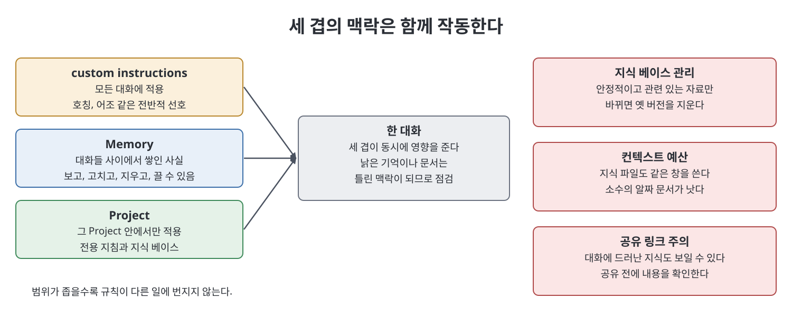

# 7장 프로젝트·메모리·지식 (Projects, Memory, and Knowledge)

이 장은 매번 처음부터 다시 설명해야 하는 비용을 없애는 기능을 다룬다. 책은 일회성 대화는 괜찮지만 일에 연속성이 생기면 같은 준비 비용을 반복해서 내고 결과도 흔들린다고 본다. 해법으로 Project(지속되는 지침과 지식 묶음), 대화 사이를 잇는 Memory, 도움이 되는 지식 베이스를 만드는 규율, 대화 검색, 공유 시 개인정보 문제, Project를 나누는 방식을 설명한다. 책은 플랜별 제공 범위와 한도는 계속 바뀌므로 공식 문서(docs.claude.com)를 확인하라고 직접 안내한다.

> **쉽게 말하면**
> 반복되는 설명은 Project에 한 번 적어 두고, 지식은 깔끔하게 관리하고, 무엇을 기억시키고 공유할지는 내가 정한다.

## 이 장의 흐름

1. Project가 푸는 문제와 첫 설정
2. 지식 베이스에 넣을 것과 뺄 것
3. 파일과 컨텍스트 예산
4. Memory, custom instructions, Project의 차이
5. 과거 대화 찾기와 공유 시 주의
6. 업무 단위로 Project 나누기

## 1. Project와 첫 설정

Project는 지침, 한 번 올린 파일(지식 베이스), 그 안의 모든 대화를 담는 컨테이너다. 그 안에서 시작한 대화는 지침과 지식을 물려받는다. 책은 이를 "다시 브리핑하는 세금"을 없애는 일이라 부른다. 설정은 세 부분이다.

- 이름과 한 줄 설명: "마케팅"처럼 넓지 않고 "A 요가원 SNS·메일"처럼 구체적으로 쓴다.
- Project 지침: 1년 일할 프리랜서에게 온보딩하듯 대상, 어조, 상시 규칙, 금지 사항을 적는다.
- 지식 베이스 구축.

## 2. 지식 베이스: 넣을 것과 뺄 것

지식 베이스는 쓰레기통이 아니라 선별된 서가다.

| 구분 | 내용 |
|------|------|
| 넣을 것 | 안정적이고 재사용되며 직접 관련된 자료: 스타일 가이드, 표준 문서, 서식, 잘 쓴 결과물 견본(few-shot 역할) |
| 뺄 것 | 자주 바뀌는 것, 한 대화에만 필요한 문서, 신호가 묻힌 거대한 아카이브, 꼭 필요하지 않은 민감 정보 |

책의 시험은 "똑똑한 신입이 1년 내내 책상에 두고 볼 문서인가"다. 정리된 문서(제목, 짧은 절, 사실을 분명히)가 줄글보다 더 잘 쓰인다고 한다. 가장 흔하고 해로운 실수는 낡은 문서를 그대로 두는 것이다. 책의 사례에서는 옛 가격표를 지우지 않아 Claude가 두 주 동안 옛 가격을 인용했다. 바뀌면 새 문서를 더하기만 하지 말고 옛 버전을 지운다.

## 3. 파일 형식과 컨텍스트 예산

책에 따르면 텍스트·Markdown, PDF, Word, 스프레드시트, CSV, 이미지(비전 기능)를 읽을 수 있다. 원본이 깔끔할수록 결과가 좋다. 스프레드시트는 참고 자료로 읽히는 것이고, 살아 있는 시트를 조작하려는 목적이라면 다른 기능(책이 뒤에서 다루는 Claude in Excel)이 맞다.

지식 베이스 파일도 대화와 같은 유한한 컨텍스트 창을 쓴다. 그래서 소수의 알짜 문서를 선호하고, 큰 자료는 주제별로 Project를 나누고, 한 대화에만 필요하면 대화에 붙여 넣는다. 60쪽 매뉴얼 중 쓰는 부분이 4쪽이면 그 4쪽만 요약해 올리라는 조언도 있다.

> **참고(노트 작성자)** 책은 컨텍스트 창을 "20만 토큰을 훌쩍 넘는다"고 쓴다. 이 수치와 지원 파일 형식은 책 시점의 서술이며 검증하지 않았다.

## 4. 세 겹의 차이

| 도구 | 범위 | 성격 |
|------|------|------|
| custom instructions | 모든 대화 | 한 번 정하는 전반적 선호(호칭, 어조, 형식) |
| Memory | 대화들 사이 | Claude가 시간이 지나며 쌓은 구체적 사실. 보고, 고치고, 지우고, 끌 수 있음 |
| Project | 그 Project 안 | 전용 지침과 지식. 범위가 한정됨 |

세 겹은 함께 작동한다. 책은 오래된 기억이 틀린 맥락이 될 수 있으니 가끔 점검하라고 하며, 기기를 공유하거나 매번 백지가 필요한 사람에게는 Memory를 꺼 두는 것도 정당한 선택이라고 말한다.

## 5. 과거 대화와 공유

대화 검색이 되므로 중요한 대화에는 찾기 좋은 이름을 붙이고, 관련 대화를 Project 안에 모은다. 대화에서 건진 정의나 서식은 지식 베이스로 승격시킨다. 책의 표현으로 대화는 기록이고 지식 베이스는 서고다.

개인정보에 대해 책은 Anthropic 제품에 광고가 없고 데이터를 팔지 않으며 대화 학습 사용은 사용자가 설정으로 정한다고 쓰는데, 정확한 현재 동작은 설정 페이지와 공식 문서를 보라고 한다. 더 날카로운 문제는 공유 링크다. 공유한 대화에는 그 대화 중 드러난 지식 베이스 내용도 보일 수 있다. 지식 베이스가 비공개라는 사실이 공유한 대화 속 내용까지 지켜 주지는 않는다. 공유 전에 내용을 확인하고, 애매하면 공유할 내용만 담은 새 대화를 만든다.

## 6. 업무 단위로 나누기

| 방식 | 알맞은 경우 | 예 |
|------|-------------|-----|
| 고객별 | 다른 고객에게 같은 종류의 일 | 고객 14곳이면 Project 14개 |
| 제품별 | 제품마다 규격과 포지셔닝이 다름 | 제품마다 한 개 |
| 반복 업무별 | 누구에게든 같은 형태의 결과물 | 주간 보고서, 쇼노트 |

하나의 거대한 Project는 어조와 문서가 섞인다. 반대로 지나치게 잘게 쪼개도 어지럽다. 시험은 "이 Project의 정체성이 분명한가"이며, 지식 문서를 올리며 "여기 일의 절반에만 해당하네"라는 생각이 들면 둘로 나눌 신호다. 두 달 열지 않은 Project는 접어 넣는다. 책의 사례에서 고객별로 Project를 둔 회계사는 월별 재설명 시간이 사라졌다고 한다.

## 핵심 정리

- Project는 반복되는 맥락을 상시 맥락으로 바꿔 매번 다시 설명하는 비용을 없앤다.
- 지식 베이스는 안정적이고 관련 있는 자료만 두고, 바뀐 자료는 옛 버전을 지운다.
- 지식 파일도 컨텍스트 예산을 쓰므로 적고 알찬 문서가 낫다.
- custom instructions, Memory, Project는 서로 다른 세 겹이며 함께 작동한다.
- 업무 단위로 범위를 정하고, 공유 링크는 대화 전체가 노출된다고 보고 확인한 뒤 보낸다.

 
 
 

이전: [6장 고급 프롬프팅과 추론 제어](06%EC%9E%A5%20%EA%B3%A0%EA%B8%89%20%ED%94%84%EB%A1%AC%ED%94%84%ED%8C%85%EA%B3%BC%20%EC%B6%94%EB%A1%A0%20%EC%A0%9C%EC%96%B4.md) | 다음: [8장 아티팩트와 긴 글 출력](08%EC%9E%A5%20%EC%95%84%ED%8B%B0%ED%8C%A9%ED%8A%B8%EC%99%80%20%EA%B8%B4%20%EA%B8%80%20%EC%B6%9C%EB%A0%A5.md)

 

[Claude AI Bible](../)
