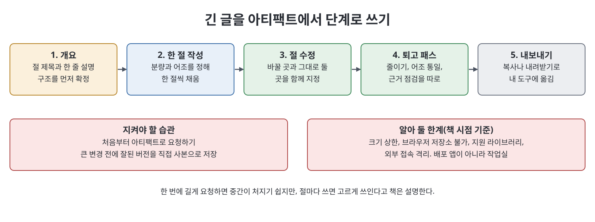

# 8장 아티팩트와 긴 글 출력 (Artifacts and Long-Form Output)

이 장은 Claude가 대화창 옆 별도 패널에 결과물을 띄우는 아티팩트(artifact)를 다룬다. 책에 따르면 아티팩트가 생기면 채팅은 작업에 대해 이야기하는 곳이 되고 아티팩트가 작업 그 자체가 된다. 장은 아티팩트가 무엇이고 왜 중요한지, 자동 생성과 제어, 종류, 제자리 수정, 코드의 만들기-시험-고치기 루프, 긴 글을 단계로 쓰는 법, 한계, 내보내기, Project와의 결합을 순서대로 설명한다.

> **쉽게 말하면**
> 채팅 답변은 흘러가지만 아티팩트는 책상 위에 놓인 작업물이다. 그것을 말로 고쳐 가며 완성한다.

## 이 장의 흐름

1. 아티팩트의 정의와 가치
2. 생성 제어와 종류
3. 제자리 수정
4. 만들기-시험-고치기 루프
5. 긴 글 단계적 작성
6. 한계, 내보내기, Project와 결합

## 1. 정의와 가치

아티팩트는 길고 독립적이며 다시 읽고 고치고 내보낼 만한 내용(문서, 코드, 웹 페이지, 다이어그램)을 별도 패널에 렌더링한 것이다. 책이 꼽는 가치는 지속성과 반복이다. 채팅 답은 스크롤에 밀려 사라지지만 아티팩트는 남고, 여러 메시지에 걸쳐 새 복사본 없이 제자리에서 갱신된다. 답을 복사해 다른 도구에서 조립하던 "전달자"에서 하나의 대상을 편집하는 "편집자"로 바뀐다는 것이 책의 설명이다. 웹 페이지나 컴포넌트는 실제로 실행되어 클릭해 볼 수 있다.

## 2. 생성 제어와 종류

Claude는 결과가 결과물인지 단순 답변인지 판단해 만든다. 직접 지시하면 판단을 대신할 수 있다.

- 강제: "편집할 수 있게 아티팩트로 만들어 줘."
- 억제: "아티팩트 없이 채팅으로만 짧게 답해 줘."

앞으로 여러 번 고칠 것이라면 첫 메시지부터 아티팩트로 요청하는 편이 낫다. 나중에 "지금까지 내용을 아티팩트로 옮겨 줘"는 뉘앙스를 잃을 수 있다는 것이 책의 조언이다.

| 종류 | 특징 | 주의할 점 |
|------|------|-----------|
| 문서 | 보고서, 개요서 등 서식 있는 글 | 실패할 일이 적음 |
| 코드 | 구문 강조되는 소스 | 복사해 프로젝트로 |
| HTML·웹 컴포넌트 | 실제로 실행되는 작은 도구 | 실행되므로 깨질 수 있고 샌드박스 제약이 있음 |
| 다이어그램 | 텍스트 설명을 구조도로 | 구조가 맞는지 확인 |
| 데이터 시각화 | 막대, 선 등 차트 | 데이터와 차트 종류 문제 |

## 3. 제자리 수정

수정 요청은 무엇을 바꾸고 무엇은 그대로 둘지 함께 말해야 한다. 막연한 "더 낫게"는 의도하지 않은 곳까지 바꾼다. "예산 절만 네 줄 항목으로 바꾸고 나머지는 그대로"처럼 범위를 맞춘다. 작은 변경은 전체 재작성보다 빠르고 깔끔하다.

## 4. 만들기-시험-고치기 루프

렌더링되는 아티팩트라면 설명, 생성, 직접 시험, 실패 보고, 수정의 순환을 빠르게 돌릴 수 있다. 책은 비엔지니어에게 거의 마법에 가까운 흐름이라고 말한다.

- 실패를 구체적으로 보고한다. "안 돼"가 아니라 "합계 칸에 NaN이 뜬다, 비면 0이어야 한다".
- 가능하면 한 번에 하나씩 시험하고, 여러 문제는 번호를 붙인다.
- 코드가 아니라 원하는 동작을 말한다.
- 같은 문제를 세 번 말해도 안 풀리면 방향을 바꿔 "왜 생기는지 먼저 설명해 줘"라고 한다. 대개 나와 모델이 이해한 요청이 어긋난 것이다.

## 5. 긴 글을 단계로

긴 글도 문서 아티팩트에서 단계로 쓴다. 먼저 뼈대(개요)를 확정하고, 한 절씩 채우고, 절 단위로 고친다. 한 번에 길게 요청하면 중간이 처지기 쉬운데, 절마다 쓰면 고르게 쓰인다고 책은 설명한다. 퇴고도 "줄이기", "어조 통일", "근거 점검"처럼 한 번에 한 가지씩 패스로 한다.

## 6. 한계, 내보내기, Project와 결합

책이 짚는 한계는 다음과 같다.

| 한계 | 설명 | 대응 |
|------|------|------|
| 크기 상한 | 매우 큰 문서나 코드베이스는 한계에 닿음 | 여러 아티팩트로 분할 |
| 브라우저 저장소 | 책은 localStorage 등을 못 쓴다고 설명. 새로고침하면 상태가 사라짐 | 오래 남겨야 하면 진짜 앱으로 |
| 라이브러리 | 지원되는 목록 안에서만 | Claude에게 쓸 수 있는 목록을 물음 |
| 격리 | 임의의 외부 서비스나 내부 시스템에 접속 못 함 | 연결이 필요하면 Claude Code, API, MCP 영역 |

책은 이 제약이 낯선 생성 코드를 안전하게 실행하기 위한 대가라고 설명한다. 아티팩트는 스케치북이자 작업실이지 배포된 애플리케이션이 아니다.

> **참고(노트 작성자)** 위 한계(크기, 저장소, 라이브러리, 격리)는 책이 쓰인 시점의 서술이다. 현재 제품에서 같은지는 노트 작성자가 검증하지 않았다.

완성되면 복사하거나 내려받아 내 도구로 옮긴다. 큰 변경을 요청하기 직전에는 잘된 버전을 직접 사본으로 저장해 두라고 책은 권한다. 마지막으로 Project와 함께 쓰면 Project가 어조와 규칙, 자료를 주고 아티팩트가 작업 표면이 되므로 짧은 요청으로도 일관된 결과가 나온다. 책의 사례에서는 보조금 신청서를 Project 안에서 개요부터 절 단위로 제자리 수정해 작성 시간이 대략 절반으로 줄었다.

## 핵심 정리

- 아티팩트는 패널에 지속되는 결과물이며, 가치는 같은 대상을 제자리에서 반복 개선하는 데 있다.
- 생성 여부는 직접 요청하거나 억제할 수 있고, 계속 고칠 일은 첫 메시지부터 아티팩트로 시작한다.
- 수정은 바꿀 것과 그대로 둘 것을 함께 지정한다.
- 코드는 만들기-시험-고치기 루프로, 실패를 구체적으로 보고한다.
- 긴 글은 개요, 절별 작성, 목적별 퇴고로 쓰고, 한계를 알고 완성본은 내보낸다.

 
 
 

이전: [7장 프로젝트·메모리·지식](07%EC%9E%A5%20%ED%94%84%EB%A1%9C%EC%A0%9D%ED%8A%B8%C2%B7%EB%A9%94%EB%AA%A8%EB%A6%AC%C2%B7%EC%A7%80%EC%8B%9D.md) | 다음: [핵심 정리](%ED%95%B5%EC%8B%AC%20%EC%A0%95%EB%A6%AC.md)

 

[Claude AI Bible](../)
