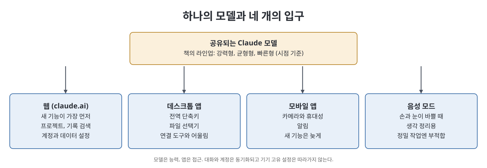
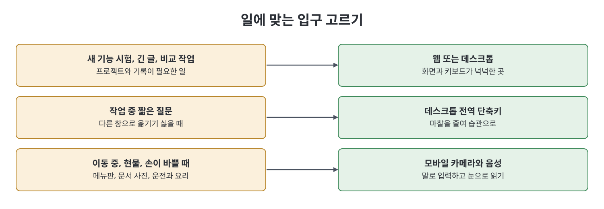

# 9장 앱: 데스크톱·웹·모바일·음성 (The Apps)

이 장은 Claude를 쓰는 여러 화면(웹, 데스크톱, 모바일, 음성)이 사실은 같은 모델 위에 얹힌 서로 다른 "문"이라는 관점으로 시작한다. 저자는 문마다 달라지는 것은 버튼, 첨부 방식, 단축키, 새 기능이 도착하는 속도 같은 "포장"이라고 말한다. 그래서 어떤 기능이 안 보이면 능력이 없는 것이 아니라 그 화면에 아직 오지 않은 것일 가능성이 크다고 본다. 이어서 모델 선택, 웹 앱, 데스크톱 앱의 전역 단축키, 모바일과 음성, 기기 간 동기화, 알림, 접근성, 자동 업데이트, 기록 관리를 차례로 짚는다.

> **쉽게 말하면**
> Claude는 한 곳이 아니라 여러 입구다. 모델은 같고 입구마다 편의와 도착 시점이 다르니, 일에 맞는 입구를 고르면 된다.

## 이 장의 흐름

1. 하나의 두뇌, 여러 개의 문
2. 서피스와 상관없는 모델 선택
3. 웹 앱과 데스크톱 앱
4. 모바일과 음성 모드
5. 동기화, 알림, 접근성, 업데이트
6. 기록 관리와 추천 설정

## 1. 하나의 두뇌, 여러 개의 문

책에 따르면 어느 화면에서 입력하든 질문은 Anthropic 서버의 모델로 가고 답이 그 화면으로 돌아온다. 모델은 어느 문으로 왔는지 모른다. 저자가 남기는 한 줄 규칙은 "모델은 능력, 앱은 접근"이다. 기능이 없을 때는 서피스를 바꾸거나 다음 업데이트를 기다리면 된다는 뜻이다.

모델 선택도 앱에 묶이지 않는다. 책은 당시 라인업을 세 단계로 설명한다. 가장 강한 모델은 어려운 추론과 분석에, 균형형은 대부분의 일상 작업에, 가장 가벼운 모델은 빠른 조회와 단순한 고쳐쓰기에 맞다. 저자의 습관은 균형형을 기본으로 쓰고, 일의 난이도에 맞춰 위아래로 옮기는 것이다. 가장 센 모델을 늘 고르는 것은 지위 과시일 뿐이라고 본다.

> **참고(노트 작성자)** 책은 이 라인업을 Opus 4.8, Sonnet 4.6, Haiku 4.5로 적었다. 모델 이름과 버전, 제공 여부는 책이 쓴 시점 기준이며 이 노트가 검증하지 않았다. 현재 제공 모델은 공식 문서로 확인해야 한다.

## 2. 웹 앱과 데스크톱 앱

| 구분 | 웹 앱 (`claude.ai`) | 데스크톱 앱 |
|------|--------------------|-------------|
| 강점 | 새 기능이 가장 먼저 도착. 계정·결제·데이터 설정, 프로젝트, 기록 검색이 가장 충실 | 어디서나 부르는 전역 단축키(global hotkey), 네이티브 창 |
| 약점 | 탭에 묻히기 쉽고 실수로 닫힘 | 웹보다 새 기능이 늦을 수 있음 |
| 파일 | 업로드로 첨부 | 파일 선택기로 로컬 문서를 바로 지정 |
| 어울리는 일 | 새 기능 시험, 긴 글, 비교 작업 | 작업 중 짧은 질문을 즉시 던지기 |

책이 가장 강조하는 것은 데스크톱 앱의 전역 단축키다. 이메일 문구를 다듬거나 PDF 조항을 풀어 달라고 할 때 다른 창으로 옮겨 가지 않고 바로 묻게 해 주므로, 마찰이 줄어 사용 빈도가 몇 배로 늘어난다는 논리다. 단축키는 한 손으로 누를 수 있고 기존 단축키와 겹치지 않게 정하라고 권한다. 앱 내 단축키는 너무 많이 외우지 말고 새 대화, 검색, 전송, 마지막 메시지 수정, 사이드바 토글 정도만 익히라고 한다.

데스크톱의 파일 선택기는 "이 파일을 읽어 줘" 수준의 편의이고, 10장의 Cowork가 주는 "이 폴더 안에서 계속 작업" 수준의 접근과는 다르다고 책은 선을 긋는다.

> **참고(노트 작성자)** 지원 OS(책은 Mac과 Windows라고 적음), 웹이 항상 먼저 받는다는 서술, 앱 스토어 심사로 모바일이 늦는다는 서술은 책의 단정이며 노트가 확인하지 않았다.

## 3. 모바일과 음성

모바일은 항상 곁에 있다는 점과 카메라가 강점이다. 메뉴판, 표지판, 화이트보드, 손글씨를 찍어 읽게 하거나 번역시키는 용도에 좋다. 반대로 긴 글, 나란히 비교, 큰 프로젝트 관리처럼 화면과 키보드가 필요한 일은 불편하고, 새 기능도 보통 마지막에 도착한다.

음성 모드는 손과 눈이 바쁠 때(운전, 요리, 걷기)와 소리 내어 생각을 정리할 때 유리하다. 코드, 정확한 수치, 이름, 복사해 쓸 결과물처럼 정밀함이 필요한 일은 타이핑이 낫고, 조용해야 하는 공간에서는 어색하다. 저자의 팁은 음성을 출력이 아닌 입력 수단으로 쓰라는 것이다. 말로 거칠게 초안을 던지고 답은 눈으로 읽으면 속도와 정밀함을 함께 얻는다.

## 4. 동기화, 알림, 접근성, 업데이트

| 항목 | 책의 설명 | 주의점 |
|------|-----------|--------|
| 동기화 | 대화 기록, 프로젝트, 계정 설정은 서버(계정)에 있어 모든 기기에 따라옴 | 기기 고유 항목(전역 단축키, 로컬 첨부 파일)은 따라가지 않음 |
| 알림 | 오래 걸리는 작업 완료나 예약 작업 결과를 알려 줌. 작업은 서버에서 돌기에 앱을 닫아도 멈추지 않을 수 있음 | 사소한 알림은 꺼서 정말 필요한 알림만 남길 것 |
| 접근성 | 텍스트 기반이라 화면 낭독기에 유리, 키보드 조작, 음성 입출력 | 지원 범위는 계속 바뀌므로 공식 지원 문서를 볼 것 |
| 자동 업데이트 | 기본은 켜 둠. 관리되는 기업 환경이나 중요한 작업 직전에는 일시 중지 가능 | 중지를 잊으면 오래된 빌드 때문에 커넥터가 깨지는 등 문제가 생김 |

여러 기기에서 쓸 파일은 로컬 첨부 대신 연결한 클라우드 드라이브처럼 실제 공유 위치에 두라는 것이 책의 조언이다. 업데이트에는 보안 수정도 들어 있으므로 "일시 중지"가 "영원히 중지"로 바뀌지 않게 알림을 걸어 두라고 한다.

## 5. 기록 관리와 추천 설정

대화가 쌓이면 검색과 프로젝트(project)가 핵심이다. 새 대화를 열기 전에 비슷한 주제를 먼저 검색해 보면 이미 푼 문제나 초안을 재활용할 수 있다. 프로젝트는 관련 대화를 묶고 공통 배경 정보를 미리 실어 두는 그릇이며, 완전한 경험은 웹과 데스크톱에서 가장 좋다고 한다.

책이 제안하는 기본 구성은 이렇다. 주 컴퓨터에 데스크톱 앱, 휴대폰에 모바일 앱을 깔고 같은 계정으로 로그인한다. 데스크톱에서는 단축키를 정해 습관으로 만든다. 새 기능을 보거나 긴 작업을 할 때는 웹을 쓴다. 휴대폰에서는 카메라와 음성을 활용하고 알림을 다듬는다. 마지막으로 계정의 데이터 설정에서 대화가 모델 개선에 쓰일지 여부를 직접 확인하고 정한다.

> **참고(노트 작성자)** 책은 광고가 없고 데이터를 판매하지 않으며 학습 사용 여부는 사용자가 설정한다고 서술한다. 설정 위치와 기본값은 시점과 요금제에 따라 다를 수 있어 노트가 검증하지 않았다.

## 핵심 정리

- Claude는 웹, 데스크톱, 모바일, 음성이라는 여러 인터페이스가 같은 모델을 공유하는 구조이며, 기능 부재는 대개 접근(서피스)의 문제다.
- 새 기능은 웹에 가장 먼저 오고, 데스크톱은 전역 단축키가 핵심 가치이며, 모바일은 카메라와 휴대성이 강점이다.
- 대화와 계정은 동기화되지만 기기 고유 설정과 로컬 파일은 따라가지 않는다.
- 알림, 접근성, 자동 업데이트, 데이터 설정은 한 번 의도적으로 정해 두면 이후 불편이 줄어든다.

 
 
 

이전: [3부 Readme](Readme.md) | 다음: [10장 Claude Cowork](10%EC%9E%A5%20Claude%20Cowork.md)

 

[Claude AI Bible](../)
