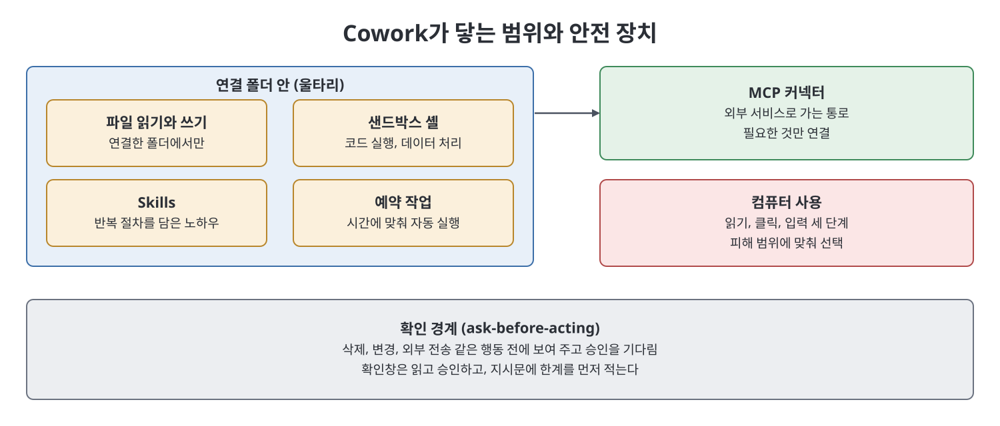
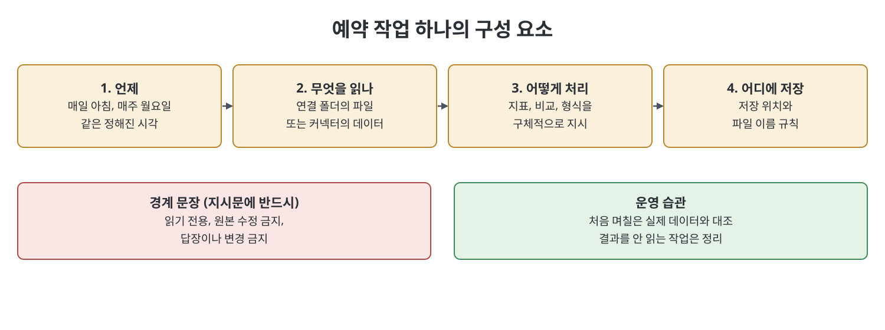

# 10장 Claude Cowork: 데스크톱 오퍼레이터

이 장은 Claude가 조언자에서 직접 일하는 오퍼레이터로 넘어가는 지점인 Claude Cowork를 다룬다. 책에 따르면 Cowork는 데스크톱 애플리케이션으로, 사용자가 연결한 폴더의 파일을 읽고 쓰며, 샌드박스 셸에서 코드를 실행하고, 예약 작업을 돌리고, Skills와 MCP 서버를 쓰고, 스스로 갱신되는 아티팩트를 만들고, 허락을 받으면 컴퓨터를 직접 조작한다. 저자는 이것이 연구 프리뷰(research preview)라서 세부 화면이 바뀔 수 있다고 먼저 밝히고, 이 장 전체를 "손을 가진 사고 파트너"를 어떻게 안전하게 쓰는가에 맞춘다.

> **쉽게 말하면**
> 질문하고 답을 받아 옮기던 채팅과 달리, 폴더를 열어 주고 일을 맡기면 알아서 처리해 결과를 보여 주는 데스크톱 도우미다. 대신 어디까지 맡길지 울타리를 직접 정해야 한다.

## 이 장의 흐름

1. Cowork가 무엇이고 채팅과 어떻게 다른가
2. 첫 설정과 연결 폴더(울타리)
3. 실행 전 확인 경계
4. MCP, Skills, 예약 작업, 라이브 아티팩트
5. 컴퓨터 사용의 안전 단계
6. 실습 예시와 Skill 작성

> **참고(노트 작성자)** Cowork의 기능 구성, 화면, 제공 여부는 책이 쓴 시점의 연구 프리뷰 기준이며 노트가 검증하지 않았다. 책도 변하기 쉬운 세부는 공식 문서(docs.claude.com)로 확인하라고 안내한다.

## 1. 채팅과 무엇이 다른가

일반 채팅은 대화 안에서만 움직인다. 파일은 붙여 넣거나 올려야 보이고, 쓴 코드를 대신 실행하지 못하고, 다음 날 스스로 돌아오지도 못해서 사람이 중간에서 옮겨 주어야 한다. Cowork는 이 "옮기는 일"을 없앤다. 폴더를 한 번 연결하면 작업 중에 파일을 읽고, 스크립트를 실행해 결과를 보여 주고, 반복 작업을 시간에 맞춰 돌린다. 사람은 허락과 판단에만 남는다. 책의 표현으로는 "상담하는 도구"에서 "일을 맡기는 동료"로 바뀐다.

그래서 요청 방식도 달라진다. "CSV를 어떻게 정리하나요?"가 아니라 "Reports 폴더의 이 CSV에서 빈 행을 빼고 날짜를 ISO 형식으로 맞춰 새 파일로 저장해 줘"처럼 결과물을 지시하라고 한다.

## 2. 연결 폴더와 확인 경계

| 구분 | 내용 | 책의 권고 |
|------|------|-----------|
| 연결 폴더 | 사용자가 명시적으로 허용한 폴더 안에서만 파일을 보고 쓴다. 밖은 보이지 않는다 | 프로젝트나 반복 업무당 폴더 하나로 범위를 좁힌다 |
| 파일을 못 찾을 때 | 대개 능력이 아니라 연결 문제다 | 파일이 있는 폴더를 연결한다 |
| 홈 디렉터리 통째 연결 | 작업에 필요한 것보다 훨씬 넓은 접근을 준다 | 피한다. 세 개 파일만 필요하면 그 폴더만 연다 |
| 확인 경계(ask-before-acting) | 읽기와 분석은 대체로 그냥 진행하고, 삭제나 변경, 외부 전송처럼 결과가 큰 행동은 먼저 보여 주고 승인을 기다린다 | 확인창을 실제로 읽고, 지시문에 한계를 먼저 적는다 |

첫 세션은 위험이 낮은 실제 업무 하나와 폴더 하나만 연결해 Cowork의 움직임을 관찰하는 것이 목적이라고 한다. 신뢰가 쌓이면 범위를 넓힌다.

책이 경고하는 실패 유형은 Cowork가 제멋대로 일하는 것보다 사람이 확인창을 약관 동의하듯 습관적으로 누르는 것이다. 해법은 지시문에 경계를 미리 쓰는 것이다. 예를 들어 폴더를 정리하되 삭제하지 말고 Archive 하위 폴더로 옮기라고 하면 위험한 확인창 자체가 뜨지 않는다.

## 3. 확장 수단

- **MCP 서버**: 데이터베이스나 업무 도구 같은 외부 시스템으로 이어지는 다리다. 연결 폴더가 로컬 파일을 준다면 MCP는 서비스로의 실시간 통로를 준다. 연결 하나하나가 접근 권한을 내주는 일이므로 필요한 것만 연결하고, 안 쓰는 커넥터는 이유 없이 열어 둔 문이라고 책은 말한다.
- **Skills**: 반복 업무의 절차를 담은 포장된 노하우다. 같은 여러 부분짜리 지시를 두세 번 넘게 반복하거나 같은 수정 요청을 매번 한다면 Skill로 만들 때라고 한다. 좋은 Skill은 처음부터 쓰기보다 써 보며 다듬은 지시에서 건져 올린다.
- **예약 작업(scheduled task)**: 매일 아침이나 매주 월요일처럼 정해진 때에 사람이 시작하지 않아도 실행된다. 일일 브리핑, 정기 보고서, 조건이 충족될 때만 알리는 경보가 대표 유형이다. 결과를 누가 어떻게 읽을지 정하고, 쓰이지 않는 작업은 정리해야 한다.
- **지속형 라이브 아티팩트**: 커넥터에서 데이터를 새로 받아 스스로 갱신되는 대시보드 같은 결과물이다. 코드 없이 말로 설명해 만들고 말로 고친다.

## 4. 컴퓨터 사용과 안전 단계

버튼만 있고 커넥터나 API가 없는 프로그램은 Cowork가 화면을 보고 커서를 움직여 조작할 수 있다. 책은 신뢰를 세 단계로 나눠 생각하라고 한다.

| 단계 | 할 수 있는 것 | 어울리는 상황 |
|------|---------------|---------------|
| 읽기 전용 | 화면을 보고 보고한다. 클릭과 입력은 막힘 | 창 내용을 확인만 할 때 |
| 클릭 허용 | 클릭은 되지만 자유 입력은 안 됨 | 이동이나 실행 버튼 누르기 |
| 클릭과 입력 | 사람처럼 앱을 조작 | 직접 지켜볼 때만 |

돈, 메시지 발송, 되돌릴 수 없는 변경을 다루는 앱에는 지켜보지 않는 한 전체 권한을 주지 말고, 일이 틀어졌을 때의 피해 범위에 맞춰 단계를 고르라는 것이 책의 경고다.

## 5. 실습 예시

책의 첫 예시는 평일 아침 브리핑이다. 이메일과 캘린더 커넥터를 연결하고 오늘 일정과 회신이 필요한 메일을 한 줄씩 요약하되 답장이나 변경은 하지 말라고, 즉 읽기 전용이라는 경계를 지시문에 쓴다. 처음 며칠은 실제 메일함과 대조해 지어낸 내용이 없는지 확인하고 지시문을 다듬는다. 두 번째 예시는 매주 월요일 영업 현황 파일을 읽어 총액, 전주 대비, 상위 건, 정체된 건을 요약해 저장하되 원본 스프레드시트는 수정하지 않게 하는 정기 보고서다.

Skill 작성은 어렵지 않다. 무슨 일인지, 언제 쓰는지, 단계, 지켜야 할 규칙을 평어로 적으면 된다. 회의 노트 폴더에서 실행 항목을 담당자별로 모으되 원본은 덮어쓰지 않는다는 식이다. 책은 가장 반복적인 절차 하나부터 작게 시작하라고 권한다.

## 핵심 정리

- Cowork는 조언자였던 Claude를 파일, 샌드박스 셸, MCP, Skills, 예약 작업, 컴퓨터 사용을 갖춘 오퍼레이터로 바꾼다. 연구 프리뷰이므로 세부는 변할 수 있다.
- 연결 폴더가 울타리이므로 작업 단위로 좁게 연결하고, 홈 디렉터리 통째 연결은 피한다.
- 확인 경계는 핵심 안전 장치다. 확인창을 읽고, 삭제 금지 같은 한계를 지시문에 먼저 적는다.
- 예약 작업과 라이브 아티팩트는 결과가 사용자에게 오게 하지만, 쓰이지 않는 작업은 정리한다.
- 컴퓨터 사용은 피해 범위에 맞춰 읽기, 클릭, 입력 단계를 고르고 민감한 앱은 지켜볼 때만 허용한다.

 
 
 

이전: [9장 앱 데스크톱·웹·모바일·음성](09%EC%9E%A5%20%EC%95%B1%20%EB%8D%B0%EC%8A%A4%ED%81%AC%ED%86%B1%C2%B7%EC%9B%B9%C2%B7%EB%AA%A8%EB%B0%94%EC%9D%BC%C2%B7%EC%9D%8C%EC%84%B1.md) | 다음: [11장 Claude in Chrome](11%EC%9E%A5%20Claude%20in%20Chrome.md)

 

[Claude AI Bible](../)
