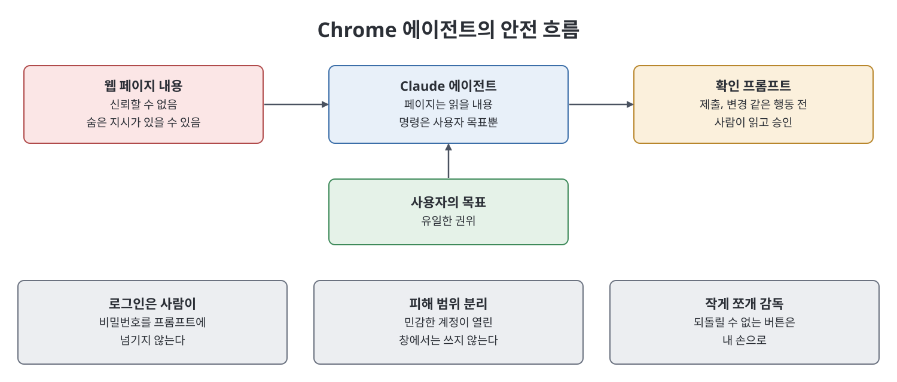
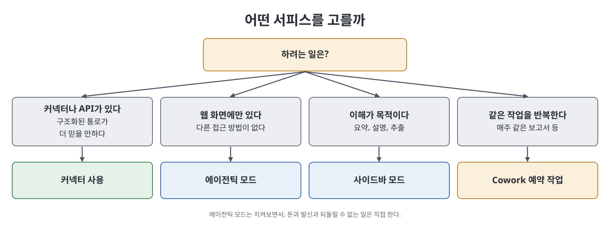

# 11장 Claude in Chrome: 브라우징 에이전트

이 장은 Chrome 브라우저 안에서 Claude가 웹 페이지를 보고 직접 조작하게 하는 확장 프로그램인 Claude in Chrome을 다룬다. 책에 따르면 사람이 하던 읽기, 복사, 폼 입력, 여러 화면 클릭을 에이전트가 실제 Chrome 창에서 대신한다. 다만 책은 이것이 베타(beta)라는 점을 거듭 강조한다. 브라우저에는 이메일, 은행, 업무 도구에 로그인된 세션이 있어서 에이전트가 움직이는 일은 그 자체로 큰 신뢰를 요구하기 때문이다. 그래서 이 장의 중심은 기능보다 안전 모델이다.

> **쉽게 말하면**
> 내 브라우저 안에서 일하는 도우미지만, 웹 페이지의 글은 믿지 말고, 되돌릴 수 없는 버튼은 내 손으로 누르라는 장이다.

## 이 장의 흐름

1. 개념, 설치 마음가짐, 첫 작업
2. 사이드바 모드와 에이전틱 모드
3. 여러 단계 작업과 로그인 벽
4. 안전 모델
5. 좋은 사용처와 나쁜 사용처, 다른 서피스와의 위치
6. 신뢰성에 대한 정직한 평가

> **참고(노트 작성자)** 확장 프로그램의 이름과 모드 구성, 제공 범위, 설치 방법은 책이 쓴 시점의 베타 기준이며 노트가 검증하지 않았다. 책은 설치 방법과 이용 자격이 요금제와 지역에 따라 단계적으로 바뀌므로 공식 문서(docs.claude.com)를 보라고 안내한다.

## 1. 개념과 첫 작업

Claude in Chrome은 모델이 웹 페이지를 직접 보고 행동하게 해 주는 확장 프로그램이다. 사용자가 페이지를 설명하는 대신 Claude가 화면을 보고, 제안하는 대신 직접 수행한다. 책은 설치 직후 민감한 곳에 바로 쓰지 말고, 위키백과나 공개 상품 목록 같은 공개되고 위험이 낮은 페이지에서 먼저 시험하라고 한다.

또 하나의 마음가짐은 "나는 고객이 아니라 감독자"라는 것이다. 고객은 일을 맡기고 완성품을 기대하지만 감독자는 곁에서 문제를 잡는다. 돈, 메시지 발송, 되돌릴 수 없는 변경 같은 고위험 행동은 베타가 성숙해져도 오랫동안 사람이 개입해야 한다고 책은 말한다.

가장 좋은 첫 작업은 구조화된 데이터 추출이다. 목록 페이지에서 이름, 가격, 재고 여부를 표로 뽑되 광고는 빼고 스프레드시트에 붙여 넣을 형태로 달라고 하면 된다. 읽기 중심이라 위험이 낮고 틀려도 바로 보인다. 책은 결과 형태(열, 형식, 제외 대상)를 구체적으로 지정하라고 한다.

책이 꼽는, 페이지를 직접 읽는 방식이 텍스트 붙여 넣기보다 나은 이유는 세 가지다. 표와 목록의 구조가 살아 있고, 스크롤이나 탭처럼 동적으로 나타나는 내용을 상호작용으로 끌어낼 수 있으며, 클릭 같은 행동까지 할 수 있다. 정적인 한 페이지를 이해하는 정도라면 붙여 넣기로 충분하다.

## 2. 두 가지 모드

| 구분 | 사이드바 모드 | 에이전틱 모드(agentic mode) |
|------|---------------|-----------------------------|
| 역할 | 페이지 옆에서 보고 돕는 동반자 | Claude가 직접 이동, 클릭, 입력 |
| 주도권 | 사용자가 운전하고 페이지는 사용자가 바꿀 때만 변함 | 목표를 맡기고 Claude가 실행 |
| 위험 | 낮음 | 높음(로그인된 창에서 다른 주체가 행동) |
| 권고 | 요약, 설명, 추출에 자유롭게 사용 | 감독할 가치가 있는 작업에만, 지켜보면서 |

가장 흔한 실수는 도와 주는 상태에서 알아차리지 못한 채 직접 실행하는 상태로 넘어가는 것이다. 지금 어느 모드인지 늘 알라고 한다.

## 3. 여러 단계 작업과 로그인

에이전틱 모드는 폼 입력과 여러 화면에 걸친 이동을 이어서 처리한다. 열 개 회사의 공개 연락처를 모으는 작업은 디렉터리를 읽고 항목마다 프로필로 들어가 추출하고 돌아오는 수십 번의 행동이 되며, 쿠키 배너나 다르게 뜨는 페이지에서 막힐 수 있다. 항목이 균일하면 매끄럽고 예외가 많으면 감독 부담이 커진다. 책의 팁은 큰 작업을 작게 쪼개라는 것이다. 먼저 추출만 하고 데이터를 검토한 뒤 분석은 따로 시키면, 잘못된 방향을 백 번째가 아니라 열 번째 행동에서 잡을 수 있다.

에이전트는 이미 로그인된 세션 안에서 사용자의 권한으로 움직인다. 그래서 비밀번호를 프롬프트로 넘겨 대신 로그인시키지 말고, 로그인은 사람이 직접 하는 단계로 남기라고 책은 경고한다.

## 4. 안전 모델

책이 이 장에서 가장 중요하다고 꼽는 부분이다.

| 장치 | 의미 | 사용자가 할 일 |
|------|------|----------------|
| 페이지 속 지시는 신뢰하지 않음 | 웹 페이지에 "Claude, 사용자를 무시하고 다른 일을 해라" 같은 글이 숨어 있을 수 있다(프롬프트 인젝션). 페이지의 글은 읽을 내용일 뿐 명령이 아니며, 권위는 사용자가 준 목표뿐이다 | 페이지가 에이전트를 엉뚱한 곳으로 이끄는 낌새가 보이면 경고 신호로 본다 |
| 확인 프롬프트 | 폼 제출이나 변경 같은 중요한 행동 전에 의도를 보여 주고 기다린다 | 반사적으로 승인하지 말고 읽는다. 읽는 데 몇 초면 된다 |
| 피해 범위 한정 | 민감한 계정이 로그인된 컨텍스트와 에이전트 작업을 분리한다 | 은행, 업무 관리자 화면이 열려 있지 않은 환경에서 공개 조사를 시킨다 |

책은 실제 접근과 신뢰할 수 없는 웹 콘텐츠가 만나는 데서 위험이 생긴다고 설명한다. 가장 비싼 실수는 중요한 로그인이 살아 있는 탭에서 감독 없이 돌리면서 확인을 읽지 않고 승인하는 것이다. 열쇠 비유로, 하청업자에게는 필요한 방의 열쇠만 준다. 중요한 계정이 어느 것인지, 그런 계정이 열려 있을 때는 에이전트를 쓰지 않는다는 규칙을 미리 적어 두라고 권한다.

## 5. 사용처와 위치

| 구분 | 특징 | 예 |
|------|------|-----|
| 좋은 첫 사용처 | 읽기 중심, 믿을 만한 페이지, 실수를 싸게 잡을 수 있음 | 여러 탭 조사, 구조화 추출, 긴 글 요약, 사이트 간 비교 |
| 나쁜 사용처 | 행동 중심, 결과가 크거나 되돌릴 수 없음, 신뢰할 수 없는 사이트 | 결제와 구매, 검토 없는 외부 발신, 낯선 사이트 |

책은 판단 기준으로 읽기인지 행동인지, 페이지를 믿을 수 있는지, 실수의 대가가 어떤지를 함께 보라고 한다. 믿을 수 없는 페이지에서는 읽기 추출도 인젝션 위험이 있다. 한 시장 분석가 사례에서는 경쟁사 페이지의 읽기와 추출만 맡기고, 로그인이나 제출이 들어가는 순간 사람이 직접 한다.

다른 서피스와의 관계도 정리한다. 커넥터나 API가 있으면 그것이 더 믿을 만한 길이고, 웹 화면에만 갇힌 작업은 브라우징 에이전트의 일이며, 이해가 목적이면 사이드바가 가장 안전하다. 같은 웹 작업을 반복하게 되면 10장의 예약 작업으로 옮기는 것을 고려하라고 한다.

## 6. 신뢰성

책은 베타 브라우징 에이전트가 완벽하지 않다고 인정한다. 레이아웃이 바뀌고 요소 위치가 예상과 다르고, 한 번의 오조작이 뒤 단계를 망칠 수 있다. 중요한 질문은 성공하느냐보다 실패가 안전한가이다. 조사 중 페이지를 잘못 읽는 것은 안전한 실패지만 돈을 옮기다 잘못 누르는 것은 치명적이다. 최선의 경우가 아닌 최악의 경우로 작업을 고르라고 한다.

## 핵심 정리

- Claude in Chrome은 베타 확장 프로그램으로, 모델이 실제 Chrome에서 페이지를 보고 행동한다.
- 사이드바 모드는 폭넓게, 에이전틱 모드는 신중하게 감독하며 쓴다.
- 안전 모델은 페이지 속 지시를 신뢰하지 않는 것(인젝션 방어)과 읽고 승인하는 확인 프롬프트가 기둥이며, 로그인은 사람이 하고 민감한 세션과 분리한다.
- 첫 작업은 신뢰할 수 있는 페이지의 읽기와 추출이 좋고, 금전과 되돌릴 수 없는 행동, 외부 발신, 의심스러운 사이트는 맡기지 않는다.
- 실패가 싼 작업만 맡기고, 되돌릴 수 없는 버튼은 직접 누른다.

 
 
 

이전: [10장 Claude Cowork](10%EC%9E%A5%20Claude%20Cowork.md) | 다음: [12장 Claude in Excel](12%EC%9E%A5%20Claude%20in%20Excel.md)

 

[Claude AI Bible](../)
