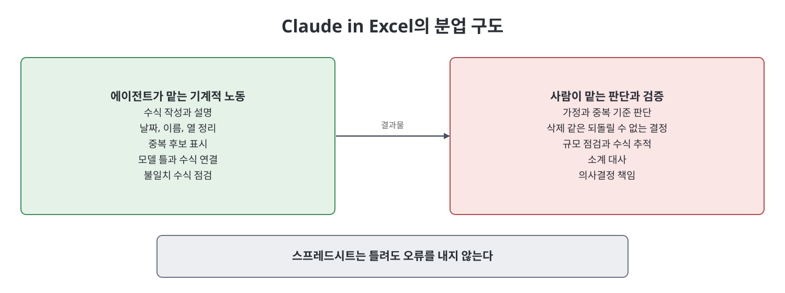
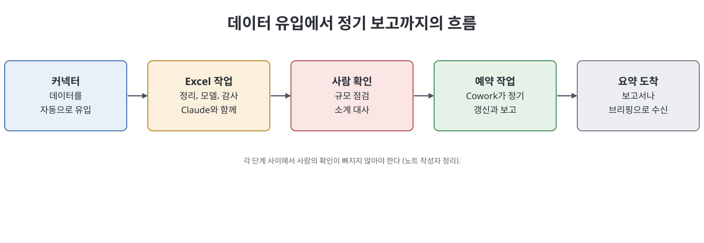

# 12장 Claude in Excel: 스프레드시트 에이전트

이 장은 Microsoft Excel 안에서 Claude가 워크북을 읽고 수식을 만들고, 물려받은 수식을 설명하고, 지저분한 데이터를 정리하고, 모델과 분석을 짓고, 오류를 점검해 주는 Claude in Excel을 다룬다. 책이 보는 대상은 스프레드시트에 기대지만 전문가는 아닌 많은 사람들과, 반복 작업을 줄이고 싶은 숙련자다. 저자는 이것도 베타라고 밝히고, 스프레드시트는 틀려도 오류를 내지 않고 그럴듯한 틀린 숫자를 보여 준다는 점에서 "사람이 반드시 확인해야 하는 부분"이 이 장의 핵심이라고 강조한다.

> **쉽게 말하면**
> 지루한 수식 작성, 데이터 정리, 점검은 Claude에게 맡기되, 결과 숫자가 현실과 맞는지는 반드시 사람이 확인하라는 장이다.

## 이 장의 흐름

1. 무엇이고 누구를 위한 것인가, 켜는 법
2. 수식 만들기와 설명, 결과를 말하는 요청법
3. 데이터 정리, 모델 만들기, 오류 점검
4. 한계와 사람의 확인, 민감 데이터
5. 더 큰 흐름과 사례

> **참고(노트 작성자)** Excel 통합의 제공 방식(데스크톱, 웹, 라이선스 등급), 활성화 절차, 베타 상태는 책이 쓴 시점 기준이며 노트가 검증하지 않았다. 책은 최신 설정 경로를 공식 문서(docs.claude.com)에서 확인하라고 안내한다.

## 1. 무엇을 대신하고 무엇을 대신하지 않나

Claude in Excel은 Claude 모델이 Excel 안에서 워크북을 읽고 만들고 고치고 설명하게 한다. 책이 선을 긋는 지점은 분명하다. 대신하는 것은 문법과 씨름하기, 찾아서 고치기, 반복적인 재구성, 줄 단위 감사 같은 기계적 노동이다. 대신하지 않는 것은 자기 숫자를 이해하는 일, 모델의 가정과 중복의 기준 같은 판단, 숫자가 의사결정에 들어갈 때의 책임이다. "생각은 사용자 몫이고 잡일이 옮겨 간다"는 것이 저자의 정리다.

시작할 때는 하나뿐인 중요한 파일이 아닌 복사본에서 하라고 권한다. 모든 숫자를 아는 워크북의 복사본에서 정답을 아는 수식을 만들게 하면, 결과를 믿어도 되는지 바로 판단할 수 있다.

## 2. 수식과 요청 방식

| 활용 | 설명 | 요청 예(노트 작성자가 새로 씀) |
|------|------|-------------------------------|
| 수식 만들기 | 필요한 결과를 말하면 수식을 만들어 배치한다 | 요약 시트에 지역별 성사 건 매출 합계를 거래 시트에서 가져와 달라 |
| 수식 설명 | 물려받은 수식이 무엇을 하는지, 바꾸면 무엇이 깨지는지 설명 | 이 셀 수식을 단계별로 풀어 주고 날짜 범위를 바꾸면 어떻게 되는지 알려 달라 |
| 정리와 재구성 | 날짜 형식 통일, 이름 정리, 열 분리, 중복 표시 | 날짜를 한 형식으로 맞추고 중복은 지우지 말고 표시만 해 달라 |
| 모델 제작 | 목표, 입력, 원하는 출력을 주면 구조와 수식을 지음 | 12개월 현금흐름표를 가정값을 바꿔 볼 수 있게 만들어 달라 |
| 오류 점검 | 이웃과 다른 수식, 어긋난 참조, 맞지 않는 합계를 찾아 목록화 | 의심스러운 셀을 목록으로 알려 달라 |

책의 요령은 함수 이름이 아닌 결과를 말하라는 것이다. "INDEX-MATCH를 써 줘"보다 "직원 목록마다 인원 명부 탭에서 부서를 찾아 옆에 넣어 줘"가 낫다. 함수를 지정하면 더 나쁜 방법에 갇힐 수 있고, 결과를 말하면 에이전트가 깔끔한 방법을 고른다. 수식을 만든 직후 그 수식을 설명해 달라고 하면 결과와 이해를 함께 얻고, 의도와 다른 수식인지도 점검할 수 있다.

유지보수성도 요청에 넣을 수 있다. 가정은 맨 위의 이름 붙은 블록에 두고, 행마다 같은 수식을 쓰고, 알아보기 어려운 셀에는 짧은 메모를 달라고 하면 나중에 또 하나의 수수께끼가 되지 않는다.

## 3. 데이터 정리와 감사에서 지킬 원칙

책이 반복하는 패턴은 에이전트가 변환하고 표시하되 되돌릴 수 없는 결정은 사람이 한다는 것이다. 중복이나 쓰레기로 보이는 행을 조용히 지우게 하지 말고 후보를 표시하게 한 뒤 검토하라고 한다. 같은 이름의 서로 다른 고객이나 합법적인 반복 거래가 있을 수 있기 때문이다.

감사 사례도 소개된다. 한 재무 책임자가 물려받은 이사회용 모델을 점검하자, 새로 생긴 비용 항목이 합계에서 빠져 있던 오류가 발견되었다는 이야기다. 책의 결론은 에이전트가 판단을 대체한 것이 아니라 판단에 재료를 준 것이다. 책은 이 도구가 모든 오류를 잡지는 못하므로 단독 검사로 믿어서는 안 된다고 덧붙인다.

## 4. 사람의 확인과 민감 데이터

| 확인 방법 | 내용 |
|-----------|------|
| 규모 점검 | 결과가 들어와야 할 범위를 먼저 생각하고 맞는지 본다. 책의 예로, 월 매출이 20만 수준인데 어느 달이 400만으로 나오면 수식이 깔끔해 보여도 틀린 것이다 |
| 수식 추적 | 몇 개 셀의 수식을 직접 따라가 본다 |
| 입력 변경 | 입력 하나를 바꿔 종속 셀이 예상한 방향과 크기로 움직이는지 본다 |
| 대사 | 소계를 독립적으로 센 값이나 이미 믿는 숫자와 맞춰 본다 |

핵심은 스프레드시트가 틀려도 빨갛게 변하지 않는다는 점이다. 중요한 출력을 의사결정에 쓰기 전에 현실과 대조하는 것이 협상 불가한 규칙이다. 책은 넓게 만들게 하고 확인은 좁고 구체적으로, 가장 틀리기 쉽거나 영향이 큰 곳에 하라고 한다.

민감한 데이터도 짚는다. 책은 광고가 없고 데이터를 판매하지 않으며 학습 사용은 사용자가 통제한다고 서술하지만, 그래도 조직의 정책을 확인하고, 최신 데이터 처리 방식을 공식 문서로 확인하고, 의심스러우면 식별자를 코드로 바꾼 버전에서 작업하라고 권한다. 코드를 원래 이름으로 되돌리는 일은 사용자가 직접 한다.

> **참고(노트 작성자)** 데이터 이용 관련 서술은 책의 시점과 설명을 옮긴 것이며 노트가 검증하지 않았다. 실제 정책은 요금제와 조직 설정에 따라 다를 수 있다.

## 5. 더 큰 흐름과 사례

책은 Excel을 단독 기능이 아닌 흐름의 한 고리로 보라고 한다. 커넥터로 데이터를 들여오고, Excel에서 Claude와 분석하고, 결과를 보고서나 10장의 예약 작업으로 내보내는 식이다. 세 사례가 같은 패턴을 보여 준다. 예산표는 수식과 전년 대비 증가율 15% 초과 표시를 맡기고 합계를 직접 대사한다. 영업 파이프라인은 단계 이름과 날짜를 정리하고 30일 무활동 건을 표시하되 죽은 건인지 느린 건인지는 사람이 판단한다. 설문 CSV는 재구성과 응답 분포를 맡기되 주관식 응답은 직접 읽는다.

## 핵심 정리

- Claude in Excel은 베타 통합으로, 수식 작성과 설명, 데이터 정리, 모델 제작, 오류 점검을 맡는다.
- 함수 이름보다 달성할 결과를 말하고, 수식 작성 직후 설명을 요청한다.
- 삭제 같은 되돌릴 수 없는 결정은 사람이 하고, 에이전트에게는 후보 표시를 시킨다.
- 스프레드시트는 틀려도 오류를 내지 않으므로 규모 점검, 수식 추적, 입력 변경, 대사로 확인한 뒤에 숫자를 의사결정에 쓴다.
- 민감한 데이터는 정책 확인과 식별자 마스킹을 먼저 하고, 시작은 복사본에서 한다.

 
 
 

이전: [11장 Claude in Chrome](11%EC%9E%A5%20Claude%20in%20Chrome.md) | 다음: [핵심 정리](%ED%95%B5%EC%8B%AC%20%EC%A0%95%EB%A6%AC.md)

 

[Claude AI Bible](../)
