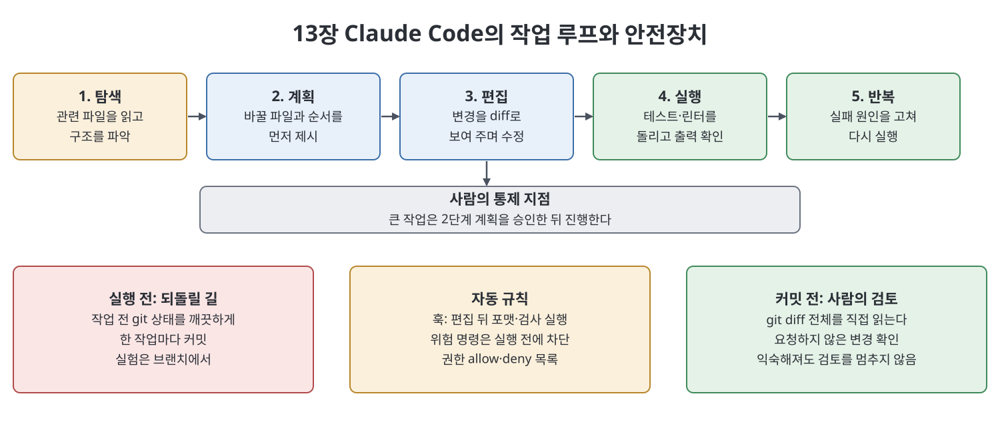

# 13장 Claude Code, 터미널의 에이전트형 코딩 (Claude Code)

이 장은 Claude를 터미널에서 "손이 달린 에이전트"로 쓰는 도구인 `Claude Code`를 소개한다. 책에 따르면 채팅 속 Claude는 답을 주고 사람이 그 답대로 일하지만, `Claude Code`는 프로젝트 파일을 읽고, 수정하고, 셸 명령까지 직접 실행한 뒤 결과를 보고 다음 행동을 정한다. 저자는 이 도구가 개발자만의 것이 아니라고 강조한다. 필요한 능력은 코딩 지식보다 원하는 바를 설명하고, 결과를 점검하고, 맞는지 판단하는 힘이라는 것이다. 장의 절반은 이 강력한 도구를 안전하게 통제하는 습관에 쓰인다.

> **쉽게 말하면**
> 말로 지시하면 알아서 파일을 읽고 고치고 테스트까지 돌려 주는 조수이지만, 계획을 먼저 보고 git으로 되돌릴 길을 만들어 두고 변경을 직접 확인해야 안전하다는 이야기다.

## 이 장의 흐름

1. `Claude Code`가 무엇이고 어떻게 시작하는가
2. 탐색, 계획, 편집, 실행, 반복의 루프와 계획 우선 습관
3. 서브에이전트, 훅, 설정 파일, `CLAUDE.md`
4. git 안전 워크플로, MCP 연결, 슬래시 명령
5. 비용과 검토에 대한 솔직한 조언

## 1. 무엇이고 어떻게 시작하나

`Claude Code`는 터미널 애플리케이션이다. 프로젝트 폴더에서 `claude`를 입력해 시작하면 대화가 열리고, 그 대화는 실제 결과를 낳는다. 책은 이를 "조수에서 운영자로의 전환"이라 부르며, 그만큼 위험도 커지므로 통제 습관이 필요하다고 한다. 모델은 `Opus`(깊은 추론), `Sonnet`(균형 잡힌 기본값), `Haiku`(빠르고 저렴한 단순 작업)를 세션 중에 바꿔 쓸 수 있다고 소개한다.

설치는 `npm` 기반 전역 설치로 예시하되, 설치 명령은 바뀔 수 있으니 공식 문서에서 현재 방법을 확인하라고 책이 직접 당부한다. 첫 실행에서는 인증을 하는데, Claude 계정으로 로그인하면 `Pro`·`Max` 구독의 포함 사용량을 쓰고, API 키를 쓰면 토큰마다 종량제로 따로 청구된다. 첫 요청은 "프로젝트를 설명하되 아무것도 바꾸지 말라"처럼 위험 없이 검증할 수 있는 것이 좋다고 한다. 설명이 틀리면 그 프로젝트에 더 많은 맥락을 줘야 한다는 신호다.

> **참고(노트 작성자)** 설치 명령, 모델 이름과 버전, 요금 방식은 책이 쓰인 시점 기준이며 노트가 검증하지 않았다. 실제로 쓸 때는 공식 문서를 확인한다.

## 2. 작업 루프와 계획 우선 습관

책이 설명하는 한 번의 작업은 다섯 단계로 흐른다.

| 단계 | 하는 일 |
|------|---------|
| 탐색(explore) | 관련 파일을 읽고 참조를 따라가 구조를 파악한다 |
| 계획(plan) | 어떤 파일을 어떻게 바꿀지 먼저 밝힌다. 사람의 첫 통제 지점이다 |
| 편집(edit) | 변경을 diff(바뀐 줄 비교)로 보여 주며 수정한다 |
| 실행(run) | 테스트, 서버, 린터 등을 돌리고 출력을 읽는다 |
| 반복(iterate) | 실패하면 원인을 진단해 고치고 다시 돌린다 |

책의 예시에서는 입력 검증 추가를 시켰더니 기존 헬퍼 함수를 찾아 재사용하고, 테스트를 쓰고, 테스트 실패를 스스로 고쳤다. 사람은 계획을 한 번 승인하고 diff를 읽었을 뿐이다. 핵심은 에이전트의 실패 방식이 "아무것도 안 함"이 아니라 "원치 않는 방향으로 많이, 빠르게 함"이라는 점이다. 그래서 파일 두세 개를 넘는 리팩터링이나 마이그레이션은 계획을 먼저 쓰게 하고(읽기 전용으로 계획만 세우는 계획 모드도 있다고 한다), 계획이 맞을 때만 진행시킨다.

## 3. 서브에이전트, 훅, 설정, CLAUDE.md

- **서브에이전트**: 긴 작업은 한 에이전트의 맥락이 지저분해지므로, 별도 맥락을 가진 일꾼에게 좁은 일을 맡기고 요약만 받는다. 책은 파일 수십 개를 읽어야 하는 조사를 맡기고 결론과 경로만 받는 "일회용 조사원" 활용을 권한다.
- **훅(hook)**: 에이전트 수명주기의 특정 시점(도구 실행 전·후, 세션 시작, 작업 종료 시점)에 자동으로 실행되는 명령이다. 책의 예는 파일 편집 뒤 포맷터와 타입 검사를 자동으로 돌리는 것이고, 실행 전 훅으로 위험 명령(예: 운영 DB 초기화)을 막는 안전장치도 소개한다. 모델의 판단에 기대지 않는 규칙이라는 점이 장점이다.
- **설정 파일**: 사용자 수준과 프로젝트 수준이 있고, 프로젝트 설정이 사용자 설정을 덮어쓴다고 한다. 허용(allow)·거부(deny) 권한 목록으로 에이전트가 묻지 않고 할 수 있는 범위를 정한다. 처음에는 좁게 시작해 신뢰가 쌓이면 넓히라고 권한다.
- **`CLAUDE.md`**: 프로젝트 루트에 두는 마크다운 파일로, 세션 시작 때마다 자동으로 읽히는 상시 지침이다. 프로젝트 설명, 핵심 명령, 규칙, "절대 하지 말 것"을 짧고 밀도 있게 적는다. 책은 이 파일을 장 전체에서 가장 효과 큰 설정으로 꼽고, 에이전트가 규칙을 어기면 꾸짖기보다 파일에 규칙을 추가하라고 한다.

| 구성요소 | 역할 | 적용 범위 |
|----------|------|-----------|
| 설정 파일 | 기본 모델, 도구 허용·거부 | 사용자 또는 프로젝트(프로젝트 우선) |
| `CLAUDE.md` | 프로젝트 맥락과 규칙을 상시 제공 | 해당 프로젝트 |
| 훅 | 특정 시점에 명령을 자동 실행·차단 | 설정에 연결 |
| 서브에이전트 | 좁은 일을 별도 맥락에서 처리 | 작업 단위 |

> **참고(노트 작성자)** 책의 훅·권한 JSON 예시에 쓰인 키 이름과 구조, 허용 규칙 문법은 책이 쓰인 시점의 것이며 노트가 확인하지 않았다. 따라 하기 전에 현재 문서와 대조한다.

## 4. git 안전 워크플로, MCP, 슬래시 명령

책이 가장 강조하는 규칙은 "git을 되돌리기 버튼으로 쓰고 자주 커밋하라"는 것이다. 작업 전에 깨끗한 상태인지 확인하고, 한 작업이 끝나면 전체 변경(`git diff`)을 코드 리뷰어의 눈으로 읽은 뒤 커밋한다. 실험적인 작업은 브랜치에서 한다. 여러 작업을 커밋 없이 이어 가면 어디서 깨졌는지 분리할 수 없게 되므로, 한 작업보다 긴 미커밋 세션은 위험 신호라고 한다.

MCP 서버를 연결하면 에이전트가 이슈 트래커나 문서 저장소 같은 외부 정보를 직접 읽을 수 있다. 책은 연결한 서버마다 환경으로 들어오는 새 문이 되므로 신뢰하는 서버만, 필요한 최소 권한으로 연결하라고 경고한다(자세한 내용은 [16장](16%EC%9E%A5%20MCP.md)).

슬래시(`/`)로 시작하는 입력은 모델에 보내는 요청이 아니라 도구 자체에 내리는 명령이다. 책은 도움말, 대화 비우기, 대화 요약(`compact`), 모델 전환, 변경 검토 같은 범주를 소개하고, 자주 쓰는 지시를 사용자 정의 슬래시 명령으로 저장할 수 있다고 한다. 세션이 느려지고 잊어버릴 때는 새로 시작하지 말고 요약으로 이어 가라는 조언이다.

> **참고(노트 작성자)** 구체적인 슬래시 명령 이름과 목록은 책이 일부러 범주만 소개하므로 노트도 이름을 단정하지 않는다.

## 5. 비용과 검토

에이전트형 코딩은 파일을 많이 읽고 명령 출력을 다시 읽으며 반복하기 때문에 채팅보다 토큰을 훨씬 많이 쓴다고 책은 말한다. 구독이면 한도에 빨리 닿고 API면 청구서에 나타난다. 대응은 기본으로 `Sonnet`을 쓰고, 어려운 추론에만 `Opus`, 기계적 편집에는 `Haiku`를 쓰며, `CLAUDE.md`와 작업 범위를 좁게 잡는 것이다. 마지막 경고는 익숙해질수록 검토가 느슨해진다는 점이다. 에이전트가 가끔 자신 있게 틀린다는 사실과 코드 사이에 있는 것은 사람의 꼼꼼한 읽기뿐이다.

## 핵심 정리

- `Claude Code`는 파일을 읽고 쓰고 명령을 실행하는 터미널 에이전트이며, 비개발자도 쓸 수 있다고 책은 본다.
- 탐색, 계획, 편집, 실행, 반복의 루프를 따르며, 큰 작업은 계획을 먼저 승인한다.
- `CLAUDE.md`는 상시 맥락, 훅은 자동 규칙·차단, 서브에이전트는 맥락 분리 수단이다.
- git 커밋을 되돌리기 지점으로 삼고, 커밋 전에 전체 diff를 직접 읽는다.
- 비용은 모델 선택과 좁은 범위로 관리하고, 검토 습관은 익숙해져도 버리지 않는다.

 
 
 

이전: [4부 Readme](Readme.md) | 다음: [14장 Skills](14%EC%9E%A5%20Skills.md)

 

[Claude AI Bible](../)
