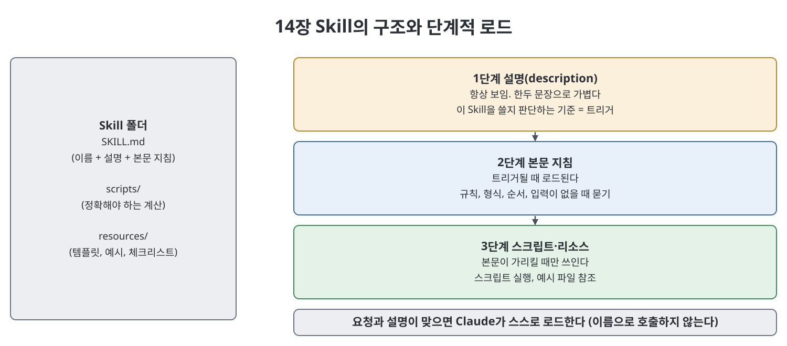

# 14장 Skills, 재사용 가능한 능력 (Skills)

이 장은 반복되는 작업을 Claude가 "우리 방식대로" 수행하도록 포장하는 `Skill`을 다룬다. 책은 회사의 제안서 양식을 완벽히 아는 동료의 지식을 병에 담는 비유로 시작한다. `Skill`은 지시문과 선택적 스크립트·참고 파일이 든 폴더이며, 과제가 맞을 때 Claude가 필요에 따라 불러와 그대로 따른다. 장은 `Skill`이 푸는 문제, 구조, 트리거(실행 조건) 원리, 작성 연습, 테스트, 라이브러리 관리, 공유까지 이어진다.

> **쉽게 말하면**
> 매번 길게 설명하던 "우리 회사식 작업법"을 폴더 하나에 적어 두면 Claude가 알아서 꺼내 쓴다. 그 폴더를 꺼낼 때를 정하는 것은 설명(description) 한 줄이다.

## 이 장의 흐름

1. `Skill`이 푸는 문제와 구조
2. 설명이 곧 트리거라는 원리
3. 첫 `Skill` 만들기와 좋은 설명·나쁜 설명
4. 스크립트·자산 번들, 테스트와 반복
5. 본문 작성법, 라이브러리 관리, 쓸 때와 안 쓸 때, 공유

## 1. 문제와 구조

책이 지적하는 문제는 이렇다. `Skill` 이전에는 대화를 열 때마다 같은 맥락을 다시 쓰고, 쓸 때마다 표현이 달라 결과가 흔들리며, 동료는 각자 다른 설명을 쓴다. `Skill`은 이 지식을 머릿속과 옛 대화에서 파일로 옮긴다. 부수 효과로 맥락이 깨끗하게 유지된다. 긴 지침이 평소에는 잠들어 있다가 필요할 때만 로드되기 때문이다.

`Skill`의 최소 단위는 `SKILL.md` 하나가 든 폴더다. 파일 위쪽에는 이름(`name`)과 설명(`description`)을 담은 메타데이터가 있고, 아래쪽 본문은 평범한 마크다운 지침이다. 선택적으로 스크립트(정확하게 반복되어야 하는 계산·변환용)와 리소스(템플릿, 스타일 참고, 예시)를 함께 넣는다.

| 구성 | 로드 시점 | 역할 |
|------|-----------|------|
| 설명(description) | 항상 보임 | 이 `Skill`을 쓸지 판단하는 기준. 한두 문장이라 가볍다 |
| 본문 지침 | `Skill`이 트리거될 때 | 방법, 규칙, 형식, 주의점 |
| 스크립트·리소스 | 본문이 가리킬 때만 | 정확한 계산, 참고 예시 |

이렇게 단계적으로 불러오므로 아주 긴 참고 문서를 붙여도 쓰기 전까지는 비용이 거의 들지 않는다고 책은 설명한다.

## 2. 설명이 곧 트리거

책이 가장 흔한 오해로 꼽는 대목이다. `Skill`은 이름으로 호출하는 명령이 아니라, Claude가 요청 내용과 설명을 대조해 스스로 쓸지 결정한다. 따라서 설명은 문서가 아니라 매칭 로직이다. 트리거와 범위는 설명에, 구체적인 방법은 본문에 둔다. 본문은 길어도 트리거 때만 로드되지만, 설명은 늘 평가되므로 짧고 구체적이어야 한다.



## 3. 첫 Skill 만들기와 설명 쓰기

책의 예시는 서점 체인의 주간 매장 성과 요약이다. 먼저 구체적인 이름을 붙이고, 사람들이 실제로 쓰는 표현("주간 요약", "월요일 숫자")을 담은 설명을 쓰고, 본문에 정해진 섹션 순서, 규칙, 스크립트 호출, 예시 파일 참조를 넣는다. 아래는 노트 작성자가 같은 구조를 다른 주제로 새로 쓴 축약 예시다.

```markdown
---
name: meeting-recap
description: 회의 내용을 팀 표준 형식의 회의록으로 정리한다. 사용자가
  회의록, 회의 요약, 오늘 회의 정리, 액션 아이템 정리를 요청할 때 쓴다.
---
# 회의록 정리
목표: 읽지 않은 사람이 결정 사항과 담당자를 바로 파악하게 한다.
## 규칙
- 순서는 결정 사항, 액션 아이템(담당자·기한), 논의 요약.
- 담당자나 기한이 없으면 추측하지 말고 사용자에게 묻는다.
```

책은 설명의 좋고 나쁨을 사례로 보인다. "사건 보고서" 같은 두 단어는 너무 짧아 동전 던지기이고, "다양한 보고서에 쓰는" 식의 장황하고 모호한 설명은 길이가 도움이 되지 않는다. 좋은 설명은 산출물(사후 보고서), 상황(운영 중단), 사람들이 쓰는 여러 표현(정리해 줘, 포스트모템 등)을 모두 담는다. 요약하면 산출물을 명명하고, 상황을 명시하고, 실제 요청 표현을 나열하며, 서론은 생략한다.

## 4. 스크립트·자산과 테스트

판단과 서식은 본문에 맡기되, 매번 똑같이 나와야 하는 계산(예: 구매 전환율)은 스크립트로 번들해 "직접 계산하지 말고 이 스크립트를 실행하라"고 지시한다. 지능이 필요한 곳은 모델에, 정밀함이 필요한 곳은 코드에 맡기는 분업이 잘 만든 `Skill`의 특징이라고 한다. 예시 출력 파일도 같은 방식으로, 추상적 설명 대신 모방할 실물을 건넨다.

테스트는 두 가지다. 먼저 트리거 테스트로, 새 대화에서 실제 사용자처럼 줄임말이나 어긋난 표현으로 요청해 `Skill`이 뜨는지 본다. 안 뜨면 설명이 너무 좁고, 엉뚱할 때 뜨면 너무 넓다. 다음은 출력 테스트로, 형식을 지키는지, 스크립트를 실제로 실행하는지, 빠진 입력을 지어내지 않고 묻는지 확인한다. 고칠 곳은 대개 본문의 불명확한 한 문장이므로 한 번에 하나씩 고친다. 억지로 트리거를 깨뜨려 보는 시험도 권한다.

## 5. 본문, 라이브러리, 적용 범위, 공유

| 본문 작성 원칙 | 의미 |
|----------------|------|
| 절차보다 목표 먼저 | 모호한 단계가 있을 때 판단 기준이 된다 |
| 절대 규칙은 눈에 띄게 | 협상 불가 규칙을 별도 구역에 명령문으로 적는다 |
| 예시를 보여 줌 | 좋은 출력(가능하면 나쁜 출력 설명도)이 가장 효과적이다 |
| 입력 누락 대비 | 필요한 입력이 없으면 지어내지 말고 묻도록 명시한다 |
| 구체성은 판단이 필요한 곳에 | 서식 같은 사소한 곳에 공을 들이지 않는다 |

라이브러리 관리 조언은 한 `Skill`에 한 가지 일만 맡기고, 설명이 겹치는 `Skill`끼리의 충돌에 주의하며, 이름 규칙을 일관되게 하고, 주기적으로 정리하라는 것이다. 책은 반복되고(recurring) 취향이 분명한(opinionated) 작업에 `Skill`이 값어치가 있다고 본다. 외부 시스템 연결은 `Skill`이 아니라 MCP 서버의 일이고, 일회성 질문이나 "잘 하라" 수준의 지침은 `Skill`로 만들 이유가 없다. 구체적 규칙이나 단계를 세 개 쓸 수 있는지가 판별 기준이다. `CLAUDE.md`는 프로젝트의 상시 맥락이고 `Skill`은 작업에 따라 호출되는 전문성이므로, 작업별 방법이 `CLAUDE.md`에 쌓이면 `Skill`로 옮길 때다.

`Skill`은 폴더이므로 압축해 보내면 공유되고, 팀은 중앙 저장소에 정본을 두어 복사본이 흩어지는 것을 막을 수 있다. 여러 구성요소를 묶어 배포하는 것은 다음 장의 플러그인이 맡는다.

> **참고(노트 작성자)** `SKILL.md` 메타데이터의 허용 필드와 폴더 규칙, 사용자가 `Skill`을 두는 위치는 책이 자세히 다루지 않아 노트도 단정하지 않는다. 실제로 만들 때는 현재 공식 문서를 확인한다.

## 핵심 정리

- `Skill`은 `SKILL.md`를 가진 폴더이며, 설명은 상시, 본문은 트리거 시, 스크립트·리소스는 필요 시 로드된다.
- 설명이 트리거이므로 산출물, 상황, 실제 요청 표현을 담아 구체적으로 쓴다.
- 정확해야 하는 계산은 스크립트로, 형식은 예시 파일로 번들한다.
- 트리거와 출력을 따로 테스트하고, 한 문장씩 고친다.
- 한 `Skill`은 한 가지 일만 하고, 반복되고 취향이 분명한 작업에만 만든다.

<br>
<br>
<br>

이전: [13장 Claude Code](13%EC%9E%A5%20Claude%20Code.md) | 다음: [15장 플러그인과 마켓플레이스](15%EC%9E%A5%20%ED%94%8C%EB%9F%AC%EA%B7%B8%EC%9D%B8%EA%B3%BC%20%EB%A7%88%EC%BC%93%ED%94%8C%EB%A0%88%EC%9D%B4%EC%8A%A4.md)

<br>

[Claude AI Bible](../)
