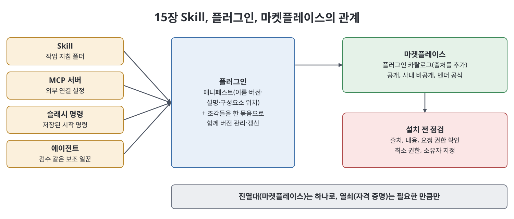

# 15장 플러그인과 마켓플레이스 (Plugins and Marketplaces)

이 장은 `Skill` 하나로는 부족해지는 순간, 즉 여러 조각이 함께 일하는 기능을 다른 사람에게 넘기고 싶을 때 쓰는 `plugin`과 그것을 유통하는 `marketplace`를 다룬다. 책의 출발점은 릴리스 노트 기능 예시다. `Skill`은 이슈 트래커 연결, 시작용 명령, 검수 에이전트가 있어야 제대로 돌아가는데, 이를 하나씩 설치하라고 하면 인수인계가 아니라 숙제가 된다는 것이다. 장은 플러그인의 정의, 설치와 갱신, 점검(vetting), 직접 만들기, 팀 거버넌스 순으로 진행한다.

> **쉽게 말하면**
> `Skill`이 부품이라면 플러그인은 조립된 가전, 마켓플레이스는 그 가전을 진열한 가게다. 가게에서 아무거나 집어 오면 위험하므로 출처 확인과 최소 권한이 핵심이다.

## 이 장의 흐름

1. 플러그인이란 무엇이고 `Skill`·MCP와 어떻게 다른가
2. 설치, 제거, 설치 범위
3. 플러그인이 해결하지 못하는 것, 마켓플레이스 추가
4. 설치 전 점검과 플러그인의 세 가지 모양
5. 직접 만들기, 공유와 갱신, 팀 거버넌스

## 1. 플러그인의 정의와 위계

책에 따르면 플러그인은 `Skill`, MCP 서버, 슬래시 명령, 에이전트를 함께 담을 수 있는 설치 가능한 묶음이다. 한 번 설치하면 모든 조각이 제자리에 등록된다. 묶음의 의미는 편의만이 아니라 신뢰성이다. 함께 버전 관리되고 함께 갱신되므로 새 `Skill`에 옛 명령이 섞이는 어긋남이 없다.

| 단위 | 정체 | 비유 |
|------|------|------|
| `Skill` | 한 가지 작업을 가르치는 지침 폴더 | 부품 |
| MCP 서버 | 외부 도구·데이터와의 연결 프로그램 | 설비 연결선 |
| 플러그인 | 위 조각들을 하나로 배포하는 패키지 | 조립된 가전 |

플러그인은 `Skill`·MCP의 경쟁자가 아니라 포장재다. 지침 하나뿐이라면 그냥 `Skill`이다. 책은 가장 작은 용기를 쓰라고 하며, 홀로 있는 `Skill`을 플러그인으로 감싸는 것은 포장 부담만 늘린다고 경고한다.

## 2. 설치와 설치 범위

책은 세션 안에서 `/plugin`으로 둘러보고 `/plugin install <이름>@<마켓플레이스>`로 설치하며, `/plugin list`, `/plugin uninstall`로 확인과 제거를 한다고 예시한다. 설치되면 `Skill`은 트리거되고, MCP 서버는 연결되며(처음에는 자격 증명이 필요할 수 있다), 슬래시 명령이 나타난다. 설치 범위는 나 혼자만 보는 개인 수준과, 프로젝트와 함께 커밋되어 팀원이 자동으로 얻는 프로젝트 수준이 있다. 책은 팀 작업이 의존하는 플러그인은 프로젝트 수준에 두라고 권한다.

> **참고(노트 작성자)** 위 명령 형태는 책이 쓰인 시점의 예시이며 책 스스로 문법이 바뀔 수 있다고 밝힌다. 노트가 검증하지 않았으므로 현재 도움말과 문서로 확인한다.

## 3. 한계와 마켓플레이스

플러그인은 유통과 일관성을 해결할 뿐 설계 문제를 해결하지 못한다. 트리거되지 않는 `Skill`을 포장해도 고장난 트리거가 더 많은 사람에게 퍼질 뿐이고, 자격 증명이 없으면 설치는 되어도 작동하지 않는다. 그래서 조각마다 먼저 단독으로 동작을 확인한 뒤 마지막에 포장해야 한다.

마켓플레이스는 플러그인 목록(카탈로그)이다. 공식 하나만 있는 것이 아니라 필요한 것을 출처로 추가하며, 공개 목록, 회사 내부의 비공개 목록, 제품 벤더의 공식 목록 등이 있을 수 있다. 책은 `/plugin marketplace add <이름> <주소>` 형태를 예로 든다. 작은 팀이라도 검증된 서너 개를 담은 내부 git 저장소 하나를 마켓플레이스로 두면 "그 링크 누가 갖고 있지?"가 사라진다고 한다.

## 4. 설치 전 점검(vetting)과 플러그인의 모양

책이 가장 중요하지만 가장 덜 주목받는다고 한 부분이다. 플러그인에는 MCP 서버와 에이전트가 들어 있을 수 있으므로 설치는 곧 데이터를 읽고 시스템에서 행동할 수 있는 소프트웨어에 권한을 주는 일이다.

| 점검 항목 | 확인할 것 |
|-----------|-----------|
| 출처 신뢰 | 누가 만들었고 믿을 이유가 있는가 |
| 내용 확인 | 어떤 `Skill`, MCP 서버, 명령, 에이전트가 들었고 읽기 전용인가 쓰기까지 가능한가 |
| 권한·자격 증명 | 정말 필요한 접근인가, 범위는 가장 좁은가 |
| 최소 권한 | 읽기 전용, 범위가 한정된 토큰, 마스터 키 금지 |

특히 급하게 넓은 권한의 자격 증명을 줘 놓고 플러그인의 존재를 잊는 것이 가장 비싼 실수라고 한다. 설치 때 필요 이상의 범위를 주지 않고, 쓰지 않는 플러그인의 접근을 주기적으로 점검해 회수한다.

책이 보여 주는 세 모양은 모두 종합 사례다. 워크플로 플러그인은 `Skill`이 중심이고 연결·명령·검수가 보조한다. 커넥터 플러그인은 MCP 서버가 중심이고 `Skill`이 사용법을 보조한다. 툴킷 플러그인은 외부 연결 없이 관련 `Skill`을 모아 한 번에 배포한다.

## 5. 만들기, 공유·갱신, 거버넌스

플러그인은 매니페스트(이름, 버전, 설명, 구성요소 위치를 적은 파일)와 `Skill`·명령·에이전트·MCP 설정 조각으로 이뤄진 디렉터리다. 책은 `plugin.json`을 매니페스트로, `skills/`, `commands/`, `agents/` 폴더와 `.mcp.json`을 두는 구조를 예시하되, 정확한 스키마는 현재 문서로 확인하라고 한다. 조언은 두 가지다. 바뀐 만큼 버전을 정직하게 올리고, 설명을 `Skill` 설명처럼 트리거와 상황이 풍부하게 쓰라는 것이다.

> **참고(노트 작성자)** 매니페스트 파일명, 필드 이름, 폴더 구조는 책의 예시이며 노트가 검증하지 않았다.

공유는 플러그인을 마켓플레이스(저장소)에 올리는 것이고, 갱신은 `/plugin marketplace update`로 카탈로그를 새로고침하고 `/plugin update`로 설치된 플러그인을 맞추는 형태로 예시한다. 책은 버전 번호를 계약으로 본다. 하위 호환되는 수정이나 추가는 작은 버전을, 명령 이름이나 출력 형태처럼 사용자가 의존하는 인터페이스를 바꾸면 큰 버전(major)과 공지를 붙인다. 슬래시 명령 이름을 몰래 바꾼 것을 작은 버전으로 낸 일이 팀 전체의 조용한 고장으로 이어진다는 경고가 있다.

팀 거버넌스의 뼈대는 큐레이션된 내부 마켓플레이스다. 올라오기 전에 검토(내용, 접근 범위, 약속한 일만 하는지)를 거치게 하고, 누가 게시할 수 있는지 정하고, 어디에 무엇이 설치됐는지 기록하며, 쓰지 않는 것은 분기마다 정리하고 자격 증명을 회수한다. 5분 검토에서 던질 네 질문은 무엇이 들었는가, 어떤 외부 시스템에 읽기·쓰기로 닿는가, 필요한 자격 증명이 가장 좁은가, 소유자가 누구인가다. 소유자는 승인할 때 정한다. 책의 로테르담 물류 회사 사례에서는 플러그인을 금지하는 대신 내부 마켓플레이스 하나를 유일한 승인 출처로 정하고 검토 담당자를 두어 생산성을 지켰다. 결론은 "플러그인을 줄이는 게 아니라 믿을 수 있는 진열대와 최소 권한 키"다.

## 핵심 정리

- 플러그인은 `Skill`, MCP 서버, 슬래시 명령, 에이전트를 함께 버전 관리하고 배포하는 묶음이다.
- 가장 작은 용기를 쓴다. 지침만 있다면 `Skill`, 연결만 있다면 MCP 서버로 충분하다.
- 마켓플레이스는 출처를 추가해 쓰는 카탈로그이며, 팀에는 내부 마켓플레이스가 신뢰의 진열대가 된다.
- 설치 전에 출처, 내용, 요청 권한을 점검하고 최소 권한만 주며, 쓰지 않는 플러그인은 접근을 회수한다.
- 인터페이스를 바꾸면 큰 버전과 공지로 알리고, 소유자 지정과 주기적 정리로 거버넌스를 유지한다.

 
 
 

이전: [14장 Skills](14%EC%9E%A5%20Skills.md) | 다음: [16장 MCP](16%EC%9E%A5%20MCP.md)

 

[Claude AI Bible](../)
