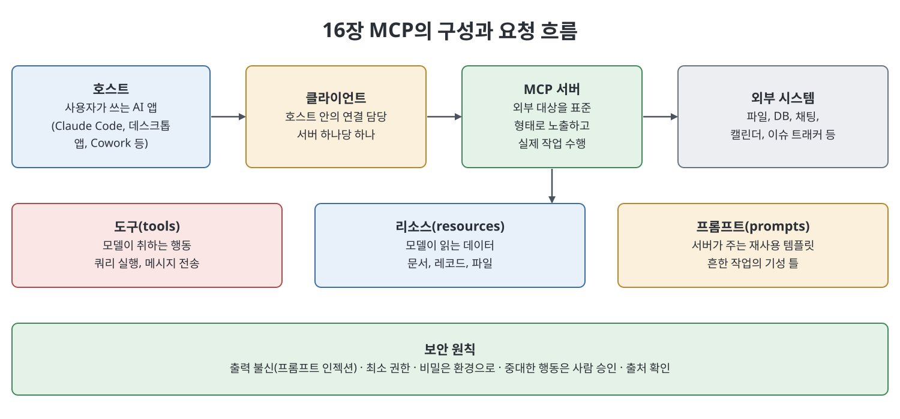

# 16장 모델 컨텍스트 프로토콜 (Model Context Protocol, MCP)

이 장은 AI와 외부 도구·데이터를 잇는 표준인 `MCP`를 다룬다. 책은 USB 비유로 시작한다. 예전에는 모델과 도구 조합마다 맞춤 연결 코드를 새로 짜야 했는데, `MCP`는 어떤 AI 애플리케이션이든 어떤 외부 도구든 하나의 일관된 인터페이스로 말하게 하는 열린 프로토콜이라는 것이다. 장은 해결하는 문제, 구성요소, 기존 서버 연결, 서버 범주, 직접 만들기, 전송 방식, 보안 순으로 진행하며, 보안 절은 두 번 읽으라고 권한다.

> **쉽게 말하면**
> AI에 달아 주는 만능 어댑터다. 한 번 만든 연결을 어디서나 재사용할 수 있지만, 그만큼 연결은 곧 권한이므로 좁게 주고 사람의 승인 단계를 두어야 한다.

## 이 장의 흐름

1. `MCP`가 해결하는 문제
2. 호스트, 클라이언트, 서버와 세 가지 제공물
3. 기존 서버 연결과 서버 범주
4. 직접 서버 만들기와 전송 방식
5. 보안과 신뢰

## 1. 해결하는 문제

모델 혼자서는 병 속의 두뇌와 같아서 파일을 보거나 데이터베이스를 조회하거나 일정을 확인하지 못한다. 문제는 연결할 대상이 부족한 것이 아니라 연결할 때마다 맞춤 작업이 필요하다는 점이었다. 책은 비용이 "도구 수 곱하기 AI 제품 수"로 늘어난다고 설명한다. `MCP`는 도구를 서버로 한 번 연결하면 `MCP`를 지원하는 어떤 애플리케이션(`Claude Code`, 데스크톱 앱, `Cowork` 등)도 쓸 수 있게 하여 이를 "도구 수 더하기 제품 수"로 바꾼다. 새 서버를 꽂으면 모델을 다시 학습시키지 않아도 새 능력이 생기는 모듈식 확장도 장점으로 꼽는다.

## 2. 구성요소

| 구성요소 | 설명 |
|----------|------|
| 호스트(host) | 사람이 쓰는 AI 애플리케이션. 모델이 들어 있다 |
| 클라이언트(client) | 호스트 안에서 서버 하나와의 연결을 맡는 부분. 서버가 다섯이면 클라이언트도 다섯 |
| 서버(server) | 특정 외부 대상(파일, DB, 채팅 도구 등)을 표준 형태로 노출하는 작은 프로그램. 실제 작업을 수행한다 |

서버가 제공하는 것은 세 종류로, 성격이 다르다.

| 제공물 | 성격 | 예 |
|--------|------|----|
| 도구(tools) | 모델이 취하는 행동. 외부에 영향을 줄 수 있다 | 쿼리 실행, 메시지 전송, 파일 생성 |
| 리소스(resources) | 모델이 읽는 데이터(동사 대비 명사) | 문서, 레코드, 파일 내용 |
| 프롬프트(prompts) | 서버가 제공하는 재사용 템플릿·워크플로 | 흔한 작업의 기성 틀 |

흐름은 이렇다. 호스트에서 요청하면 모델이 외부 작업이 필요하다고 판단하고, 클라이언트가 이를 표준 프로토콜로 서버에 전달하며, 서버가 실제 시스템에서 수행한 결과를 돌려준다.

## 3. 기존 서버 연결과 범주

대부분은 서버를 만들지 않고 이미 있는 것을 연결한다. 연결은 설정으로, 서버 이름, 시작 방법, 필요한 정보(자격 증명, 경로)를 적는다. 책의 예시는 프로젝트 폴더용 파일 시스템 서버와 주문 데이터베이스 서버를 `mcpServers` 블록에 등록한다. 파일 서버는 지정한 폴더만 볼 수 있고, DB 서버는 환경 변수로 연결 문자열을 받으며, 접속 계정을 읽기 전용(`readonly_user`)으로 둔 점이 핵심이다. 비밀 값을 설정 본문에 직접 쓰지 않고 환경 변수로 넘기는 방식도 보여 준다. 책은 "더 안전할 것 같아서" 넓은 쓰기 권한을 주는 것이 정반대의 실수라고 지적한다. 권한 벽은 방해물이 아니라 안전장치다.

> **참고(노트 작성자)** 설정 키(`mcpServers`, `command`, `args`, `env`)와 패키지 이름, 연결 문자열 예시는 책이 쓰인 시점의 예시이며 노트가 검증하지 않았다. 책은 서버 제품 목록도 변하므로 범주만 소개한다.

책이 소개하는 범주는 다음과 같다.

| 범주 | 하는 일 | 책이 짚은 주의점 |
|------|---------|------------------|
| 파일 시스템 | 파일·폴더 접근 | 첫 서버로 흔함 |
| 버전 관리·코드 호스팅 | 저장소, 이슈, PR 열람 | 코드와 논의를 잇는다 |
| 데이터베이스 | 쿼리, 스키마 읽기 | 읽기 전용 원칙이 가장 중요 |
| 커뮤니케이션 | 채널 읽기, 메시지 게시 | 게시는 현실 영향이 있어 범위를 좁힌다 |
| 생산성·워크스페이스 | 문서, 일정, 메일, 노트 | 비개발자에게 즉각 유용 |
| 검색·웹 | 최신·구체 정보 조회 | 외부 콘텐츠는 신뢰할 수 없다 |
| 이슈·CRM·업무 시스템 | 고객 기록, 티켓, 프로젝트 | 업무 핵심에 닿는다 |

운영자의 요령으로 책은 절제를 권한다. 서버를 많이 붙이면 모델이 고려할 도구가 늘어 선택이 흐려지고 공격 면도 커진다. 반복 업무에 맞는 소수의 서버만 연결한다.

## 4. 직접 만들기와 전송 방식

서버를 직접 만드는 일은 세 가지다. 노출할 도구와 리소스를 정하고, 각각을 구현하고, 모델이 언제 쓸지 알 수 있도록 명확한 이름과 설명으로 프로토콜에 선언한다. 프로토콜 처리는 프레임워크가 맡고 개발자는 자기 시스템에 해당하는 부분만 쓴다. 책은 파이썬 프레임워크로 읽기 전용 도구 하나(계정 ID로 구독 등급을 조회)를 노출하는 짧은 스케치를 보이며, 도구 설명은 사후 처리가 아니라 모델이 도구를 쓰는 근거라고 강조한다. "사용자 관련 작업"처럼 흐린 설명은 잘못 쓰이고, 무엇을 입력받아 무엇을 돌려주며 읽기 전용인지까지 쓴 설명이 정확히 쓰인다.

전송(transport)은 호스트와 서버가 대화하는 방식으로, 책은 두 가지를 구분한다.

| 방식 | 서버 위치 | 주된 보안 관심사 |
|------|-----------|------------------|
| `stdio` | 호스트와 같은 기계의 로컬 프로그램 | 내 기계에서 무엇을 건드릴 수 있는가 |
| HTTP 기반 | 다른 기계나 클라우드의 원격 서버 | 누가 접속을 승인받는지, 연결 보호, 서버가 진짜인지 |

## 5. 보안과 신뢰

책은 MCP의 힘과 위험이 같은 곳에서 나온다고 말하며 다섯 가지 원칙을 든다.

1. **도구 출력은 신뢰하지 않는다.** 웹 페이지, 문서, DB 필드 속에 모델을 조종하려는 문장이 숨어 있을 수 있다(프롬프트 인젝션). 지시와 데이터가 같은 통로로 들어오기 때문이다. 읽은 내용 때문에 중대한 행동을 하게 될 때는 특히 경계하고, 중요한 행동에는 사람을 끼운다.
2. **모든 연결의 범위를 좁힌다.** 읽기 전용, 폴더 하나, 범위가 한정된 계정과 토큰. 최소 권한은 실수를 막지 못하지만 크기를 줄인다.
3. **비밀을 보호한다.** 자격 증명은 환경으로 전달하고 코드나 버전 관리에 쓰지 않으며, 회전하고, 어느 서버가 어떤 비밀을 갖는지 파악한다.
4. **혼동된 대리인(confused deputy) 문제를 경계한다.** 서버는 실제 권한을 가진 대리인이다. 모델이 조작되어 해로운 일을 시키면 서버는 정당한 권한으로 그대로 실행한다. 방어는 좁은 범위, 출력 불신, 중대한 행동 앞의 사람 승인을 겹쳐 쓰는 것이다.
5. **서버의 출처를 믿을 수 있는지 확인한다.** 서버는 부여한 권한으로 돌아가는 소프트웨어이므로 플러그인과 같은 점검 원칙을 적용한다(자세한 내용은 [15장](15%EC%9E%A5%20%ED%94%8C%EB%9F%AC%EA%B7%B8%EC%9D%B8%EA%B3%BC%20%EB%A7%88%EC%BC%93%ED%94%8C%EB%A0%88%EC%9D%B4%EC%8A%A4.md)).

책의 멜버른 연구팀 사례에서는 웹 검색, 문서 저장소, 이메일 발송 서버를 함께 쓰던 중 웹 페이지에 숨은 지시 때문에 외부로 문서 색인을 보낼 뻔했고, 한 연구자가 우연히 발견해 막았다. 대응은 서버를 끊는 것이 아니라 모든 발신 이메일에 사람 승인 단계를 두고, 이메일 서버의 범위를 좁히고, 열린 웹에서 읽은 내용이 촉발한 행동은 명시적 확인을 받게 한 것이었다. 가드레일을 "신뢰할 수 없는 데이터를 읽는 경계와 현실 행동 사이"에 둔 셈이다.

## 핵심 정리

- `MCP`는 AI와 외부 도구를 하나의 인터페이스로 잇는 열린 표준이며, 연결을 한 번 만들어 어디서나 재사용하게 한다.
- 호스트가 서버별 클라이언트를 통해 서버와 대화하고, 서버는 도구(행동), 리소스(읽을 데이터), 프롬프트(템플릿)를 제공한다.
- 기존 서버 연결은 설정이며, 비밀은 환경 변수로 넘기고 DB는 읽기 전용 계정으로 연결한다.
- 직접 만들 때는 프로토콜 처리를 프레임워크에 맡기고, 도구를 명확한 설명과 함께 선언하며, 전송은 로컬 `stdio` 또는 원격 HTTP 기반 중에서 고른다.
- 보안은 출력 불신, 최소 권한, 비밀 보호, 혼동된 대리인 방지(사람 승인), 신뢰할 수 있는 출처 확인으로 지킨다.

 
 
 

이전: [15장 플러그인과 마켓플레이스](15%EC%9E%A5%20%ED%94%8C%EB%9F%AC%EA%B7%B8%EC%9D%B8%EA%B3%BC%20%EB%A7%88%EC%BC%93%ED%94%8C%EB%A0%88%EC%9D%B4%EC%8A%A4.md) | 다음: [핵심 정리](%ED%95%B5%EC%8B%AC%20%EC%A0%95%EB%A6%AC.md)

 

[Claude AI Bible](../)
