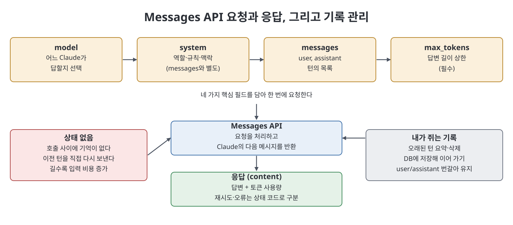
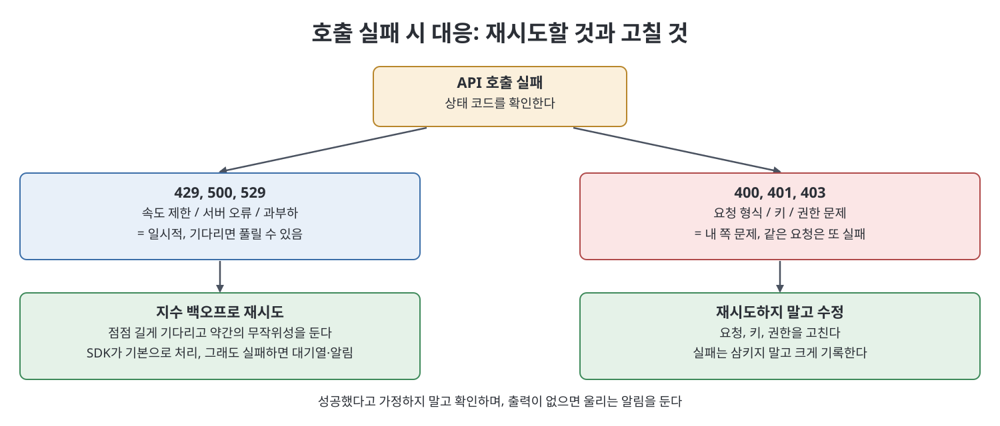

# 17장 Anthropic API (The Anthropic API)

이 장은 채팅 제품 밑바닥에 있는 API를 직접 쓰는 방법을 다룬다. 책은 먼저 API가 맞는 경우와 채팅 제품이 맞는 경우를 가르고, 계정과 키를 안전하게 만드는 방법을 설명한다. 그다음 `Messages API`의 요청 구조, 대화 기록을 직접 쥐는 다중 턴, 스트리밍을 보고, 비용을 줄이는 수단(모델 선택·`max_tokens`·기록 다듬기·`stop_sequences`·프롬프트 캐싱·`Batch API`)과 속도 제한·재시도·오류 처리로 마무리한다. 책에 따르면 이 장부터는 터미널 명령과 짧은 코드를 읽을 수 있는 사람이 대상이다.

> **쉽게 말하면**
> 채팅창이 완성된 가게라면 API는 재료와 주방이다. 대신 키 관리, 대화 기록, 비용, 실패 처리를 전부 내가 책임진다.

> **참고(노트 작성자)** 이 장의 모델 ID, 엔드포인트 형식, 헤더 값, 재시도 횟수 같은 세부는 책이 쓰인 시점 기준이며 노트가 검증하지 않았다. 책도 모델 문자열은 바뀌므로 하드코딩 전에 공식 문서를 확인하라고 한다. 실제 사용 전 공식 문서로 다시 확인하기를 권한다.

## 이 장의 흐름

1. API가 맞는 때와 아닌 때
2. 계정, 키, 지출 한도
3. `Messages API`와 요청의 네 가지 핵심 필드
4. 상태 없음(stateless)과 다중 턴, 스트리밍
5. 비용 통제: 모델·캐싱·`Batch API`
6. 속도 제한, 재시도, 오류 처리

## 1. API를 쓸 때와 쓰지 않을 때

책은 API를 권하기 전에 말리는 것부터 한다. 사람이 곁에서 한 번에 한 대화씩 하는 일(초안 쓰기, 문서 분석, 함께 문제 풀기)은 채팅 앱이 더 빠르고 싸고 안전하다고 본다. API는 다음 셋 중 하나일 때 맞다고 한다.

- 사람 없이 일정이나 이벤트에 따라 돌아야 할 때
- Claude가 다른 소프트웨어(DB, CRM) 안에서 동작해야 할 때
- 같은 작업을 수백·수천 번 대량으로 할 때

기준 한 줄은 "매일 아침 자동으로 돌았으면" 또는 "파일의 모든 행에 대해 했으면"이라는 생각이 들면 API 영역이라는 것이다. 또 API는 채팅 구독의 싼 버전이 아니다. 별도 계정에서 토큰 단위 종량제로 청구되므로 대화 용도로는 오히려 더 들 수 있고, 절약은 자동화와 대량 처리에서 나온다고 책은 경고한다.

## 2. 계정과 키

API는 `claude.ai` 구독과 별개 제품으로, 콘솔(Console)에서 가입하고 결제 수단을 등록하고 조직을 만든다. 회사용이라면 처음부터 공용 청구 이메일로 만들라고 한다. 키는 은행 비밀번호처럼 다뤄야 하며 책이 드는 위생 수칙은 아래와 같다.

| 수칙 | 이유 |
|------|------|
| 코드에 키를 붙여 넣지 않고 환경 변수에서 읽는다 | 저장소에 올라간 키가 가장 흔한 유출 경로 |
| 서버에서는 가능하면 비밀 관리 서비스를 쓴다 | 평문 환경 변수보다 안전 |
| 앱마다 키를 따로 발급한다 | 유출 시 그 키만 폐기 가능 |
| 콘솔에서 월 지출 한도를 건다 | 폭주 루프나 유출 키의 피해 상한 |
| 정기적으로, 특히 팀원이 나간 뒤 키를 교체한다 | 노출 위험 축소 |

책은 처음에 키 하나를 만들고 조직 한도를 10달러로 거는 것부터 하라고 권한다. 이 노트의 예시에서는 키 값을 항상 `<API_KEY>` 같은 자리표시자로만 쓴다.

## 3. Messages API와 요청 구조

책에 따르면 대부분의 일은 하나의 엔드포인트, 즉 대화와 몇 가지 설정을 보내면 Claude의 다음 메시지가 돌아오는 `Messages API`로 한다. 도구 사용과 비전도 이 호출의 변형이다. 공식 SDK(Python은 `pip install anthropic`)가 HTTP 세부를 감싸 주고 키는 환경 변수에서 자동으로 읽는다. 콘솔의 `Workbench`에서 호출을 먼저 시험하고 코드로 내보내는 방법도 책이 추천한다.

핵심 필드는 네 가지다.

| 필드 | 역할 |
|------|------|
| `model` | 어느 Claude가 답할지 고르는 문자열. 책은 어려운 추론용 Opus, 균형형 Sonnet, 빠르고 싼 Haiku의 세 계열을 든다 |
| `messages` | 턴의 목록. 각 턴은 `role`(`user` 또는 `assistant`)과 `content` |
| `system` | `messages`와 별개로 넘기는 시스템 프롬프트. 역할·규칙·맥락을 정하며, 책은 가장 강력하지만 초보가 가장 덜 쓰는 필드라고 한다 |
| `max_tokens` | 답변 길이의 하드 상한이며 필수. 목표치가 아니라 안전 상한 |

선택 필드로 `temperature`(0~1, 낮을수록 일관됨. 추출·분류에는 낮게), `stop_sequences`, `metadata`가 있다. 아래는 개념을 보이기 위한 노트 식 예시다.

```python
# 개념 예시(노트 작성자 작성): 네 필드를 모두 쓴 요청
message = client.messages.create(
    model="<모델 ID>",
    max_tokens=300,
    system="너는 배송 팀의 분석가다. 숫자를 말할 때는 가정을 함께 밝힌다.",
    messages=[{"role": "user", "content": "차량을 한 대 늘리면 하루 몇 건 더 돌 수 있나?"}],
)
```

## 4. 상태 없음과 다중 턴, 스트리밍

API는 호출 사이에 아무것도 기억하지 않는다. 후속 질문을 하려면 이전 턴을 `messages`에 직접 다시 넣어야 한다. 책은 이를 약점이 아니라 설계로 본다. 기록을 내가 쥐므로 오래된 턴을 줄이고, 기록을 고쳐 행동을 유도하고, DB에 저장해 다음 주에 이어 갈 수 있다. 대신 매 호출마다 전체 기록의 입력 토큰을 다시 내므로 대화가 길수록 비싸진다.

흔한 버그는 `assistant` 턴을 빼먹거나 `user`와 `assistant`의 번갈아 나옴이 깨지는 것이다. 이상하면 `messages`의 역할 순서부터 출력해 보라고 책은 말한다.

스트리밍은 응답을 조각조각 받는 방식이다. 사람이 기다리는 화면에서는 체감 속도가 빨라지고, 긴 출력에서는 타임아웃 위험이 줄어든다. 사람이 안 보는 배치 작업에는 복잡도만 늘리므로 쓰지 말라고 한다.



## 5. 비용 통제

비용은 입력 토큰(시스템 프롬프트, 기록, 새 질문)과 출력 토큰(답변)에 비례하고 출력이 더 비싸다. 책이 말하는 수단은 다음과 같다.

| 수단 | 요점 |
|------|------|
| 모델 선택 | 가장 큰 수단. Opus는 깊은 추론이 결과를 바꿀 때만, Sonnet은 기본값, Haiku는 분류·추출·라우팅 같은 대량 작업. Haiku가 1차로 처리하고 애매한 건만 올리는 2단 구성을 자주 쓴다고 한다 |
| `max_tokens` | 한 문단이면 300 정도로 작게. 습관적으로 크게 잡지 않는다 |
| 보내는 양 줄이기 | 오래된 턴 요약·삭제 또는 최근 대화만 유지 |
| `stop_sequences` | 특정 문자열이 나오면 즉시 중단해 출력 비용 절약 |
| 프롬프트 캐싱 | 매번 같은 긴 앞부분(시스템 프롬프트, 정책 문서, 예시)을 저장해 재사용하면 입력 비용과 지연이 줄어듦. 바뀌는 부분은 뒤에, 고정 부분은 앞에 두고 고정 부분을 캐시 대상으로 표시 |
| `Batch API` | 즉시 필요 없는 대량 작업을 한 묶음으로 제출해 비동기로 처리. 책에 따르면 보통 하루 안에 결과가 나오고 요청당 할인이 있다. 요청마다 `custom_id`를 붙여 결과를 맞춘다 |

책의 사례에서 맨체스터의 부동산 관리 회사는 모든 문의를 Opus로 처리하다 월 약 400파운드를 냈는데, 문의의 약 70퍼센트가 단순 질문이라 Haiku로 돌리고 어려운 건만 Sonnet을 쓰자 60파운드 미만으로 줄었다고 한다.

> **참고(노트 작성자)** 캐시 수명, 할인율, 요율, 한도 같은 수치는 책도 구체 수치를 주지 않고 공식 문서 확인을 권한다. 노트도 수치를 적지 않았다.

## 6. 속도 제한, 재시도, 오류 처리

속도 제한은 사용 등급에 따라 분당 요청 수와 토큰 수에 걸리며, 넘으면 429가 온다. 이는 코드 오류가 아니라 천천히 보내라는 신호다. 책이 정리하는 구분은 아래와 같다.

| 상태 | 의미 | 대응 |
|------|------|------|
| 429 | 속도 제한 | 기다렸다 재시도(지수 백오프, 약간의 무작위성) |
| 500, 529 | 서버 오류, 과부하 | 같은 방식으로 재시도 |
| 400 | 요청 형식 오류 | 재시도 금지, 요청을 고친다 |
| 401 | 키 오류 | 키를 고친다 |
| 403 | 권한 없음 | 권한을 확인한다 |

공식 SDK가 일시적 오류 재시도를 기본으로 처리한다. 좋은 습관은 세 가지다. SDK 재시도를 활용하고, 영구 오류는 삼키지 않고 크게 기록하며, 호출이 성공했다고 가정하지 않고 확인한다. 책의 싱가포르 핀테크 사례는 재시도 없는 야간 작업이 529에 조용히 죽어 9일간 아무도 몰랐고, 해결책이 재시도, 출력 파일 부재 시 Slack 알림, 재실행 시 중복 집계를 막는 멱등성 확인이었다고 한다.



## 핵심 정리

- API는 모든 Claude 제품의 기반이며, 사람 없이 돌릴 때, 다른 소프트웨어에 넣을 때, 대량 처리할 때만 쓴다.
- 키는 은행 비밀번호처럼 환경 변수나 비밀 관리 서비스에 두고, 앱마다 분리하고, 지출 한도를 먼저 건다.
- 요청은 `model`, `messages`, `system`, 필수 `max_tokens`로 이뤄지고, API는 상태가 없어 기록과 그 비용을 내가 진다.
- 비용은 모델 선택, `max_tokens`, 기록 다듬기, `stop_sequences`, 캐싱, `Batch API`로 줄인다.
- 429와 5xx는 백오프로 재시도하고 400번대 오류는 고치며, 실패는 반드시 알림으로 드러낸다.

<br>
<br>
<br>

이전: [5부 Readme](Readme.md) | 다음: [18장 Claude Agent SDK](18%EC%9E%A5%20Claude%20Agent%20SDK.md)

<br>

[Claude AI Bible](../)
