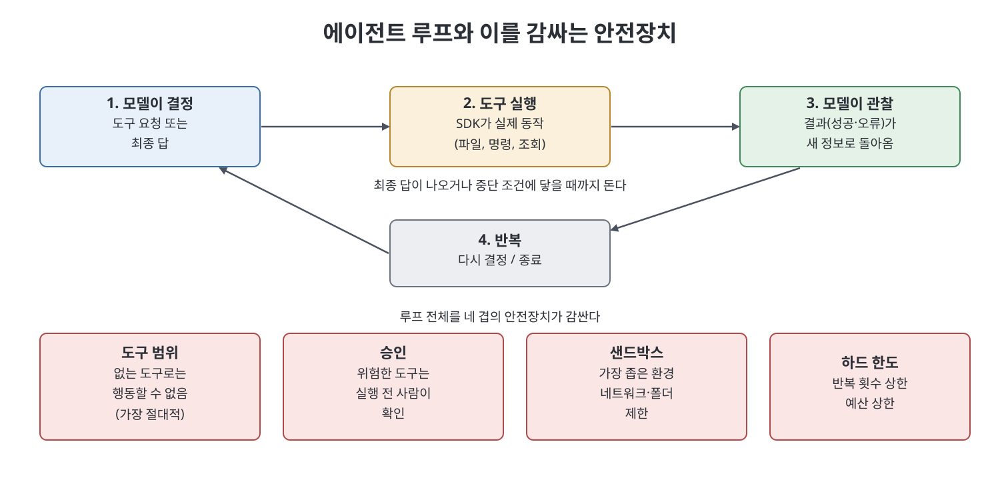

# 18장 Claude Agent SDK (The Claude Agent SDK)

이 장은 한 번의 요청과 응답을 넘어, Claude가 스스로 도구를 쓰며 여러 단계를 밟는 에이전트를 만드는 틀인 `Claude Agent SDK`를 다룬다. 책은 이 SDK가 Claude Code를 움직이는 것과 같은 엔진을 일반화한 것이라고 소개한다. 장은 SDK를 언제 쓰는지, 에이전트 루프, 도구 정의, 세션과 메모리, 권한과 안전장치, 서브에이전트, 관찰과 배포, 최소 예제 순으로 진행한다.

> **쉽게 말하면**
> 에이전트는 "할 말"이 아니라 "할 일"을 맡긴 Claude다. SDK는 반복 루프와 권한 통제라는 번거로운 배관을 대신 해 주고, 나는 목표와 도구를 정한다.

> **참고(노트 작성자)** 책은 이 장의 코드를 완성된 튜토리얼이 아닌 스케치로 두고 정확한 API는 공식 문서에서 확인하라고 한다. 노트도 SDK 함수명이나 설정 이름을 검증하지 않았고, 아래 코드는 모두 개념을 보이는 의사코드다.

## 이 장의 흐름

1. SDK를 쓸 때와 원시 API를 쓸 때
2. 에이전트 루프의 네 박자
3. 도구와 MCP 연결
4. 세션, 컨텍스트, 메모리
5. 권한과 안전장치
6. 서브에이전트, 관찰, 배포, 최소 예제

## 1. SDK는 언제 쓰나

원시 `Messages API`로 도구를 쓰려면 요청을 보내고, 응답에 도구 요청이 있는지 파싱하고, 도구를 돌리고, 결과를 다시 보내는 일을 끝날 때까지 직접 반복하고 기록 길이와 권한도 관리해야 한다. SDK는 이 장치를 대신 돌려 준다. 개발자는 도구와 목표를 정의한다.

책의 기준은 이렇다. 입력이 들어가 출력이 나오는 단일 변환이면 원시 API, 단계가 미리 계획되지 않고 각 단계가 앞 결과에 의존하며 단계 수를 실행 중에야 아는 일이면 SDK다. 예를 들어 "실패하는 테스트를 찾아 고치고 통과할 때까지 반복"은 에이전트 일이고, "이 파일을 요약해 줘"는 한 번의 호출이다. 순서를 미리 쓸 수 있으면 단순한 스크립트 체인이 낫다. 책은 이 부에서 가장 비싼 실수가 단일 호출로 될 일에 에이전트를 만드는 것이라고 경고한다. 에이전트는 호출이 많아 더 느리고 비싸고 예측하기 어렵기 때문이다.

## 2. 에이전트 루프

모든 것은 네 박자의 반복이다.

| 박자 | 하는 일 |
|------|---------|
| 1. 모델이 결정 | 목표와 지금까지의 기록을 보고 최종 답을 낼지 도구를 요청할지 정함 |
| 2. 도구 실행 | SDK가 파일 읽기, 명령, DB 조회 등 실제 동작을 수행 |
| 3. 모델이 관찰 | 도구 결과(내용이든 오류든)가 새 정보로 모델에 돌아감 |
| 4. 반복 | 다른 도구를 쓰거나 끝낼 때까지 되풀이, 또는 정해 둔 중단 조건에서 멈춤 |

핵심 전환은 단계를 내가 쓰지 않고 Claude가 결정한다는 점이다. 이것이 강력함이자 예측 불가능성의 원인이고, 그래서 이 장의 나머지는 대부분 통제 방법이다.



## 3. 도구와 MCP

도구는 이름, 언제 쓰는지를 설명하는 평이한 문장, 입력 스키마로 이뤄진 능력 설명이다. 모델은 코드를 직접 실행하지 않고 이름과 인자로 요청하며 실제 함수는 SDK가 돌린다. SDK에는 파일 읽기·쓰기, 셸 명령 같은 내장 도구가 있어 선택해서 켜고, 도메인에 맞는 사용자 정의 도구도 만든다. 책은 도구 설명을 시스템을 처음 보는 유능한 신입에게 쓰듯 쓰라고 한다. 모델이 도구를 고르는 근거는 거의 이름과 설명뿐이기 때문이다.

실무 팁으로 책은 쓰기 도구마다 읽기 도구를 함께 주라고 한다. 방금 고친 파일을 다시 읽어 확인하는 에이전트가 맹목적으로 쓰는 에이전트보다 훨씬 믿을 만하다는 것이다. 또 SDK는 MCP를 지원해, 프로젝트 관리 도구나 DB 같은 MCP 서버를 연결하면 그 서버가 제공하는 도구를 직접 통합 코드 없이 얻는다. 내 문제에 고유한 것은 직접 만들고 흔한 기능은 기존 MCP 서버를 쓰라는 구분이다.

```text
# 의사코드(노트 작성자 작성): 도구 하나의 모양
tool name: lookup_inventory
description: 상품 코드로 현재 재고와 창고를 돌려준다. 코드가 없으면 그 사실을 알린다.
input: sku (문자열)
```

## 4. 세션, 컨텍스트, 메모리

세션은 한 목표를 향한 에이전트의 한 번의 실행과 그 누적 기록이다. 기록은 단계마다 늘어 컨텍스트 창을 압박하므로 SDK가 오래된 부분을 요약으로 압축하는 등의 방법을 제공한다고 한다. 메모리는 둘로 구분한다.

| 구분 | 내용 | 주의 |
|------|------|------|
| 세션 안 | 이번 실행에서 일어난 일 전부(대화 컨텍스트) | 길어지면 비용과 표류 증가 |
| 세션 간 | 의도적으로 저장하지 않으면 없음 | 이전 세션 내용을 기억한다고 가정하면 정보를 잃고, 한 파일에 전부 쌓아 매번 로드하면 비용과 낡은 정보가 늘어남 |

원칙은 의도적으로 저장하고 선택적으로 불러오기다. 장기 메모리는 정리되고 가지치기되는 팀 공유 문서처럼 다루고 세션은 잘 정한 하나의 목표에 집중시킨다.

## 5. 권한과 안전장치

행동할 수 있는 에이전트는 잘못 행동할 수도 있다. 책은 권한 경계, 즉 묻지 않고 해도 되는 것, 물어야 하는 것, 절대 못 하는 것을 명시하라고 하며 층을 나눈다.

| 층 | 설명 |
|----|------|
| 도구 범위 | 도구가 없는 행동은 할 수 없다. 초안 에이전트에는 보내기 도구를 주지 않는다. 가장 절대적인 장치 |
| 승인 | 민감한 도구는 실행 전 사람 확인을 요구 |
| 샌드박스 | 네트워크가 막히고 작업 폴더만 보이는 격리 환경에서 실행. 전체 권한으로 돌리면 위험 |
| 하드 한도 | 루프 반복 횟수 상한과 예산 상한 |

로테르담 물류 스타트업 사례에서는 에이전트에게 승인 게이트 없이 운영 DB 쓰기 도구를 주었다가 40여 건을 잘못 고쳤고, 복구에 이틀이 걸렸다. 해결책은 더 똑똑한 모델이 아니라 모든 쓰기를 제안하고 사람의 한 번 클릭 승인을 거치게 한 것이었다.

## 6. 서브에이전트, 관찰, 배포, 최소 예제

**서브에이전트.** 조율 에이전트가 일을 쪼개 각각 좁은 일에 집중하는 서브에이전트에게 맡기고 결과를 합친다(예: 보안·성능·스타일 검토). 각자 깨끗한 컨텍스트를 가지는 장점이 있지만 비용과 복잡도가 늘므로 독립된 하위 문제가 있을 때만 쓰고, 대부분은 잘 범위를 정한 에이전트 하나가 낫다고 한다.

**관찰.** 에이전트를 블랙박스로 두면 믿을 수도 고칠 수도 없다. 루프의 각 박자(결정, 도구 호출과 인자, 결과)를 로그로 남기고 읽는다. 오작동 시 먼저 큰 모델로 바꾸지 말고 트레이스를 읽어 도구 설명, 모호한 결과, 목표의 틈을 찾으라고 한다. 이 로그는 배포 후 모니터링으로 그대로 이어진다.

**로컬과 배포.** 나만 쓰는 에이전트는 로컬 스크립트로 충분하다. 사람 없이 돌릴 때(스케줄형, 이벤트형, 서비스형)는 키 보관, 샌드박스, 로깅, 비용과 반복 상한이 필수가 된다. 책의 권고 순서는 로컬에서 여러 번 돌려 단계를 읽고, 로깅과 하드 한도를 넣은 뒤, 샌드박스·읽기 전용 또는 승인형 쓰기·이상 알림이라는 좁은 피해 범위로 무인 배포하는 것이다.

**최소 예제.** 책은 지원 티켓 폴더를 분류하는 에이전트를 든다. 도구는 티켓 읽기와 로그 한 줄 추가, 목표는 분류와 긴급도 기록, 반복 상한을 둔다. 삭제·이메일·셸·네트워크 도구가 없어서 최악이어도 로그 파일에 잘못된 줄을 쓰는 정도이며, 이 봉쇄가 에이전트를 믿고 천 건을 맡길 수 있게 한다.

## 핵심 정리

- Agent SDK는 Claude Code와 같은 엔진을 일반화한 틀로, 루프와 컨텍스트, 권한을 대신 처리한다.
- 단계를 미리 알 수 없고 각 단계가 앞 결과에 의존할 때만 에이전트를 쓰고, 순서를 쓸 수 있으면 단순 호출이나 체인이 낫다.
- 모든 에이전트는 결정, 도구 실행, 관찰, 반복의 네 박자이며 나는 경로가 아니라 목표와 도구를 정한다.
- 안전장치는 기반이다. 도구 범위를 좁히고, 위험한 행동은 승인받고, 가장 좁은 샌드박스에서 돌리고, 반복과 예산 상한을 건다.
- 로컬에서 읽으며 검증하고 파괴적 권한 없이 좁게 시작한 뒤에만 무인 배포한다.

<br>
<br>
<br>

이전: [17장 Anthropic API](17%EC%9E%A5%20Anthropic%20API.md) | 다음: [19장 도구 사용·컴퓨터 사용·비전](19%EC%9E%A5%20%EB%8F%84%EA%B5%AC%20%EC%82%AC%EC%9A%A9%C2%B7%EC%BB%B4%ED%93%A8%ED%84%B0%20%EC%82%AC%EC%9A%A9%C2%B7%EB%B9%84%EC%A0%84.md)

<br>

[Claude AI Bible](../)
