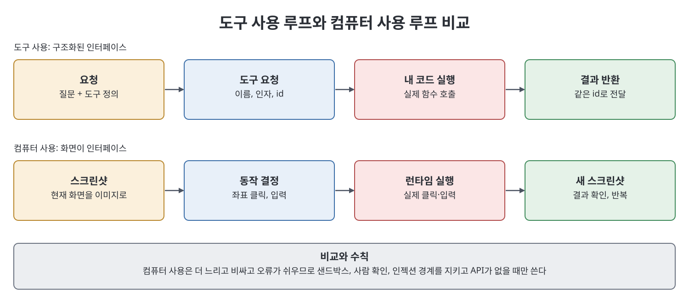
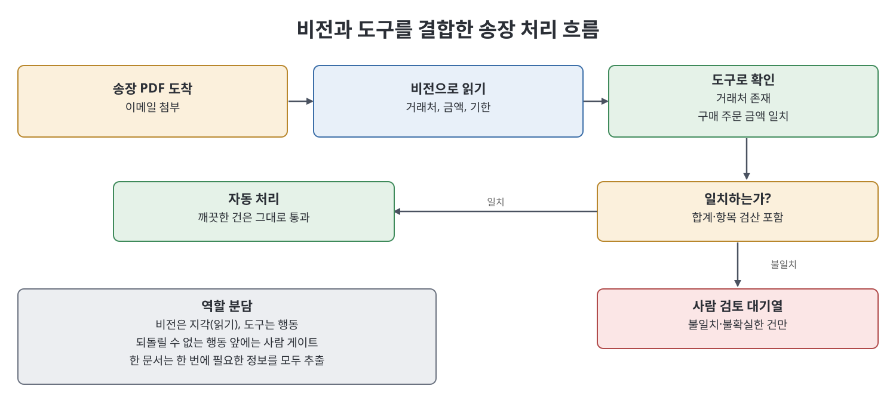

# 19장 도구 사용·컴퓨터 사용·비전 (Tool Use, Computer Use, and Vision)

이 장은 글만 만들어 내는 모델에 손(도구 사용), 눈과 마우스(컴퓨터 사용), 시각(비전)을 달아 주는 세 기능을 다룬다. 책은 이 셋이 챗봇에서 일하는 시스템으로 넘어가는 지점이라고 하면서, 각각의 원리와 설계법, 그리고 지나치게 믿으면 어디서 실패하는지를 함께 설명한다. 마지막에는 비전으로 읽고 도구로 행동하는 결합 워크플로를 보인다.

> **쉽게 말하면**
> 도구 사용은 "이걸 실행해 달라"는 정해진 형식의 부탁이고, 실행은 항상 내 코드가 한다. 컴퓨터 사용은 화면을 보고 클릭하는 최후의 수단이며, 비전은 읽기만 하므로 상대적으로 안전하다.

> **참고(노트 작성자)** `tool_use`, `tool_result`, `tool_choice`, `is_error` 같은 필드명과 이미지·PDF 블록 형식은 책이 쓰인 시점 기준이며 노트가 검증하지 않았다. 아래 흐름 표기는 의사코드이니 실제 형식은 공식 문서로 확인하기를 권한다.

## 이 장의 흐름

1. 도구 사용의 원리와 한 번의 왕복
2. 도구 스키마 설계와 구조화 출력
3. 병렬 도구 호출과 도구 실패 처리
4. 컴퓨터 사용과 안전 수칙
5. 비전: 이미지, 차트, PDF
6. 도구와 비전의 결합

## 1. 도구 사용의 원리

도구 사용(함수 호출)은 구조화된 협상이다. 내가 어떤 능력이 있는지 알려 주면, Claude는 필요하다고 판단할 때 그것을 실행해 달라고 인자와 함께 요청하고, 내 코드가 실행해 결과를 돌려주면, Claude가 그 결과를 답에 녹인다. 핵심은 Claude가 아무것도 직접 실행하지 않는다는 점이다. 도구를 쓴다는 것은 산문 대신 "이 이름의 도구를 이 인자로 실행해 달라"는 구조화된 요청을 내는 것이고, 삭제를 요청해도 내 코드가 실행하지 않으면 삭제되지 않는다. 책은 이 분리를 안전 속성의 핵심이라 한다.

한 번의 왕복은 아래와 같다.

```text
# 의사코드(노트 작성자 작성)
1) 요청: 질문 + 도구 정의 목록(이름, 설명, 입력 스키마)
2) 응답: 도구 요청 블록(도구 이름, 인자, 요청 id)  -> 최종 답이 아님
3) 내 코드가 실제 함수를 실행
4) 재요청: 지금까지의 대화 + 결과 블록(같은 요청 id, 실행 결과)
5) 응답: 최종 답변 (또는 또 다른 도구 요청)
```

18장의 Agent SDK는 이 순환을 자동으로 돌려 주는 것이고, 이 왕복이 에이전트의 기본 단위라고 책은 말한다.

## 2. 도구 스키마 설계와 구조화 출력

책은 도구 사용의 품질이 모델의 영리함보다 도구를 어떻게 설명했는가에 달렸다고 본다. 설명은 무엇을 하는지, 언제 쓰는지, 언제 쓰지 말아야 하는지의 세 가지에 답해야 하고 특히 마지막이 중요하다.

| 설계 원칙 | 내용 |
|-----------|------|
| 이름 | 사람이 쓰는 동사형(예: 주문 검색, 초안 답장 보내기) |
| 설명 | 용도, 쓸 때, 쓰지 않을 때를 명시. 오작동하면 "이럴 때는 쓰지 말라"는 문장을 추가 |
| 파라미터 | 타입만이 아니라 설명도 달고, 선택지는 열거형(`enum`)으로 제한, 날짜는 형식을 명시 |
| 모호함 | 스키마에 남긴 모호함은 모델이 추측해야 하는 부분이고 오류가 생기는 곳 |

책은 도구 정의를 출력 모양 강제에도 쓰라고 한다. 원하는 구조를 입력 스키마로 가진 도구를 하나 정의하고 `tool_choice`로 그 도구를 지정하면, 결과가 검증된 필드를 가진 객체로 나와 정규식 파싱이 필요 없다. 기본값에서는 Claude가 도구 사용 여부를 스스로 정한다.

> **참고(노트 작성자)** `tool_choice` 값의 정확한 형식과 지원 범위는 모델과 SDK 버전에 따라 다를 수 있다. 사용 전 공식 문서를 확인할 것.

## 3. 병렬 호출과 도구 실패

서로 독립적인 정보가 여럿 필요하면 Claude가 한 응답에 도구 요청 블록을 여러 개 낼 수 있고, 내 코드는 이를 동시에 실행해 결과를 한 메시지에 함께 돌려준다. 지연이 가장 느린 호출 하나 수준으로 줄어든다. 단 앞 결과에 의존하는 호출은 순서대로 해야 하고, 병렬을 억지로 강제하지 않는다.

도구가 실패하면 책은 프로그램 중단으로 보지 말고 설명이 있는 오류를 결과로 돌려주라고 한다. "오류 500"은 정보가 없지만 "이 상품 코드는 6자리여야 하는데 5자리다"처럼 쓰면 Claude가 스스로 복구한다. 결과를 오류로 표시하는 방법도 있다. 다만 쓰기 도구가 넘으면 안 될 권한 경계에 닿은 것 같은 위험한 실패는 에이전트가 우회하게 두지 말고 루프를 멈추고 사람에게 알려야 한다.

| 실패 종류 | 처리 |
|-----------|------|
| 복구 가능, 설명 가능(없는 코드, 형식 오류) | 설명을 담아 Claude에게 돌려주어 적응하게 함 |
| 구조적·위험(권한 경계 침범) | 루프를 멈추고 사람에게 알림 |

## 4. 컴퓨터 사용

API가 없는 낡은 내부 시스템이나 업체 포털을 위해 Claude는 스크린샷을 보고 어디를 클릭하고 무엇을 입력할지 정해 동작을 내고, 다시 스크린샷으로 결과를 확인하는 일을 반복한다. 18장의 네 박자 루프에서 도구가 가상 마우스와 키보드이고 관찰이 스크린샷인 셈이다.

책은 한계를 분명히 말한다. 도구 사용보다 느리고(단계마다 스크린샷과 시각 추론), 큰 이미지 입력이라 더 비싸고, 좌표를 잘못 읽는 식의 오류가 쉽게 연쇄되며, 되돌릴 수 없는 일을 실제로 할 수 있어 위험 면이 가장 넓다. 그래서 안전 수칙이 필수다.

- 격리된 샌드박스 환경에서 실행하고, 잃으면 안 되는 것이 있는 머신에서는 쓰지 않는다.
- 구매, 삭제, 제출처럼 돈이 나가거나 되돌릴 수 없는 행동에는 사람이 확인하는 단계를 둔다.
- 화면의 글이 지시를 가장하는 프롬프트 인젝션에 주의하고, 신뢰할 수 없는 페이지의 내용은 데이터로만 다루고 명령으로 따르지 않는다.
- 같은 일에 진짜 API가 있다면 도구 사용을 쓴다. 컴퓨터 사용은 최후의 수단이다.

책의 리스본 여행사 사례에서는 에이전트가 서로 가까운 "취소"와 "확정" 버튼 중 잘못된 것을 눌렀지만, 최종 제출에 사람 승인이 있어 고객에게 가기 전에 잡혔다고 한다.



## 5. 비전

Claude는 이미지, PDF, 차트, 스크린샷, 화이트보드 사진을 텍스트와 함께 읽고 추론한다. 책은 보는 것은 행동이 아니므로 컴퓨터 사용에 비해 위험이 낮다고 한다. 이미지나 문서는 메시지 안의 콘텐츠 블록으로 넘기고(base64 데이터 또는 가져올 수 있는 참조) 지시문을 함께 둔다.

| 활용 패턴 | 설명 |
|-----------|------|
| 문서 데이터 추출 | 영수증, 송장, 양식을 읽어 JSON 같은 지정 구조로 뽑음. 출력 형식과 누락·판독 불가 값의 처리법을 지시하는 것이 요령 |
| 차트·도표 이해 | 차트의 추세와 수치를 표로 옮기거나 구조도를 말로 설명 |
| 스크린샷 질의응답 | 오류 메시지, 설정 화면, 대시보드를 보고 설명·해결 |
| PDF | 텍스트와 각 쪽의 레이아웃(표, 양식, 번호 조항)을 함께 읽음. 반복 질의할 문서는 17장의 캐싱과 결합 |

정확도에 대해 책은 비전이 강하지만 틀리지 않는 것은 아니며, 실패는 눈에 띄는 오류가 아니라 그럴듯한 오류(숫자 하나가 바뀜 등)라고 경고한다. 틀린 숫자의 대가가 큰 금융 추출은 검증을 넣어야 한다. 신뢰도를 보고하게 하거나, 합계가 맞아야 하는 숫자는 코드로 항목을 더해 추출한 합계와 비교해 불일치를 사람에게 보내는 방법이다. 해상도가 높고 깨끗한 원본일수록 정확도가 오른다.

## 6. 도구와 비전의 결합

비전은 읽고 도구는 행동한다. 책의 예는 매입 송장 처리다. 이메일 PDF에서 거래처, 금액, 기한을 비전으로 추출하고, 도구로 거래처 존재와 구매 주문 금액 일치를 확인해 불일치만 사람에게 넘긴다. 호주 태양광 설치업체 사례에서는 영수증 사진을 읽어 프로젝트에 매칭해 제출하되, 합계가 항목과 맞지 않거나 매칭이 불확실한 것은 사람 검토 대기열로 보냈고, 책에 따르면 약 7건 중 1건이 대기열에 갔다.

비용에 대해서는, 이미지와 PDF가 큰 입력이므로 인식 단계는 문서를 정확히 읽는 가장 싼 모델(깨끗한 영수증은 Haiku 계열 등)에 맡기고, 고정 지시문은 캐시하고, 한 문서는 한 번에 필요한 정보를 모두 뽑으라고 한다.



## 핵심 정리

- 도구 사용은 협상이다. Claude는 요청만 하고 실행은 내 코드가 하며, 이 분리가 안전의 근거다.
- 품질은 코드가 아니라 글쓰기에서 나온다. 도구 설명에 용도와 쓰지 말 때를 쓰고 파라미터를 좁게 제한한다.
- 도구 정의와 `tool_choice`로 출력 구조를 강제할 수 있고, 복구 가능한 실패는 설명 있는 오류로 돌려주고 위험한 실패는 멈춘다.
- 컴퓨터 사용은 느리고 비싸고 위험하므로 샌드박스, 사람 확인, 프롬프트 인젝션 경계를 지키며 API가 없을 때만 쓴다.
- 비전은 저위험이지만 그럴듯한 오류가 있으므로 검증을 넣고, 비전과 도구를 결합할 때는 되돌릴 수 없는 행동 앞에 사람 게이트를 둔다.

<br>
<br>
<br>

이전: [18장 Claude Agent SDK](18%EC%9E%A5%20Claude%20Agent%20SDK.md) | 다음: [20장 AI 에이전트와 자동화 만들기](20%EC%9E%A5%20AI%20%EC%97%90%EC%9D%B4%EC%A0%84%ED%8A%B8%EC%99%80%20%EC%9E%90%EB%8F%99%ED%99%94%20%EB%A7%8C%EB%93%A4%EA%B8%B0.md)

<br>

[Claude AI Bible](../)
