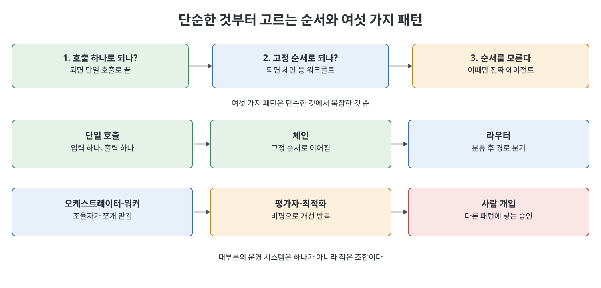
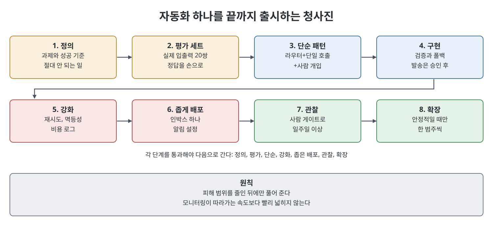

# 20장 AI 에이전트와 자동화 만들기 (Building AI Agents and Automations)

이 장은 책 전체를 모아 "사람이 지켜보지 않아도 믿고 돌아가는 자동화"를 만드는 법을 다룬다. 책은 먼저 에이전트를 만들지 말라고 설득하는 데서 시작한다. 이어 워크플로와 에이전트의 구분, 여섯 가지 설계 패턴, 무엇을 자동화할지 고르는 기준, 신뢰성 공학, 평가와 모니터링, 단계별 모델 선택, 비용·지연 관리, 실패 유형과 피해 범위 축소, 끝까지 가는 구축 청사진을 순서대로 설명한다.

> **쉽게 말하면**
> 가장 단순한 도구로 풀고 거기서 멈추는 것이 실력이다. 에이전트는 마지막 수단이고, 그 앞에서 검증·재시도·사람 확인·작은 피해 범위로 안전을 설계한다.

> **참고(노트 작성자)** 이 장에는 모델 ID나 가격 수치는 거의 없고 원칙 중심이다. 아래 코드는 책이 보이는 검증·멱등성 예시를 노트 방식으로 줄인 의사코드이며 SDK 문법은 검증하지 않았다. "20배 비용", "약 7건 중 1건" 같은 사례 수치는 책이 든 일화 그대로이며 일반 사실이 아니다.

## 이 장의 흐름

1. 에이전트와 워크플로, 그리고 정말 필요한가
2. 여섯 가지 핵심 패턴
3. 무엇을 자동화하고 무엇을 남길까
4. 신뢰성 공학
5. 평가(eval)와 모니터링
6. 모델·비용·지연, 실패 유형과 피해 범위, 구축 청사진

## 1. 에이전트와 워크플로

책의 구분은 이렇다. 워크플로는 단계를 빌더가 미리 정하고 모델이 조각을 채우는 시스템이고, 에이전트는 모델이 스스로 다음 단계를 정하고 끝났다고 판단할 때까지 반복하는 시스템이다. "서비스가 왜 실패하는지 디버깅"은 다음 확인이 직전 결과에 달려 있으니 에이전트 일이고, "문서를 스페인어로 번역"은 한 단계라 에이전트가 아니다.

순서대로 물으라는 것이 책의 권고다. (1) 잘 쓴 API 호출 하나로 되는가? 되면 그것으로 끝. (2) 단계를 아는 고정 순서의 호출로 되는가? 되면 워크플로. (3) 단계를 미리 정할 수 없을 때만 진짜 에이전트. 복잡도는 비용이며, 자율을 한 단계 더하면 느리고 비싸고 테스트하기 어려워진다. 책은 6주를 들여 자율 에이전트를 만들었는데 실은 구조화 출력의 프롬프트 한 번이면 됐고, 오히려 덜 신뢰할 만하고 실행당 약 20배 비쌌다는 사례를 든다.

## 2. 여섯 가지 패턴

단순한 것에서 복잡한 것 순으로, 맞는 것 중 가장 단순한 것을 고른다.

| 패턴 | 설명 | 쓸 때 |
|------|------|-------|
| 단일 호출(single-shot) | 호출 한 번으로 입출력 | 분류, 요약, 추출. 되면 나머지는 과잉 |
| 체인(chain) | 앞 출력이 다음 입력인 고정 순서 | 한 호출이 너무 많은 일을 해 엉성할 때. 이음새마다 검증 가능 |
| 라우터(router) | 입력을 분류해 맞는 경로로 보냄 | 싼 모델로 분류하고 비싼 처리는 필요한 경로에만 |
| 오케스트레이터-워커 | 조율자가 작업을 쪼개 워커(서브에이전트)에 맡기고 종합 | 독립된 조각이 있고 분담이 동적일 때 |
| 평가자-최적화(evaluator-optimizer) | 한 호출이 만들고 다른 호출이 비평해 기준을 넘을 때까지 개선 | 속도보다 품질이 중요하고 "충분히 좋음"을 정의할 수 있을 때. 호출이 늘어남 |
| 사람 개입(human-in-the-loop) | 다른 패턴에 넣는 검토·승인 지점 | 돈, 외부 발송, 중요한 데이터 변경 앞 |

대부분의 운영 시스템은 하나가 아니라 작은 조합이다. 책의 예는 Haiku 라우터가 분류하고, 단순 건은 초안 단일 호출, 복잡한 분쟁은 오케스트레이터, 모든 발송 전에 사람 승인 대기열을 두는 지원 자동화다.



## 3. 무엇을 자동화할까

자동화에 맞는 일은 빈도가 높고, 잘 정의되고, 가끔의 오류를 감당하거나 값싸게 잡을 수 있는 일이다. 드물고, 고위험이고, 판단이 필요하거나, 한 번의 실수가 치명적이고 되돌리기 어려운 일은 사람에게 남긴다. 책의 세 질문은 이렇다.

- 얼마나 자주 하고 사람 시간을 얼마나 쓰는가? 연 2회 일은 투자가 아니라 취미다.
- "제대로 됨"의 기준을 쓸 수 있는가? 못 쓰면 테스트도 못 한다.
- 실패의 대가는 얼마인가? 대가가 클수록 사람 감독이 더 필요하다.

첫 자동화로는 분류, 태깅, 초안, 추출, 1차 요약처럼 잦고 명확하고 관대한 일이 좋다. 범위도 단번에 전부가 아니라 반복적이고 안전한 부분만 자동화하고 판단은 사람에게 두며, 증거가 쌓이는 만큼 경계를 옮기라고 한다. 또 사람이 직접 해 본 적이 없는 일을 자동화하는 것은 함정이다. 먼저 수동으로 여러 번 해서 예외를 찾아 성공 기준과 평가 세트에 적어야 한다.

## 4. 신뢰성 공학

데모는 한 번, 좋은 조건에서 돌지만 자동화는 천 번, 예상 못한 조건에서 돈다. 책이 꼽는 습관은 아래와 같다.

| 습관 | 내용 |
|------|------|
| 재시도와 백오프 | 네트워크를 건너는 호출은 SDK 재시도에 맡기고, 그래도 실패하는 호출을 견디도록 설계 |
| 출력 검증 | JSON이면 파싱하고 필드를 확인, 분류면 허용 범주인지 확인. 검증 없이 모델 원문을 중요한 행동에 넘기지 않음 |
| 폴백 | 검증 실패나 낮은 신뢰도에서는 사람에게 올리거나, 재시도 대기열에 넣거나, 안전한 기본값 적용. 조용히 진행하지 않음 |
| 멱등성 | 같은 작업을 두 번 해도 한 번과 같은 효과. 고유 id로 이미 했는지 확인하고, 했으면 이전 결과를 돌려줌 |

```text
# 의사코드(노트 작성자 작성): 검증, 폴백, 멱등성
결과 = 모델이 낸 JSON을 파싱
파싱 실패, 허용 밖 범주, 신뢰도 낮음 -> 사람 대기열로 보냄 (폴백)
이미 처리된 티켓 id인가? -> 예: 이전 결과 반환 / 아니오: 실행 후 기록
```

## 5. 평가와 모니터링

평가(eval)는 대표 입력과 정답(또는 허용 가능한 출력)을 짝지은 자동화용 테스트 세트다. 배포 전 정답률을 재고, 프롬프트나 모델을 바꿀 때마다 다시 돌려 다른 곳이 깨지지 않았는지 확인한다. 책은 자동화를 만들기 전에 실제 입력 20개와 손으로 쓴 정답을 먼저 만들라고 권한다. 20쌍을 못 만든다면 아직 그 일을 이해하지 못한 것이다.

모니터링은 운영 중의 짝이다. 호출, 도구 사용, 판단, 폴백, 실행당 비용을 기록하고, 사람으로의 폴백 급증, 오류율 상승, 실행당 비용의 급등, 출력 분포 변화를 지켜본다. 실패나 이상 동작에 울리는 알림을 최소 하나는 만들어 문제가 9일이 아니라 몇 분 안에 닿게 한다.

## 6. 모델·비용·지연, 실패 유형, 청사진

**단계별 모델 선택.** 시스템 전체에 모델 하나가 아니라 단계마다 모델과 생각 예산(확장된 사고)을 정한다. 라우터는 Haiku에 확장 사고 없이, 섬세한 답장은 Sonnet, 드문 어려운 분쟁은 Opus에 확장 사고를 높여서. 근거는 평가 세트로, 싼 모델을 먼저 시험해 수치가 요구할 때만 올린다.

**비용과 지연.** 비용은 모델 선택과 라우터, 반복 컨텍스트 캐싱, 급하지 않은 일의 배치, 에이전트의 반복 상한으로 줄인다. 지연은 스트리밍, 독립 조회의 병렬 도구 호출, 빠른 모델, 그리고 라우터로 단순 건을 한 번의 호출로 단축하는 것으로 줄인다. 보통 비용과 속도는 함께 움직인다.

**실패 유형과 피해 범위(blast radius).** 에이전트는 루프(반복 상한), 도구·인자 환각(검증과 엄격한 스키마), 장기 작업에서의 표류(좁은 목표와 집중된 세션), 확신에 찬 잘못된 행동(승인 게이트와 좁은 도구 세트)이라는 전형적 방식으로 실패한다. 이를 묶는 원칙은 완전히 오작동했을 때 최악이 무엇인가를 묻고, 그 최악이 견딜 만하게 피해 범위를 줄이는 것이다. 읽기와 초안만 하는 에이전트는 범위가 작고, 운영 DB 쓰기와 외부 이메일이 가능한 에이전트는 크다. 토론토 구독 상자 회사는 환불을 직접 처리하는 에이전트가 중복 요청을 여러 번 처리해 수천 달러를 잃은 뒤, 승인 대기열, 일일 환불 상한, 요청 id 기반 멱등성으로 재설계했다고 한다.

**구축 청사진.** 책은 지원 인박스의 1차 분류와 초안 답장을 예로 든다.

| 단계 | 내용 |
|------|------|
| 1. 정의 | 과제, 성공 기준, 절대 안 되는 일(검토 없는 자동 발송 등) |
| 2. 평가 세트 | 실제 티켓 20건과 정답 |
| 3. 가장 단순한 패턴 | 라우터 + 단일 호출 초안 + 사람 개입. 에이전트 루프는 불필요 |
| 4. 구현 | Haiku 라우터(범주 검증, 폴백), 범주별 Sonnet 초안(발송은 안 함), 승인 대기열 |
| 5. 강화 | 재시도, 티켓 id 기반 멱등 발송, 비용 로그, 일일 물량 점검, 평가 세트로 손 점검 |
| 6. 좁게 배포 | 인박스 하나, 모든 발송에 사람 승인, 오류·폴백 급증 알림 |
| 7. 관찰 후 확장 | 일주일간 사람 게이트로 관찰, 안정적일 때만 가장 신뢰도 높고 위험 낮은 범주부터 완화, 모니터링이 따라가는 속도로만 확장 |



## 핵심 정리

- 에이전트는 모델이 단계를 정하고 워크플로는 내가 정한다. 대부분은 워크플로나 단일 호출로 충분하니 복잡도를 하나씩 정당화한다.
- 단일 호출, 체인, 라우터, 오케스트레이터-워커, 평가자-최적화, 사람 개입의 여섯 패턴 중 가장 단순한 조합을 고른다.
- 재시도, 출력 검증, 폴백, 멱등성이 신뢰성의 실체이며, 검증 없이 모델 출력을 중요한 행동에 넘기지 않는다.
- 만들기 전에 실제 입출력 20쌍의 평가 세트를 만들고, 운영 중에는 로그와 알림으로 감시한다.
- 최악의 경우를 견딜 수 있게 피해 범위를 줄이고, 사람 게이트 뒤에서 좁게 배포해 모니터링이 따라가는 만큼만 넓힌다.

<br>
<br>
<br>

이전: [19장 도구 사용·컴퓨터 사용·비전](19%EC%9E%A5%20%EB%8F%84%EA%B5%AC%20%EC%82%AC%EC%9A%A9%C2%B7%EC%BB%B4%ED%93%A8%ED%84%B0%20%EC%82%AC%EC%9A%A9%C2%B7%EB%B9%84%EC%A0%84.md) | 다음: [핵심 정리](%ED%95%B5%EC%8B%AC%20%EC%A0%95%EB%A6%AC.md)

<br>

[Claude AI Bible](../)
