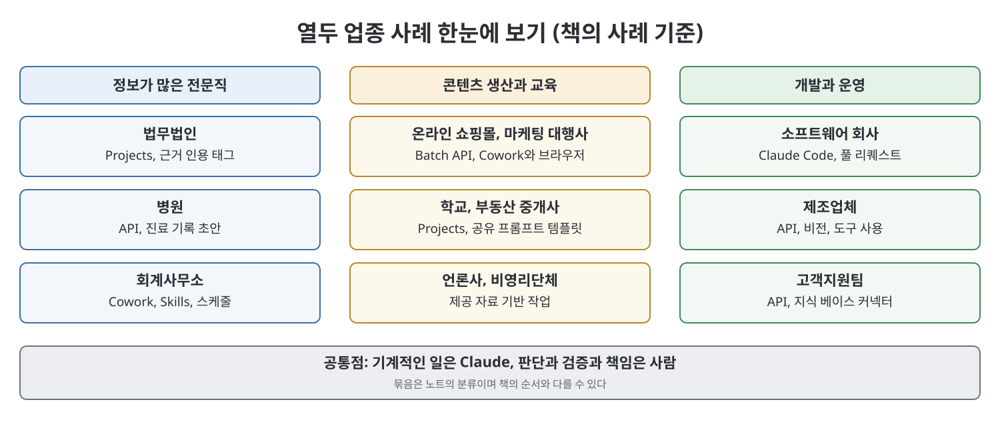
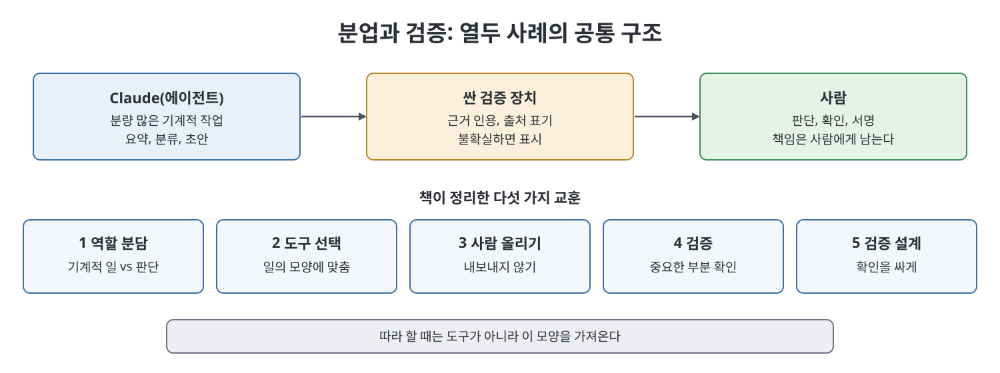

# 21장 산업별 플레이북 (Industry Playbooks)

이 장은 앞 장들에서 배운 부품(모델, 프롬프트, 커넥터, 에이전트, 스케줄)을 하나로 엮어 "내 업종에서는 어떻게 보이는가"를 열두 가지 사례로 보여 준다. 법무법인, 병원, 회계사무소, 온라인 쇼핑몰, 소프트웨어 회사, 마케팅 대행사, 학교, 부동산 중개사, 제조업체, 고객지원팀, 언론사, 비영리단체가 차례로 나온다. 각 사례는 문제, 쓴 Claude 구성, 대략의 수치, 그리고 한계로 이루어진다. 책은 등장하는 회사와 사람이 실제 사례 여러 개를 섞어 익명화한 합성이라고 밝히며, 수치도 "실제로 얻을 만한 수준"이라고만 말한다.

> **쉽게 말하면**
> 업종은 달라도 "반복되는 기계적 작업은 Claude가, 판단과 확인과 책임은 사람이"라는 모양이 똑같이 되풀이된다는 것을 보여 주는 장이다.

> **참고(노트 작성자)** 이 장의 시간 단축, 비용 절감, 건수 같은 수치와 사례는 모두 책의 서술이며 노트가 검증하지 않았다. 의료, 법률, 회계, 부동산 관련 내용은 책이 설명하는 활용 방식일 뿐 전문적 조언이 아니다.

## 이 장의 흐름

1. 열두 업종 사례: 문제, 구성, 결과, 한계
2. 사례마다 박힌 "함정"과 "운영자의 비결"
3. 열두 사례를 관통하는 다섯 가지 공통 교훈

## 1. 열두 업종 사례

### 정보가 많은 전문직: 법무, 의료, 회계

- **법무법인**: 사건마다 Projects에 배경, 쟁점, 메모 양식을 넣어 두고 증거 문서를 올려 요약과 모순 탐지를 시켰다. 핵심은 쟁점 목록을 주고 문서별로 태그를 달게 하면서 근거 문장을 인용하게 한 것이다. 책에 따르면 그 덕에 검토자는 문서 전체를 다시 읽지 않고 인용 한 줄만 원문과 대조하면 됐다. 책은 약 4,000쪽 사건에서 1차 검토가 60시간에서 18시간 정도로 줄었다고 쓴다. 단 Claude는 법률 자문을 하지 않으며, 모든 인용과 판단은 사람이 확인해야 한다고 강조한다.
- **병원**: 보호 건강정보 처리 계약을 맺은 벤더를 통해 API를 쓰고, 진료 요약으로 구조화된 기록 초안을 만들게 했다. 책은 하루 문서 작업이 의사당 약 2시간에서 35분으로 줄었다고 한다. 모든 초안은 의사가 검토하고 서명했고, 데이터 취급 규칙은 노트 생성 전에 준수 담당자가 정했다. 진료실에서 잘못 말한 내용이나 녹음 오류는 깔끔한 문장으로 그대로 재현되므로 용량, 알레르기, 계획을 직접 확인해야 한다고 한다.
- **회계사무소**: Cowork에 고객 장부 스프레드시트 커넥터와 Skills(거래 분류, 차이 설명 문안)를 붙이고 월말 작업을 스케줄로 시작시켰다. 책은 거래 800건짜리 고객의 1차 분류가 4시간에서 40분 검토로 줄었다고 쓴다. 판단이 필요한 건은 확신이 없으면 표시만 하게 했고 자격 있는 사람이 승인했다. 같은 절차를 팀이 반복할 때는 프롬프트를 매번 붙이기보다 Skill로 만들면 모두가 같은 논리를 쓰고 한 곳에서 개선할 수 있다는 것이 비결이다.

### 콘텐츠 생산: 쇼핑몰, 마케팅, 학교

- **온라인 쇼핑몰**: 상품 사양서를 넣으면 3개 언어의 제목, 설명, 특징, SEO 메타데이터가 나오게 Batch API로 처리했다. 사람이 기다리지 않는 대량 작업이라 배치 할인이 맞는 사례다. 책은 140개 신상품의 초안이 하룻밤에 나오고 편집에 이틀이 걸렸다고 한다. 대표 상품은 여전히 사람이 직접 썼고, 언어마다 원어민이 검토했다. 비결은 형용사로 톤을 설명하기보다 잘 쓴 실제 예시 두세 개를 프롬프트에 넣는 것이다.
- **마케팅 대행사**: 정형 자료는 Cowork로, 웹 화면 뒤에 있는 공개 정보는 브라우저 에이전트로 모으고 Skill로 제안서 리서치 양식을 만들었다. 책은 조사 단계가 약 15시간에서 4시간으로 줄었다고 한다. 정돈된 사실 더미가 아이디어는 아니며 승부를 가르는 통찰은 사람 몫이라고 한다. 커넥터로 되는 일에 브라우저 에이전트를 쓰면 느리고 불안정하다는 점도 덧붙인다.
- **학교**: 단원마다 Projects에 교육과정, 목표, 학급 수준을 넣고 3단계 수준의 학습지, 문제 은행, 에세이 피드백 틀 초안을 만들었다. 학생 개인의 성적 평가는 절대 맡기지 않는다는 선을 그었고, 학생에게도 도구를 공개적으로 가르쳤다.

### 개발과 운영: 소프트웨어, 제조, 고객지원

- **소프트웨어 회사**: 엔지니어들이 Claude Code로 버그와 작은 기능을 테스트가 붙은 풀 리퀘스트로 만들게 했다. 책은 한 분기 동안 병합된 풀 리퀘스트의 약 35%에서 대부분의 작업을 맡았다고 추정한다. 테스트를 통과했지만 다른 모듈의 가정을 어긴 변경이 한 번 있었고, 이후 에이전트가 변경 범위 밖에서 한 가정을 설명하게 했다. 테스트 통과는 증거일 뿐 증명이 아니라는 교훈이다.
- **제조업체**: 비전과 도구 사용을 가진 API 파이프라인으로 스캔 문서와 이메일을 공급업체, 부품, 수량, 날짜, 발주서 불일치로 구조화했다. 책은 일일 처리 부담이 약 5시간에서 90분으로 줄었다고 한다. 맞지 않는 것은 조용히 입력하지 않고 담당자에게 표시했다. 모르면 추측하지 않고 알리는 설계가 신뢰의 조건이었다.
- **고객지원팀**: 지식 베이스 커넥터로 도움말 문서에 근거한 답변 초안을 만들고, 어느 문서에서 나왔는지 인용하게 했으며, 사람이 검토해서 보냈다. 책은 첫 응답 중앙값이 약 4시간에서 40분으로 줄었고 해고는 없었다고 한다. 초안 자동 발송 유혹이 생기지만 뉘앙스가 있는 건에서는 사람을 빼지 않았다.

### 신뢰가 생명인 곳: 부동산, 언론, 비영리

- **부동산 중개사**: 웹 앱과 공유 프롬프트 템플릿만 썼다. 책은 매물 설명 작성이 20분에서 2분으로, 중개인당 주 3~4시간이 절약됐다고 한다. 과장된 특징이나 공정주택 관련 민감 표현은 법적 문제가 될 수 있어 모든 사실을 매물과 대조하게 했다. 핵심은 기술이 아니라 최고 작성자의 글을 템플릿으로 표준화한 조직적 혁신이라는 것이다.
- **언론사**: 제공된 자료가 있는 일만 시켰다. 긴 공문서 요약, 인터뷰 전사와 구조화, 보고서 버전 비교, 이미 쓴 기사의 제목 후보다. 요약은 "어디를 볼지 알려 주는 지도"일 뿐이고 모든 사실은 1차 자료로 사람이 검증했다. 사용 범위를 글로 적어 합의한 규칙이 도입의 열쇠였다.
- **비영리단체**: Pro 요금제의 웹 앱과 Cowork로 보조금 신청서 초안, 현장 조사 요약, 후원자 소통 초안에 썼다. 책은 신청 처리량이 1년에 약 두 배가 됐다고 한다. 통계를 모르는 자원봉사자가 Cowork로 조사 결과를 분석했지만 수치는 직접 점검했다. 도구는 일을 "쉬운 것"이 아니라 "닿을 수 있는 것"으로 만든다는 설명이다.

## 2. 사례에 박힌 함정과 비결

| 업종 | 책이 쓰는 구성 | 책이 짚는 주의점 |
|------|---------------|-----------------|
| 법무 | Projects, 근거 인용 요구 | 요약을 원문 확인 없이 고객에게 전달하지 말 것 |
| 의료 | 계약된 벤더의 API, 프롬프트 캐싱 | 거의 맞는 초안에 익숙해져 검토가 형식이 되는 것 |
| 회계 | Cowork, 커넥터, Skills, 스케줄 | 자본/운영 구분 같은 판단은 전문가 서명 |
| 쇼핑몰 | Batch API, 예시 포함 프롬프트 | 대표 상품은 사람이, 언어별 원어민 검토 |
| 소프트웨어 | Claude Code, 프로젝트 지침 | 에이전트 코드도 읽고 병합, 범위 밖 가정 확인 |
| 마케팅 | Cowork와 브라우저 에이전트 | 통찰은 사람, 도구를 일에 맞게 선택 |
| 학교 | 단원별 Projects | 학생 성적 평가는 교사가 |
| 부동산 | 웹 앱 템플릿 | 사실 대조, 구매자를 묘사하는 표현 주의 |
| 제조 | API, 비전, 도구 사용 | 불확실하면 추측하지 말고 표시 |
| 고객지원 | API, 지식 베이스 커넥터 | 뉘앙스 있는 건의 자동 발송은 위험 |
| 언론 | Projects, Cowork | 사실을 생성하지 않는다는 서면 규칙 |
| 비영리 | 웹 앱, Cowork | 숫자 점검, 후원자 관계는 사람 |

> **참고(노트 작성자)** 위 표는 책의 서술을 정리한 것이며 업종별 규제나 법적 요건을 노트가 확인한 것은 아니다. 의료와 법률 같은 분야의 데이터 취급은 책이 권하듯 공식 문서와 전문가에게 따로 확인해야 한다.

## 3. 열두 사례를 관통하는 공통 교훈

책은 다섯 가지를 꼽는다.

| 교훈 | 내용 |
|------|------|
| 역할 분담 | 성공 사례마다 에이전트는 기계적이고 분량 많은 일을, 사람은 판단과 검증과 책임을 맡았다 |
| 일의 모양에 맞는 도구 | 화려한 도구보다 일에 맞는 것. 표준 프롬프트로 충분한 곳도 있고 API 파이프라인이 필요한 곳도 있다 |
| 사람을 위로 올리기 | 시간 절약보다 의사가 그만두지 않고, 지원 담당이 해고되지 않는 것이 진짜 성과. 남는 시간으로 더 잘할지 단순히 줄일지는 리더의 선택 |
| 검증 | 중요한 부분은 사람이 확인했다. 확인하지 않은 확신에 찬 출력이 실패의 공통 원인 |
| 검증을 싸게 만드는 설계 | 근거 인용, 출처 표기, 불확실성 표시로 확인이 몇 초 만에 되게 만든다 |

따라 하려면 도구가 아니라 모양을 가져오라고 책은 말한다. 먼저 분량 많은 기계적 부분과 판단 부분을 나눈다. 그 기계적 부분에 맞는 가장 단순한 도구를 고른다. 사실이 걸린 곳은 자기 자료에 근거하게 한다. 사람이 어디에 남을지 정하고, 검증은 싸게 설계한다.

## 핵심 정리

- 열두 업종 모두 에이전트가 반복 작업을, 사람이 판단과 검증과 책임을 맡는 같은 구도다.
- 도구는 일의 모양으로 고른다. 웹 앱 템플릿, Skills, Batch API, Claude Code, 비전을 쓰는 API 파이프라인이 각각 맞는 자리가 다르다.
- 규제가 강한 분야(의료, 법률, 회계)는 사람의 검증이 필수이며 데이터 취급 규칙을 시작 전에 정한다.
- 근거 인용과 불확실성 표시처럼 검증을 싸게 만드는 설계가 검증이 실제로 지켜지게 한다.
- 가장 오래가는 성과는 사람을 내보내는 것이 아니라 더 가치 있는 일로 올려 보내는 데서 나왔다.

 
 
 

이전: [6부 Readme](Readme.md) | 다음: [22장 한계와 위험, 그리고 솔직한 미래](22%EC%9E%A5%20%ED%95%9C%EA%B3%84%EC%99%80%20%EC%9C%84%ED%97%98%2C%20%EA%B7%B8%EB%A6%AC%EA%B3%A0%20%EC%86%94%EC%A7%81%ED%95%9C%20%EB%AF%B8%EB%9E%98.md)

 

[Claude AI Bible](../)
