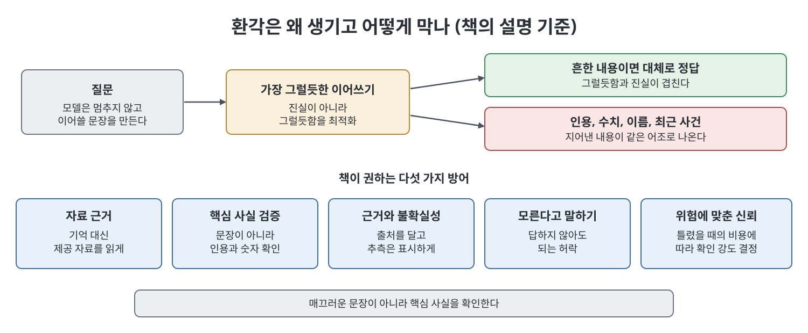
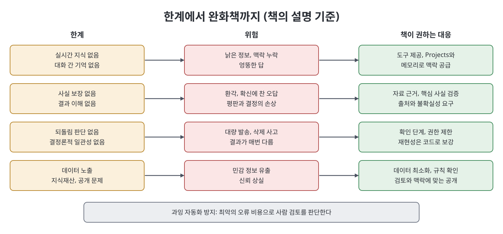

# 22장 한계와 위험, 그리고 솔직한 미래 (Limits, Risks, and the Honest Future)

이 장은 책 전체의 장점 소개에 대한 균형추다. Claude가 지금 할 수 없는 것, 환각이 생기는 이유와 방어법, 개인정보와 보안의 자세, 자동화가 지나친 지점, 지식재산과 공개 문제, 앞으로의 방향, 그리고 스스로 최신 상태를 유지하는 법을 차례로 다룬다. 저자는 겁을 주려는 것이 아니라 한계를 아는 운영자가 오래 신뢰받는다는 취지로 쓴다고 밝힌다.

> **쉽게 말하면**
> 출력이 그럴듯하다고 맞는 것은 아니므로, 어디까지 맡기고 어디서 사람이 확인할지를 정하는 법을 배우는 장이다.

> **참고(노트 작성자)** 데이터 정책, 약관, 지식재산 및 공개 의무와 관련한 서술은 책의 설명이며 노트가 검증하지 않았다. 책 스스로도 이런 내용은 시간이 지나면 바뀔 수 있으니 공식 문서(docs.claude.com)에서 현재 내용을 확인하라고 권한다. 이 노트는 법률적 조언이 아니다.

## 이 장의 흐름

1. Claude가 혼자서는 못 하는 것
2. 환각: 원리와 방어
3. 개인정보와 보안의 자세
4. 과잉 자동화
5. 지식재산과 공개
6. 앞으로의 방향과 기술 유지

## 1. Claude가 혼자서는 못 하는 것

책이 꼽는 한계는 다음과 같다.

- **실시간 지식 없음**: 학습 시점 이후는 모르며, 웹 검색이나 API 같은 도구가 있어야 최신 정보를 얻는다. 책은 도구를 "창문"에 비유한다.
- **사실 정확성 보장 없음**: 모델은 검증된 문장이 아니라 그럴듯한 문장을 만든다. 틀린 말도 맞는 말과 똑같이 차분하게 한다.
- **대화 간 기억 없음**: 기본적으로 대화마다 새로 시작하며, Projects나 메모리 기능 같은 장치가 연속성을 준다.
- **결과에 대한 이해 없음**: 이메일이 고객을 화나게 할지, 숫자가 이사회 자료에 들어갈지 스스로 알지 못한다.
- **되돌릴 수 있는지에 대한 판단 없음**: 에이전트에게는 자기에게 초안 보내기와 만 명에게 보내기가 똑같은 행동이다. 확인 단계, 제한된 권한, 감독을 사람이 구조로 제공해야 한다.
- **결정론적 일관성 없음**: 같은 질문에 조금 다른 답이 나올 수 있다. 정확한 재현성은 코드와 구조로 모델 바깥에서 만든다.

책의 "함정" 상자는 유창한 출력을 검증된 출력으로 착각하는 것이 가장 비싼 오해라고 말한다.

## 2. 환각: 원리와 방어

모델은 다음에 올 토큰을 예측해 그럴듯한 이어쓰기를 만든다. 잘 알려진 내용이면 그럴듯한 것이 곧 정답이지만, 모호하거나 존재하지 않거나 경계에 있는 내용에서도 멈추지 않고 그럴듯한 말을 만든다. 책은 이것을 거짓말이나 단순 버그가 아니라 "진실을 쓸 수 없을 때 그럴듯함을 최적화한 시스템의 자연스러운 산출"이라고 설명한다. 그래서 위험은 정확한 인용, 정밀한 수치, 낯선 이름, 최근이나 틈새 사건에 몰린다.

| 방어 | 내용 |
|------|------|
| 자료에 근거시키기 | 기억을 꺼내게 하지 말고 제공한 자료를 읽게 한다 |
| 구체 사항 검증 | 문장의 매끄러움이 아니라 인용, 숫자, 이름 같은 핵심 사실을 확인한다 |
| 근거와 불확실성 요구 | 주장마다 출처를 달고, 확신과 추측을 구분해 달라고 한다 |
| 모른다고 말할 권한 | 답이 있다는 전제로 묻지 말고 "신뢰할 정보가 없다"도 괜찮은 답이라고 알려 준다 |
| 위험에 맞춘 신뢰 | 틀렸을 때의 비용에 따라 확인 강도를 정한다. 계약, 진단, 기사, 재무 모델에 들어가는 사실은 매번 확인한다 |

책의 "운영자의 비결"은 답변 속 사실 주장을 하나씩 나열하고 출처가 없는 것을 표시하게 하라는 것이다. 그러면 검토가 체크리스트가 되고, 출처 없는 줄이 의심할 곳이다.

## 3. 개인정보와 보안의 자세

책은 Anthropic 제품에 광고가 없고 데이터를 팔지 않으며, 학습 사용 여부는 사용자가 통제하는 부분이 있고 소비자 요금제와 API, 비즈니스 계층마다 다르다고 설명한다. 하지만 "벤더를 믿을 만하다"는 것은 보안 생각의 바닥이지 천장이 아니라고 한다. 권하는 세 겹은 아래와 같다.

1. **데이터 최소화**: 작업에 필요 없는 데이터는 넣지 않는다. 이름을 코드로 바꾸거나 민감한 열을 빼고, 나중에 직접 되돌려 매핑한다.
2. **자기 조직의 규칙 알기**: 의료, 금융, 법률, 공공 분야의 의무는 벤더의 약속이 없애 주지 않는다. 워크플로를 만들기 전에 조직의 입장을 확인한다.
3. **민감도에 맞는 계층 선택**: 민감하거나 규제 있는 작업에는 계약 조건과 통제를 제공하는 비즈니스, 엔터프라이즈 계층이 있다. 현재 조건은 공식 문서로 확인한다.

## 4. 과잉 자동화

사람 검토가 잘 돌아가면 "거의 못 잡으니 빼자"는 논리가 생긴다. 책은 사람의 가치가 자주 잡는 데 있지 않고, 드물지만 치명적인 오류를 잡는 데 있다고 반박한다. 따라서 측정 기준은 얼마나 자주 잡았는가가 아니라 가장 나쁜 미검증 오류의 비용이다.

- 비용이 어색한 이메일 정도면 자유롭게 자동화한다.
- 재무제표의 잘못된 수치, 기사 속 가짜 인용, 미묘하게 틀린 의료 지시, 엉뚱한 곳으로 가는 송금이면 사람을 둔다.
- 전부 아니면 전무가 아니라, 사소하고 명확한 건은 자동으로, 중대하거나 모호한 건은 사람에게 보내는 단계 설계를 한다.
- 가장 튼튼한 방식은 모델이 확신이 없을 때 사람에게 넘기게 하는 것이다. 쉬운 건과 어려운 건에 똑같이 확신하는 시스템이 위험하다.
- 숨은 비용은 기술 퇴화다. 검토를 전혀 안 하면 사람이 미묘한 오류를 알아보는 능력을 잃으므로 표본 검토나 직접 수행을 유지한다.

책의 사례에서 물류 운영 책임자는 석 달간 맞았다는 이유로 확인을 뺐다가, 낯선 문서 형식에서 틀린 수량이 계획에 들어가 생산 라인이 거의 하루 멈췄다. 이후 예외에만 사람을 두었다고 한다.

## 5. 지식재산과 공개

- **소유권**: 약관은 요금제와 현재 정책이 정하므로 공식 문서로 확인한다. 실무적으로는 생성물을 책임지는 초안으로 다루고, 쓰는 순간 품질과 주장의 책임은 자기에게 있다.
- **기존 자료와의 유사**: 학습한 내용이 메아리처럼 나올 수 있다. 상업용 코드나 대규모 게시 콘텐츠는 평소 원고에 하듯 독창성을 검토한다. 자동으로 깨끗하다고도, 오염됐다고도 가정하지 않는다.
- **공개**: 일부 법률, 학술 맥락과 출판사, 고객은 명시적 공개 요건이 있다. 기본값은 정직이고, 의존하는 사람이 작성 주체에 대해 합리적 기대를 가지는지 따진다. 책의 기준 질문은 "알면 상대가 싫어할까"다. 개인 판단을 사서 맡긴 고객에게는 도구 사용을 밝혀야 하고, 일상적 상품 설명에는 크게 문제되지 않는다.

## 6. 앞으로의 방향과 기술 유지

책은 확실한 방향과 추측을 구분해서 말한다.

| 구분 | 내용 |
|------|------|
| 보이는 흐름 | 컨텍스트 창 확대, 더 오래 자율적으로 일하는 에이전트, MCP 등을 통한 깊은 도구 연동, 추론 비용 하락 |
| 저자의 추측 | 챗봇 사용과 에이전트 지휘의 경계가 흐려진다, 도구 연결 마찰이 줄어든다, 위임과 검증 판단 능력의 가치가 오른다 |
| 비교적 확신하는 것 | 검증과 사람의 책임은 규모가 커져도 사라지지 않는다. 오류는 줄어도 범주는 남고, 자동화가 늘수록 사람을 어디 둘지가 더 중요해진다 |

저자는 "하룻밤에 모든 것이 바뀐다"와 "다 과장이다"라는 두 가지 극단을 모두 경계하고, 꾸준히 좋아지는 강력한 도구라는 평범한 중간이 진실이라고 본다.

기술 유지에 대해서는 모든 발표를 쫓지 말고, 가격과 한도처럼 낡는 사실은 공식 문서(docs.claude.com, support.claude.com)에서 그때그때 확인하라고 한다. 문제를 단계로 나누는 판단, 검증 본능, 명확한 지시, 데이터와 결과에 대한 규율처럼 낡지 않는 기술에 투자하고, 실제 업무에 계속 써 보는 것이 가장 좋은 방법이라고 한다. 분기마다 오래된 워크플로를 처음부터 다시 만들어 보라는 비결도 덧붙인다.

## 한계, 위험, 완화책 요약

| 한계·위험 | 증상 | 책이 권하는 완화책 |
|-----------|------|-------------------|
| 지식 시점 한계 | 최신 사건·가격을 모름 | 웹, API, 커넥터 같은 도구 제공 |
| 환각 | 가짜 인용, 지어낸 수치 | 자료 근거, 핵심 사실 검증, 출처 표기 요구 |
| 되돌릴 수 없는 행동 | 대량 발송, 삭제 | 확인 단계, 권한 제한, 감독 |
| 비일관성 | 같은 질문에 다른 답 | 재현성은 코드와 구조로 보강 |
| 데이터 노출 | 민감 정보 유출 | 최소화, 조직 규칙 확인, 계층 선택 |
| 과잉 자동화 | 드문 대형 오류, 기술 퇴화 | 위험 기준 단계 설계, 확신 낮으면 사람에게 |
| 공개·유사성 문제 | 신뢰 상실 | 검토, 맥락에 맞는 공개 |

## 핵심 정리

- Claude는 혼자서는 실시간 지식, 사실 보장, 대화 간 기억, 결과 이해가 없으며 되돌림 판단도 못 하므로 사람이 구조와 책임을 제공한다.
- 환각은 그럴듯함을 최적화한 결과로 인용, 수치, 이름에 몰린다. 근거 자료, 핵심 사실 검증, 출처와 불확실성 표시가 방어다.
- 보안은 데이터 최소화, 조직 규칙 준수, 민감도에 맞는 계층 선택의 세 겹으로 하고 최신 조건은 공식 문서로 확인한다.
- 사람 검토의 가치는 최악의 오류 비용으로 잰다. 사소한 건은 자동, 중대하거나 모호한 건은 사람으로 단계화한다.
- 지속적인 학습의 핵심은 낡지 않는 판단력을 기르고 실제 업무에 계속 써 보는 것이다.

 
 
 

이전: [21장 산업별 플레이북](21%EC%9E%A5%20%EC%82%B0%EC%97%85%EB%B3%84%20%ED%94%8C%EB%A0%88%EC%9D%B4%EB%B6%81.md) | 다음: [핵심 정리](%ED%95%B5%EC%8B%AC%20%EC%A0%95%EB%A6%AC.md)

 

[Claude AI Bible](../)
