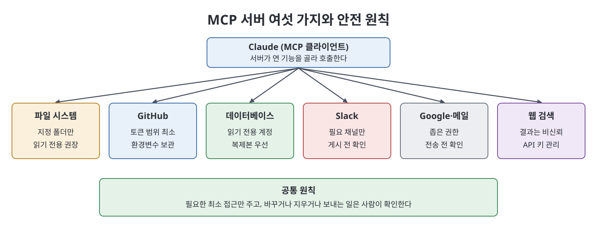

# 부록 D MCP 서버 레시피 (MCP Server Recipes)

부록 D는 사람들이 가장 먼저 연결하는 MCP 서버 여섯 종류를 레시피 형태로 보여 준다. 책은 이를 복사해 붙일 설정이 아니라 "구성의 모양을 알아보기 위한 스케치"라고 못 박는다. 패키지 이름, 명령어, 환경 변수, 인증 방식은 생태계가 성숙하면서 바뀌고 클라이언트마다 다르므로, 연결 전에 공식 문서와 해당 서버의 안내를 확인하라고 한다. 설정은 보통 클라이언트가 시작할 때 읽는 JSON 파일에 있고, 최상위 `mcpServers` 객체 아래에 내가 정한 이름별로 실행·접속 방법을 적는다.

> **쉽게 말하면**
> MCP 서버는 Claude에게 손을 달아 주는 일이다. 손이 닿는 범위가 곧 위험이므로, 레시피마다 붙은 "안전 메모"가 가장 중요한 줄이다.

> **참고(노트 작성자)** 서버 종류와 설정 형태는 책이 쓰인 시점 기준이며 노트가 검증하지 않았다. 패키지 이름과 설정 키는 옮기지 않았다. 직접 연결할 때는 공식 문서를 따라야 한다.



## 1. 여섯 가지 레시피

| 서버 | 하는 일 | 인증 | 안전 메모 |
|------|---------|------|-----------|
| 파일 시스템 | 지정한 폴더 안의 파일을 읽고(설정에 따라) 쓴다. 문서 요약, 메모 정리, 보고서 조립에 쓴다 | 없음(폴더 경로를 인자로 지정) | 넘긴 경로가 울타리다. 홈 디렉터리나 드라이브 루트 금지, 읽기만 필요하면 읽기 전용으로 |
| GitHub | 저장소 탐색, 이슈·풀 리퀘스트 읽기, 권한이 있으면 이슈 생성과 댓글 | 개인 액세스 토큰 | 필요한 최소 권한만, 분석이면 읽기 전용. 토큰은 환경 변수에 두고 설정 파일에 직접 쓰거나 커밋하지 않는다 |
| 데이터베이스(예: Postgres) | 자연어 질문을 질의로 바꿔 실행하고 결과를 해석한다 | 접속 문자열(환경 변수) | 읽기 전용 사용자로 연결, 가능하면 복제본이나 비운영 DB. 질의를 쓰는 모델과 수정 가능한 연결의 조합을 기본값으로 피한다 |
| Slack 등 메신저 | 허용된 채널의 최근 글을 읽고, 허용하면 대신 게시한다 | 봇 토큰, 팀 ID | 프롬프트 인젝션이 가장 쉽게 일어나는 곳. 필요한 채널만, 읽기부터, 게시 전 확인 필수 |
| Google Workspace와 메일 | 일정, 문서, 메일을 읽고 정리한다 | OAuth(브라우저 동의 한 번) | 가장 민감한 영역. 좁은 범위의 권한, 자격 증명 파일은 공유·버전 관리 밖에 두기, 메일 발송이나 일정 삭제 전 명시적 확인 |
| 웹 검색 | 실시간 검색으로 최신 정보를 가져온다 | 검색 제공자의 API 키 | 검색 결과는 본질적으로 신뢰할 수 없는 입력이다. 명령이 아니라 평가할 자료로 보고, 행동을 하는 서버와 같이 쓸 때 특히 조심. 키는 과금과 연결되니 사용량 확인 |

## 2. 설정 파일의 모양

책의 모든 JSON은 같은 틀을 따른다.

| 요소 | 의미 |
|------|------|
| `mcpServers` | 서버 목록을 담는 최상위 객체 |
| 서버 이름(키) | 내가 정하는 이름 |
| `command`, `args` | 서버를 실행하는 명령과 인자. 파일 시스템 서버는 인자로 허용 폴더를 받는다 |
| `env` | 토큰, 접속 문자열, 키 등을 환경 변수로 넘기는 자리 |

비밀 값은 설정 파일에 값을 쓰지 않고 환경 변수를 참조하는 형태로 적는 것이 책의 일관된 패턴이다. 노트의 예시도 값은 자리표시자다.

```json
{
  "mcpServers": {
    "내-서버": {
      "command": "<실행 명령>",
      "args": ["<인자>"],
      "env": { "SERVICE_TOKEN": "${SERVICE_TOKEN}" }
    }
  }
}
```

## 3. 공통 원칙

- 서버는 내가 준 접근 범위 안에서 Claude가 목표를 좇는 데 그 접근을 쓴다. 그래서 최소 권한이 기본이다.
- 읽기는 비교적 안전하고, 대신 행동하는 것(게시, 발송, 삭제, 수정)은 위험하다.
- 신뢰할 수 없는 글을 읽는 에이전트가 사람의 확인 없이 자유롭게 보낼 수 있게 두지 않는다.

## 핵심 정리

- 대표 MCP 서버는 파일, GitHub, 데이터베이스, 메신저, Google·메일, 웹 검색 여섯 가지다.
- 각 레시피는 "무엇이 가능해지나"와 "무엇을 조심하나"를 함께 적고, 안전 메모가 핵심이다.
- 구체적인 설정은 바뀌므로 공식 문서와 서버 안내로 반드시 확인한다.

<br>
<br>
<br>

이전: [부록 C 스킬 템플릿](%EB%B6%80%EB%A1%9D%20C%20%EC%8A%A4%ED%82%AC%20%ED%85%9C%ED%94%8C%EB%A6%BF.md) | 다음: [부록 E 설정과 구성 참조](%EB%B6%80%EB%A1%9D%20E%20%EC%84%A4%EC%A0%95%EA%B3%BC%20%EA%B5%AC%EC%84%B1%20%EC%B0%B8%EC%A1%B0.md)

<br>

[Claude AI Bible](../)
