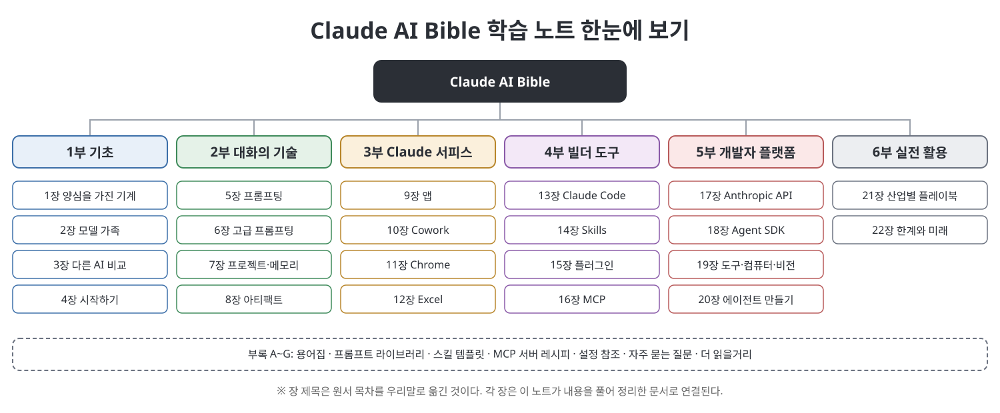

# **Claude AI Bible 학습 노트**
(Claude AI Bible: The Complete Guide to Mastering Claude, Claude Code, Claude Cowork, MCP, AI Agents, Automation, 장별 정리 노트)
 

이 문서는 Stephen Clear의 『Claude AI Bible』을 부와 장별로 정리한 한국어 학습 노트입니다. 원문을 번역한 것이 아니라 내용을 우리말로 풀어서 다시 설명했고, 처음 나오는 용어에는 쉬운 풀이를 붙였습니다. 책은 Claude의 기본 개념과 모델, 프롬프팅, 앱과 Cowork·Chrome·Excel 같은 사용 환경, Claude Code·Skills·플러그인·MCP 같은 빌더 도구, API와 Agent SDK, 산업별 활용과 한계까지 22개 장과 부록 A~G로 다룹니다. 이 노트는 6개 부와 부록으로 묶어 같은 순서를 따릅니다. 장마다 개념도와 비교 그림, 표를 직접 만들어 넣었습니다.

> **이 노트를 읽을 때 유의할 점**
> - 이 노트는 원서의 **요약·해설본**이며 원서를 대신하지 않습니다. 정확성이 필요한 내용은 원서와 Anthropic 공식 문서에서 확인하세요.
> - 모델 이름, 기능, 요금제, 한도, 설정 키는 **책이 쓰인 시점의 서술**입니다. 제품이 빠르게 바뀌므로 지금과 다를 수 있고, 이 노트가 사실 여부를 검증한 것은 아닙니다. 해당 부분에는 `참고(노트 작성자)`로 표시했습니다.
> - 책 속 사례와 수치는 책의 주장이며 "책에 따르면"처럼 출처를 밝혔습니다.
> - 코드, 프롬프트, 설정 예시는 개념을 보여 주려고 새로 쓴 짧은 예시입니다. API 키 같은 비밀 값은 자리표시자로 두었습니다.
 

---

## 목차

- [1부 기초 (1~4장)](01.%201%EB%B6%80%20%EA%B8%B0%EC%B4%88/Readme.md)
  - [1장 양심을 가진 기계](01.%201%EB%B6%80%20%EA%B8%B0%EC%B4%88/01%EC%9E%A5%20%EC%96%91%EC%8B%AC%EC%9D%84%20%EA%B0%80%EC%A7%84%20%EA%B8%B0%EA%B3%84.md)
  - [2장 Opus·Sonnet·Haiku 모델 가족](01.%201%EB%B6%80%20%EA%B8%B0%EC%B4%88/02%EC%9E%A5%20Opus%C2%B7Sonnet%C2%B7Haiku%20%EB%AA%A8%EB%8D%B8%20%EA%B0%80%EC%A1%B1.md)
  - [3장 Claude와 다른 AI 비교](01.%201%EB%B6%80%20%EA%B8%B0%EC%B4%88/03%EC%9E%A5%20Claude%EC%99%80%20%EB%8B%A4%EB%A5%B8%20AI%20%EB%B9%84%EA%B5%90.md)
  - [4장 시작하기 요금제·가격·개인정보·계정](01.%201%EB%B6%80%20%EA%B8%B0%EC%B4%88/04%EC%9E%A5%20%EC%8B%9C%EC%9E%91%ED%95%98%EA%B8%B0%20%EC%9A%94%EA%B8%88%EC%A0%9C%C2%B7%EA%B0%80%EA%B2%A9%C2%B7%EA%B0%9C%EC%9D%B8%EC%A0%95%EB%B3%B4%C2%B7%EA%B3%84%EC%A0%95.md)
  - [핵심 정리](01.%201%EB%B6%80%20%EA%B8%B0%EC%B4%88/%ED%95%B5%EC%8B%AC%20%EC%A0%95%EB%A6%AC.md)
- [2부 대화의 기술 (5~8장)](02.%202%EB%B6%80%20%EB%8C%80%ED%99%94%EC%9D%98%20%EA%B8%B0%EC%88%A0/Readme.md)
  - [5장 기술로서의 프롬프팅](02.%202%EB%B6%80%20%EB%8C%80%ED%99%94%EC%9D%98%20%EA%B8%B0%EC%88%A0/05%EC%9E%A5%20%EA%B8%B0%EC%88%A0%EB%A1%9C%EC%84%9C%EC%9D%98%20%ED%94%84%EB%A1%AC%ED%94%84%ED%8C%85.md)
  - [6장 고급 프롬프팅과 추론 제어](02.%202%EB%B6%80%20%EB%8C%80%ED%99%94%EC%9D%98%20%EA%B8%B0%EC%88%A0/06%EC%9E%A5%20%EA%B3%A0%EA%B8%89%20%ED%94%84%EB%A1%AC%ED%94%84%ED%8C%85%EA%B3%BC%20%EC%B6%94%EB%A1%A0%20%EC%A0%9C%EC%96%B4.md)
  - [7장 프로젝트·메모리·지식](02.%202%EB%B6%80%20%EB%8C%80%ED%99%94%EC%9D%98%20%EA%B8%B0%EC%88%A0/07%EC%9E%A5%20%ED%94%84%EB%A1%9C%EC%A0%9D%ED%8A%B8%C2%B7%EB%A9%94%EB%AA%A8%EB%A6%AC%C2%B7%EC%A7%80%EC%8B%9D.md)
  - [8장 아티팩트와 긴 글 출력](02.%202%EB%B6%80%20%EB%8C%80%ED%99%94%EC%9D%98%20%EA%B8%B0%EC%88%A0/08%EC%9E%A5%20%EC%95%84%ED%8B%B0%ED%8C%A9%ED%8A%B8%EC%99%80%20%EA%B8%B4%20%EA%B8%80%20%EC%B6%9C%EB%A0%A5.md)
  - [핵심 정리](02.%202%EB%B6%80%20%EB%8C%80%ED%99%94%EC%9D%98%20%EA%B8%B0%EC%88%A0/%ED%95%B5%EC%8B%AC%20%EC%A0%95%EB%A6%AC.md)
- [3부 Claude 서피스 (9~12장)](03.%203%EB%B6%80%20Claude%20%EC%84%9C%ED%94%BC%EC%8A%A4/Readme.md)
  - [9장 앱 데스크톱·웹·모바일·음성](03.%203%EB%B6%80%20Claude%20%EC%84%9C%ED%94%BC%EC%8A%A4/09%EC%9E%A5%20%EC%95%B1%20%EB%8D%B0%EC%8A%A4%ED%81%AC%ED%86%B1%C2%B7%EC%9B%B9%C2%B7%EB%AA%A8%EB%B0%94%EC%9D%BC%C2%B7%EC%9D%8C%EC%84%B1.md)
  - [10장 Claude Cowork](03.%203%EB%B6%80%20Claude%20%EC%84%9C%ED%94%BC%EC%8A%A4/10%EC%9E%A5%20Claude%20Cowork.md)
  - [11장 Claude in Chrome](03.%203%EB%B6%80%20Claude%20%EC%84%9C%ED%94%BC%EC%8A%A4/11%EC%9E%A5%20Claude%20in%20Chrome.md)
  - [12장 Claude in Excel](03.%203%EB%B6%80%20Claude%20%EC%84%9C%ED%94%BC%EC%8A%A4/12%EC%9E%A5%20Claude%20in%20Excel.md)
  - [핵심 정리](03.%203%EB%B6%80%20Claude%20%EC%84%9C%ED%94%BC%EC%8A%A4/%ED%95%B5%EC%8B%AC%20%EC%A0%95%EB%A6%AC.md)
- [4부 빌더 도구 (13~16장)](04.%204%EB%B6%80%20%EB%B9%8C%EB%8D%94%20%EB%8F%84%EA%B5%AC/Readme.md)
  - [13장 Claude Code](04.%204%EB%B6%80%20%EB%B9%8C%EB%8D%94%20%EB%8F%84%EA%B5%AC/13%EC%9E%A5%20Claude%20Code.md)
  - [14장 Skills](04.%204%EB%B6%80%20%EB%B9%8C%EB%8D%94%20%EB%8F%84%EA%B5%AC/14%EC%9E%A5%20Skills.md)
  - [15장 플러그인과 마켓플레이스](04.%204%EB%B6%80%20%EB%B9%8C%EB%8D%94%20%EB%8F%84%EA%B5%AC/15%EC%9E%A5%20%ED%94%8C%EB%9F%AC%EA%B7%B8%EC%9D%B8%EA%B3%BC%20%EB%A7%88%EC%BC%93%ED%94%8C%EB%A0%88%EC%9D%B4%EC%8A%A4.md)
  - [16장 MCP](04.%204%EB%B6%80%20%EB%B9%8C%EB%8D%94%20%EB%8F%84%EA%B5%AC/16%EC%9E%A5%20MCP.md)
  - [핵심 정리](04.%204%EB%B6%80%20%EB%B9%8C%EB%8D%94%20%EB%8F%84%EA%B5%AC/%ED%95%B5%EC%8B%AC%20%EC%A0%95%EB%A6%AC.md)
- [5부 개발자 플랫폼 (17~20장)](05.%205%EB%B6%80%20%EA%B0%9C%EB%B0%9C%EC%9E%90%20%ED%94%8C%EB%9E%AB%ED%8F%BC/Readme.md)
  - [17장 Anthropic API](05.%205%EB%B6%80%20%EA%B0%9C%EB%B0%9C%EC%9E%90%20%ED%94%8C%EB%9E%AB%ED%8F%BC/17%EC%9E%A5%20Anthropic%20API.md)
  - [18장 Claude Agent SDK](05.%205%EB%B6%80%20%EA%B0%9C%EB%B0%9C%EC%9E%90%20%ED%94%8C%EB%9E%AB%ED%8F%BC/18%EC%9E%A5%20Claude%20Agent%20SDK.md)
  - [19장 도구 사용·컴퓨터 사용·비전](05.%205%EB%B6%80%20%EA%B0%9C%EB%B0%9C%EC%9E%90%20%ED%94%8C%EB%9E%AB%ED%8F%BC/19%EC%9E%A5%20%EB%8F%84%EA%B5%AC%20%EC%82%AC%EC%9A%A9%C2%B7%EC%BB%B4%ED%93%A8%ED%84%B0%20%EC%82%AC%EC%9A%A9%C2%B7%EB%B9%84%EC%A0%84.md)
  - [20장 AI 에이전트와 자동화 만들기](05.%205%EB%B6%80%20%EA%B0%9C%EB%B0%9C%EC%9E%90%20%ED%94%8C%EB%9E%AB%ED%8F%BC/20%EC%9E%A5%20AI%20%EC%97%90%EC%9D%B4%EC%A0%84%ED%8A%B8%EC%99%80%20%EC%9E%90%EB%8F%99%ED%99%94%20%EB%A7%8C%EB%93%A4%EA%B8%B0.md)
  - [핵심 정리](05.%205%EB%B6%80%20%EA%B0%9C%EB%B0%9C%EC%9E%90%20%ED%94%8C%EB%9E%AB%ED%8F%BC/%ED%95%B5%EC%8B%AC%20%EC%A0%95%EB%A6%AC.md)
- [6부 실전 활용 (21~22장)](06.%206%EB%B6%80%20%EC%8B%A4%EC%A0%84%20%ED%99%9C%EC%9A%A9/Readme.md)
  - [21장 산업별 플레이북](06.%206%EB%B6%80%20%EC%8B%A4%EC%A0%84%20%ED%99%9C%EC%9A%A9/21%EC%9E%A5%20%EC%82%B0%EC%97%85%EB%B3%84%20%ED%94%8C%EB%A0%88%EC%9D%B4%EB%B6%81.md)
  - [22장 한계와 위험, 그리고 솔직한 미래](06.%206%EB%B6%80%20%EC%8B%A4%EC%A0%84%20%ED%99%9C%EC%9A%A9/22%EC%9E%A5%20%ED%95%9C%EA%B3%84%EC%99%80%20%EC%9C%84%ED%97%98%2C%20%EA%B7%B8%EB%A6%AC%EA%B3%A0%20%EC%86%94%EC%A7%81%ED%95%9C%20%EB%AF%B8%EB%9E%98.md)
  - [핵심 정리](06.%206%EB%B6%80%20%EC%8B%A4%EC%A0%84%20%ED%99%9C%EC%9A%A9/%ED%95%B5%EC%8B%AC%20%EC%A0%95%EB%A6%AC.md)
- [부록 (A~G)](07.%20%EB%B6%80%EB%A1%9D/Readme.md)
  - [부록 A 용어집](07.%20%EB%B6%80%EB%A1%9D/%EB%B6%80%EB%A1%9D%20A%20%EC%9A%A9%EC%96%B4%EC%A7%91.md)
  - [부록 B 프롬프트 라이브러리](07.%20%EB%B6%80%EB%A1%9D/%EB%B6%80%EB%A1%9D%20B%20%ED%94%84%EB%A1%AC%ED%94%84%ED%8A%B8%20%EB%9D%BC%EC%9D%B4%EB%B8%8C%EB%9F%AC%EB%A6%AC.md)
  - [부록 C 스킬 템플릿](07.%20%EB%B6%80%EB%A1%9D/%EB%B6%80%EB%A1%9D%20C%20%EC%8A%A4%ED%82%AC%20%ED%85%9C%ED%94%8C%EB%A6%BF.md)
  - [부록 D MCP 서버 레시피](07.%20%EB%B6%80%EB%A1%9D/%EB%B6%80%EB%A1%9D%20D%20MCP%20%EC%84%9C%EB%B2%84%20%EB%A0%88%EC%8B%9C%ED%94%BC.md)
  - [부록 E 설정과 구성 참조](07.%20%EB%B6%80%EB%A1%9D/%EB%B6%80%EB%A1%9D%20E%20%EC%84%A4%EC%A0%95%EA%B3%BC%20%EA%B5%AC%EC%84%B1%20%EC%B0%B8%EC%A1%B0.md)
  - [부록 F 자주 묻는 질문](07.%20%EB%B6%80%EB%A1%9D/%EB%B6%80%EB%A1%9D%20F%20%EC%9E%90%EC%A3%BC%20%EB%AC%BB%EB%8A%94%20%EC%A7%88%EB%AC%B8.md)
  - [부록 G 더 읽을거리](07.%20%EB%B6%80%EB%A1%9D/%EB%B6%80%EB%A1%9D%20G%20%EB%8D%94%20%EC%9D%BD%EC%9D%84%EA%B1%B0%EB%A6%AC.md)

---

## 읽는 순서 제안

| 목적 | 추천 경로 |
|------|-----------|
| Claude가 무엇이고 어떤 모델이 있는지 알고 싶다 | 1부 (1~4장) |
| 답을 더 잘 받는 대화법을 익히고 싶다 | 2부 (5~8장) |
| 앱, Cowork, Chrome, Excel로 일을 맡기고 싶다 | 3부 (9~12장) |
| Claude Code, Skills, 플러그인, MCP를 쓰고 싶다 | 4부 (13~16장) |
| API와 SDK로 직접 만들고 싶다 | 5부 (17~20장) |
| 업종별 활용과 한계, 위험을 보고 싶다 | 6부 (21~22장) |
| 용어, 프롬프트, 설정을 빠르게 찾고 싶다 | 부록 (A~G) |

## 용어 몇 가지

| 용어 | 쉬운 설명 |
|------|-----------|
| Claude | Anthropic이 만든 AI 어시스턴트. 대화, 글쓰기, 분석, 코딩 등을 돕는다. |
| 프롬프트 | AI에게 하는 지시나 질문. 쓰는 방식에 따라 결과가 크게 달라진다. |
| 에이전트 | 목표를 받아 스스로 단계를 계획하고 도구를 써서 일을 수행하는 AI. |
| MCP | AI가 외부 도구와 데이터에 연결하는 방식을 정한 공통 규약(Model Context Protocol). |
| Skills | Claude에게 특정 작업의 절차와 지식을 미리 가르쳐 두는 재사용 가능한 묶음. |
| API / SDK | 프로그램에서 Claude를 호출하는 통로와, 그것을 쉽게 쓰게 해 주는 개발 도구. |

---

## 이 노트에 대하여

- 각 장 문서는 개요, 흐름, 본문 정리, 표, 그림, 핵심 정리, 이전·다음 링크 순서로 구성됩니다.
- 그림은 모두 이 노트용으로 새로 그린 SVG이며 책의 그림을 쓰지 않았습니다.
- 같은 저장소의 다른 학습 노트와 같은 형식을 따릅니다.

