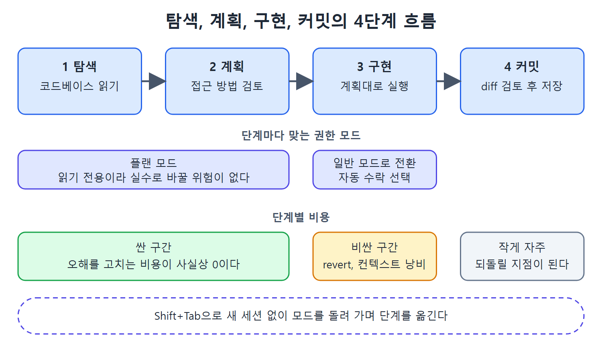

# 4단계 작업 흐름

구현 요청을 곧바로 Claude Code에 입력해 왔다면 가장 중요한 단계를 건너뛰고 있었던 셈이다. 이 문서는 가장 안정적으로 좋은 결과를 내는 탐색, 계획, 구현, 커밋의 4단계 흐름을 설명한다. 그리고 권한 모드(permission mode)를 안전장치가 아니라 이 흐름의 각 단계를 고르는 선택기로 보는 관점을 함께 다룬다.

마지막에는 Anthropic의 한 팀이 모든 작업을 Claude Code에서 시작하는 습관으로 일하는 방식을 바꾼 사례를 소개한다.

---

## 1. 네 단계

꾸준히 최고의 결과를 내는 흐름은 탐색(explore), 계획(plan), 구현(implement), 커밋(commit)이다. 탐색을 건너뛰는 것이 가장 흔한 실수이고, 그러면 Claude가 기술적으로는 올바른 코드로 엉뚱한 문제를 자신 있게 푸는 일이 생긴다.

그림은 네 단계마다 어울리는 권한 모드와 단계별 비용을 한눈에 보여 준다. 탐색과 계획은 플랜 모드에서 싸게 끝내고, 구현에서 고치는 비싼 비용을 줄이는 것이 핵심이다.

### 탐색

플랜 모드(plan mode)에서 시작한다. Claude가 코드베이스를 읽게 하고, 관련 디렉터리를 가리켜 주고, 기존 패턴과 컨벤션과 아키텍처를 파악하게 한다. 플랜 모드는 Claude를 읽기 전용 작업으로 제한하기 때문에 상황을 파악하는 동안 실수로 무엇을 바꿀 위험이 없다. 그래서 이 단계는 싸다.

### 계획

여전히 플랜 모드다. Claude에게 접근 방법을 정리해 달라고 하고, 계획을 검토한다. 내 머릿속 그림과 맞지 않는 부분은 반박한다. 오해는 이 단계에서 드러나며, 계획 단계에서 고치는 비용은 사실상 0이다. 구현 단계에서 고치면 되돌리기(revert)와 낭비된 컨텍스트 윈도라는 값을 치른다.

### 구현

일반 모드로 전환한다. 이제 Claude는 탐색에서 얻은 컨텍스트와 검토를 마친 계획을 갖고 있다. 가정이 아니라 이해에 기반해 일하기 때문에 구현 품질이 눈에 띄게 높다. 그냥 돌리게 둔다.

### 커밋

구현이 끝나면 Claude가 커밋을 제안한다. diff를 검토한다. 앞 단계를 잘 했다면 diff에 놀랄 것이 없어야 한다. 커밋은 자주 한다. 작은 커밋은 싼 보험이다. 이 장 뒤쪽에서 다루는 체크포인트와 롤백 전략은 되돌아갈 깨끗한 커밋 경계가 있어야 성립한다.

## 2. 신중함이 아니라 효율

이 흐름은 조심하자는 이야기가 아니다. 효율의 문제다. 탐색과 계획은 싸고, 구현과 디버깅은 비싸다. 싼 일을 앞에서 해서 비싼 일을 줄이는 것은 소심함이 아니라 엔지니어링이다.

## 3. 첫 번째 정거장: 모든 작업을 Claude Code에서 시작하기

Anthropic의 한 팀은 듣기엔 사소하지만 일하는 방식을 바꾼 습관을 만들었다. 모든 작업의 첫 번째 정거장을 Claude Code로 삼은 것이다. 코드를 직접 읽기 전에, 저장소를 검색하기 전에, 동료에게 묻기 전에 Claude Code를 열고 지금 하는 일에 어떤 파일을 봐야 하는지부터 물었다. 버그 수정이든 기능 개발이든 분석이든 가리지 않았다.

이 습관은 코드베이스를 직접 돌아다니며 맥락을 모으던 시간 많이 드는 과정을 대체했다. Claude는 저장소 전체 구조를 훑고, 관련 파일을 찾고, 모듈 간의 복잡한 상호작용을 설명하고, 사람이 디렉터리를 15분쯤 뒤져야 찾을 의존성을 드러낼 수 있었다. 팀은 선택적인 가속기로 두지 않고 언제나 Claude Code로 시작하는 이 습관 하나가 일상 업무에서 가장 큰 변화였다고 보고했다.

## 4. 권한 모드는 작업 방식을 고르는 선택기

권한 모드를 안전 다이얼로 보는 사람이 많다. 위험하면 올리고 믿을 만하면 내린다는 식이다. 하지만 이 관점은 핵심을 놓친다. 권한 모드는 일이 진행되는 방식을 정한다. 단순한 가드레일이 아니라 워크플로 선택기다.

| 모드 | 동작 | 쓰는 때 |
|------|------|---------|
| 플랜 모드 | 읽기 전용으로 제한 | 탐색과 조사. 조심해서가 아니라 지금 어느 단계인지 의식하고 쓰는 것이다 |
| 기본(default) 모드 | 쓰기 작업마다 권한을 묻는다 | 모든 수정을 직접 승인하고 싶은 정밀한 변경 |
| 자동 수락(auto-accept edits) 모드 | 파일 쓰기는 묻지 않고, 셸 명령은 여전히 묻는다 | 계획은 믿지만 시스템 수준 작업은 지켜보고 싶은 구현 단계 |
| 전체 자동 수락 모드 | 중단 없이 실행 | 검증 장치가 탄탄할 때. 좋은 테스트 스위트, 규칙이 엄격한 린터, 표준을 강제하는 pre-commit 훅 |

권한 모델 전체, 즉 Claude Code가 묻지 않고 할 수 있는 일의 범위는 2장에서 다룬다.

## 5. Shift+Tab으로 모드를 오간다

세션 도중 Shift+Tab으로 모드를 돌려 가며 쓰는 것은 우유부단해서가 아니다. 숙련자가 새 세션을 열지 않고 탐색, 계획, 구현, 커밋 흐름을 이동하는 방법이다. 플랜 모드에서 탐색하고, 계획을 검토하고, 자동 수락으로 바꾼 뒤 Claude가 실행하게 둔다.

## 6. 정리

- 탐색을 건너뛰면 올바른 코드로 틀린 문제를 푼다.
- 탐색과 계획은 싸고 구현과 디버깅은 비싸다. 앞쪽에 몰아서 투자한다.
- 계획 단계의 오해는 공짜로 고치고, 구현 단계의 오해는 revert와 컨텍스트를 날린다.
- 커밋은 작게 자주 한다. 뒤에서 되돌릴 지점이 된다.
- 권한 모드는 안전 다이얼이 아니라 단계에 맞는 작업 방식을 고르는 도구다.

 
 
 

[Claude Code The Definitive Guide to Agentic Development-2](../)
