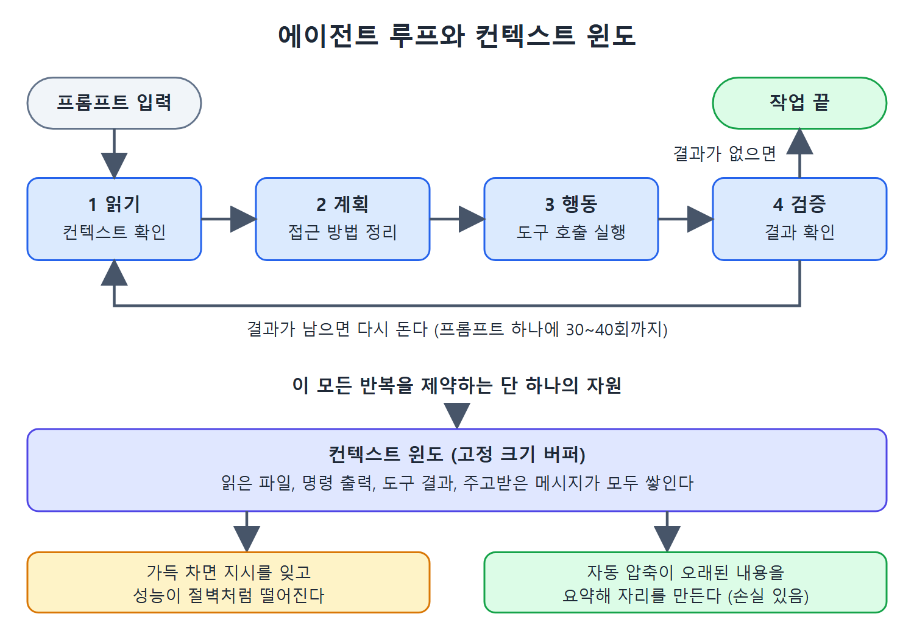

# 에이전트 루프와 컨텍스트 윈도

Claude Code를 처음 쓰면 대부분 "질문을 입력하면 답이 나오는 도구"로 이해한다. 챗봇과 자동완성 도구를 오래 써 온 습관 때문이다. 이 이해는 Claude Code가 실제로 하는 일을 크게 과소평가하게 만들고, 쓰는 방식 전체를 좁은 틀에 가둔다.

이 문서는 그 틀을 깨는 두 가지를 다룬다. 하나는 Claude Code가 한 번의 응답이 아니라 반복 루프로 움직인다는 사실이고, 다른 하나는 그 루프 전체를 제약하는 유일한 자원인 컨텍스트 윈도다. 이 둘을 이해하면 프롬프트를 쓰는 태도와 세션을 관리하는 방식이 달라진다.

---

## 1. 입문 단계에서 멈추는 이유

원문은 많은 개발자가 사용 3일 차쯤에서 더 나아가지 못한다고 말한다. 프롬프트를 입력하고, 코드를 받고, 붙여 넣는 기본기까지는 익히지만 거기서 멈춘다. 잘못해서가 아니라 그 위에 더 깊은 층이 있다는 걸 아무도 알려 주지 않았기 때문이다.

Claude Code는 에이전트(agent) 방식으로 동작하는 시스템이다. 코드베이스를 읽고, 접근 방법을 계획하고, 수십 개 파일을 고치고, 테스트를 돌리고, 에러를 읽고, 다시 시도한다. 도구 호출을 한 번으로 끝내지 않고 루프로 이어 붙인다. 이 차이를 받아들이는 순간 도구와의 관계가 바뀐다. 질문을 던지는 사람에서 과제를 내주는 사람이 되는 것이다.

## 2. 루프라는 구조

Claude Code는 요청과 응답 한 쌍이 아니라 루프다. 구조는 다음 순서를 반복한다.

1. 컨텍스트를 읽는다.
2. 계획을 세운다.
3. 행동을 취한다.
4. 결과를 검증한다.

그리고 이 사이클을 다시 돈다. 프롬프트 하나가 이 사이클을 30~40번 돌릴 수도 있다. 매번 파일을 읽고, 코드를 쓰고, 명령을 실행하고, 출력을 확인하고, 다음에 무엇을 할지 정한다.



그림은 읽기, 계획, 행동, 검증이 도는 루프와 그 위에서 쌓이는 컨텍스트 윈도를 함께 보여 준다. 도구 결과가 남아 있으면 루프가 다시 돌고, 윈도가 가득 차면 성능이 떨어지거나 자동 압축이 오래된 내용을 요약한다.

## 3. 350줄로 만드는 에이전트 루프

이 루프를 돌리는 껍데기(하네스, harness)는 생각보다 단순하다. 커뮤니티 개발자들이 에이전트 시스템의 정체를 보여 주려고 만든 교육용 최소 구현은 약 350줄이다. 핵심 패턴은 세 함수로 이루어진다. 모델을 호출하고, 응답에 담긴 도구 호출을 처리하고, 다시 반복한다. 도구 결과가 있으면 메시지에 덧붙여 모델을 또 부르고, 없으면 작업이 끝난 것이다.

```text
response = callApi(messages, systemPrompt)
toolResults = processToolCalls(response.content)
if toolResults.length == 0: return   // done
messages.append(response, toolResults)
// loop again
```

도구는 맵(map)에 등록해 둔다. 파일 읽기, 파일 쓰기, 명령 실행 같은 것들이다. 모델이 부르는 도구 호출은 각각 대응하는 핸들러로 전달된다. 무슨 도구를 다음에 쓸지는 모델이 판단하고, 하네스는 실행해서 결과를 돌려준다. 구조의 전부가 이것이다.

실제 제품인 Claude Code에서는 모든 단계가 권한(permission) 검사, 컨텍스트 관리, 훅(hook) 평가, 서브에이전트(subagent) 조율, 안전 제약으로 감싸져 있다. 그래도 중심은 이 루프다.

## 4. 프롬프트의 의미가 바뀐다

루프 구조를 알면 "프롬프팅"이 무엇인지 다시 보게 된다. 프롬프트는 검색 쿼리가 아니다. 코드베이스, 터미널, 테스트 스위트, 빌드 시스템에 모두 접근할 수 있는 동료에게 업무를 브리핑하는 일에 가깝다. 이 동료는 직접 탐색하고, 계획을 세우고, 구현하고, 끝났거나 막혔을 때 돌아와서 보고한다. 처음 브리핑의 품질이 이후 모든 것을 결정한다.

## 5. 컨텍스트 윈도: 단 하나의 자원

Claude Code의 모든 기능, 모든 설계 결정, 모든 모범 사례는 결국 하나의 제약으로 돌아간다. 컨텍스트 윈도(context window)다. 대화를 위한 RAM이라고 생각하면 쉽다. Claude가 읽는 모든 파일, 캡처한 모든 명령 출력, 처리한 모든 도구 결과, 주고받은 모든 메시지가 이 고정 크기 버퍼에 쌓인다.

가득 차면 성능은 완만하게 떨어지지 않고 절벽처럼 떨어진다. 지시를 잊고, 하던 작업이 빠지고, 이미 푼 문제를 다시 풀기 시작한다. 이론상의 걱정이 아니라 긴 세션이면 거의 반드시 겪는 일이다.

윈도가 거의 찼을 때는 자동 압축(auto-compaction)이 작동해 오래된 내용을 요약하고 자리를 만든다. 하지만 요약은 손실이 있다. 압축 방식과 살아남는 법은 3장에서 다룬다.

## 6. 컨텍스트를 예산처럼 쓴다

실무적으로는 모든 상호작용에 컨텍스트 공간이라는 비용이 든다고 생각해야 한다. 연산 예산이나 메모리 할당을 따지는 것과 같은 감각이다.

- 2,000줄짜리 파일을 통째로 읽게 하면 비싸다.
- 장황한 테스트 출력을 대화에 쏟아 넣으면 비싸다.
- 목표를 좁힌 glob으로 찾을 수 있는 것을 Claude가 이리저리 뒤지게 두면 비싸다.

Claude Code를 가장 잘 쓰는 개발자는 컨텍스트를 희소 자원으로 다룬다. 장황한 작업은 서브에이전트에 맡겨 격리하고(4장), CLAUDE.md는 500줄 아래로 간결하게 유지하고(3장), 자동 압축이 최악의 순간에 컨텍스트를 망치기 전에 먼저 직접 압축한다.

## 7. 정리

| 개념 | 핵심 |
|------|------|
| 에이전트 루프 | 읽기, 계획, 행동, 검증을 반복한다. 프롬프트 하나가 30~40회 반복을 일으킬 수 있다 |
| 하네스 | 최소 구현은 약 350줄. 모델 호출, 도구 호출 처리, 반복의 세 함수가 핵심이다 |
| 프롬프트 | 질의가 아니라 동료에게 하는 브리핑이다 |
| 컨텍스트 윈도 | 고정 크기 버퍼. 차면 성능이 절벽처럼 떨어진다 |
| 대응 | 서브에이전트로 격리, CLAUDE.md 500줄 미만, 선제적 압축 |

<br>
<br>
<br>

[Claude Code The Definitive Guide to Agentic Development-2](../)
