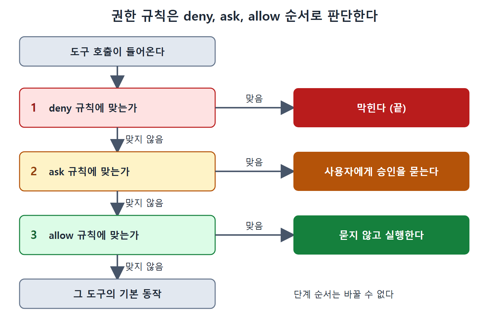

# 권한 규칙 평가와 민감 파일

같은 범위 안에서 권한 규칙은 어떤 순서로 판단될까. Claude Code는 거부, 확인, 허용의 세 단계를 차례로 보고, 먼저 맞는 규칙이 결정을 내린다. 단순해 보이지만 날카로운 모서리가 있다.

이 문서는 규칙을 쓰는 문법, 평가 순서, 그리고 규칙을 써서 비밀 파일을 AI가 읽지 못하게 막는 방법을 설명한다.

---

## 1. 세 단계 평가

한 도구 호출이 들어오면 아래 순서로 규칙을 확인한다.

1. **Deny(거부)**: 어떤 deny 규칙이든 하나라도 맞으면 그 호출은 막힌다. 더 따져 볼 것 없이 끝이다.
2. **Ask(확인)**: ask 규칙에 맞으면 사용자에게 승인을 묻는다.
3. **Allow(허용)**: allow 규칙에 맞으면 묻지 않고 실행한다.

어느 규칙에도 맞지 않으면 그 도구의 기본 동작이 적용된다. 정리하면, 가장 안전한 쪽이 항상 먼저 평가되는 구조다.



그림은 도구 호출 하나가 deny, ask, allow를 차례로 거치며 먼저 맞는 단계에서 결과가 정해지고, 어디에도 맞지 않으면 기본 동작으로 넘어가는 흐름을 보여 준다.

## 2. 규칙 문법

규칙은 `Tool` 또는 `Tool(specifier)` 형태로 쓰고, specifier 자리에 glob 패턴을 쓸 수 있다. 원문이 든 예는 다음과 같다.

| 규칙 | 의미 |
|---|---|
| `Bash(npm test)` | 특정 bash 명령 하나에 맞는다 |
| `Bash(rm *)` | `rm`으로 시작하는 삭제 명령에 맞는다 |
| `Write(*.env)` | 환경 변수 파일에 쓰는 동작에 맞는다 |

glob 패턴 덕분에 표현력이 높지만 그만큼 깨지기도 쉽다. 특히 deny 규칙의 패턴이 너무 넓으면, 허용하려던 작업까지 조용히 막아 버릴 수 있다.

## 3. 먼저 맞는 규칙이 이긴다

개발자가 가장 많이 걸려 넘어지는 곳이 여기다. 예를 들어 `Bash(rm *)`에 deny 규칙을 두고, `Bash(rm -rf node_modules)`에 allow 규칙을 따로 두었다고 하자. 이때는 deny가 먼저 발동하므로 allow 규칙은 실행될 기회조차 얻지 못한다. `rm -rf node_modules`도 `rm *` 패턴에 맞기 때문이다.

두 가지 순서가 있다는 점을 구분해야 한다. 한 단계 안에서의 규칙 순서도 영향을 주지만, 단계 사이의 순서(deny, ask, allow)는 바꿀 수 없다.

```json
{
  "permissions": {
    "deny":  ["Bash(rm *)"],
    "allow": ["Bash(rm -rf node_modules)"]
  }
}
```

위 예시는 원문이 설명한 상황을 보여 주기 위해 구성한 것이고, 결과는 allow 규칙이 무시되고 모든 `rm` 명령이 막히는 것이다.

실무 지침은 이렇다. deny 규칙은 좁게, allow 규칙은 넓게 쓴다. deny는 넘을 수 없는 벽이므로 막으려는 대상만 정확히 막도록 만들어야 한다.

## 4. 민감 파일 제외

`permissions.deny` 설정은 예전에 쓰이던 `ignorePatterns`라는 방식을 대체한다. 파일 단위로 접근을 명시적으로 막는 수단이다. AI 에이전트가 읽거나 고치지 않았으면 하는 모든 것에 쓰라는 것이 원문의 권고다.

전형적인 대상은 다음과 같다.

- `.env` 파일
- credentials가 들어 있는 디렉터리
- 개인 키(private key)
- 시크릿 매니저 관련 파일
- API 키 설정

기준은 간단하다. 내용이 클라우드 서비스로 가는 API 요청에 실려 나가면 위험한 파일이라면 모두 대상이다.

## 5. 왜 읽기만 해도 위험한가

Claude Code는 파일 내용을 외부 API를 거쳐 처리한다. 즉 어떤 파일에 운영 DB 접속 정보가 들어 있고 에이전트가 그 파일을 읽으면, 그 정보가 API 엔드포인트로 전송된다. 파일을 고치지 않고 읽기만 해도 유출이 일어날 수 있다는 뜻이다.

원문은 `permissions.deny` 목록을 이런 정보를 막는 방화벽에 비유한다. 읽기 자체를 규칙으로 막아 두면, 에이전트가 실수하거나 속더라도 해당 내용이 애초에 컨텍스트에 들어오지 않는다.

## 6. 정리

- 평가 순서는 deny, ask, allow이고 이 순서는 바꿀 수 없다.
- deny가 맞으면 allow가 무엇이든 소용없다. 그래서 deny는 좁게, allow는 넓게 쓴다.
- 비밀이 든 파일은 `permissions.deny`로 읽기부터 막는다. 읽는 순간 내용이 외부 API로 가기 때문이다.
- 규칙 하나만으로는 부족한 경우가 많으며, 이후 문서에서 다루는 샌드박스, 컨테이너, 훅과 함께 겹겹이 쓰는 것이 원칙이다.

<br>
<br>
<br>

[Claude Code The Definitive Guide to Agentic Development-2](../)
