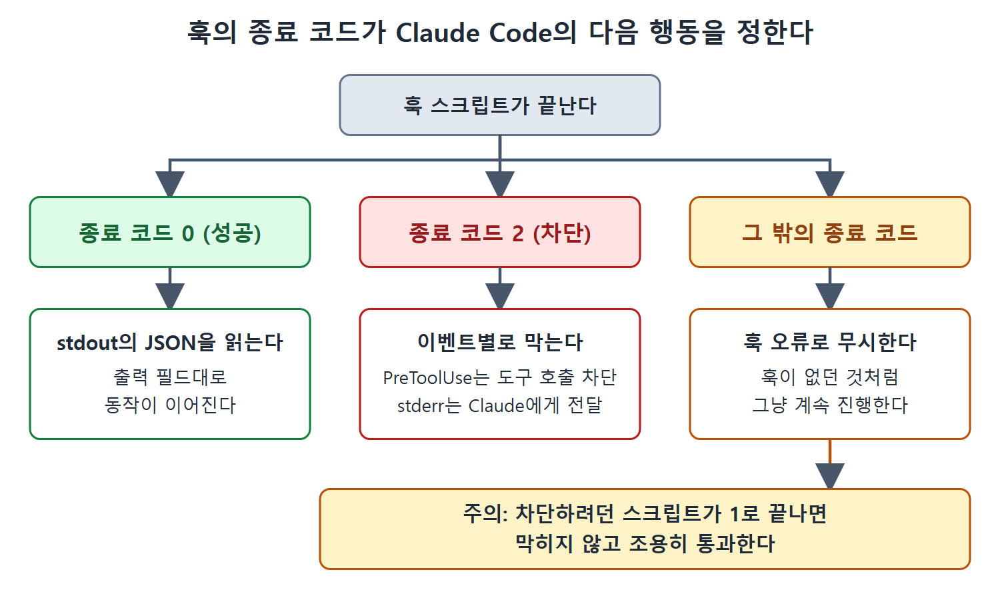

# 훅 종류와 입출력

훅이 모두 셸 스크립트인 것은 아니다. Claude Code는 세 가지 훅 핸들러를 지원하고, 각각 맞는 검증 상황이 다르다. 이 문서는 세 종류의 차이, 백그라운드로 도는 비동기 훅, 훅이 받는 입력과 돌려주는 출력의 규칙, 입력을 몰래 고쳐 쓰는 `updatedInput`을 설명한다.

---

## 1. 세 가지 훅 종류

### 명령 훅 (`type: "command"`)

기본값이다. 셸 명령을 실행하고, 이벤트의 JSON 입력을 stdin으로 받고, 종료 코드와 stdout으로 결과를 알린다. 패턴 매칭, 파일 존재 여부, 명령 검증처럼 결과가 정해져 있는 검사에 쓴다. 빠르고 예측이 쉽다.

### 프롬프트 훅 (`type: "prompt"`)

LLM이 행동을 평가한다. 스크립트를 실행하는 대신 이벤트 입력과 내가 쓴 프롬프트를 빠른 모델(기본값은 Haiku)에 보내고, 구조화된 예/아니오 결정을 받는다. 패턴 매칭이 아니라 판단이 필요한 검사에 알맞다. 코드 변경이 아키텍처 규약을 따르는지, bash 명령이 현재 작업에 적절한지, Claude가 작업을 멈춰도 되는지를 보는 경우가 그렇다.

```json
{
  "type": "prompt",
  "prompt": "Evaluate if Claude should stop: $ARGUMENTS. Check if all tasks are complete, no errors remain, and no follow-up is needed."
}
```

`$ARGUMENTS` 자리 표시자는 훅의 JSON 입력으로 치환된다. 모델은 허용이면 `{"ok": true}`, 차단이면 `{"ok": false, "reason": "..."}`를 반환하고, reason은 Claude의 다음 지시로 전달된다.

### 에이전트 훅 (`type: "agent"`)

프롬프트 훅과 비슷하지만 여러 턴에 걸쳐 도구를 쓸 수 있다. LLM 호출 한 번으로 끝나는 대신 서브에이전트를 띄워서 파일을 읽고, 코드를 검색하고, 코드베이스를 살펴본 뒤 조건을 검증한다. 서브에이전트는 결정을 돌려주기까지 최대 50턴 동안 동작한다. 훅 입력 데이터만 평가해서는 안 되고 실제 파일이나 테스트 출력을 확인해야 할 때 쓴다.

```json
{
  "type": "agent",
  "prompt": "Verify that all unit tests pass. Run the test suite and check the results. $ARGUMENTS",
  "timeout": 120
}
```

## 2. 타임아웃과 응답 형식

기본 타임아웃은 종류마다 다르다.

| 훅 종류 | 기본 타임아웃 |
|---|---|
| 명령 훅 | 600초 |
| 프롬프트 훅 | 30초 |
| 에이전트 훅 | 60초 |

에이전트 훅의 응답 형식은 프롬프트 훅과 같다. 허용은 `{"ok": true}`, 차단은 `{"ok": false, "reason": "..."}`다.

프롬프트 훅과 에이전트 훅이 지원하는 이벤트는 PreToolUse, PostToolUse, PostToolUseFailure, PermissionRequest, UserPromptSubmit, Stop, SubagentStop, TaskCompleted다. TeammateIdle은 프롬프트 훅과 에이전트 훅을 지원하지 않는다.

선택 기준을 정리하면 이렇다. 결과가 정해져 있고 빠르게 확인되면 명령 훅, 판단이 필요하되 입력만 보면 되면 프롬프트 훅, 실제 파일이나 테스트 결과를 열어 봐야 하면 에이전트 훅이다.

## 3. 비동기 훅

기본적으로 훅은 끝날 때까지 Claude의 실행을 멈춘다. 테스트 스위트, 배포, 외부 API 호출처럼 오래 걸리는 작업에서는 이 지연이 견디기 어렵다. 이를 풀어 주는 것이 비동기(async) 훅이다.

명령 훅에 `"async": true`를 지정하면 백그라운드에서 실행된다. Claude는 기다리지 않고 바로 작업을 이어 간다. 백그라운드 프로세스가 끝나면 훅의 JSON 출력에 있는 `systemMessage`나 `additionalContext`가 다음 대화 턴에 Claude에게 전달된다. 비동기 훅은 동작을 막거나 제어할 수 없다. 끝났을 때는 제어하려던 동작이 이미 완료되었기 때문이다.

대표적인 사용례는 파일을 쓸 때마다 테스트 스위트를 돌리는 PostToolUse 훅이다. Claude가 일하는 동안 테스트가 백그라운드에서 돌고, 실패하면 다음 턴에 실패 메시지가 컨텍스트에 나타나 Claude가 문제를 고치게 만든다.

```json
{
  "PostToolUse": [{
    "matcher": "Write|Edit",
    "hooks": [{
      "type": "command",
      "command": "$CLAUDE_PROJECT_DIR/.claude/hooks/run-tests-async.sh",
      "async": true,
      "timeout": 300
    }]
  }]
}
```

비동기 실행마다 별도의 백그라운드 프로세스가 만들어지고 중복 제거가 없다. Claude가 파일 다섯 개를 빠르게 연달아 쓰면 훅도 다섯 번 실행된다.

## 4. 훅의 입력

모든 훅은 stdin으로 JSON을 받는다. 공통 필드는 `session_id`, `transcript_path`, `cwd`, `permission_mode`, `hook_event_name`이다. 여기에 이벤트별 필드가 더해진다. 도구 훅은 `tool_name`과 `tool_input`을, 서브에이전트 훅은 `agent_id`와 `agent_type`을 받는다.

## 5. 종료 코드의 의미

훅의 종료 코드가 Claude Code가 할 일을 정한다.

- **종료 코드 0**은 성공이다. Claude Code가 stdout에서 JSON 출력 필드를 읽는다. 대부분의 이벤트에서 stdout은 verbose 모드에서만 보인다.
- **종료 코드 2**는 차단이다. 정확한 동작은 이벤트에 따라 다르다. PreToolUse는 도구 호출을 막고, PermissionRequest는 권한을 거부하고, Stop은 Claude가 멈추지 못하게 하고, TeammateIdle은 팀원이 계속 일하게 하고, TaskCompleted는 작업이 닫히지 않게 한다. stderr 메시지는 피드백으로 Claude에게 전달된다.
- **그 밖의 종료 코드**는 훅 오류로 처리되어 무시된다. Claude Code는 훅이 실행되지 않은 것처럼 계속 진행한다.

이 마지막 규칙이 중요하다. 차단을 의도한 스크립트가 실수로 1 같은 다른 코드로 끝나면, 차단이 아니라 조용히 통과가 된다.



그림은 훅이 끝날 때 종료 코드 0, 2, 그 밖의 값에 따라 결과를 읽거나, 막거나, 오류로 무시하는 세 갈래와, 차단 의도가 있어도 다른 코드면 통과한다는 점을 보여 준다.

## 6. JSON 출력 필드

JSON 출력은 모든 이벤트에서 다음 필드를 지원한다.

| 필드 | 역할 |
|---|---|
| `continue` | 불리언. 종료 코드가 정한 결정을 덮어쓴다 |
| `stopReason` | Stop 훅용 |
| `suppressOutput` | verbose 모드에서 stdout을 숨긴다 |
| `systemMessage` | 다음 턴에 Claude의 컨텍스트에 추가된다 |
| `additionalContext` | 즉시 추가된다 |

## 7. PreToolUse로 입력 바꾸기

PreToolUse 훅에는 독특한 능력이 있다. 도구가 실행되기 전에 입력을 수정할 수 있다. 훅의 JSON 출력에 있는 `updatedInput` 필드가 도구 입력 매개변수 중 지정한 필드를 바꿔 넣는다.

- `updatedInput`과 `"permissionDecision": "allow"`를 함께 쓰면 명령을 조용히 고쳐 쓰고 자동 승인한다.
- `updatedInput`과 `"permissionDecision": "ask"`를 함께 쓰면 수정된 입력을 사용자에게 보여 주고 승인을 받는다.

유연한 만큼 위험하다. bash 명령을 다시 쓰는 훅은 안전 플래그를 붙이거나, 로깅을 앞에 붙이거나, 명령을 모니터링 하네스로 감쌀 수 있다. 하지만 재작성 로직에 결함이 있으면 취약점이 된다. 실행 가능한 명령을 다시 쓰는 코드를 다룰 때와 같은 수준의 보안 검토를 `updatedInput` 훅에도 적용해야 한다.

## 8. `once` 필드

설정 파일이 아니라 스킬(skill) 안에 정의된 훅에는 `once` 필드를 쓸 수 있다. 이 필드가 있으면 훅이 세션당 한 번만 실행되고 스스로 제거된다. 첫 도구 호출에서 준비 로직을 한 번 돌리고 비켜 주는 스킬 초기화에 알맞다.

<br>
<br>
<br>

[Claude Code The Definitive Guide to Agentic Development-2](../)
