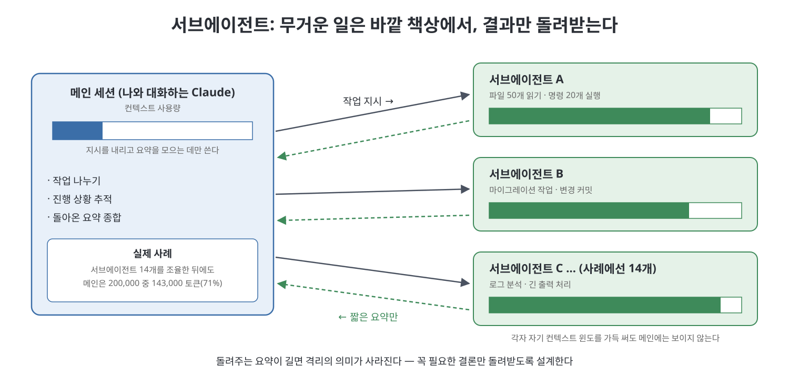
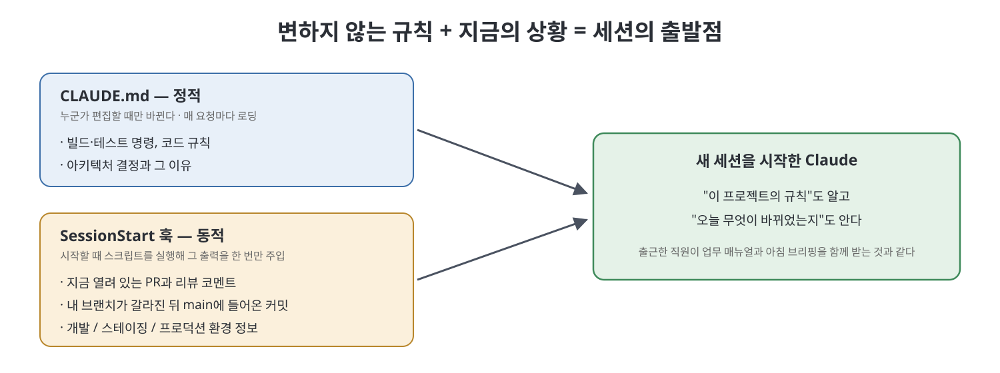

# AGENTS.md와 서브에이전트 격리

CLAUDE.md는 Claude Code 전용이다. 이 문서는 여러 AI 코딩 도구가 함께 쓰는 AGENTS.md 표준, 서브에이전트를 이용한 컨텍스트 격리, 그리고 SessionStart 훅으로 동적인 정보를 주입하는 방법을 다룬다.

세 주제에는 공통된 원칙이 있다. **무거운 정보는 메인 컨텍스트 밖에 두고 필요한 만큼만 가져온다**는 것이다.

> **세 주제를 한 줄씩**
> - **AGENTS.md**: Claude뿐 아니라 여러 AI 도구가 함께 읽는 공용 안내문. 짧게 두고 자세한 건 링크로.
> - **서브에이전트**: 무거운 일을 다른 Claude에게 맡기고 결과 요약만 받는 방법.
> - **SessionStart 훅**: 세션을 시작할 때 "오늘의 최신 상황"을 자동으로 한 번 알려 주는 장치.

---

## 1. AGENTS.md: 에이전트 공용 표준

팀이 여러 AI 코딩 도구를 쓰거나, 저장소 기여자들이 서로 다른 에이전트를 쓴다면 알아 둘 보완 표준이 있다. AGENTS.md는 에이전트용 문서를 위한 오픈 표준이다. 저장소 루트에 두고 20개가 넘는 코딩 에이전트와 함께 쓸 수 있다. README는 사람을 위한 문서이고, AGENTS.md는 코딩 에이전트가 필요로 하는 추가 컨텍스트를 담는다. 개발 환경 설정, 코딩 표준, 테스트 절차, 아키텍처 제약이 그 예다.

> **용어 풀이**
> - **에이전트(agent)**: 질문에 답만 하는 것이 아니라 파일을 읽고, 명령을 실행하고, 코드를 고치는 등 **스스로 행동하며 일을 처리하는 AI**를 말한다. Claude Code도 코딩 에이전트의 하나다.
> - **오픈 표준**: 특정 회사가 아니라 누구나 따를 수 있도록 공개된 약속. 전기 콘센트 규격처럼, 표준을 맞춰 두면 어느 제품을 꽂아도 동작한다.
>
> CLAUDE.md가 "Claude 전용 업무 수칙"이라면, AGENTS.md는 **어느 AI가 와도 읽을 수 있는 공용 업무 수칙**이다.

CLAUDE.md와 실질적으로 겹치는 부분이 많고, 핵심은 정보 구조에 있다. 모든 것을 담으려는 비대한 AGENTS.md(또는 CLAUDE.md)는 수백 줄이 되기도 하고 엄청난 컨텍스트를 쓴다. 간결한 방식은 점진적 공개(progressive disclosure)다. 짧은 루트 파일에 문서 참조 표를 두고, 자세한 문서는 Claude가 필요할 때 읽게 한다. API 문서를 직접 붙이는 대신 참조하고, 아키텍처 가이드를 붙여 넣는 대신 import한다.

> **점진적 공개란?** 처음에는 꼭 필요한 것만 보여 주고, 더 알고 싶을 때 다음 단계를 펼쳐 보게 하는 방식이다. 책의 목차가 좋은 예다. 목차만 보고 필요한 장으로 바로 가면 되지, 책 전체를 매번 처음부터 읽을 필요는 없다.

```markdown
# AGENTS.md
## Dev Environment
- How to set up and navigate
## Standards
- Code style, naming, patterns
## Testing
- How to run and write tests
## Docs Reference
| Topic | File |
|-------|------|
| API contracts | docs/api.md |
| Architecture | docs/architecture.md |
| Deployment | docs/deploy.md |
```

> **위 예시 읽는 법**
> 위 세 섹션(개발 환경, 코딩 표준, 테스트)은 짧은 요점만 담는다. 마지막 **Docs Reference** 표는 "API 규약은 docs/api.md에, 구조 설명은 docs/architecture.md에, 배포 방법은 docs/deploy.md에 있다"는 **목차** 역할을 한다. 에이전트는 이 표를 보고 필요한 문서만 골라 읽는다.

이 간결한 버전은 빨리 로딩되고 컨텍스트를 거의 쓰지 않으며, 에이전트가 필요할 때만 상세 문서를 끌어오게 한다. CLAUDE.md의 500줄 가이드라인과 같은 원리를 더 넓은 에이전트 생태계에 적용한 것이다.

## 2. 서브에이전트는 컨텍스트 격리 전략이다

서브에이전트는 병렬 처리만을 위한 것이 아니다. 컨텍스트를 격리하는 전략이기도 하다.

Claude가 서브에이전트를 호출하면 서브에이전트는 자기만의 컨텍스트 윈도에서 실행된다. 파일을 읽고, 명령을 돌리고, 데이터를 처리하는 일이 모두 격리된 곳에서 일어난다. 부모에게 돌아오는 요약만 메인 윈도의 컨텍스트를 쓴다. 파일 쉰 개를 읽고 명령 스무 개를 실행한 서브에이전트는 자기 윈도에서는 엄청난 컨텍스트를 쓰지만, 메인 대화는 그 어떤 것도 보지 못한다.

> **팀장과 팀원에 비유하면**
> 팀장(메인 Claude)이 팀원(서브에이전트)에게 "자료 50개를 검토해서 핵심만 한 쪽으로 정리해 와"라고 맡긴다. 팀원은 자기 책상에 자료 50개를 펼쳐 놓고 일한다. 팀장 책상에는 **한 쪽짜리 보고서만** 올라온다. 팀장은 책상을 깨끗하게 유지한 채 여러 팀원의 보고서를 모아 판단에 집중할 수 있다.
> 여기서 **격리**란 팀원의 책상과 팀장의 책상이 분리되어 있다는 뜻이다.



효과는 극적이다. 문서화된 한 사례에서 개발자는 복잡한 마이그레이션 프로젝트에서 서브에이전트 열네 개를 조율했다(여러 에이전트를 나누어 맡기고 조율하는 일, 즉 오케스트레이션). 각 서브에이전트는 맡은 작업을 끝내고 변경을 커밋한 뒤 짧은 요약을 돌려보냈다. 열네 개가 모두 끝난 뒤 메인 세션의 컨텍스트 사용량은 200,000 토큰 윈도 중 143,000 토큰으로 71%였다. 이 중 시스템 프롬프트와 도구 정의가 약 10%를 차지했다. 나머지는 작업 생성, 진행 추적, 결과 종합이라는 조율 오버헤드가 썼다. 실제 구현 작업은 메인 컨텍스트에 전혀 닿지 않았다.

> **이 숫자가 의미하는 것**
> 서브에이전트 14개가 각자 파일을 수십 개씩 읽었다면, 그 일을 메인 세션 혼자 했을 경우 책상은 진작 넘쳐서 압축이 여러 번 일어났을 것이다. 실제로는 메인 세션이 **지시하고, 추적하고, 종합하는 일만** 했기 때문에 71%로 끝까지 버텼다.
> (용어: **마이그레이션**은 시스템이나 코드를 새 구조·새 버전으로 옮기는 작업, **오버헤드**는 본 작업 외에 관리하느라 드는 부수 비용이다.)

그래서 파일 스무 개를 읽고 복잡한 분석을 하는 스킬이 있어도 메인 컨텍스트에서 파일 스무 개만큼을 쓰지는 않는다. 최종 결과만 돌아온다. 자기만의 컨텍스트 포크(`context: fork`)에서 실행되는 스킬도 똑같이 동작한다.

### 설계할 때 기억할 점

- 파일을 많이 읽거나 방대한 데이터를 처리해야 하는 복잡한 워크플로는 메인 대화에서 직접 수행하는 것보다 스킬로 묶거나 서브에이전트에게 위임하는 편이 컨텍스트 효율이 좋다. 메인 대화는 가볍게 유지되고 무거운 일은 격리된 곳에서 일어난다.
- 스킬이나 서브에이전트가 무엇을 돌려주는지도 신중히 설계해야 한다. 분석 전체를 거대한 텍스트 덩어리로 돌려주는 스킬은 격리의 의미를 없앤다. 결과를 만든 과정의 군더더기 없이 메인 대화에 필요한 것만 담은 간결한 요약을 출력하도록 설계한다.

> **흔한 실수** 팀원에게 "정리해 와"라고 했는데 자료 50개를 그대로 복사해 가져오면, 팀장 책상은 결국 넘친다. 서브에이전트에게 일을 맡길 때는 "결론과 근거 세 줄만", "바뀐 파일 목록과 남은 문제만"처럼 **돌려받을 형식을 함께 정해 주는 것**이 중요하다.

## 3. SessionStart 훅으로 동적 컨텍스트 주입

CLAUDE.md는 정적이어서 누군가 편집할 때만 바뀐다. 하지만 어떤 컨텍스트는 본질적으로 동적이다. CI 파이프라인의 현재 상태, 열려 있는 이슈 목록, 다른 팀원의 최근 커밋, 현재 브랜치와 main의 관계 같은 것이다.

> **정적 vs 동적**
> - **정적(static)**: 한 번 적어 두면 그대로인 정보. 예: "테스트는 이 명령으로 돌린다".
> - **동적(dynamic)**: 시간이 지나면 계속 바뀌는 정보. 예: "지금 검토 대기 중인 변경 요청이 3건 있다".
>
> 동적인 정보를 CLAUDE.md에 손으로 적으면 금세 낡은 정보가 된다.

SessionStart 훅이 이를 해결한다. `SessionStart` 이벤트에 설정한 훅은 Claude Code가 시작될 때 외부 명령을 실행하고 그 출력을 컨텍스트로 주입한다. 매 턴 컨텍스트를 쓰는 CLAUDE.md 내용과 달리, 훅 출력은 한 번만 주입되어 세션 초기화의 일부로 취급된다.



실용적인 예는 다음과 같다.

- 현재 브랜치의 열린 풀 리퀘스트를 확인하고 리뷰 코멘트를 요약하는 스크립트.
- 현재 브랜치가 갈라진 뒤 main에 들어온 최근 커밋을 나열해서 무엇이 바뀌었는지 Claude가 알게 하는 명령.
- 환경별 설정을 읽어 컨텍스트로 주입해서 개발, 스테이징, 프로덕션에 따라 Claude의 동작을 맞추는 스크립트.

> **용어 풀이**
> - **풀 리퀘스트(PR)**: "내가 고친 코드를 합쳐 달라"는 검토 요청. 동료가 리뷰 코멘트를 단다.
> - **브랜치 / main**: 브랜치는 원본(main)에서 갈라져 나와 따로 작업하는 사본이다. 내가 브랜치에서 일하는 동안 main에는 다른 사람의 변경이 계속 들어온다.
> - **개발 / 스테이징 / 프로덕션**: 각각 개발자가 실험하는 환경, 출시 전 최종 점검 환경, 실제 사용자가 쓰는 운영 환경이다.

SessionStart 훅은 정적인 CLAUDE.md를 보완한다. CLAUDE.md는 변하지 않는 프로젝트 지식을, 훅은 특정 시점의 상태를 준다. 둘을 함께 쓰면 Claude가 영구 규칙과 현재 상황을 모두 알게 된다.

> **출근에 비유하면** CLAUDE.md는 늘 같은 **업무 매뉴얼**이고, SessionStart 훅은 매일 아침 받는 **오늘의 브리핑**("어젯밤 이런 일이 있었고, 오늘 검토할 건이 이것")이다. 둘 다 있어야 일을 제대로 시작할 수 있다.

---

> **이 문서 한 줄 요약**
> 여러 AI 도구가 함께 쓰는 AGENTS.md는 짧은 목차처럼 쓰고, 무거운 조사는 서브에이전트에게 맡겨 요약만 받고, 매번 바뀌는 최신 상황은 SessionStart 훅으로 시작할 때 한 번만 알려 준다.

<br>
<br>
<br>

[Claude Code The Definitive Guide to Agentic Development-2](../)
