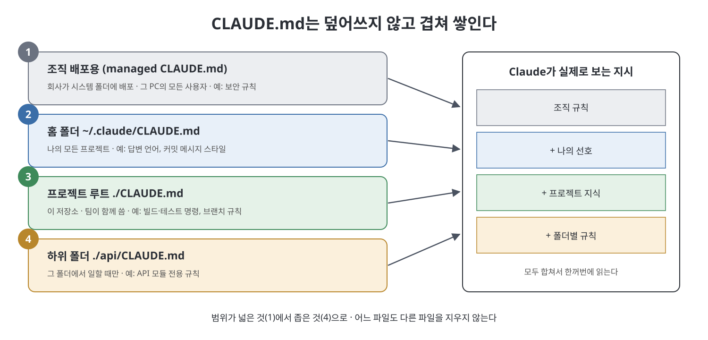

# CLAUDE.md 기본기

Claude Code의 모든 기능은 컨텍스트 윈도(context window, 모델이 한 번에 볼 수 있는 대화와 자료의 총량)라는 제약에서 출발한다. 이 책은 컨텍스트 윈도를 에이전트 작업의 CPU, RAM, 하드디스크를 겸하는 자원으로 본다. 엉뚱한 내용으로 채우면 Claude가 지시를 잊고, 너무 비워 두면 이미 아는 내용을 매번 다시 알아내느라 시간을 쓴다. 그래서 좋은 결과를 내는 개발자는 프롬프트를 잘 쓰는 사람이 아니라 컨텍스트를 잘 설계하는 사람이라고 말한다.

이 문서는 컨텍스트 설계의 핵심 도구인 CLAUDE.md를 다룬다. 어디에 두는지, 어떻게 시작하는지, 무엇을 적고 무엇을 빼야 하는지를 정리한다.

> **비유로 먼저 이해하기**
> 새로 온 동료에게 일을 맡긴다고 해 보자. 그 동료는 실력은 뛰어나지만 **매일 아침 기억이 초기화된다.** 그래서 책상 위에 "우리 팀 업무 수칙" 메모를 붙여 둔다. 동료는 출근할 때마다 이 메모부터 읽고 일을 시작한다.
> CLAUDE.md가 바로 이 메모다. Claude는 대화를 시작할 때마다 이 파일을 자동으로 읽는다.

---

## 1. CLAUDE.md는 항상 켜져 있는 파일이다

CLAUDE.md는 문서가 아니고 README도 아니다. 프로젝트에서 Claude가 처리하는 모든 요청에 주입되는 지시문이다. 그래서 CLAUDE.md의 모든 줄에는 비용이 있다. 대화가 한 턴 오갈 때마다 컨텍스트 윈도 자리를 차지하고, 그만큼 실제 작업에 쓸 공간이 줄어든다.

> **README와 무엇이 다른가?**
> README는 **사람**이 프로젝트를 처음 볼 때 읽는 안내서다. 한 번 읽으면 끝이다.
> CLAUDE.md는 **Claude**가 매 요청마다 다시 읽는 수칙이다. 메모가 길수록 동료가 아침마다 읽는 시간이 늘고, 책상 위 자리도 그만큼 줄어든다. 그래서 "있으면 좋은 정보"가 아니라 "꼭 필요한 정보"만 적어야 한다.

책은 CLAUDE.md를 단순한 설정 파일로 보지 말고 코드베이스의 신경계로 보라고 권한다. 어렵게 얻은 지식이 쌓여서 같은 교훈을 두 번 배울 필요가 없게 만드는 곳이라는 뜻이다.

## 2. 여러 위치에서 겹쳐 읽는다

Claude Code는 CLAUDE.md를 여러 위치에서 정해진 계층에 따라 읽는다.

| 위치 | 적용 범위 |
|------|-----------|
| 홈 디렉터리 | 모든 프로젝트 |
| 프로젝트 루트 | 해당 저장소 |
| 하위 디렉터리 | Claude가 그 디렉터리에서 작업할 때 |
| 조직이 시스템 디렉터리에 배포한 managed CLAUDE.md | 그 머신의 모든 사용자 |



로딩은 덮어쓰기가 아니라 누적이다. Claude는 이 파일들을 층층이 쌓아서 전부 본다. 그래서 역할도 나누어 쓴다. 홈 파일에는 어디서나 통하는 선호를 둔다. 선호하는 테스트 방식, 커밋 메시지 스타일, 쓰는 언어 같은 것이다. 프로젝트 파일에는 그 저장소만의 지식을 두고, 하위 디렉터리 파일에는 코드베이스의 그 부분에만 필요한 내용을 둔다.

> **회사 규정에 비유하면**
> 회사 전체 규정(조직) → 내 개인 업무 습관(홈) → 우리 부서 업무 지침(프로젝트) → 특정 업무 담당자용 세부 지침(하위 폴더).
> 부서 지침이 생겼다고 회사 규정이 사라지지 않듯, 아래 단계 파일은 위 단계 파일을 지우지 않고 **덧붙는다.**

## 3. /init으로 초안 만들기

처음 시작한다면 `/init` 명령이 첫 초안을 만들어 준다. 코드베이스를 분석해서 빌드 시스템, 테스트 프레임워크, 코드 패턴, 디렉터리 구조를 파악하고, 기본 내용이 채워진 시작용 CLAUDE.md를 생성한다. 결과가 완벽하지는 않지만 다듬어 갈 만한 바탕은 된다. 책은 `/init`을 뼈대 세우기에 비유한다. 구조는 `/init`이 잡아 주니, 사람은 자기만 아는 프로젝트 지식을 채우는 데 집중하면 된다.

> **`/init` 같은 명령은 어디에 입력하나?**
> Claude Code 대화창에 `/`로 시작하는 단어를 입력하면 명령으로 처리된다. 이 장에 나오는 `/init`, `/compact`, `/rewind`, `/context`, `/mcp`가 모두 이런 **슬래시 명령**이다.

## 4. @path로 다른 파일 끌어오기

CLAUDE.md를 키우지 않고 확장하는 방법이 @path import다. 모든 내용을 직접 적는 대신 `@docs/architecture.md`처럼 쓰면 외부 파일을 끌어온다. 루트 파일은 짧게 유지하면서 Claude가 더 깊은 참고 자료를 볼 수 있게 된다.

```text
@README.md                              # CLAUDE.md 위치 기준 상대 경로
@docs/git-instructions.md               # 하위 디렉터리 참조
@~/.claude/my-project-instructions.md   # 홈 디렉터리 참조
```

> **쉽게 말하면** 메모에 내용을 다 베껴 쓰는 대신 "자세한 건 ○○ 문서 참고"라고 적어 두는 방식이다. `@` 뒤에 파일 위치(경로)를 적으면 Claude가 그 파일 내용을 함께 읽는다.

불러온 내용도 컨텍스트를 차지한다는 점은 달라지지 않는다. 다만 간접 참조로 바꾸면 CLAUDE.md가 읽기 쉽고 관리하기 쉬워진다. API 계약서, 코딩 표준, 아키텍처 결정 기록 같은 자료를 파일별로 나누어 두고, 현재 프로젝트에 맞는 것만 가져오면 된다.

## 5. 500줄 가이드라인

500줄 기준에는 이유가 있다. 이 선을 넘으면 지시들이 서로 경쟁하기 시작한다. Claude가 너무 긴 CLAUDE.md를 무시하는 것은 아니다. 지시가 너무 많으면 주의가 분산되어, 정말 중요한 규칙이 별로 중요하지 않은 규칙과 같은 무게로 취급된다. 그래서 간결한 CLAUDE.md는 있으면 좋은 것이 아니라 성능을 위한 필수 조건이다.

> **왜 길면 안 될까?**
> 신입 직원에게 규칙 300개를 한꺼번에 건네면 "절대 운영 서버를 건드리지 말 것"과 "회의실 예약은 하루 전에" 같은 규칙이 비슷한 무게로 묻혀 버린다. 정말 중요한 규칙이 눈에 띄려면 목록 자체가 짧아야 한다.

문제가 생겼을 때 진단하는 방법도 있다.

- 금지 규칙을 써 두었는데도 Claude가 계속 그 행동을 한다면, 파일이 너무 길어서 규칙이 묻혔을 가능성이 크다.
- CLAUDE.md에 답이 있는 질문을 Claude가 되묻는다면, 문구가 모호할 가능성이 있다.

따라서 CLAUDE.md는 코드처럼 다룬다. 문제가 생기면 검토하고, 주기적으로 쳐내고, 바꾼 뒤에는 Claude의 행동이 실제로 달라지는지 관찰해서 확인한다. 중요한 규칙은 "IMPORTANT"나 "YOU MUST" 같은 강조를 붙여 준수율을 높일 수도 있다.

## 6. 무엇을 넣고 무엇을 뺄까

기준이 되는 질문은 "Claude가 알아야 할 것이 무엇인가"가 아니다. **"Claude가 스스로 알아낼 수 없는 것이 무엇인가"** 다. 이 기준을 적용하면 개발자가 본능적으로 적어 넣는 내용 대부분이 빠진다.

> **이 질문이 왜 중요한가?**
> Claude는 프로젝트 폴더의 파일을 직접 열어 볼 수 있다. 어떤 프로그래밍 언어를 쓰는지, 폴더가 어떻게 나뉘어 있는지는 파일만 봐도 안다. 반면 "테스트용 데이터베이스는 평소와 다른 포트를 쓴다", "이 구조를 택한 이유는 ○○ 때문이다" 같은 것은 파일 어디에도 적혀 있지 않다. **사람 머릿속에만 있는 지식**이 CLAUDE.md에 들어갈 내용이다.

| 넣을 것 | 뺄 것 |
|---------|-------|
| Claude가 짐작할 수 없는 bash 명령 | 코드를 읽으면 알 수 있는 모든 것 |
| 기본값과 다른 코드 스타일 규칙 | Claude가 이미 아는 표준 언어 관례 |
| 테스트 방법과 선호하는 테스트 러너 | 상세한 API 문서(문서 링크로 대체) |
| 저장소 예절(브랜치 이름, PR 규칙) | 자주 바뀌는 정보 |
| 프로젝트 고유의 아키텍처 결정 | 긴 설명이나 튜토리얼 |
| 개발 환경의 특이점(필수 환경 변수) | 파일마다 설명을 붙인 코드베이스 안내 |
| 흔한 함정, 직관에 어긋나는 동작 | "깨끗한 코드를 짜라" 같은 당연한 말 |

### 넣어야 하는 내용

- **빌드와 테스트 명령**: 프로젝트가 쓰는 테스트 러너 호출 방식, 빌드 명령, 린트 단계다. 직접 실행해 보고 실패해 보기 전에는 Claude가 알 수 없다.
- **표준과 다른 코드 스타일**: 팀이 스페이스 대신 탭을 쓰거나, Python 프로젝트가 PEP8과 다른 import 순서를 따른다면 적어야 한다. 안 적으면 Claude는 표준을 따른다.
- **저장소 예절**: 보호 브랜치가 어디인지, squash merge를 쓰는지 rebase를 쓰는지, PR에 특정 레이블 형식이 필요한지 같은 규칙이다.
- **아키텍처 결정과 그 이유**: 예를 들어 "헥사고날 아키텍처를 쓰고 도메인 로직은 인프라를 import하지 않는다" 같은 내용이다. Claude는 코드 구조는 볼 수 있어도 그 뒤의 설계 의도는 볼 수 없다.
- **환경의 특이점**: "테스트 DB는 5432가 아니라 5433 포트를 쓴다", "CI는 런타임 20이 아니라 18을 쓴다" 같은 것이다. 모르면 시간을 잡아먹는 보이지 않는 함정이다.
- **데이터의 특이점과 알려진 문제**: 예컨대 "users 테이블의 `created_at` 컬럼은 마이그레이션 버그로 2024년 3월 이전 값이 null이다". Claude도 언젠가 스스로 발견하겠지만, 그 과정에서 컨텍스트와 시간이 든다.

### 넣지 말아야 하는 내용

- **코드에서 추론할 수 있는 것**: Claude는 의존성 목록, 설정 파일, 디렉터리 구조를 읽는다. 저장소만 봐도 뻔한 프레임워크와 언어를 알려 주는 것은 컨텍스트 낭비다.
- **표준 언어 관례**: 주요 언어의 스타일 가이드와 관용 패턴은 Claude가 이미 안다. 표준과 다른 부분만 적는다.
- **잘 알려진 라이브러리의 장황한 설명**: 프레임워크 문서를 붙여 넣지 않는다. 인기 있는 도구는 Claude가 학습 데이터로 충분히 안다.
- **흔한 작업의 단계별 절차**: PR 만들기, 마이그레이션 실행, 테스트 파일 세팅은 Claude가 안다. 일반 절차가 아니라 우리 프로젝트만의 변형을 알려 준다.

### 예시: 좋은 CLAUDE.md의 모습

위 기준을 적용하면 CLAUDE.md는 대략 이런 모습이 된다. 짧지만 하나하나가 "적어 두지 않으면 모를 내용"이다.

```markdown
# 프로젝트 규칙

## 빌드와 테스트
- 테스트: `npm run test:unit` (전체 `npm test`는 E2E까지 돌아서 10분 걸림)
- 테스트 DB는 5433 포트 (5432는 로컬 개발용)

## 코드 규칙
- 들여쓰기는 탭
- 도메인 로직(src/domain)은 인프라(src/infra)를 import하지 않는다

## 주의
- IMPORTANT: /legacy 폴더의 파일은 수정하지 않는다
- users.created_at은 2024년 3월 이전 값이 null이다 (마이그레이션 버그)

## 참고 문서
- @docs/architecture.md
```

## 7. 품질이 곧 효율이다

CLAUDE.md의 품질은 Claude Code의 효과와 직접 연결된다. 며칠에 걸친 프로젝트에서 다섯 번 이상의 세션만큼 다듬어진 CLAUDE.md 내용을 쌓은 팀은, 매번 처음부터 시작하는 팀보다 훨씬 좋은 결과를 얻는다고 보고한다. 다음 문서들에서 이 지식을 어떻게 세션 사이에 쌓아 가는지 이어서 본다.

---

> **이 문서 한 줄 요약**
> CLAUDE.md는 Claude가 매번 읽는 짧은 업무 수칙이다. 여러 위치의 파일이 겹쳐 쌓이며, "Claude가 스스로 알아낼 수 없는 것"만 500줄 이내로 적는다.

<br>
<br>
<br>

[Claude Code The Definitive Guide to Agentic Development-2](../)
