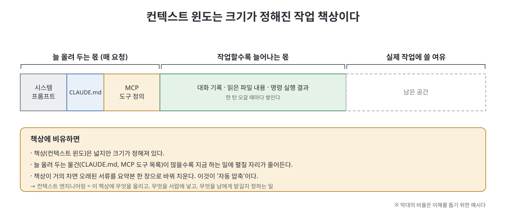

# 컨텍스트 엔지니어링

Claude Code의 모든 기능은 컨텍스트 윈도라는 제약에서 출발한다. 이 장은 컨텍스트 윈도를 CPU, RAM, 하드디스크처럼 다루는 법을 설명한다. 좋은 결과를 내는 개발자는 프롬프트를 잘 쓰는 사람이 아니라 컨텍스트를 잘 설계하는 사람이라는 관점이다.

중심 도구는 CLAUDE.md다. 무엇을 넣고 뺄지, 스킬, MCP, 서브에이전트, 훅과 비용을 어떻게 비교할지, 자동 압축을 어떻게 다룰지, 세션이 끝나도 지식을 어떻게 남길지를 다룬다. 비개발 분야의 재무 계획 사례와 Anthropic 내부 팀의 활용 사례도 함께 나온다.

> **이 장을 한 문장으로**
> AI에게 "무엇을 물어볼까"보다 "AI의 책상 위에 무엇을 올려 둘까"가 결과를 더 크게 좌우한다.

---

## 0. 먼저 알아 둘 것: 컨텍스트 윈도란

Claude 같은 AI는 사람처럼 기억을 계속 쌓아 두지 못한다. 대화를 할 때마다 **지금 눈앞에 펼쳐진 자료만** 보고 답한다. 이 "눈앞에 펼칠 수 있는 자료의 최대량"을 **컨텍스트 윈도(context window)** 라고 한다.

가장 쉬운 비유는 **작업 책상**이다.

- 책상은 넓지만 크기가 정해져 있다.
- 항상 올려 두는 물건(규칙 문서, 도구 목록)이 많으면 정작 지금 하는 일을 펼칠 자리가 줄어든다.
- 책상이 꽉 차면 오래된 서류를 요약본 한 장으로 바꿔 치운다. 이 과정을 **압축(compaction)** 이라고 한다. 공간은 생기지만 세부 내용은 사라진다.

책이 컨텍스트 윈도를 "CPU, RAM, 하드디스크를 겸하는 자원"이라고 부르는 것도 같은 뜻이다. 생각하는 곳, 잠깐 기억하는 곳, 자료를 쌓아 두는 곳이 모두 이 한 책상이라는 말이다. **컨텍스트 엔지니어링**은 이 책상에 무엇을 올리고, 무엇을 서랍에 넣고, 무엇을 다른 사람에게 맡길지 설계하는 일이다.

### 이 장에 자주 나오는 말

| 용어 | 쉬운 설명 |
|------|-----------|
| 토큰(token) | AI가 글을 세는 단위. 대략 단어 조각 하나라고 보면 된다. "200,000 토큰 윈도"는 책상 크기를 토큰 수로 나타낸 것이다. |
| 세션 / 턴 | 세션은 Claude Code를 켜서 끌 때까지의 대화 한 묶음, 턴은 그 안에서 질문과 답이 한 번 오가는 것이다. |
| 프롬프트 | Claude에게 보내는 요청 문장. |
| CLAUDE.md | 프로젝트 폴더에 두는 메모 파일. Claude가 매번 자동으로 읽는 "업무 수칙"이다. |
| 스킬(skill) | 특정 작업용 매뉴얼. 평소엔 서랍에 넣어 두고 필요할 때만 꺼낸다. |
| MCP | Model Context Protocol. Claude를 외부 서비스(이슈 관리, 데이터베이스 등)에 연결하는 표준 규격이다. |
| 서브에이전트 | Claude가 일을 맡기는 보조 Claude. 자기 책상에서 일하고 결과 요약만 돌려준다. |
| 훅(hook) | 특정 순간(시작할 때, 도구를 쓰기 전 등)에 자동으로 실행되는 프로그램. Claude의 책상을 쓰지 않는다. |
| 압축(compaction) | 책상이 차면 오래된 대화를 요약해 자리를 비우는 동작. |

---

## 1. 핵심 요점

- **CLAUDE.md는 항상 켜져 있다**: 모든 요청에 주입되므로 줄마다 비용이 든다. 500줄 이내로 유지하고, Claude가 스스로 알아낼 수 없는 것만 적는다.
- **기능마다 비용이 다르다**: CLAUDE.md와 MCP는 매 요청, 스킬은 설명만 매 요청이고, 서브에이전트는 분리되며, 훅은 0이다. `disable-model-invocation: true`를 쓰면 스킬 비용도 0이 된다. 여기서 "비용"은 돈이 아니라 **책상 자리(컨텍스트)를 얼마나 차지하느냐**를 말한다.
- **자동 압축은 약 95%에서 일어난다**: 80%쯤에서 `/compact`로 직접 압축하는 편이 낫다. CLAUDE.md의 Compact Instructions 섹션은 압축 후에도 보존된다.
- **/rewind의 "Summarize from here"**: 막다른 탐색 구간만 골라 요약해서 쓸모 있는 작업은 그대로 둔다. `/context`로는 사용량을 진단한다.
- **세션이 끝나도 지식은 남긴다**: 세션 종료 시 CLAUDE.md 업데이트로 지식을 쌓고, 반복되는 실수는 정밀한 지시로 패치한다. 스펙 문서는 압축과 재시작을 견딘다.
- **서브에이전트는 컨텍스트 격리 수단이다**: 서브에이전트 열네 개를 조율한 뒤에도 메인 컨텍스트는 200,000 토큰 중 143,000 토큰(71%)이었다.
- **훅으로 동적 상태를 준다**: SessionStart 훅은 PR 상태나 최근 커밋 같은 현재 상황을 한 번 주입한다.
- **CLAUDE.md는 코드 밖에서도 쓴다**: 재무 계획 사례와 디자이너용 설정처럼, 사용자와 분야에 맞춰 쓸 수 있다.

---

## 2. 문서 목록

처음 읽는다면 아래 순서대로 읽기를 권한다. 앞 문서의 개념을 뒤 문서가 이어받는다.

| 순서 | 문서 | 이런 질문에 답한다 |
|:---:|------|------------------|
| 1 | [CLAUDE.md 기본기](CLAUDE.md%20%EA%B8%B0%EB%B3%B8%EA%B8%B0.md) | CLAUDE.md는 어디에 두고 무엇을 적어야 하나? |
| 2 | [컨텍스트 비용과 기능 선택](%EC%BB%A8%ED%85%8D%EC%8A%A4%ED%8A%B8%20%EB%B9%84%EC%9A%A9%EA%B3%BC%20%EA%B8%B0%EB%8A%A5%20%EC%84%A0%ED%83%9D.md) | 이 정보는 CLAUDE.md, 스킬, 훅 중 어디에 두어야 하나? |
| 3 | [자동 압축과 컨텍스트 관리](%EC%9E%90%EB%8F%99%20%EC%95%95%EC%B6%95%EA%B3%BC%20%EC%BB%A8%ED%85%8D%EC%8A%A4%ED%8A%B8%20%EA%B4%80%EB%A6%AC.md) | 대화가 길어져 책상이 차면 무엇이 사라지고, 어떻게 지키나? |
| 4 | [세션을 넘어 쌓이는 지식](%EC%84%B8%EC%85%98%EC%9D%84%20%EB%84%98%EC%96%B4%20%EC%8C%93%EC%9D%B4%EB%8A%94%20%EC%A7%80%EC%8B%9D.md) | 세션이 끝나도 배운 것을 어떻게 남기나? |
| 5 | [AGENTS.md와 서브에이전트 격리](AGENTS.md%EC%99%80%20%EC%84%9C%EB%B8%8C%EC%97%90%EC%9D%B4%EC%A0%84%ED%8A%B8%20%EA%B2%A9%EB%A6%AC.md) | 무거운 일을 메인 대화 밖으로 빼는 방법은? |
| 6 | [컨텍스트 엔지니어링 종합](%EC%BB%A8%ED%85%8D%EC%8A%A4%ED%8A%B8%20%EC%97%94%EC%A7%80%EB%8B%88%EC%96%B4%EB%A7%81%20%EC%A2%85%ED%95%A9.md) | 여덟 가지 도구를 한눈에 보면? |
| 7 | [핵심 정리](%ED%95%B5%EC%8B%AC%20%EC%A0%95%EB%A6%AC.md) | 장 전체를 빠르게 복습하려면? |

- **CLAUDE.md 기본기**: 계층 구조, /init, @path import, 500줄 기준, 넣을 것과 뺄 것
- **컨텍스트 비용과 기능 선택**: 기능별 비용 비교, 선택 기준, 수동 전용 스킬, 예산 점검
- **자동 압축과 컨텍스트 관리**: 자동 압축, Compact Instructions, /compact, /rewind, PreCompact 훅, /context, 세션 포크
- **세션을 넘어 쌓이는 지식**: 제도적 기억, 같은 실수 막기, 개선 루프, 스펙 문서, 비개발 사례, 페르소나 적응형
- **AGENTS.md와 서브에이전트 격리**: AGENTS.md 표준, 서브에이전트 격리, SessionStart 훅
- **컨텍스트 엔지니어링 종합**: 여덟 가지 구성 요소와 선택표
- **핵심 정리**: 장 끝 Key Takeaways를 풀어 쓴 열 가지 요점

 
 
 

[Claude Code The Definitive Guide to Agentic Development-2](../)
