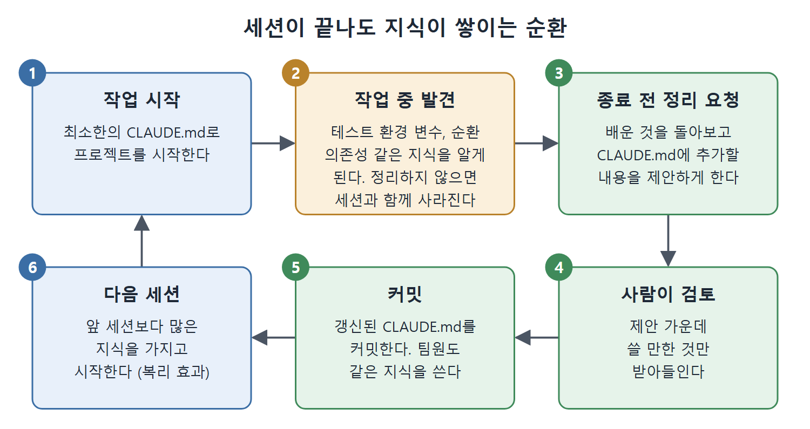

# 세션을 넘어 쌓이는 지식

세션이 끝나면 그 안에서 Claude가 알아낸 지식은 사라진다. 이 문서는 그 지식을 CLAUDE.md와 스펙 문서, 프로젝트 파일에 남겨서 다음 세션이 더 똑똑하게 시작하게 만드는 방법을 다룬다.

핵심은 CLAUDE.md를 한 번 쓰고 끝내는 문서가 아니라 계속 자라는 문서로 대하는 것이다. 책은 제도적 기억(institutional memory)이라는 말로 이를 설명하고, 같은 실수 막기, 지속적 개선 루프, 스펙 문서, 비개발 분야 사례, 사용자에게 맞춘 CLAUDE.md까지 폭넓게 소개한다.

---

## 1. 제도적 기억: 쌓이는 CLAUDE.md

CLAUDE.md는 세션을 넘어 지식을 쌓는 살아 있는 문서로 다룰 때 훨씬 가치가 커진다. 흐름은 이렇다.

1. 빌드 명령, 스타일 규칙, 아키텍처 메모 몇 개만 담은 최소한의 CLAUDE.md로 프로젝트를 시작한다.
2. 첫 세션에서 Claude가 테스트 스위트에 특정 환경 변수가 필요하다는 것을 발견한다. 어떤 모듈에 우회해야 할 순환 의존성이 있다는 것도 알게 된다. API 클라이언트가 표준이 아닌 에러 형식을 던진다는 것도 파악한다.
3. 이 지식은 모두 세션 컨텍스트에만 있다. 세션이 끝나면 사라진다.

해결책은 세션 종료 시 업데이트 루프다. 세션을 닫기 전에 Claude에게 배운 것을 돌아보고 CLAUDE.md에 추가할 내용을 제안하라고 시킨다. Claude는 겪은 문제를 바탕으로 구체적인 추가 내용을 제안한다. 사람이 검토해서 쓸 만한 것만 받아들이고 갱신된 CLAUDE.md를 커밋한다.

위 그림은 세션에서 알아낸 지식이 CLAUDE.md로 옮겨져 다음 세션의 출발점이 되는 순환을 보여 준다. 사람이 검토하고 커밋하는 단계를 거치므로 쓸 만한 내용만 쌓인다.

이렇게 시간이 지나면 CLAUDE.md에는 보통 시니어 엔지니어의 머릿속에만 있는 지식이 쌓인다. 특이한 동작, 우회법, "우리가 이렇게 하는 이유" 같은 설명은 아무도 글로 남기지 않는다. 이제는 글로 남아 있고, 이후의 모든 세션이 그 덕을 본다. 내가 쓰든 팀원이 쓰든 마찬가지다.

복리 효과도 생긴다. 세션마다 앞 세션보다 많은 지식을 가지고 시작한다. 첫 세션에서 시간을 잡아먹은 실수는 CLAUDE.md에 기록되어 다시 일어나지 않는다. 프로젝트 고유의 지식 기반이 커지면 Claude의 효율도 커진다. CLAUDE.md를 버전 관리에 올리는 팀은 이 효과가 팀 전체로 곱해진다. 한 개발자의 발견이 모두의 컨텍스트가 된다.

## 2. 같은 실수 반복 막기

제도적 기억의 구체적인 응용 하나는 따로 짚을 만하다. Claude가 같은 실수를 반복한다는 흔한 불만을 해결하기 때문이다.

Anthropic 내부 팀은 Claude Code가 한 프로젝트 안에서 특정 도구 호출 오류를 내거나 잘못된 패턴을 일관되게 따르는 현상을 기록했다. 처방은 정밀하다. 정확히 그 오류를 겨냥한 지시를 CLAUDE.md에 추가한다.

- 계속 잘못된 모듈 경로에서 import한다면: "데이터베이스 유틸리티를 import할 때는 `@app/utils/db`가 아니라 `@app/db/utils`를 쓴다. 뒤의 경로도 존재하지만 deprecated 상태다."
- 타이밍 문제로 실패하는 테스트를 계속 만든다면: "이 프로젝트의 모든 비동기 테스트는 `setTimeout`이 아니라 `waitForCondition` 헬퍼를 써야 한다. CI 환경은 타이밍이 비결정적이다."

이처럼 문제를 정확히 겨냥한 추가는 일반적인 지시보다 효과가 좋다. Claude가 실제로 보인 실패 양상을 직접 다루기 때문이다. 이상적인 지침이 아니라 이 프로젝트에서 관찰된 Claude 행동 버그에 대한 패치다.

## 3. 지속적 개선 루프

Anthropic의 데이터 인프라 팀은 세션 종료 시 업데이트를 지식 축적 너머로 확장한다. 완료한 작업을 요약하고 개선점을 제안하라고 Claude에게 시키는데, CLAUDE.md에 내용을 더하는 것뿐 아니라 워크플로 자체의 개선까지 포함한다.

차이는 미묘하지만 중요하다. 대부분의 팀은 세션 종료 업데이트로 지식을 더한다. "테스트 DB는 5433 포트를 쓴다", "모듈 X에 순환 의존성이 있다" 같은 것이다. 지속적 개선 패턴은 프로세스 개선도 담는다. 예를 들어 "배포 스크립트는 빌드 전에 lint를 돌려야 한다", 또는 "API 모듈 관련 CLAUDE.md 지시 때문에 Claude가 지나치게 장황한 에러 핸들러를 만든다. 지시를 단순하게 고쳐라" 같은 내용이다.

이렇게 하면 CLAUDE.md가 아는 것뿐 아니라 지시하는 방식도 진화하는 피드백 루프가 생긴다. 시간이 갈수록 관찰된 결과를 바탕으로 지시문 자체가 다듬어진다. 이 팀은 매 세션 후 지식과 프로세스를 모두 갱신하는 이 루프 덕분에 이후 반복이 눈에 띄게 효과적이 되었다고 보고했다. Claude가 더 나은 지식으로 일할 뿐 아니라 더 나은 지시로 일하기 때문이다.

## 4. 스펙 기반 컨텍스트

CLAUDE.md는 영속적이지만 수동으로 갱신하기 전에는 정적이다. 복잡하고 여러 세션에 걸치는 프로젝트에는 보완적인 접근이 있는데, 바로 스펙 문서다.

스펙 문서는 구현을 시작하기 전에 쓰는, 만들려는 것에 대한 상세한 설명이다. `spec.md`, `design.md` 등 프로젝트에 맞는 이름의 파일로 저장소 안에 둔다. CLAUDE.md에서 `@path` import로 참조하거나, 매 세션 시작 때 읽으라고 Claude에게 지시한다.

스펙의 힘은 컨텍스트 오염과 세션 재시작을 견딘다는 데 있다. 세션이 압축되어 앞선 논의의 뉘앙스를 잃어도 스펙은 Claude가 다시 읽을 수 있는 파일 속에 그대로 남아 있다. 새 세션을 시작할 때도 다시 설명하지 않고 스펙으로 전체 맥락을 줄 수 있다.

스펙 우선 개발은 코드를 쓰기 전에 검토할 수 있는 구체적인 산출물도 만든다. Claude에게 스펙을 쓰게 하고, 검토하고, 대화로 다듬은 뒤에야 구현으로 넘어간다. 스펙은 여러 세션, 여러 서브에이전트, 며칠에 걸친 작업에서 구현이 어긋나지 않게 잡아 주는 단일 기준(source of truth)이 된다.

이 패턴은 두세 세션을 넘는 프로젝트에서 가장 의미가 있다. 스펙이 없으면 새 세션마다 의도를 다시 설명해야 하고, 그 과정에서 내용이 빠지기 쉽다. 스펙이 있으면 정확하고 버전 관리되는 목표 설명으로 시작한다.

## 5. 비개발 분야의 CLAUDE.md: 재무 계획 사례

CLAUDE.md는 소프트웨어 프로젝트 전용이 아니다. 제도적 기억의 가장 인상적인 사례는 전통적인 코드베이스가 없는 포트폴리오 최적화 프로젝트에서 나왔다.

작업 순서는 이렇다. 금융 계좌에서 데이터를 스프레드시트로 내보낸다. 구조화된 내보내기가 없는 정보는 보충 텍스트 파일로 만든다. 상세한 목표 프롬프트를 쓴다. 이 모두가 담긴 디렉터리를 가리키며 Claude Code 세션을 시작한다. 여러 세션에 걸쳐 Claude는 데이터를 파싱하고, 보유 자산을 분류하고, 빈틈을 찾아냈다. 그리고 세금 영향 분석, 펀드 추천, 전후 자산 배분표가 담긴 단계별 최적화 계획을 만들어 냈다.

핵심은 이 사람이 코드 지식이 아니라 도메인 분석 기억을 쌓는 CLAUDE.md를 키웠다는 점이다. 파싱 중 발견한 데이터의 특이점, 앞선 세션에서 내린 전략 결정, 반복적으로 다듬어 합의한 목표 자산 배분이 들어갔다. 며칠 뒤 돌아왔을 때 Claude는 CLAUDE.md가 프로젝트의 분석 상태를 담고 있었기에 정확히 중단한 곳에서 이어서 작업했다.

이 패턴은 여러 세션에 걸치는 모든 분야에 통한다. 연구 프로젝트, 데이터 분석, 기술 문서 작성, 인프라 계획, 규정 준수 검토가 그렇다. 내용은 빌드 명령과 코딩 규칙 대신 데이터 스키마, 분석 프레임워크, 도메인 제약이 되지만 원리는 같다. 영속하는 컨텍스트가 세션마다 이전보다 더 똑똑하게 시작하게 해 준다.

## 6. 작업 결과가 복리로 쌓인다

같은 사람이 이름을 붙일 만한 패턴을 하나 더 짚었다. 작업 산출물의 복리(work product compounding)다. 재무 계획을 마친 뒤 그는 같은 프로젝트 디렉터리, 즉 세션 기록, 계획 문서, 분석 산출물을 Claude Code에 보여 주고 그 과정에 대한 블로그 글을 쓰라고 시켰다. 첫 프로젝트의 결과물이 전혀 다른 결과물의 입력이 된 것이다.

우연이 아니라 파일 시스템 기반 컨텍스트의 결과다. Claude가 만드는 계획, 분석, 보고서, 코드 같은 모든 산출물은 프로젝트 디렉터리에 파일로 존재한다. 그 파일은 이후의 세션, 스킬, 서브에이전트가 쓸 수 있다. Claude Code로 한 작업은 대화 기록에 갇히지 않고 파일 시스템에 쌓인다. 새 세션은 그 이전의 모든 것 위에 쌓아 올릴 수 있다.

## 7. 사용자에 맞춰 바뀌는 CLAUDE.md(persona-adaptive)

Anthropic의 제품 디자인 팀은 소프트웨어 엔지니어가 떠올리기 어려운 사실을 발견했다. 사용자가 개발자가 아니면 CLAUDE.md가 다르게 작동한다는 것이다.

디자이너들은 자신이 코딩 경험이 적은 디자이너이며 자세한 설명과 작은 단위의 점진적 변경이 필요하다고 Claude에게 알리는 CLAUDE.md를 직접 만들었다. 이것이 응답 품질을 크게 높였다. 엔지니어링 지식을 이미 안다고 가정한 짧고 딱딱한 출력 대신, Claude는 단계별 설명을 내놓고 코드에 주석을 더 많이 달고 검토하기 쉬운 작은 변경을 만들었다.

이것이 페르소나 적응형 컨텍스트다. CLAUDE.md는 프로젝트만이 아니라 사용자도 설명한다. 데이터 과학자라면 시각화가 포함된 탐색용 스크립트를 선호한다고 적을 수 있다. 기술 문서 작성자는 모든 변경에 자세한 커밋 메시지와 문서를 함께 요구할 수 있다. 디자이너는 UI 중심의 설명과 시각적 diff가 필요하다고 적을 수 있다.

여기서 알 수 있는 점은 CLAUDE.md가 팀 안에서도 모두에게 같지 않다는 것이다. 프로젝트 수준 CLAUDE.md는 공유 표준을 담고, 홈 디렉터리의 사용자 수준 CLAUDE.md는 개인 선호를 담는다. 둘을 합치면 Claude가 프로젝트의 필요와 개인의 작업 방식에 모두 맞춰진다.

 
 
 

[Claude Code The Definitive Guide to Agentic Development-2](../)
