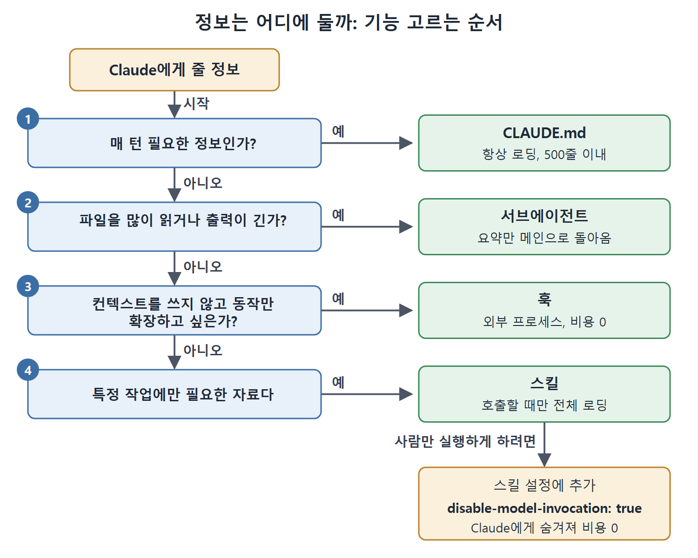

# 컨텍스트 비용과 기능 선택

CLAUDE.md, 스킬, MCP, 서브에이전트, 훅은 모두 Claude에게 정보나 능력을 더해 주지만 컨텍스트에 드는 비용은 제각각이다. 이 비용 모델을 이해하는 것이 200턴 동안 또렷하게 유지되는 세션과 40턴 만에 압축이 일어나는 세션을 가르는 차이라고 책은 말한다.

이 문서는 기능별 비용을 비교하고, 어떤 정보를 어디에 둘지 고르는 기준, 예산을 점검하는 방법, 스킬을 수동 전용으로 만드는 방법을 설명한다.

---

## 1. 기능별 컨텍스트 비용 비교

| 기능 | 로딩 시점 | 로딩되는 내용 | 컨텍스트 비용 |
|------|-----------|----------------|----------------|
| CLAUDE.md | 세션 시작 | 모든 CLAUDE.md 파일의 전체 내용 | 매 요청마다 |
| 스킬(skill) | 세션 시작, 그리고 사용할 때 | 시작 시에는 설명만, 호출하면 전체 내용 | 낮음(설명은 매 요청마다)* |
| MCP 서버 | 세션 시작 | 모든 도구 정의와 스키마 | 매 요청마다 |
| 서브에이전트 | 생성될 때 | 지정한 스킬이 담긴 새 컨텍스트 | 메인 세션과 분리됨 |
| 훅 | 트리거될 때 | 없음(외부에서 실행) | 0, 단 훅이 추가 컨텍스트를 돌려주면 그만큼 |

\* 기본적으로 스킬 설명은 세션 시작 때 로딩되어 Claude가 언제 쓸지 판단할 수 있게 한다. 스킬의 frontmatter에 `disable-model-invocation: true`를 넣으면 Claude에게서 완전히 숨기고, 사람이 `/skill-name`으로 직접 부를 때만 쓰인다. 이러면 직접 호출하는 스킬의 컨텍스트 비용이 0이 된다.

## 2. 선택 기준: 스킬, 서브에이전트, CLAUDE.md, MCP, 훅

각 수단은 목적이 다르다. 고르는 기준은 그 정보가 언제 필요한지, 그리고 계속 대기시켜 두는 데 얼마나 드는지다.

- **CLAUDE.md**: 정보가 매 턴 필요할 때 쓴다. 빌드 명령, 스타일 규칙, 아키텍처 제약, 환경 특이점 같은 항상 켜 두는 채널이다. 500줄 이내로 유지한다.
- **스킬**: 특정 종류의 작업에만 필요한 정보에 쓴다. DB 마이그레이션 절차, 배포 체크리스트, API 연동 가이드, 복잡한 리팩터링 워크플로가 예다. 설명은 매 요청마다 약간의 비용이 들지만 전체 내용은 Claude나 사용자가 호출할 때만 로딩된다.
- **서브에이전트**: 파일을 많이 읽거나, 출력이 긴 작업을 처리하거나, 메인 컨텍스트를 부풀릴 탐색을 할 때 쓴다. 서브에이전트는 자기만의 컨텍스트 윈도에서 돌고 요약만 세션으로 돌아온다. 그래서 서브에이전트는 병렬 처리 도구일 뿐 아니라 컨텍스트 관리 전략이다.
- **MCP**: 외부 서비스에 구조화된 방식으로 접근해야 할 때 쓴다. MCP 도구 정의는 세션 시작 때 로딩되어 계속 남으므로, 서버를 하나 추가할 때마다 지속적인 비용이 생긴다. 그래도 구조화된 인터페이스, 권한과의 통합, 훅에서의 가시성 덕분에 민감하거나 자주 쓰는 외부 연동에는 적합하다.
- **훅**: 컨텍스트를 전혀 쓰지 않고 Claude의 동작을 확장하고 싶을 때 쓴다. 훅은 외부 프로세스로 실행된다. 파일 경로를 검증하는 PreToolUse 훅, 동작을 기록하는 PostToolUse 훅, 환경을 준비하는 SessionStart 훅은 모두 컨텍스트를 쓰지 않는다. 그래서 훅은 컨텍스트 효율이 가장 좋은 확장 수단이다.

분류를 잘못하면 어느 방향이든 손해다. 참고 자료를 CLAUDE.md에 넣으면 매 요청마다 컨텍스트를 낭비한다. 항상 지켜야 하는 규칙을 스킬에 넣으면, 스킬이 로딩되지 않은 순간마다 Claude가 그 규칙을 어긴다.



위 그림은 정보를 어디에 둘지 네 가지 질문으로 가려내는 순서를 보여 준다. 위에서부터 차례로 묻고, 처음 "예"가 나오는 곳이 알맞은 수단이다. 스킬을 사람만 실행하게 하고 싶다면 disable-model-invocation: true를 더해 비용을 0으로 만든다.

## 3. 스킬과 CLAUDE.md: 로딩 시점이 예산을 결정한다

둘 다 Claude에게 지시를 주지만 차이는 언제 로딩되느냐이고, 이 차이가 컨텍스트 예산을 좌우한다.

CLAUDE.md는 모든 요청에서 로딩되므로 항상 존재하고 항상 컨텍스트를 쓴다. 그래서 빌드 명령, 스타일 규칙, 아키텍처 제약처럼 Claude가 끊임없이 필요로 하는 정보를 담는 곳이다.

스킬은 필요할 때만 로딩된다. 세션 시작 때는 각 스킬이 무엇을 하는지 한 줄 요약(설명)만 올라오고, 전체 내용은 Claude가 그 스킬을 호출할 때에야 올라온다. 데이터베이스 마이그레이션 지침 200줄짜리 스킬이 있어도 실제로 마이그레이션을 하기 전까지는 비용이 거의 없다. 그 시점이 되면 해당 상호작용을 위해 스킬 내용이 컨텍스트에 들어온다.

## 4. disable-model-invocation으로 수동 전용 스킬 만들기

Claude가 쓸 시점을 판단하게 두고 싶지 않은 스킬도 있다. 배포 스킬, 릴리스 체크리스트, 복잡한 리팩터링 워크플로처럼 Claude가 지금이 적절한 때라고 멋대로 정하지 않고 사람이 `/skill-name`으로 직접 부르고 싶은 경우다.

frontmatter에 `disable-model-invocation: true`를 넣으면 그 스킬이 Claude에게서 완전히 숨겨진다. 세션 시작 때 설명이 로딩되지 않고, Claude가 쓸 수 있는 도구 목록에도 나타나지 않는다. 사람이 직접 호출하기 전까지 컨텍스트 비용은 0이다. 드물게 쓰거나 반드시 사람이 선택했을 때만 돌아야 하는 스킬에 쓸 수 있는 가장 강력한 최적화다.

```text
---
description: Deploy to production
disable-model-invocation: true
---
Follow the production deployment checklist...
```

판단 규칙은 간단하다.

1. Claude가 매 턴 알아야 하는 내용("항상 작은따옴표를 써라", "/legacy 안의 파일은 수정하지 마라")은 CLAUDE.md에 둔다.
2. 특정 종류의 작업에만 필요한 참고 자료(자세한 배포 절차, 복잡한 리팩터링 체크리스트, API 연동 가이드)는 스킬로 만든다.
3. 스킬을 언제 실행할지 오직 사람이 정해야 한다면 `disable-model-invocation: true`를 추가한다.

## 5. 컨텍스트 예산 점검하기

비용 모델에서 나오는 실무 결론이 있다. 컨텍스트가 자주 모자란다면 항상 켜져 있는 비용부터 점검한다는 것이다.

- `/mcp`를 실행하면 서버별 토큰 비용을 볼 수 있다.
- CLAUDE.md에서 스킬로 옮길 수 있는 내용이 있는지 검토한다.
- 거의 안 쓰는데 로딩되어 있는 MCP 서버가 없는지 확인한다.
- `/context` 명령은 현재 컨텍스트 사용량을 색깔 격자로 시각화해서 공간이 어디에 쓰이는지 정확히 보여 준다.

`/context`는 자동 압축과 컨텍스트 관리를 다룬 문서에서 더 설명한다.

<br>
<br>
<br>

[Claude Code The Definitive Guide to Agentic Development-2](../)
