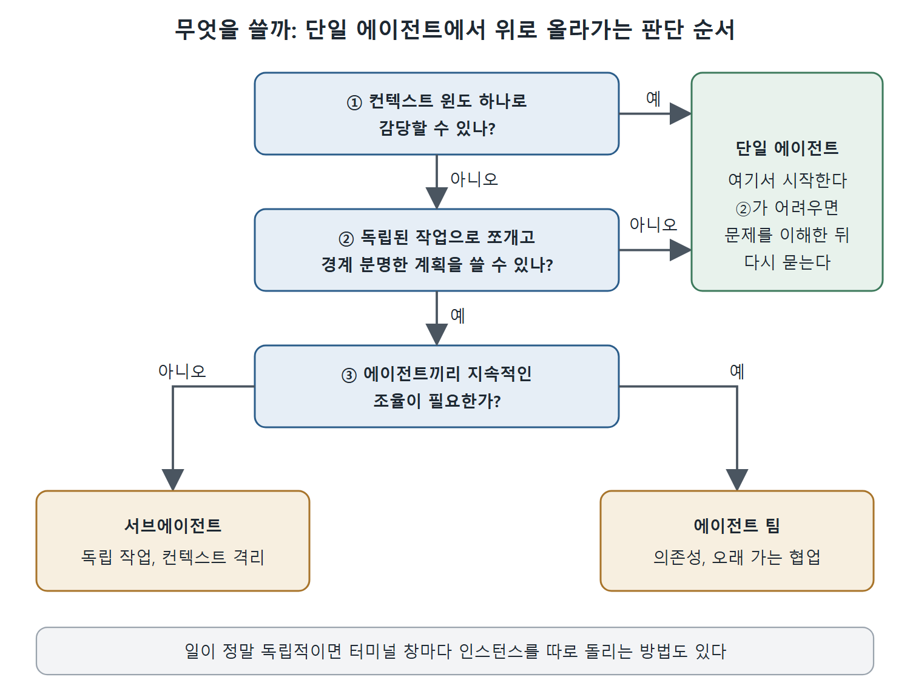

# 무엇을 쓸지 고르는 기준

서브에이전트, 에이전트 팀, 그리고 아무것도 나누지 않는 단일 에이전트 중에서 무엇을 쓸지는 작업의 범위, 비용, 조율의 복잡도로 정해진다. 책은 "단일 에이전트부터 시작하고, 필요할 때만 위로 올라가라"는 한 줄로 이 기준을 요약한다. 이 문서는 세 선택지가 각각 맞는 상황, 단일 에이전트가 오히려 이기는 경우, 그리고 판단을 위한 간단한 질문을 정리한다.

---

## 1. 서브에이전트와 팀의 선택

서브에이전트와 팀 중 무엇을 고를지는 범위, 비용, 조율의 복잡도에 대응한다.

### 1.1 서브에이전트가 맞는 경우

- 일이 서로 조율 없이 끝낼 수 있는 독립 작업들로 나뉜다.
- 각 작업이 서브에이전트 세션 하나에 들어간다.
- 결과를 빠르고 싸게 얻어야 한다.

전형적인 서브에이전트 작업은 몇 분이면 끝나고 비용도 메인 세션의 일부에 그친다.

### 1.2 팀이 맞는 경우

- 전문가 역할들 사이에 지속적인 조율이 필요하다.
- 작업 사이에 추적해야 할 의존성이 있다.
- 시스템의 서로 다른 측면에 대해 에이전트들이 오래 가는 컨텍스트를 유지해야 한다.

전형적인 팀 작업은 시간이 더 걸리고, 같은 일을 서브에이전트로 했을 때보다 몇 배의 비용이 든다.

### 1.3 둘 다 아닌 경우

잘 쓴 프롬프트의 단일 세션 하나로 해결되는 작업에는 둘 다 맞지 않는다. 책은 이런 경우가 생각보다 흔하다고 강조한다. 멀티 에이전트로 가기 전에, 이 작업이 정말 컨텍스트 윈도 하나로 감당할 수 없는지 먼저 물어야 한다. 답이 "아니오"라면 지시가 분명한 단일 에이전트가 멀티 에이전트 구성보다 거의 언제나 낫다. 조율 오버헤드는 공짜가 아니고, 단일 에이전트에는 없는 실패 유형까지 끌고 온다.

---

## 2. 선호의 위계

선택은 이 순서로 한다.

1. 먼저 단일 에이전트.
2. 컨텍스트 격리가 필요하면 서브에이전트.
3. 지속적인 조율이 필요하면 팀.

위에서 아래로 내려오는 것이 아니라 아래에서 위로 올라가야 한다. 단순한 쪽에서 시작해 증거가 생기면 한 단계씩 올린다.

---

## 3. 단일 에이전트가 이기는 상황

명확한 지시, 좋은 CLAUDE.md, 확실한 검증 기준을 갖춘 단일 에이전트는 몇몇 상황에서 멀티 에이전트보다 더 낫다.

- **작은 작업부터 중간 크기 작업**: 컨텍스트 윈도 하나에 여유 있게 들어가는 작업이라면 멀티 에이전트의 조율 오버헤드는 얻는 것 없이 비용과 지연만 더한다.
- **강하게 결합된 변경**: 모든 파일의 변경이 다른 모든 파일의 변경에 의존한다면 병렬화는 통합 문제를 만든다. 순차 실행은 그 문제를 피한다.
- **분해가 불분명한 경우**: 작업 경계와 인터페이스 계약을 분명히 쓸 수 없다면 에이전트들이 서로 발을 밟는다. 순차로 일하는 단일 에이전트는 적어도 일관성을 유지한다.
- **새로운 문제**: 확립된 패턴이 없는 문제에서는 에이전트들이 예측할 수 없는 방향으로 갈라질 가능성이 높다. 단일 에이전트는 배워 가면서 접근을 조정하며 반복 탐색할 수 있다. 여러 에이전트가 병렬로 탐색하면 서로 맞지 않는 접근이 여러 개 나온다.

---

## 4. 판단을 위한 질문 하나

판단 틀은 단순하다. 일을 독립된 작업들로 깔끔하게 쪼개고 경계가 분명한 계획을 쓸 수 있는지 따져 보면 된다.

- 쓸 수 있다면 멀티 에이전트가 도움이 된다.
- 그 계획을 쓰기가 어렵다면 단일 에이전트로 시작하고, 문제를 더 이해한 뒤에 다시 질문한다.

책은 멀티 에이전트 조율을 전동 공구에 비유한다. 모든 전동 공구가 그렇듯 솜씨와 실수를 둘 다 증폭한다. 작업이 요구할 때 쓰고, 정교해 보인다는 이유로 쓰지는 말라는 것이다.

그림은 이 장의 판단 순서를 한눈에 보여 준다. 컨텍스트 윈도 하나로 되는지, 경계 분명한 계획을 쓸 수 있는지, 지속적인 조율이 필요한지를 차례로 묻고, 어느 한 질문에서 막히면 단일 에이전트에 머문다.

---

## 5. 가장 단순한 형태: 인스턴스 여러 개 따로 돌리기

조율 인프라가 전혀 필요 없는 가장 단순한 멀티 에이전트 방식이 있다. 서로 다른 터미널 창에서 Claude Code 인스턴스 여러 개를 띄워, 각각 다른 저장소나 워크트리에서 일하게 하는 것이다.

각 인스턴스는 자기 컨텍스트 윈도, 세션, 도구를 갖는다. 서로의 존재를 모르고 조율도 하지 않는다. 일이 정말로 독립적이라면 이것으로 충분하다. 예를 들어 API는 공유하지만 코드는 공유하지 않는 마이크로서비스 세 개를 업데이트하는 경우다.

git 워크트리(9장)를 쓰면 같은 저장소의 브랜치들 사이에서 코드를 완전히 분리한 채 병렬 개발을 할 수 있어서 특히 효과적이다.

책은 이 방식이 지루하기 때문에 과소평가되고 있다고 말한다. 조율도, 에이전트 간 통신도, 공유 작업 목록도 없고 독립된 일을 하는 인스턴스만 여럿이다. 그러나 저장소를 넘나드는 작업, 여러 브랜치 유지, 서로 관련 없는 일 처리 같은 많은 현실 시나리오에서는 이것이 가장 효과적인 멀티 에이전트 패턴이다.

---

## 6. 정리

- 단일 에이전트, 서브에이전트, 팀 순으로 단순한 쪽에서 올라간다.
- 서브에이전트는 독립 작업과 컨텍스트 격리에, 팀은 의존성과 지속적인 협업에 맞다.
- 작은 작업, 강하게 결합된 변경, 분해가 불분명한 일, 새로운 문제에서는 단일 에이전트가 이긴다.
- 계획을 깔끔하게 쓸 수 있는지가 멀티 에이전트를 쓸지의 판단 기준이다.
- 독립된 일이라면 터미널 창 여러 개로 인스턴스를 따로 돌리는 방식이 의외로 가장 강력하다.

 
 
 

[Claude Code The Definitive Guide to Agentic Development-2](../)
