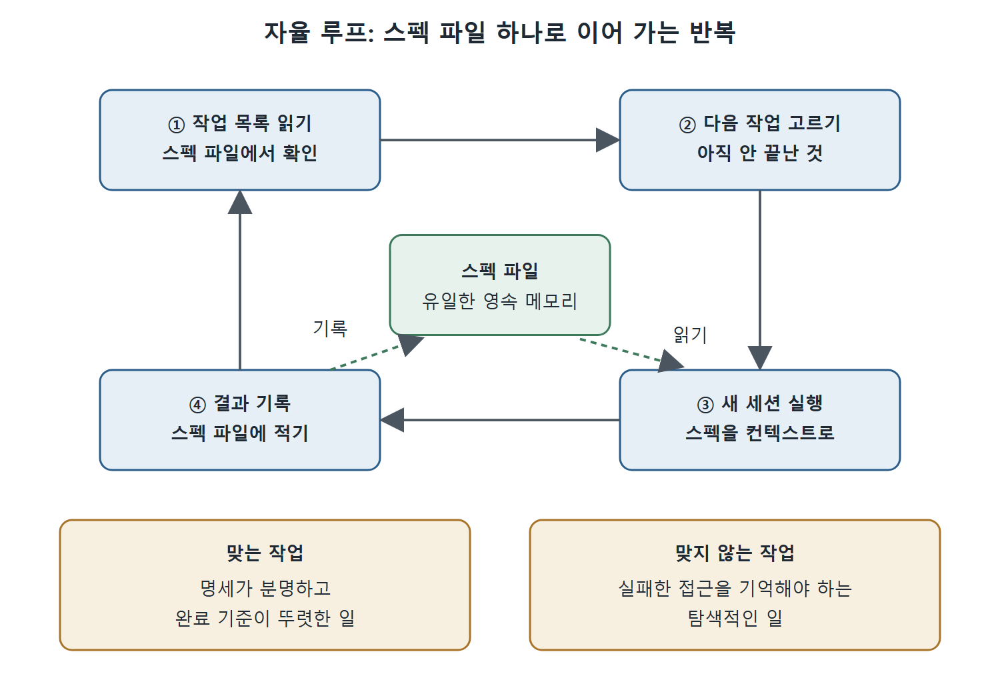

# 작업 시스템과 자율 루프

서브에이전트와 에이전트 팀의 밑바닥에는 작업을 디스크에 저장하고 세션 사이에서 진행을 조율하는 공통 작업 관리 시스템이 있다. 이 문서는 작업 파일의 모양, 네 가지 작업 도구, 여러 세션이 작업 목록을 함께 쓰는 방법, 그리고 며칠씩 이어지는 프로젝트를 위한 자율 루프 패턴을 설명한다.

---

## 1. 작업 파일의 모양

작업은 `.claude/tasks/{session-id}/` 아래에 JSON 파일로 저장된다.

```json
{
  "id": "task-1",
  "subject": "Create idb-helpers.ts",
  "description": "Implement IndexedDB promise wrappers...",
  "status": "pending",
  "blocks": ["task-3", "task-4"],
  "blockedBy": ["task-0"]
}
```

`blocks`는 이 작업이 끝나야 시작할 수 있는 작업들이고, `blockedBy`는 이 작업이 시작되기 전에 끝나야 하는 작업들이다.

---

## 2. 작업 도구 네 가지

작업의 생애주기는 네 도구가 관리한다.

- **TaskCreate**: 제목(subject), 설명, 의존성을 가진 새 작업을 만든다.
- **TaskUpdate**: 상태를 바꾸거나(pending, in_progress, completed 순) 의존성을 수정한다.
- **TaskList**: 모든 작업과 상태, 무엇이 막혀 있는지 보여 준다.
- **TaskGet**: 특정 작업의 설명을 포함한 전체 내용을 가져온다.

대화형 세션에서 `Ctrl+T`를 누르면 터미널 상태 표시 영역에서 작업 목록 표시를 켜고 끌 수 있다. 한 번에 최대 10개 작업이 보이며 현재 상태와 진행 상황이 나온다.

---

## 3. 여러 세션이 작업 목록 공유하기

작업 시스템은 Claude Code 세션 여러 개에 걸친 조율도 지원한다. 공유 작업 목록 ID를 설정하면 된다.

```bash
CLAUDE_CODE_TASK_LIST_ID=myproject claude
```

`.claude/settings.json`에 적어도 된다.

```json
{
  "env": {
    "CLAUDE_CODE_TASK_LIST_ID": "myproject"
  }
}
```

여러 세션이 같은 작업 목록 ID를 쓰면 모두 같은 작업 파일을 읽고 쓴다. 한 세션은 작업을 만드는 오케스트레이터 역할을 하고, 다른 세션은 그 작업을 처리하고, 세 번째 세션은 완료된 작업을 지켜보면서 후속 작업을 추가하는 식이다. 에이전트 팀 인프라 전체가 없어도 되는 가벼운 조율 방식이며, 필요한 것은 디스크 위의 공유 상태뿐이다.

---

## 4. 자율 루프 패턴

며칠이나 몇 주 걸리는 프로젝트에는 진짜 자율적으로 일하는 패턴이 있다. 마크다운 파일 하나를 Claude Code에 반복해서 먹이는 bash 루프다. 매 반복은 완전히 새로운 세션에서 실행되며, 마크다운 파일이 유일한 영속 메모리다.

루프는 작업 목록을 읽고, 아직 끝나지 않은 다음 작업을 고르고, 스펙 문서를 컨텍스트로 삼아 Claude Code를 실행하고, 결과를 스펙 파일에 다시 적는다. 그다음 처음으로 돌아간다.

이 방식은 상태가 없고(stateless) 무한히 돌 수 있다. 유지되는 상태는 스펙 파일뿐이다. 각 세션은 깨끗하게 시작해서 필요한 것만 읽고, 일을 하고, 스펙을 갱신하고, 종료한다. 다음 반복이 이전 반복이 멈춘 곳에서 이어받는다.



그림은 루프가 한 바퀴 도는 순서를 보여 준다. 세션은 매번 새로 시작하고, 스펙 파일을 읽어 일한 뒤 결과를 다시 스펙 파일에 적어 다음 반복에 넘긴다.

### 4.1 트레이드오프

대화 기록도, 쌓인 컨텍스트도 없고, 스펙 파일에 적힌 것 말고는 세 번 전 반복에서 무슨 일이 있었는지 기억할 방법이 없다. 명세가 분명하고 완료 기준이 잘 정의된 작업이라면 이 정도로 충분하다. 실패한 접근을 기억해야 하는 탐색적인 작업에는 부족하다.

### 4.2 스펙 문서가 중요한 이유

이 패턴은 스펙 문서가 컨텍스트 압축이나 세션 재시작에도 살아남는다는 점에 기댄다. 여러 세션에 걸친 프로젝트에서 스펙이 필수인 이유다.

---

## 5. 정리

- 작업은 `.claude/tasks/{session-id}/`의 JSON 파일이며, `blocks`와 `blockedBy`로 의존성을 표현한다.
- `TaskCreate`, `TaskUpdate`, `TaskList`, `TaskGet` 네 도구로 관리하고 `Ctrl+T`로 목록을 본다.
- `CLAUDE_CODE_TASK_LIST_ID`가 같은 세션들은 같은 작업 파일을 공유한다.
- 자율 루프는 스펙 파일 하나만 상태로 쓰는 단순한 구조이며, 명세가 뚜렷한 작업에 맞고 탐색적 작업에는 맞지 않는다.

<br>
<br>
<br>

[Claude Code The Definitive Guide to Agentic Development-2](../)
