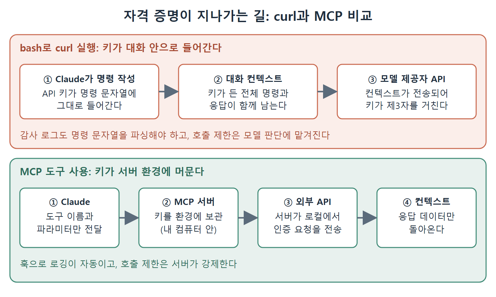

# curl 대신 MCP를 쓰는 보안상 이유

"그냥 bash로 curl 쓰면 되지 않나" 하는 생각이 먼저 들기 쉽다. bash는 무엇이든 되고, CLI 클라이언트나 curl 엔드포인트가 있는 API라면 모두 접근할 수 있다. 반면 MCP는 서버를 만들고 유지해야 한다. 노력의 차이는 분명히 있다. 그런데도 민감한 데이터를 다룰 때는 MCP가 더 낫고, 그 이유는 편의가 아니라 자격 증명이 어디에 놓이느냐에 있다. 이 문서는 그 차이를 풀어 쓴다.

---

## 1. 그냥 curl을 쓰면 안 되는가

개발자는 Claude에게 bash 권한을 주고 데이터 API에 curl 명령을 실행하게 해서 같은 일을 할 수 있다. 동작은 한다. 하지만 측정 가능한 모든 면에서 더 나쁘다.

### curl을 bash로 쓸 때

- 자격 증명이 명령 문자열에 나타난다. 컨텍스트, 로그, 그리고 모델 제공자로 가는 API 호출에도 보일 수 있다.
- 접근 방식이 비구조적이다. curl 출력을 파싱하는 일은 깨지기 쉽다.
- 감사 로깅을 하려면 bash 명령 문자열을 파싱해야 한다.
- 호출 횟수 제한(rate limiting)을 서버 로직이 아니라 모델의 판단에 맡기게 된다.

### MCP를 쓸 때

- 자격 증명이 서버 쪽에 있다.
- 접근이 구조화되어 있다.
- 훅으로 로깅이 자동이다.
- 호출 횟수 제한을 서버가 강제한다.

초기 설정 비용은 MCP가 더 높다. 하지만 운영상의 보안은 비교가 안 될 만큼 낫다.

## 2. 자격 증명이 지나가는 길

차이는 자격 증명이 어디에 존재하느냐다.

 두 방식의 흐름을 나란히 보여 준다. curl은 키가 명령에 담겨 대화 컨텍스트를 거쳐 모델 제공자까지 가고, MCP는 키가 서버 환경에 머물러 응답 데이터만 컨텍스트로 돌아온다.

| 구분 | bash로 curl 실행 | MCP 도구 사용 |
|---|---|---|
| 컨텍스트에 들어가는 것 | 자격 증명, API 키, 토큰이 든 전체 명령 | 도구 이름과 파라미터 |
| 자격 증명의 위치 | 대화 컨텍스트 | MCP 서버의 환경 (내 컴퓨터를 벗어나지 않음) |
| 인증된 요청을 보내는 주체 | 모델이 만든 명령 | MCP 서버가 로컬에서 수행 |
| 컨텍스트로 돌아오는 것 | 명령과 응답 | 응답 데이터만 |

bash 명령을 Claude가 실행하면, 자격 증명이 박힌 전체 명령이 대화 컨텍스트에 존재한다. 그 컨텍스트는 모델 제공자의 API로 전송된다. 즉 자격 증명이 제3자 서비스를 거쳐 가게 된다.

MCP 도구를 쓰면 도구 이름과 파라미터만 컨텍스트에 있다. 자격 증명은 내 머신을 떠나지 않는 MCP 서버의 환경에 있고, 인증된 요청은 MCP 서버가 로컬에서 보낸다. 컨텍스트에는 응답 데이터만 들어간다.

## 3. 왜 이 차이가 중요한가

데이터 분류 정책이 있는 조직에서는 이 구분이 결정적이다. "우리 API 키가 제3자 API 호출에 나타난다"와 "우리 API 키가 우리 인프라에 머문다"의 차이이기 때문이다. 자격 증명이 어디에 존재할 수 있는지에 대해 보안팀이 의견을 가지고 있다면(그래야 한다), 그 의견을 만족시키는 구조가 MCP다.

이것은 특정 모델 제공자를 믿느냐의 문제가 아니다. 아키텍처 위생의 문제다. 자격 증명은 상대가 누구든 대화 컨텍스트가 아니라 서버 환경에 있어야 한다.

## 4. 언제 무엇을 쓰는가

한 데이터 인프라 팀은 이렇게 요약했다. 민감한 데이터에는 보안 통제를 더 잘하기 위해 CLI 대신 MCP 서버를 쓰라는 것이다. 특히 로깅과 프라이버시가 문제가 되는 데이터가 그렇다.

| 작업 종류 | 권장 방식 |
|---|---|
| 내부용, 민감하지 않은 작업 | CLI(bash)도 괜찮다 |
| 컴플라이언스 요구가 있는 작업 (운영 DB 질의, 금융 데이터 제공자 API 호출, 고객 데이터 시스템 접근) | MCP. 감사 담당자를 만족시키는 구조다 |

## 5. 엔터프라이즈 데이터 프라이버시

규제 환경에서 MCP는 더 넓은 데이터 처리 전략의 한 구성 요소다. 앞서 본 요소들이 모두 한 방향으로 이어진다. 자격 증명은 서버 환경에 두고, 접근은 구조화하고, 호출은 훅으로 기록하며, 허용할 서버는 관리형 설정으로 제한한다.

 
 
 

[Claude Code The Definitive Guide to Agentic Development-2](../)
