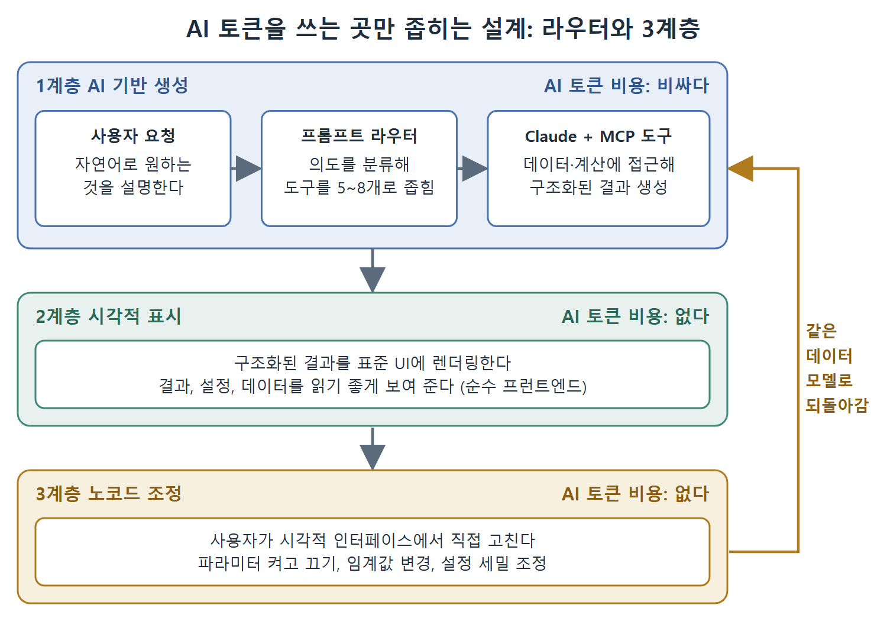

# 프롬프트 라우터와 3계층 구조

MCP 도구가 수십 개로 늘어나면 두 가지 문제가 생긴다. 하나는 Claude가 매 턴마다 수십 개 중에서 골라야 해서 토큰도 오류도 늘어난다는 것이다. 다른 하나는 사용자 작업 전체를 AI 토큰으로 처리하면 비용이 감당되지 않는다는 것이다. 운영 중인 MCP 배포에서 반복해서 보이는 해법이 이 문서의 두 패턴이다. 앞의 것은 도구 후보를 좁히는 프롬프트 라우터이고, 뒤의 것은 AI를 쓰는 구간을 최소화하는 3계층 구조다.

---

## 1. 프롬프트 라우터 패턴

프롬프트 라우터(prompt router)는 사용자 입력과 MCP 도구 호출 사이에 놓이는 분류 계층이다. 사용자가 메시지를 보내면, 라우터가 먼저 의도를 분류하고 그에 맞는 처리 파이프라인으로 보낸다.

### 동작 방식

1. 요청이 들어온다.
2. 라우터가 사용자가 무언가를 만들려는 건지, 분석하려는 건지, 데이터를 조회하려는 건지, 어떤 동작을 실행하려는 건지 판단한다.
3. 분류 결과에 따라 시스템이 정해진 순서로 특정 MCP 도구들을 호출한다.

예를 들어 "전략 만들기" 의도로 분류되면 이런 파이프라인이 돈다. 포트폴리오 객체를 만들고, 전략 생성을 반복하고, 조건을 분해하고, 구조화된 객체를 만든 뒤, 결과를 보낸다. "분석" 의도로 분류되면 다른 파이프라인이 돈다. MCP로 데이터를 가져오고, 분석을 수행하고, 결과를 돌려준다.

### 왜 효과가 있는가

이 패턴은 특정 분야에 한정되지 않는다. Claude에게 MCP 도구를 많이 노출하는 시스템이라면 어디서든 라우터가 Claude가 추론을 시작하기 전에 도구 집합을 좁혀 주는 장점을 누린다.

- 매 턴마다 41개 중에서 고르는 대신, 라우터가 분류된 의도와 관련된 5~8개로 후보를 줄인다.
- 컨텍스트에 올라가는 도구 설명이 줄어 토큰 비용이 내려간다.
- 관련 없는 도구를 실수로 호출할 가능성이 줄어 오류율이 내려간다.

## 2. 3계층 아키텍처

MCP를 사용자용 애플리케이션과 결합하는 운영 배포 패턴 중에는 세 개의 계층으로 나누는 구조가 있다. 핵심은 AI 토큰이 드는 곳과 들지 않는 곳을 분리하는 것이다.

 1계층 안에서 라우터가 도구 후보를 좁히고, 결과가 2계층 표시와 3계층 조정으로 이어지는 순서를 보여 준다. 토큰 비용은 1계층에만 들고, 사용자가 고친 내용은 같은 데이터 모델로 되돌아간다.

| 계층 | 이름 | 하는 일 | AI 토큰 비용 |
|---|---|---|---|
| 1계층 | AI 기반 생성 | 사용자가 자연어로 원하는 것을 설명하면 Claude가 의도를 처리하고, MCP 도구로 데이터와 계산에 접근해 구조화된 결과를 만든다 | 비싸다 |
| 2계층 | 시각적 표시 | 1계층의 구조화된 결과를 표준 UI에 렌더링해 결과, 설정, 데이터를 읽기 좋은 형태로 보여 준다 | 없다 (순수 프런트엔드 렌더링) |
| 3계층 | 노코드 조정 | 사용자가 시각적 인터페이스에서 AI가 만든 결과를 직접 고친다. 파라미터를 켜고 끄고, 임계값을 바꾸고, 설정을 세밀하게 조정한다 | 없다 |

### 세부 설명

1계층은 토큰이 많이 들지만 가장 어려운 부분을 맡는다. 사람의 의도를 구조화된 데이터로 바꾸는 일이다.

3계층에서 사용자가 바꾼 내용은 1계층이 만든 것과 같은 데이터 모델로 되돌아간다. 그래서 AI가 만든 결과와 사람이 손본 결과가 하나의 모델 안에서 이어진다.

### 경제성

역할 분담의 경제적 이유는 분명하다.

- 아이디어를 내는 일(ideation)은 AI가 맡는다. 비싸지만 가치가 높다.
- 결과를 표시하는 일은 UI가 맡는다. 공짜다.
- 다듬는 일은 노코드 편집이 맡는다. 이것도 공짜다.

MCP는 1계층에 있다. Claude가 구조화된 출력을 만드는 데 필요한 데이터 접근과 계산을 제공한다. 이렇게 3계층으로 나누면 AI 토큰을 생성 단계에서만 쓰고, 사용자 워크플로 전체에서는 쓰지 않는다.

## 3. 두 패턴을 함께 쓰기

두 패턴은 서로 겹치지 않고 보완한다. 라우터는 1계층 안에서 Claude가 고를 도구를 5~8개로 줄여 주고, 3계층 구조는 1계층 바깥의 작업을 AI 비용 없이 처리하게 한다. 둘 다 같은 방향, 즉 AI가 정말 필요한 곳에만 토큰을 쓰자는 설계 원칙을 따른다.

 
 
 

[Claude Code The Definitive Guide to Agentic Development-2](../)
