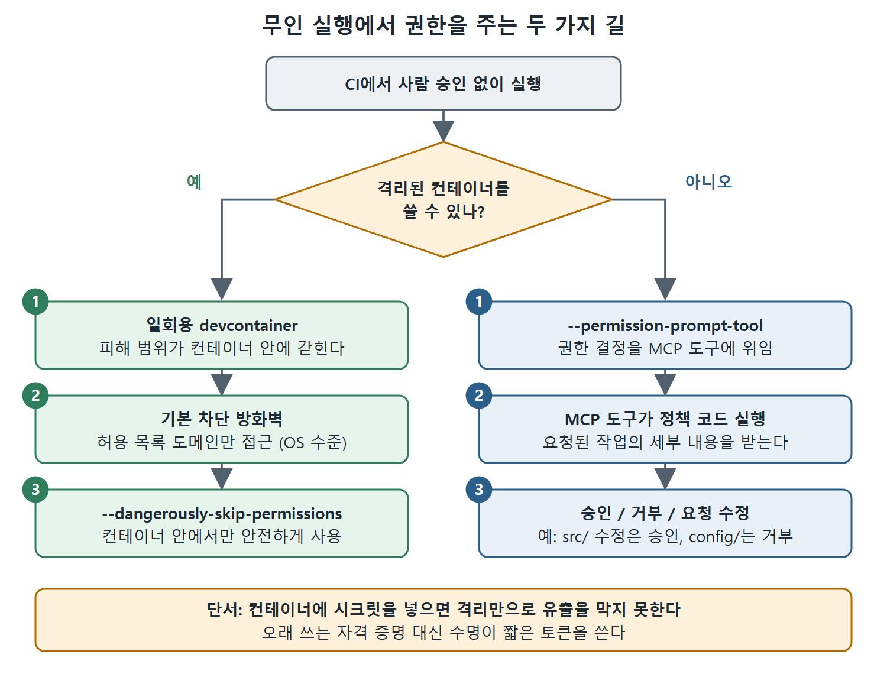

# 무인 실행의 안전장치

CI에서 Claude Code를 돌리면 곧바로 이런 질문이 생긴다. 매번 사람이 승인해 주지 않아도 파일을 고치고 명령을 실행하게 하려면 어떻게 권한을 줄 것인가. 이 문서는 그 답으로 쓰이는 개발 컨테이너(devcontainer), 컨테이너를 쓰지 못할 때의 대안인 `--permission-prompt-tool`, 실행 결과를 재현 가능하게 만드는 시스템 프롬프트 플래그, 그리고 참조용 devcontainer의 구성을 설명한다.

핵심 발상은 하나다. 권한 확인을 사람에게 맡길 수 없으니, 그 역할을 격리된 환경이나 코드로 정한 정책에 넘긴다.

---

## 1. 개발 컨테이너 세 겹 구조

devcontainer(개발 컨테이너)는 개발 환경을 격리된 컨테이너로 정의해 둔 것이다. 이 안에서는 Claude Code가 자유롭게 움직여도 피해 범위(blast radius)가 컨테이너 안에 갇힌다. 방식은 세 겹으로 이루어진다.

**참조 devcontainer.** Claude Code는 일반적인 개발 환경을 본뜬 참조용 devcontainer 설정을 함께 제공한다. 언어 런타임, 빌드 도구, 프로젝트에 필요한 의존성이 들어 있다. 컨테이너는 일회용이다. CI 실행을 위해 만들고, 끝나면 없앤다.

**네트워크 격리.** 참조 devcontainer는 기본적으로 모두 막는(default-deny) 방화벽 정책을 적용한다. 미리 허용 목록에 올려 둔 도메인에만 접근할 수 있다. 이렇게 하면 데이터 유출을 막고, 예상 밖의 동작이 일으킬 피해도 줄인다. 네트워크 정책은 Claude Code 안이 아니라 devcontainer 정의에 설정하므로 OS 수준에서 강제된다.

**권한 우회 장치.** 네트워크가 격리된 컨테이너 안에서는 `--dangerously-skip-permissions`를 안전하게 쓸 수 있다. 이 플래그는 모든 권한 확인을 건너뛰게 해서 Claude Code가 사람 승인 없이 자율적으로 돌게 한다. 플래그 이름이 일부러 섬뜩하게 지어졌다. 컨테이너 자체가 보안 경계 역할을 할 때만 쓰라는 뜻이다.

이 세 겹, 즉 격리된 컨테이너, 제한된 네트워크, 자율 권한이 CI 통합의 표준 패턴이다. Claude Code가 가진 자체 권한 시스템을 컨테이너 수준의 격리로 맞바꾸는 셈이며, 무인 운영에는 이쪽이 더 잘 맞는다.

---

## 2. 컨테이너가 못 막는 것: 시크릿 유출

한 가지 단서가 있다. CI 환경이 시크릿(비밀 값)을 컨테이너에 주입한다면 컨테이너 격리만으로는 자격 증명 유출을 막을 수 없다. 악의적이거나 혼란에 빠진 Claude Code 인스턴스가 API 키가 담긴 환경 변수에 접근할 수 있다면, 이론적으로 그 값을 허용된 도메인으로 보낼 수 있기 때문이다.

그래서 시크릿의 범위를 신중하게 정해야 한다. 오래 쓰는 자격 증명보다 수명이 짧은 토큰을 쓰는 편이 낫다.

---

## 3. 컨테이너를 못 쓸 때: --permission-prompt-tool

모든 헤드리스 배포가 컨테이너를 쓰는 것은 아니다. CI 호스트에서 바로 돌리거나 컨테이너 격리를 쓸 수 없는 환경도 있다. 이럴 때를 위해 Claude Code는 `--permission-prompt-tool`을 제공한다. 권한 결정을 MCP 도구에 위임하는 플래그다.

사람의 승인이 필요했을 작업을 만나면, 사용자에게 물어보는 대신(물어볼 사람이 없다) 지정한 MCP 도구를 호출해서 요청된 작업의 세부 내용을 넘긴다. 그러면 그 도구가 승인할지, 거부할지, 요청을 수정할지 결정한다.

이 방식의 진짜 가치는 권한 정책을 코드로 표현할 수 있다는 점이다. MCP 도구는 어떤 논리든 구현할 수 있다.

- `src/` 안의 파일 수정은 승인하되 `config/` 수정은 거부한다.
- 테스트 실행은 승인하되 배포 명령은 거부한다.
- 업무 시간 외에는 모두 승인하고, 업무 시간에는 더 엄격하게 통제한다.

컨테이너 없이 `--dangerously-skip-permissions`를 쓰는 방법도 있지만, 플래그 이름 그대로 위험하다. 제대로 격리된 환경에서만 써야 한다.

그림은 사람 승인 없이 돌려야 할 때 컨테이너를 쓸 수 있는지에 따라 길이 갈리는 모습을 보여 준다. 컨테이너를 쓸 수 있으면 격리와 방화벽 위에서 권한 확인을 건너뛰고, 쓸 수 없으면 MCP 도구가 승인·거부·수정을 정한다.

---

## 4. 재현성을 위한 시스템 프롬프트 플래그

대화형 세션은 대화 흐름에 맞춰 달라진다. 헤드리스 세션에는 재현성(같은 입력이면 같은 방식으로 동작하는 성질)이 필요하다. 이를 위한 플래그가 네 개 있고, 각각 쓰임새가 다르다.

| 플래그 | 동작 | 쓰임새 |
|---|---|---|
| `--system-prompt` | 시스템 프롬프트를 문자열로 직접 넘긴다 | 빠른 스크립팅. 규모가 커지면 맞지 않는다 |
| `--system-prompt-file` | 기본 시스템 프롬프트를 파일 내용으로 통째로 교체한다 | 특정 CI 작업에 맞춘 전용 프롬프트가 필요하고 기본 동작은 필요 없을 때 |
| `--append-system-prompt` | 기본 프롬프트는 두고 문자열을 덧붙인다 | 일회성 수정 |
| `--append-system-prompt-file` | 같은 방식이되 파일에서 읽는다 | CI 파이프라인에서 가장 흔한 선택 |

`--system-prompt`로 CI 스크립트 안에 프롬프트를 직접 박아 넣으면, 아무도 모르는 사이에 프롬프트가 흐트러지고 갈라지며 품질이 떨어지기 쉽다. 반대로 `--system-prompt-file`은 Claude의 성격, 제약, 집중 영역까지 완전히 통제하게 해 준다. 이 파일을 CI 설정과 함께 버전 관리하면 실행할 때마다 프롬프트 동작이 일정해진다.

`--append-system-prompt-file`은 Claude Code의 기본 기능을 그대로 쓰면서, 프로젝트별 지침을 버전 관리되는 파일로 얹을 수 있어서 대부분의 CI에서 가장 많이 선택한다.

교체할지 덧붙일지는 간단하게 정할 수 있다. 출력 형식이 정해진 자동 분석 작업처럼 완전한 통제가 필요하면 교체하고, 기본 동작이 유용해서 제약이나 집중 영역만 얹으면 되면 덧붙인다.

네 플래그는 모두 print 모드(`-p`)에서만 동작한다. CI에서는 파일 기반 변형을 권한다. 워크플로 YAML 속에 묻힌 문자열이 아니라, 리뷰할 수 있고 버전 관리되는 프롬프트 정의가 남기 때문이다.

반복 실행되는 CI 파이프라인에는 프롬프트 파일과 CLAUDE.md가 재현 가능한 맥락을 두 겹으로 제공한다. 시스템 프롬프트는 이번 CI 작업에서 Claude가 어떻게 행동할지를 정하고, CLAUDE.md는 프로젝트 전체에 걸친 지식을 준다.

---

## 5. 참조 devcontainer 구성

참조 devcontainer는 세 가지 구성 요소로 되어 있다.

1. 설정, 확장 기능, 볼륨 마운트를 다루는 컨테이너 설정 파일
2. 런타임과 도구를 설치하는 컨테이너 이미지 정의
3. 네트워크 보안 규칙을 세우는 방화벽 초기화 스크립트

직접 컨테이너를 만들더라도 이미지 정의는 살펴볼 만하다. 베이스 이미지에서 시작해 대상 언어 런타임을 설치하고, 생산성을 높이는 셸 설정을 하고, 마지막에 Claude Code 자체를 설치한다. 방화벽 스크립트는 기본 차단 정책을 적용하고, Claude Code가 동작하는 데 필요한 도메인(API 엔드포인트, 패키지 레지스트리)만 명시적으로 허용한다. 컨테이너 설정 파일은 세션 유지를 위한 볼륨 마운트와 작업 공간 설정으로 이 모든 것을 묶는다.

가장 중요한 설계 결정은 네트워크 격리가 애플리케이션 수준이 아니라 방화벽 규칙을 통한 OS 수준에서 이뤄진다는 점이다. Claude Code는 자신이 네트워크 제한을 받는지 모른다. 허용되지 않은 도메인으로의 연결이 그냥 실패할 뿐이다. 제한이 애플리케이션 계층보다 아래에서 걸리므로, Claude Code가 무엇을 시도하든 보안 경계가 무너지지 않는다.

개발자들과 CI 사이에서 일관되고 재현 가능한 환경이 필요한 팀은 참조 devcontainer에서 시작하면 된다. 복제해서 언어 런타임과 의존성을 자기 스택에 맞게 바꾸고, 네트워크 허용 목록을 조정하면 대화형 개발과 헤드리스 CI 모두에 쓸 수 있는 안전한 환경이 된다.

 
 
 

[Claude Code The Definitive Guide to Agentic Development-2](../)
